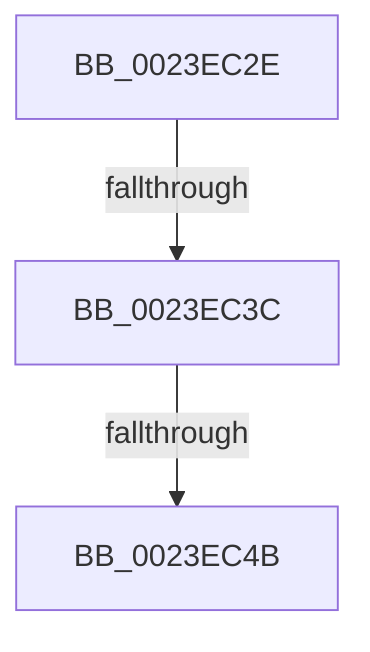

# sub_0023EC2E

- RVA: `0x0023EC2E`–`0x0023EC7F` (길이 `81` bytes)
- VA: `0x000000014023EC2E`
- 실행 섹션: `.text`
- PDB 이름 있음: `아니요`; PDB Function 태그: `아니요`
- unwind 정보 RVA: `0x000614F4`
- 디코드: `16`개 명령, `81/81` bytes 표시
- 미해석 바이트: `0` (있으면 어셈블리에 `.byte`로 보존)

> 이 문서는 커널 이미지의 기계어와 PDB 기호를 분석해 생성했습니다. 4번과 5번은 함수 원형과 자료형을 바이너리 사용 방식에서 추정한 C 해석이며 원본 소스 복구 결과는 아닙니다.

## 1. Dependencies

- 직접 호출 지점: **1**; 고유 호출 대상: **1**
- 직접 호출자로 확인된 함수: **0**
- RIP 상대 이미지 참조: **0**

### Outgoing calls
- `0x0023EC57` → [MiCheckLinearProtectedPteAccessedBit](../29/MiCheckLinearProtectedPteAccessedBit_function_00292D80.md) (function, `0x00292D80`)

### Direct callers
- 이 함수 시작 RVA로 연결되는 직접 call은 확인되지 않았습니다. 간접 호출은 완전히 역산할 수 없습니다.

### Static image references
- 디코드된 RIP-relative 메모리 참조가 없습니다.

## 2. Other-region calls and transfers

- 다른 실행 섹션으로 향하는 call: **0**
- call이 아닌 외부 분기/꼬리 이동: **3**
  - `0x0023EC36` → [sub_0023EB18 + 0x29](Unknown_function_0023EB18.md) (`tail-transfer`)
  - `0x0023EC45` → [sub_0023EB18 + 0x29](Unknown_function_0023EB18.md) (`tail-transfer`)
  - `0x0023EC7A` → [sub_0023EB18 + 0x29](Unknown_function_0023EB18.md) (`tail-transfer`)

## 3. Assembly (complete function range)

```asm
0023EC2E  40 0F B6 C7                     movzx eax, dil
0023EC32  24 21                           and al, 0x21
0023EC34  3C 01                           cmp al, 1
0023EC36  0F 85 05 FF FF FF               jne 0x14023eb41
0023EC3C  48 8B C2                        mov rax, rdx
0023EC3F  49 03 C0                        add rax, r8
0023EC42  48 3B F0                        cmp rsi, rax
0023EC45  0F 82 F6 FE FF FF               jb 0x14023eb41
0023EC4B  41 B8 80 00 00 00               mov r8d, 0x80
0023EC51  48 8B D7                        mov rdx, rdi
0023EC54  48 8B CE                        mov rcx, rsi
0023EC57  E8 24 41 05 00                  call 0x140292d80
0023EC5C  48 B9 00 00 00 00 00 00 00 20   movabs rcx, 0x2000000000000000
0023EC66  48 BA 00 00 00 00 80 F6 FF FF   movabs rdx, 0xfffff68000000000
0023EC70  49 B8 00 00 00 00 40 00 00 00   movabs r8, 0x4000000000
0023EC7A  E9 C2 FE FF FF                  jmp 0x14023eb41
```

## 4. C-style interpretation (structured pseudocode)

```c
__int64 __fastcall sub_0023EC2E(__int64 a1, __int64 a2, __int64 a3)
{
    __int64 result;

    result = (unsigned __int8)(((unsigned __int8)(v_rdi)) & (33));
    result = (a2) + (a3);
    result = MiCheckLinearProtectedPteAccessedBit(v_rsi, v_rdi, 128, a4);
}
```

## 5. (Beta) C Style

```c
int64_t sub_0023EC2E(int64_t Arg1, int64_t Arg2, int64_t Arg3)
{
    int64_t result;

    result = (uint8_t)(((uint8_t)(local_rdi)) & (33));
    result = (Arg2) + (Arg3);
    result = MiCheckLinearProtectedPteAccessedBit(local_rsi, local_rdi, 128, a4);
}
```

## 6. Execution-region graph

[열기: 2D/3D 그래프와 함수 탐색 컨트롤 패널](../../../control-panel.html?section=text&rva=0x0023EC2E&view=graph)

- 2D 그래프는 위에서 아래로 흐르고, 3D 그래프는 빈 공간을 드래그해 회전합니다. Shift+드래그는 이동, 휠은 확대·축소, 함수 노드 선택은 대상 보고서 이동입니다.

### Static fallback


