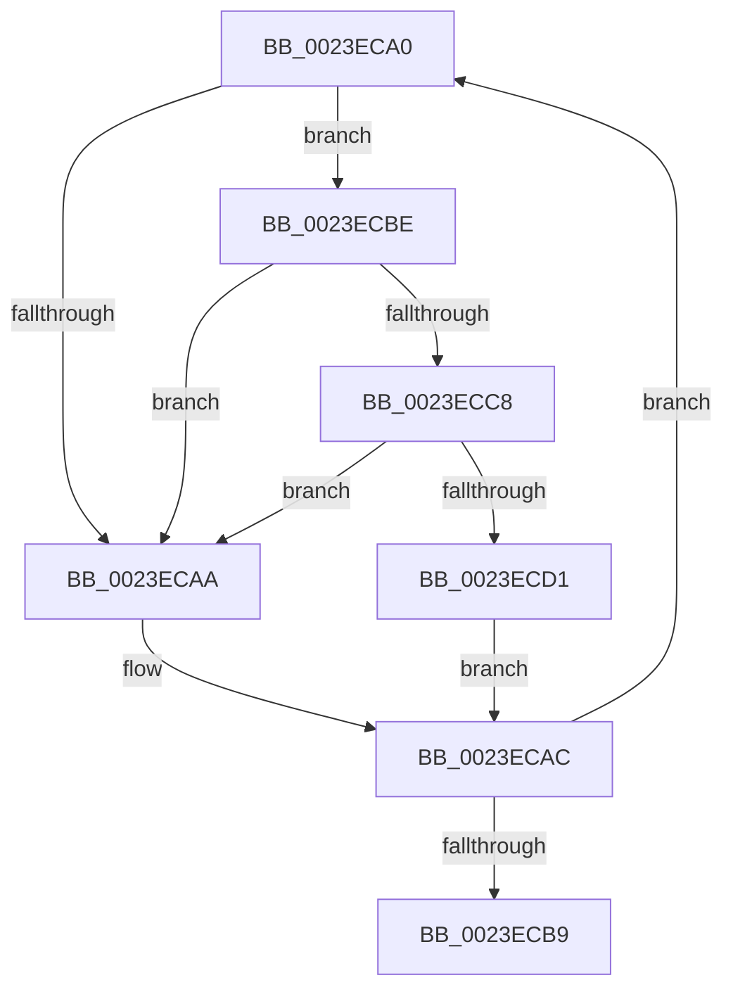

# sub_0023ECA0

- RVA: `0x0023ECA0`–`0x0023ECDA` (길이 `58` bytes)
- VA: `0x000000014023ECA0`
- 실행 섹션: `.text`
- PDB 이름 있음: `아니요`; PDB Function 태그: `아니요`
- unwind 정보 RVA: `0x0006152C`
- 디코드: `20`개 명령, `58/58` bytes 표시
- 미해석 바이트: `0` (있으면 어셈블리에 `.byte`로 보존)

> 이 문서는 커널 이미지의 기계어와 PDB 기호를 분석해 생성했습니다. 4번과 5번은 함수 원형과 자료형을 바이너리 사용 방식에서 추정한 C 해석이며 원본 소스 복구 결과는 아닙니다.

## 1. Dependencies

- 직접 호출 지점: **2**; 고유 호출 대상: **2**
- 직접 호출자로 확인된 함수: **0**
- RIP 상대 이미지 참조: **2**

### Outgoing calls
- `0x0023ECC8` → [KiCheckVpBackingLongSpinWaitHypercall](../30/KiCheckVpBackingLongSpinWaitHypercall_function_0030F490.md) (function, `0x0030F490`)
- `0x0023ECD3` → [HvlNotifyLongSpinWait](../30/HvlNotifyLongSpinWait_function_0030F460.md) (function, `0x0030F460`)

### Direct callers
- 이 함수 시작 RVA로 연결되는 직접 call은 확인되지 않았습니다. 간접 호출은 완전히 역산할 수 없습니다.

### Static image references
- `0x0023ECA2` → RVA `0x00FC52AC` (`ALMOSTRO`; reference)
- `0x0023ECBE` → RVA `0x00FC6AB8` (`ALMOSTRO`; read)

## 2. Other-region calls and transfers

- 다른 실행 섹션으로 향하는 call: **0**
- call이 아닌 외부 분기/꼬리 이동: **1**
  - `0x0023ECB9` → [sub_0023EB7F + 0x4D](Unknown_function_0023EB7F.md) (`tail-transfer`)

## 3. Assembly (complete function range)

```asm
0023ECA0  FF C5                           inc ebp
0023ECA2  85 2D 04 66 D8 00               test dword ptr [rip + 0xd86604], ebp
0023ECA8  74 14                           je 0x14023ecbe
0023ECAA  F3 90                           pause
0023ECAC  8B 17                           mov edx, dword ptr [rdi]
0023ECAE  41 8B CE                        mov ecx, r14d
0023ECB1  8B C2                           mov eax, edx
0023ECB3  D3 E8                           shr eax, cl
0023ECB5  A8 01                           test al, 1
0023ECB7  75 E7                           jne 0x14023eca0
0023ECB9  E9 0E FF FF FF                  jmp 0x14023ebcc
0023ECBE  8B 05 F4 7D D8 00               mov eax, dword ptr [rip + 0xd87df4]
0023ECC4  A8 40                           test al, 0x40
0023ECC6  74 E2                           je 0x14023ecaa
0023ECC8  E8 C3 07 0D 00                  call 0x14030f490
0023ECCD  84 C0                           test al, al
0023ECCF  74 D9                           je 0x14023ecaa
0023ECD1  8B CD                           mov ecx, ebp
0023ECD3  E8 88 07 0D 00                  call 0x14030f460
0023ECD8  EB D2                           jmp 0x14023ecac
```

## 4. C-style interpretation (structured pseudocode)

```c
__int64 __fastcall sub_0023ECA0(void)
{
    __int64 result;
    __int64 v_rbp;

    v_rbp = (unsigned int)((v_rbp) + 1);
    if (((*(unsigned int *)(v_rip + 14181892)) & ((unsigned int)(v_rbp))) == 0) goto loc_0023ECBE;
loc_0023ECAA:
loc_0023ECAC:
    result = (unsigned int)(((unsigned int)((unsigned int)((unsigned int)(*(unsigned int *)(v_rdi))))) >> ((unsigned __int8)((unsigned int)((unsigned int)(v_r14)))));
    if ((((unsigned __int8)(result)) & (1)) != 0) goto loc_0023ECA0;
loc_0023ECBE:
    if ((((unsigned __int8)((unsigned int)(*(unsigned int *)(v_rip + 14188020)))) & (64)) == 0) goto loc_0023ECAA;
    result = KiCheckVpBackingLongSpinWaitHypercall((unsigned int)((unsigned int)(v_r14)), (unsigned int)(*(unsigned int *)(v_rdi)), a3, a4);
    if ((unsigned __int8)(result) == 0) goto loc_0023ECAA;
    result = HvlNotifyLongSpinWait((unsigned int)((unsigned int)(v_rbp)), (unsigned int)(*(unsigned int *)(v_rdi)), a3, a4);
    goto loc_0023ECAC;
}
```

## 5. (Beta) C Style

```c
void sub_0023ECA0(void)
{
    int64_t result;
    int64_t local_rbp;

    local_rbp = (uint32_t)((local_rbp) + 1);
    if (((*(uint32_t *)(v_rip + 0xD86604)) & ((uint32_t)(local_rbp))) == 0) goto loc_0023ECBE;
loc_0023ECAA:
loc_0023ECAC:
    result = (uint32_t)(((uint32_t)((uint32_t)((uint32_t)(*(uint32_t *)(local_rdi))))) >> ((uint8_t)((uint32_t)((uint32_t)(local_r14)))));
    if ((((uint8_t)(result)) & (1)) != 0) goto loc_0023ECA0;
loc_0023ECBE:
    if ((((uint8_t)((uint32_t)(*(uint32_t *)(v_rip + 0xD87DF4)))) & (64)) == 0) goto loc_0023ECAA;
    result = KiCheckVpBackingLongSpinWaitHypercall((uint32_t)((uint32_t)(local_r14)), (uint32_t)(*(uint32_t *)(local_rdi)), a3, a4);
    if ((uint8_t)(result) == 0) goto loc_0023ECAA;
    result = HvlNotifyLongSpinWait((uint32_t)((uint32_t)(local_rbp)), (uint32_t)(*(uint32_t *)(local_rdi)), a3, a4);
    goto loc_0023ECAC;
}
```

## 6. Execution-region graph

[열기: 2D/3D 그래프와 함수 탐색 컨트롤 패널](../../../control-panel.html?section=text&rva=0x0023ECA0&view=graph)

- 2D 그래프는 위에서 아래로 흐르고, 3D 그래프는 빈 공간을 드래그해 회전합니다. Shift+드래그는 이동, 휠은 확대·축소, 함수 노드 선택은 대상 보고서 이동입니다.

### Static fallback


