# sub_0023EEBA

- RVA: `0x0023EEBA`–`0x0023F0B3` (길이 `505` bytes)
- VA: `0x000000014023EEBA`
- 실행 섹션: `.text`
- PDB 이름 있음: `아니요`; PDB Function 태그: `아니요`
- unwind 정보 RVA: `0x0006156C`
- 디코드: `121`개 명령, `505/505` bytes 표시
- 미해석 바이트: `0` (있으면 어셈블리에 `.byte`로 보존)

> 이 문서는 커널 이미지의 기계어와 PDB 기호를 분석해 생성했습니다. 4번과 5번은 함수 원형과 자료형을 바이너리 사용 방식에서 추정한 C 해석이며 원본 소스 복구 결과는 아닙니다.

## 1. Dependencies

- 직접 호출 지점: **1**; 고유 호출 대상: **1**
- 직접 호출자로 확인된 함수: **0**
- RIP 상대 이미지 참조: **2**

### Outgoing calls
- `0x0023F044` → [MiPteInShadowRange](MiPteInShadowRange_function_0023FB00.md) (function, `0x0023FB00`)

### Direct callers
- 이 함수 시작 RVA로 연결되는 직접 call은 확인되지 않았습니다. 간접 호출은 완전히 역산할 수 없습니다.

### Static image references
- `0x0023EFE5` → RVA `0x00010880` (`.rdata`; read)
- `0x0023F00D` → RVA `0x00FC6A88` (`ALMOSTRO`; read)

## 2. Other-region calls and transfers

- 다른 실행 섹션으로 향하는 call: **0**
- call이 아닌 외부 분기/꼬리 이동: **12**
  - `0x0023EEDD` → [sub_0023F124 + 0x15B](Unknown_function_0023F124.md) (`tail-transfer`)
  - `0x0023EF21` → [sub_0023F124](Unknown_function_0023F124.md) (`tail-transfer`)
  - `0x0023EF60` → [sub_0023F124 + 0x360](Unknown_function_0023F124.md) (`tail-transfer`)
  - `0x0023EF7B` → [sub_0023F124 + 0x8B](Unknown_function_0023F124.md) (`tail-transfer`)
  - `0x0023EF9F` → [sub_0023F124 + 0x6C](Unknown_function_0023F124.md) (`tail-transfer`)
  - `0x0023F007` → [sub_0023F124 + 0x186](Unknown_function_0023F124.md) (`tail-transfer`)
  - `0x0023F022` → [sub_0023F124 + 0x25E](Unknown_function_0023F124.md) (`tail-transfer`)
  - `0x0023F02D` → [sub_0023F124 + 0x153](Unknown_function_0023F124.md) (`tail-transfer`)
  - `0x0023F036` → [sub_0023F124 + 0x29E](Unknown_function_0023F124.md) (`tail-transfer`)
  - `0x0023F04B` → [sub_0023F124 + 0x237](Unknown_function_0023F124.md) (`tail-transfer`)
  - `0x0023F057` → [sub_0023F124 + 0x24E](Unknown_function_0023F124.md) (`tail-transfer`)
  - `0x0023F088` → [sub_0023F124 + 0x215](Unknown_function_0023F124.md) (`tail-transfer`)

## 3. Assembly (complete function range)

```asm
0023EEBA  48 89 74 24 48                  mov qword ptr [rsp + 0x48], rsi
0023EEBF  48 B8 00 00 00 00 00 DE FF FF   movabs rax, 0xffffde0000000000
0023EEC9  4C 8D 34 52                     lea r14, [rdx + rdx*2]
0023EECD  49 C1 E6 04                     shl r14, 4
0023EED1  48 8B C0                        mov rax, rax
0023EED4  4C 03 F0                        add r14, rax
0023EED7  49 8B C1                        mov rax, r9
0023EEDA  4C 3B D8                        cmp r11, rax
0023EEDD  0F 83 9C 03 00 00               jae 0x14023f27f
0023EEE3  44 8B D5                        mov r10d, ebp
0023EEE6  89 AC 24 A8 00 00 00            mov dword ptr [rsp + 0xa8], ebp
0023EEED  49 8B 6E 28                     mov rbp, qword ptr [r14 + 0x28]
0023EEF1  49 8B 07                        mov rax, qword ptr [r15]
0023EEF4  48 C1 ED 3F                     shr rbp, 0x3f
0023EEF8  41 33 EA                        xor ebp, r10d
0023EEFB  48 8B C9                        mov rcx, rcx
0023EEFE  4C 3B F9                        cmp r15, rcx
0023EF01  72 2E                           jb 0x14023ef31
0023EF03  49 8B C8                        mov rcx, r8
0023EF06  4C 3B F9                        cmp r15, rcx
0023EF09  77 26                           ja 0x14023ef31
0023EF0B  48 8B C8                        mov rcx, rax
0023EF0E  41 84 C2                        test r10b, al
0023EF11  74 1E                           je 0x14023ef31
0023EF13  A8 42                           test al, 0x42
0023EF15  41 0F 95 C0                     setne r8b
0023EF19  A8 20                           test al, 0x20
0023EF1B  0F 95 C2                        setne dl
0023EF1E  44 84 C2                        test dl, r8b
0023EF21  0F 84 FD 01 00 00               je 0x14023f124
0023EF27  49 B8 F8 D7 BE 7D FB F6 FF FF   movabs r8, 0xfffff6fb7dbed7f8
0023EF31  48 8B C8                        mov rcx, rax
0023EF34  41 8B DC                        mov ebx, r12d
0023EF37  48 C1 E8 3C                     shr rax, 0x3c
0023EF3B  41 23 DA                        and ebx, r10d
0023EF3E  24 07                           and al, 7
0023EF40  48 C1 E9 38                     shr rcx, 0x38
0023EF44  C0 E0 04                        shl al, 4
0023EF47  80 E1 0F                        and cl, 0xf
0023EF4A  0A C1                           or al, cl
0023EF4C  44 8B CB                        mov r9d, ebx
0023EF4F  45 33 CA                        xor r9d, r10d
0023EF52  0F B6 F0                        movzx esi, al
0023EF55  41 8D 41 09                     lea eax, [r9 + 9]
0023EF59  89 44 24 30                     mov dword ptr [rsp + 0x30], eax
0023EF5D  80 F9 08                        cmp cl, 8
0023EF60  0F 84 1E 05 00 00               je 0x14023f484
0023EF66  49 B9 00 00 00 00 80 F6 FF FF   movabs r9, 0xfffff68000000000
0023EF70  85 DB                           test ebx, ebx
0023EF72  0F 85 04 01 00 00               jne 0x14023f07c
0023EF78  45 85 D2                        test r10d, r10d
0023EF7B  0F 84 2E 02 00 00               je 0x14023f1af
0023EF81  41 8B C5                        mov eax, r13d
0023EF84  89 84 24 A8 00 00 00            mov dword ptr [rsp + 0xa8], eax
0023EF8B  41 F6 C4 04                     test r12b, 4
0023EF8F  74 49                           je 0x14023efda
0023EF91  85 ED                           test ebp, ebp
0023EF93  74 45                           je 0x14023efda
0023EF95  41 8B DD                        mov ebx, r13d
0023EF98  F0 49 0F BA 6E 18 3F            lock bts qword ptr [r14 + 0x18], 0x3f
0023EF9F  0F 82 EB 01 00 00               jb 0x14023f190
0023EFA5  49 8B 46 18                     mov rax, qword ptr [r14 + 0x18]
0023EFA9  48 B9 00 00 00 00 00 00 00 40   movabs rcx, 0x4000000000000000
0023EFB3  48 0B C1                        or rax, rcx
0023EFB6  49 B8 F8 D7 BE 7D FB F6 FF FF   movabs r8, 0xfffff6fb7dbed7f8
0023EFC0  49 89 46 18                     mov qword ptr [r14 + 0x18], rax
0023EFC4  B8 40 00 00 00                  mov eax, 0x40
0023EFC9  89 84 24 A8 00 00 00            mov dword ptr [rsp + 0xa8], eax
0023EFD0  49 B9 00 00 00 00 80 F6 FF FF   movabs r9, 0xfffff68000000000
0023EFDA  44 39 6C 24 34                  cmp dword ptr [rsp + 0x34], r13d
0023EFDF  0F 85 84 00 00 00               jne 0x14023f069
0023EFE5  48 8B 1D 94 18 DD FF            mov rbx, qword ptr [rip - 0x22e76c]
0023EFEC  49 8B 17                        mov rdx, qword ptr [r15]
0023EFEF  48 B8 00 D0 BE 7D FB F6 FF FF   movabs rax, 0xfffff6fb7dbed000
0023EFF9  48 8B C0                        mov rax, rax
0023EFFC  4C 3B F8                        cmp r15, rax
0023EFFF  72 0C                           jb 0x14023f00d
0023F001  49 8B C0                        mov rax, r8
0023F004  4C 3B F8                        cmp r15, rax
0023F007  0F 86 9D 02 00 00               jbe 0x14023f2aa
0023F00D  48 8B 05 74 7A D8 00            mov rax, qword ptr [rip + 0xd87a74]
0023F014  48 8B C8                        mov rcx, rax
0023F017  48 C1 E9 1A                     shr rcx, 0x1a
0023F01B  83 E1 03                        and ecx, 3
0023F01E  48 83 F9 01                     cmp rcx, 1
0023F022  0F 86 5A 03 00 00               jbe 0x14023f382
0023F028  48 0F BA E0 19                  bt rax, 0x19
0023F02D  0F 82 44 02 00 00               jb 0x14023f277
0023F033  F6 C2 20                        test dl, 0x20
0023F036  0F 84 86 03 00 00               je 0x14023f3c2
0023F03C  49 8B CF                        mov rcx, r15
0023F03F  48 89 5C 24 38                  mov qword ptr [rsp + 0x38], rbx
0023F044  E8 B7 0A 00 00                  call 0x14023fb00
0023F049  85 C0                           test eax, eax
0023F04B  0F 85 0A 03 00 00               jne 0x14023f35b
0023F051  49 89 1F                        mov qword ptr [r15], rbx
0023F054  45 85 ED                        test r13d, r13d
0023F057  0F 85 15 03 00 00               jne 0x14023f372
0023F05D  BF 01 00 00 00                  mov edi, 1
0023F062  8B 84 24 A8 00 00 00            mov eax, dword ptr [rsp + 0xa8]
0023F069  85 C0                           test eax, eax
0023F06B  74 0F                           je 0x14023f07c
0023F06D  48 B8 FF FF FF FF FF FF FF 7F   movabs rax, 0x7fffffffffffffff
0023F077  F0 49 21 46 18                  lock and qword ptr [r14 + 0x18], rax
0023F07C  4C 8B B4 24 90 00 00 00         mov r14, qword ptr [rsp + 0x90]
0023F084  41 F6 C4 02                     test r12b, 2
0023F088  0F 84 AB 02 00 00               je 0x14023f339
0023F08E  48 8B 8C 24 B0 00 00 00         mov rcx, qword ptr [rsp + 0xb0]
0023F096  B8 01 00 00 00                  mov eax, 1
0023F09B  89 39                           mov dword ptr [rcx], edi
0023F09D  48 8B 74 24 48                  mov rsi, qword ptr [rsp + 0x48]
0023F0A2  48 83 C4 50                     add rsp, 0x50
0023F0A6  41 5F                           pop r15
0023F0A8  41 5E                           pop r14
0023F0AA  41 5D                           pop r13
0023F0AC  41 5C                           pop r12
0023F0AE  5F                              pop rdi
0023F0AF  5D                              pop rbp
0023F0B0  5B                              pop rbx
0023F0B1  C3                              ret
0023F0B2  CC                              int3
```

## 4. C-style interpretation (structured pseudocode)

```c
__int64 __fastcall sub_0023EEBA(__int64 a1, __int64 a2, __int64 a3, __int64 a4, __int64 a5, __int64 a6, __int64 a7, __int64 a8, __int64 a9, __int64 a10, __int64 a11, __int64 a12, __int64 a13, __int64 a14, __int64 a15, __int64 a16, __int64 a17, __int64 a18, __int64 a19, __int64 a20, unsigned int a21, __int64 a22)
{
    __int64 result;
    __int64 v_r14;
    __int64 v_rbp;
    __int64 v_rbx;
    __int64 v_rsp;
    unsigned int v_stack_p30;
    unsigned int v_stack_p34;
    unsigned __int64 v_stack_p38;
    unsigned __int64 v_stack_p48;
    unsigned int v_stack_pA8;

    v_stack_p48 = v_rsi;
    v_r14 = (a2 + a2 * 2) << (4);
    v_r14 = (v_r14) + (result);
    v_stack_pA8 = (unsigned int)(v_rbp);
    v_rbp = (*(unsigned __int64 *)(v_r14 + 40)) >> (63);
    v_rbp = (unsigned int)((v_rbp) ^ ((unsigned int)((unsigned int)((unsigned int)(v_rbp)))));
    if (v_r15 < a1) goto loc_0023EF31;
    if (v_r15 > a3) goto loc_0023EF31;
    if ((((unsigned __int8)((unsigned int)((unsigned int)(v_rbp)))) & ((unsigned __int8)(*(unsigned __int64 *)(v_r15)))) == 0) goto loc_0023EF31;
    a3 = ((((unsigned __int8)(*(unsigned __int64 *)(v_r15))) & (66)) != 0) ? 1 : 0;
    a2 = ((((unsigned __int8)(*(unsigned __int64 *)(v_r15))) & (32)) != 0) ? 1 : 0;
loc_0023EF31:
    result = (*(unsigned __int64 *)(v_r15)) >> (60);
    v_rbx = (unsigned int)(((unsigned int)((unsigned int)(v_r12))) & ((unsigned int)((unsigned int)((unsigned int)(v_rbp)))));
    result = (unsigned __int8)((result) & (7));
    a1 = (*(unsigned __int64 *)(v_r15)) >> (56);
    result = (unsigned __int8)((result) << (4));
    a1 = (unsigned __int8)((a1) & (15));
    result = (unsigned __int8)((result) | ((unsigned __int8)(a1)));
    a4 = (unsigned int)(((unsigned int)((unsigned int)(v_rbx))) ^ ((unsigned int)((unsigned int)((unsigned int)(v_rbp)))));
    v_stack_p30 = (unsigned int)(a4 + 9);
    if ((unsigned int)(v_rbx) != 0) goto loc_0023F07C;
    v_stack_pA8 = (unsigned int)((unsigned int)((unsigned int)(v_r13)));
    if ((((unsigned __int8)(v_r12)) & (4)) == 0) goto loc_0023EFDA;
    if ((unsigned int)(v_rbp) == 0) goto loc_0023EFDA;
    result = (*(unsigned __int64 *)(v_r14 + 24)) | (a1);
    *(unsigned __int64 *)(v_r14 + 24) = result;
    v_stack_pA8 = 64;
loc_0023EFDA:
    if (v_stack_p34 != ((unsigned int)(v_r13))) goto loc_0023F069;
    if (v_r15 < 64) goto loc_0023F00D;
loc_0023F00D:
    a1 = (*(unsigned __int64 *)(v_rip + 14187124)) >> (26);
    a1 = (unsigned int)((a1) & (3));
    v_stack_p38 = *(unsigned __int64 *)(v_rip - 2287468);
    result = MiPteInShadowRange(v_r15, *(unsigned __int64 *)(v_r15), a3, a4);
    *(unsigned __int64 *)(v_r15) = *(unsigned __int64 *)(v_rip - 2287468);
loc_0023F069:
    if ((unsigned int)((unsigned int)(a21)) != 0) {
    }
    *(unsigned int *)(a22) = 1;
    v_rsp = (v_rsp) + (80);
    return 1;
}
```

## 5. (Beta) C Style

```c
int64_t sub_0023EEBA(int64_t Arg1, void *Arg2, int64_t Arg3, int64_t Arg4, uint64_t Arg5, uint64_t Arg6, uint64_t Arg7, uint64_t Arg8, int64_t Arg9, uint64_t Arg10, uint64_t Arg11, uint64_t Arg12, uint64_t Arg13, uint64_t Arg14, uint64_t Arg15, uint64_t Arg16, uint64_t Arg17, int64_t Arg18, uint64_t Arg19, uint64_t Arg20, uint32_t Arg21, void *Arg22)
{
    uint8_t *arg2 = (uint8_t *)Arg2;
    uint8_t *arg22 = (uint8_t *)Arg22;

    int64_t result;
    int64_t local_r14;
    int64_t local_rbp;
    int64_t local_rbx;
    int64_t local_rsp;
    uint32_t v_stack_p30;
    uint32_t v_stack_p34;
    uint64_t v_stack_p38;
    uint64_t v_stack_p48;
    uint32_t v_stack_pA8;

    v_stack_p48 = local_rsi;
    local_r14 = (Arg2 + Arg2 * 2) << (4);
    local_r14 = (local_r14) + (result);
    v_stack_pA8 = (uint32_t)(local_rbp);
    local_rbp = (*(uint64_t *)(local_r14 + 0x28)) >> (63);
    local_rbp = (uint32_t)((local_rbp) ^ ((uint32_t)((uint32_t)((uint32_t)(local_rbp)))));
    if (local_r15 < Arg1) goto loc_0023EF31;
    if (local_r15 > Arg3) goto loc_0023EF31;
    if ((((uint8_t)((uint32_t)((uint32_t)(local_rbp)))) & ((uint8_t)(*(uint64_t *)(local_r15)))) == 0) goto loc_0023EF31;
    Arg3 = ((((uint8_t)(*(uint64_t *)(local_r15))) & (66)) != 0) ? 1 : 0;
    Arg2 = ((((uint8_t)(*(uint64_t *)(local_r15))) & (32)) != 0) ? 1 : 0;
loc_0023EF31:
    result = (*(uint64_t *)(local_r15)) >> (60);
    local_rbx = (uint32_t)(((uint32_t)((uint32_t)(local_r12))) & ((uint32_t)((uint32_t)((uint32_t)(local_rbp)))));
    result = (uint8_t)((result) & (7));
    Arg1 = (*(uint64_t *)(local_r15)) >> (56);
    result = (uint8_t)((result) << (4));
    Arg1 = (uint8_t)((Arg1) & (15));
    result = (uint8_t)((result) | ((uint8_t)(Arg1)));
    Arg4 = (uint32_t)(((uint32_t)((uint32_t)(local_rbx))) ^ ((uint32_t)((uint32_t)((uint32_t)(local_rbp)))));
    v_stack_p30 = (uint32_t)(Arg4 + 9);
    if ((uint32_t)(local_rbx) != 0) goto loc_0023F07C;
    v_stack_pA8 = (uint32_t)((uint32_t)((uint32_t)(local_r13)));
    if ((((uint8_t)(local_r12)) & (4)) == 0) goto loc_0023EFDA;
    if ((uint32_t)(local_rbp) == 0) goto loc_0023EFDA;
    result = (*(uint64_t *)(local_r14 + 0x18)) | (Arg1);
    *(uint64_t *)(local_r14 + 0x18) = result;
    v_stack_pA8 = 64;
loc_0023EFDA:
    if (v_stack_p34 != ((uint32_t)(local_r13))) goto loc_0023F069;
    if (local_r15 < 64) goto loc_0023F00D;
loc_0023F00D:
    Arg1 = (*(uint64_t *)(v_rip + 0xD87A74)) >> (26);
    Arg1 = (uint32_t)((Arg1) & (3));
    v_stack_p38 = *(uint64_t *)(v_rip - 0x22E76C);
    result = MiPteInShadowRange(local_r15, *(uint64_t *)(local_r15), Arg3, Arg4);
    *(uint64_t *)(local_r15) = *(uint64_t *)(v_rip - 0x22E76C);
loc_0023F069:
    if ((uint32_t)((uint32_t)(Arg21)) != 0) {
    }
    *(uint32_t *)(arg22) = 1;
    local_rsp = (local_rsp) + (80);
    return 1;
}
```

### 관측된 메모리 오프셋

구조체 형식이 확인되지 않은 접근은 인자 기준의 오프셋으로만 기록했습니다.

| 기준 인자 | 오프셋 표현 | 폭 (bit) | 접근 |
|---|---:|---:|---|
| `Arg2` | `+ 0x0 + rdx*2` | `64` | `R` |
| `Arg22` | `+ 0x0` | `32` | `W` |

## 6. Execution-region graph

[열기: 2D/3D 그래프와 함수 탐색 컨트롤 패널](../../../control-panel.html?section=text&rva=0x0023EEBA&view=graph)

- 2D 그래프는 위에서 아래로 흐르고, 3D 그래프는 빈 공간을 드래그해 회전합니다. Shift+드래그는 이동, 휠은 확대·축소, 함수 노드 선택은 대상 보고서 이동입니다.

### Static fallback

```mermaid
flowchart TD
  bb_0023EEBA[BB_0023EEBA]
  bb_0023EEE3[BB_0023EEE3]
  bb_0023EF03[BB_0023EF03]
  bb_0023EF0B[BB_0023EF0B]
  bb_0023EF13[BB_0023EF13]
  bb_0023EF27[BB_0023EF27]
  bb_0023EF31[BB_0023EF31]
  bb_0023EF66[BB_0023EF66]
  bb_0023EF78[BB_0023EF78]
  bb_0023EF81[BB_0023EF81]
  bb_0023EF91[BB_0023EF91]
  bb_0023EF95[BB_0023EF95]
  bb_0023EFA5[BB_0023EFA5]
  bb_0023EFDA[BB_0023EFDA]
  bb_0023EFE5[BB_0023EFE5]
  bb_0023F001[BB_0023F001]
  bb_0023F00D[BB_0023F00D]
  bb_0023F028[BB_0023F028]
  bb_0023F033[BB_0023F033]
  bb_0023F03C[BB_0023F03C]
  bb_0023F051[BB_0023F051]
  bb_0023F05D[BB_0023F05D]
  bb_0023F069[BB_0023F069]
  bb_0023F06D[BB_0023F06D]
  bb_0023F07C[BB_0023F07C]
  bb_0023F08E[BB_0023F08E]
  bb_0023F0B2[BB_0023F0B2]
  bb_0023EEBA -->|fallthrough| bb_0023EEE3
  bb_0023EEE3 -->|branch| bb_0023EF31
  bb_0023EEE3 -->|fallthrough| bb_0023EF03
  bb_0023EF03 -->|branch| bb_0023EF31
  bb_0023EF03 -->|fallthrough| bb_0023EF0B
  bb_0023EF0B -->|branch| bb_0023EF31
  bb_0023EF0B -->|fallthrough| bb_0023EF13
  bb_0023EF13 -->|fallthrough| bb_0023EF27
  bb_0023EF27 -->|flow| bb_0023EF31
  bb_0023EF31 -->|fallthrough| bb_0023EF66
  bb_0023EF66 -->|branch| bb_0023F07C
  bb_0023EF66 -->|fallthrough| bb_0023EF78
  bb_0023EF78 -->|fallthrough| bb_0023EF81
  bb_0023EF81 -->|branch| bb_0023EFDA
  bb_0023EF81 -->|fallthrough| bb_0023EF91
  bb_0023EF91 -->|branch| bb_0023EFDA
  bb_0023EF91 -->|fallthrough| bb_0023EF95
  bb_0023EF95 -->|fallthrough| bb_0023EFA5
  bb_0023EFA5 -->|flow| bb_0023EFDA
  bb_0023EFDA -->|branch| bb_0023F069
  bb_0023EFDA -->|fallthrough| bb_0023EFE5
  bb_0023EFE5 -->|branch| bb_0023F00D
  bb_0023EFE5 -->|fallthrough| bb_0023F001
  bb_0023F001 -->|fallthrough| bb_0023F00D
  bb_0023F00D -->|fallthrough| bb_0023F028
  bb_0023F028 -->|fallthrough| bb_0023F033
  bb_0023F033 -->|fallthrough| bb_0023F03C
  bb_0023F03C -->|fallthrough| bb_0023F051
  bb_0023F051 -->|fallthrough| bb_0023F05D
  bb_0023F05D -->|flow| bb_0023F069
  bb_0023F069 -->|branch| bb_0023F07C
  bb_0023F069 -->|fallthrough| bb_0023F06D
  bb_0023F06D -->|flow| bb_0023F07C
  bb_0023F07C -->|fallthrough| bb_0023F08E
```


