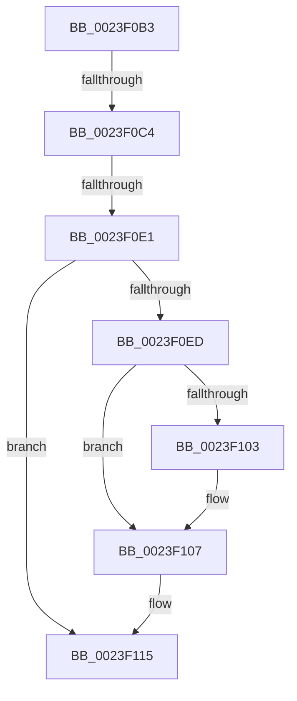

# sub_0023F0B3

- RVA: `0x0023F0B3`–`0x0023F124` (길이 `113` bytes)
- VA: `0x000000014023F0B3`
- 실행 섹션: `.text`
- PDB 이름 있음: `아니요`; PDB Function 태그: `아니요`
- unwind 정보 RVA: `0x00061584`
- 디코드: `22`개 명령, `113/113` bytes 표시
- 미해석 바이트: `0` (있으면 어셈블리에 `.byte`로 보존)

> 이 문서는 커널 이미지의 기계어와 PDB 기호를 분석해 생성했습니다. 4번과 5번은 함수 원형과 자료형을 바이너리 사용 방식에서 추정한 C 해석이며 원본 소스 복구 결과는 아닙니다.

## 1. Dependencies

- 직접 호출 지점: **0**; 고유 호출 대상: **0**
- 직접 호출자로 확인된 함수: **0**
- RIP 상대 이미지 참조: **1**

### Outgoing calls
- 직접 디코드된 call 명령이 없습니다.

### Direct callers
- 이 함수 시작 RVA로 연결되는 직접 call은 확인되지 않았습니다. 간접 호출은 완전히 역산할 수 없습니다.

### Static image references
- `0x0023F0B3` → RVA `0x00FC6A88` (`ALMOSTRO`; read)

## 2. Other-region calls and transfers

- 다른 실행 섹션으로 향하는 call: **0**
- call이 아닌 외부 분기/꼬리 이동: **3**
  - `0x0023F0BE` → [MiTerminateWsle + 0xA5](MiTerminateWsle_function_0023EDF0.md) (`tail-transfer`)
  - `0x0023F0DB` → [MiTerminateWsle + 0xA5](MiTerminateWsle_function_0023EDF0.md) (`tail-transfer`)
  - `0x0023F11F` → [MiTerminateWsle + 0xA5](MiTerminateWsle_function_0023EDF0.md) (`tail-transfer`)

## 3. Assembly (complete function range)

```asm
0023F0B3  48 F7 05 CA 79 D8 00 00 00 60 00  test qword ptr [rip + 0xd879ca], 0x600000
0023F0BE  0F 84 D1 FD FF FF               je 0x14023ee95
0023F0C4  65 48 8B 0C 25 88 01 00 00      mov rcx, qword ptr gs:[0x188]
0023F0CD  4C 8B 81 B8 00 00 00            mov r8, qword ptr [rcx + 0xb8]
0023F0D4  41 38 A8 60 01 00 00            cmp byte ptr [r8 + 0x160], bpl
0023F0DB  0F 84 B4 FD FF FF               je 0x14023ee95
0023F0E1  4D 8B 88 08 05 00 00            mov r9, qword ptr [r8 + 0x508]
0023F0E8  4D 85 C9                        test r9, r9
0023F0EB  74 28                           je 0x14023f115
0023F0ED  49 8B CF                        mov rcx, r15
0023F0F0  48 C1 E9 03                     shr rcx, 3
0023F0F4  81 E1 FF 01 00 00               and ecx, 0x1ff
0023F0FA  49 8B 0C C9                     mov rcx, qword ptr [r9 + rcx*8]
0023F0FE  F6 C1 20                        test cl, 0x20
0023F101  74 04                           je 0x14023f107
0023F103  48 83 C8 20                     or rax, 0x20
0023F107  48 8B D0                        mov rdx, rax
0023F10A  48 83 CA 42                     or rdx, 0x42
0023F10E  F6 C1 42                        test cl, 0x42
0023F111  48 0F 44 D0                     cmove rdx, rax
0023F115  49 B9 00 00 00 00 80 F6 FF FF   movabs r9, 0xfffff68000000000
0023F11F  E9 71 FD FF FF                  jmp 0x14023ee95
```

## 4. C-style interpretation (structured pseudocode)

```c
__int64 __fastcall sub_0023F0B3(void)
{
    __int64 result;

    if (*(unsigned __int64 *)(*(unsigned __int64 *)(*(unsigned __int64 *)(gs_base + (0 + 392)) + 184) + 1288) == 0) goto loc_0023F115;
    a1 = (v_r15) >> (3);
    a1 = (unsigned int)((a1) & (511));
    if ((((unsigned __int8)(*(unsigned __int64 *)(*(unsigned __int64 *)(*(unsigned __int64 *)(*(unsigned __int64 *)(gs_base + (0 + 392)) + 184) + 1288) + a1 * 8))) & (32)) != 0) {
        result = (result) | (32);
    }
    a2 = (result) | (66);
    if ((((unsigned __int8)(*(unsigned __int64 *)(*(unsigned __int64 *)(*(unsigned __int64 *)(*(unsigned __int64 *)(gs_base + (0 + 392)) + 184) + 1288) + a1 * 8))) & (66)) == 0) { a2 = result; }
loc_0023F115:
}
```

## 5. (Beta) C Style

```c
void sub_0023F0B3(void)
{
    int64_t result;

    if (*(uint64_t *)(*(uint64_t *)(*(uint64_t *)(gs_base + (0 + 0x188)) + 0xB8) + 0x508) == 0) goto loc_0023F115;
    a1 = (local_r15) >> (3);
    a1 = (uint32_t)((a1) & (511));
    if ((((uint8_t)(*(uint64_t *)(*(uint64_t *)(*(uint64_t *)(*(uint64_t *)(gs_base + (0 + 0x188)) + 0xB8) + 0x508) + a1 * 8))) & (32)) != 0) {
        result = (result) | (32);
    }
    a2 = (result) | (66);
    if ((((uint8_t)(*(uint64_t *)(*(uint64_t *)(*(uint64_t *)(*(uint64_t *)(gs_base + (0 + 0x188)) + 0xB8) + 0x508) + a1 * 8))) & (66)) == 0) { a2 = result; }
loc_0023F115:
}
```

## 6. Execution-region graph

[열기: 2D/3D 그래프와 함수 탐색 컨트롤 패널](../../../control-panel.html?section=text&rva=0x0023F0B3&view=graph)

- 2D 그래프는 위에서 아래로 흐르고, 3D 그래프는 빈 공간을 드래그해 회전합니다. Shift+드래그는 이동, 휠은 확대·축소, 함수 노드 선택은 대상 보고서 이동입니다.

### Static fallback


