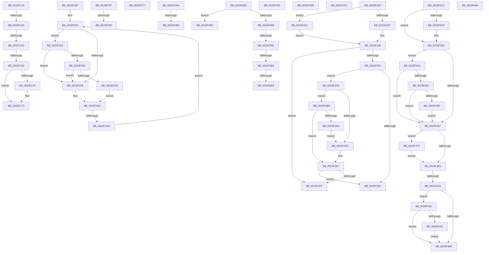

# sub_0023F124

- RVA: `0x0023F124`–`0x0023F4DE` (길이 `954` bytes)
- VA: `0x000000014023F124`
- 실행 섹션: `.text`
- PDB 이름 있음: `아니요`; PDB Function 태그: `아니요`
- unwind 정보 RVA: `0x00061594`
- 디코드: `209`개 명령, `954/954` bytes 표시
- 미해석 바이트: `0` (있으면 어셈블리에 `.byte`로 보존)

> 이 문서는 커널 이미지의 기계어와 PDB 기호를 분석해 생성했습니다. 4번과 5번은 함수 원형과 자료형을 바이너리 사용 방식에서 추정한 C 해석이며 원본 소스 복구 결과는 아닙니다.

## 1. Dependencies

- 직접 호출 지점: **18**; 고유 호출 대상: **15**
- 직접 호출자로 확인된 함수: **0**
- RIP 상대 이미지 참조: **4**

### Outgoing calls
- `0x0023F1B9` → [MI_READ_PTE_LOCK_FREE](../28/MI_READ_PTE_LOCK_FREE_function_002828A0.md) (function, `0x002828A0`)
- `0x0023F1FC` → [MiLockNestedPageTable](MiLockNestedPageTable_function_0023E890.md) (function, `0x0023E890`)
- `0x0023F204` → [MI_READ_PTE_LOCK_FREE](../28/MI_READ_PTE_LOCK_FREE_function_002828A0.md) (function, `0x002828A0`)
- `0x0023F268` → [MiUnlockNestedPageTableWritePte](MiUnlockNestedPageTableWritePte_function_0023F4E4.md) (function, `0x0023F4E4`)
- `0x0023F2AA` → [MiPteHasShadow](../32/MiPteHasShadow_function_0032B998.md) (function, `0x0032B998`)
- `0x0023F2E2` → [MiCleanupLazyStampedPageTable](../32/MiCleanupLazyStampedPageTable_function_0032A43C.md) (function, `0x0032A43C`)
- `0x0023F2FB` → [MiUnlockPageTable](../21/MiUnlockPageTable_function_00216EC0.md) (function, `0x00216EC0`)
- `0x0023F320` → [KiCheckVpBackingLongSpinWaitHypercall](../30/KiCheckVpBackingLongSpinWaitHypercall_function_0030F490.md) (function, `0x0030F490`)
- `0x0023F32F` → [HvlNotifyLongSpinWait](../30/HvlNotifyLongSpinWait_function_0030F460.md) (function, `0x0030F460`)
- `0x0023F351` → [MiRemoveWsle](../22/MiRemoveWsle_function_0022D0C4.md) (function, `0x0022D0C4`)
- `0x0023F360` → [MiSanitizeShadowPxe](../29/MiSanitizeShadowPxe_function_00294B68.md) (function, `0x00294B68`)
- `0x0023F378` → [MiWritePteShadow](../29/MiWritePteShadow_function_00294EAC.md) (function, `0x00294EAC`)
- `0x0023F3F0` → [MiPteInShadowRange](MiPteInShadowRange_function_0023FB00.md) (function, `0x0023FB00`)
- `0x0023F443` → [MiCheckLinearProtectedPteAccessedBit](../29/MiCheckLinearProtectedPteAccessedBit_function_00292D80.md) (function, `0x00292D80`)
- `0x0023F46A` → [MiCheckLinearProtectedPteAccessedBit](../29/MiCheckLinearProtectedPteAccessedBit_function_00292D80.md) (function, `0x00292D80`)
- `0x0023F47A` → [MiWritePteShadow](../29/MiWritePteShadow_function_00294EAC.md) (function, `0x00294EAC`)
- `0x0023F497` → [MiUnlockWsle](../40/MiUnlockWsle_function_00407F84.md) (function, `0x00407F84`)
- `0x0023F4C2` → [MiGetAnyMultiplexedVm](../44/MiGetAnyMultiplexedVm_function_00448BD0.md) (function, `0x00448BD0`)

### Direct callers
- 이 함수 시작 RVA로 연결되는 직접 call은 확인되지 않았습니다. 간접 호출은 완전히 역산할 수 없습니다.

### Static image references
- `0x0023F124` → RVA `0x00FC6A88` (`ALMOSTRO`; read)
- `0x0023F192` → RVA `0x00FC52AC` (`ALMOSTRO`; reference)
- `0x0023F1AF` → RVA `0x00010880` (`.rdata`; read)
- `0x0023F312` → RVA `0x00FC6AB8` (`ALMOSTRO`; read)

## 2. Other-region calls and transfers

- 다른 실행 섹션으로 향하는 call: **0**
- call이 아닌 외부 분기/꼬리 이동: **23**
  - `0x0023F12F` → [sub_0023EEBA + 0x6D](Unknown_function_0023EEBA.md) (`tail-transfer`)
  - `0x0023F14C` → [sub_0023EEBA + 0x6D](Unknown_function_0023EEBA.md) (`tail-transfer`)
  - `0x0023F15C` → [sub_0023EEBA + 0x6D](Unknown_function_0023EEBA.md) (`tail-transfer`)
  - `0x0023F18A` → [sub_0023EEBA + 0x6D](Unknown_function_0023EEBA.md) (`tail-transfer`)
  - `0x0023F1A7` → [sub_0023EEBA + 0xDE](Unknown_function_0023EEBA.md) (`tail-transfer`)
  - `0x0023F272` → [sub_0023EEBA + 0x1CA](Unknown_function_0023EEBA.md) (`tail-transfer`)
  - `0x0023F27A` → [sub_0023EEBA + 0x179](Unknown_function_0023EEBA.md) (`tail-transfer`)
  - `0x0023F28C` → [sub_0023EEBA + 0x29](Unknown_function_0023EEBA.md) (`tail-transfer`)
  - `0x0023F2A5` → [sub_0023EEBA + 0xB6](Unknown_function_0023EEBA.md) (`tail-transfer`)
  - `0x0023F2B2` → [sub_0023EEBA + 0x153](Unknown_function_0023EEBA.md) (`tail-transfer`)
  - `0x0023F2BC` → [sub_0023EEBA + 0x179](Unknown_function_0023EEBA.md) (`tail-transfer`)
  - `0x0023F30D` → [sub_0023EEBA + 0x1E3](Unknown_function_0023EEBA.md) (`tail-transfer`)
  - `0x0023F356` → [sub_0023EEBA + 0x1D4](Unknown_function_0023EEBA.md) (`tail-transfer`)
  - `0x0023F36D` → [sub_0023EEBA + 0x197](Unknown_function_0023EEBA.md) (`tail-transfer`)
  - `0x0023F37D` → [sub_0023EEBA + 0x1A3](Unknown_function_0023EEBA.md) (`tail-transfer`)
  - `0x0023F398` → [sub_0023EEBA + 0x179](Unknown_function_0023EEBA.md) (`tail-transfer`)
  - `0x0023F3AB` → [sub_0023EEBA + 0x179](Unknown_function_0023EEBA.md) (`tail-transfer`)
  - `0x0023F3B3` → [sub_0023EEBA + 0x179](Unknown_function_0023EEBA.md) (`tail-transfer`)
  - `0x0023F3BD` → [sub_0023EEBA + 0x179](Unknown_function_0023EEBA.md) (`tail-transfer`)
  - `0x0023F3FD` → [sub_0023EEBA + 0x1A3](Unknown_function_0023EEBA.md) (`tail-transfer`)
  - `0x0023F411` → [sub_0023EEBA + 0x1A8](Unknown_function_0023EEBA.md) (`tail-transfer`)
  - `0x0023F4B8` → [sub_0023EEBA + 0xAC](Unknown_function_0023EEBA.md) (`tail-transfer`)
  - `0x0023F4D9` → [sub_0023EEBA + 0x179](Unknown_function_0023EEBA.md) (`tail-transfer`)

## 3. Assembly (complete function range)

```asm
0023F124  48 F7 05 59 79 D8 00 00 00 60 00  test qword ptr [rip + 0xd87959], 0x600000
0023F12F  0F 84 F2 FD FF FF               je 0x14023ef27
0023F135  65 48 8B 14 25 88 01 00 00      mov rdx, qword ptr gs:[0x188]
0023F13E  4C 8B 82 B8 00 00 00            mov r8, qword ptr [rdx + 0xb8]
0023F145  45 38 90 60 01 00 00            cmp byte ptr [r8 + 0x160], r10b
0023F14C  0F 84 D5 FD FF FF               je 0x14023ef27
0023F152  4D 8B 88 08 05 00 00            mov r9, qword ptr [r8 + 0x508]
0023F159  4D 85 C9                        test r9, r9
0023F15C  0F 84 C5 FD FF FF               je 0x14023ef27
0023F162  49 8B D7                        mov rdx, r15
0023F165  48 C1 EA 03                     shr rdx, 3
0023F169  81 E2 FF 01 00 00               and edx, 0x1ff
0023F16F  49 8B 14 D1                     mov rdx, qword ptr [r9 + rdx*8]
0023F173  F6 C2 20                        test dl, 0x20
0023F176  74 04                           je 0x14023f17c
0023F178  48 83 C9 20                     or rcx, 0x20
0023F17C  48 8B C1                        mov rax, rcx
0023F17F  48 83 C8 42                     or rax, 0x42
0023F183  F6 C2 42                        test dl, 0x42
0023F186  48 0F 44 C1                     cmove rax, rcx
0023F18A  E9 98 FD FF FF                  jmp 0x14023ef27
0023F18F  90                              nop
0023F190  FF C3                           inc ebx
0023F192  85 1D 14 61 D8 00               test dword ptr [rip + 0xd86114], ebx
0023F198  0F 84 74 01 00 00               je 0x14023f312
0023F19E  F3 90                           pause
0023F1A0  49 8B 46 18                     mov rax, qword ptr [r14 + 0x18]
0023F1A4  48 85 C0                        test rax, rax
0023F1A7  0F 89 EB FD FF FF               jns 0x14023ef98
0023F1AD  EB E1                           jmp 0x14023f190
0023F1AF  48 8B 1D CA 16 DD FF            mov rbx, qword ptr [rip - 0x22e936]
0023F1B6  49 8B CF                        mov rcx, r15
0023F1B9  E8 E2 36 04 00                  call 0x1402828a0
0023F1BE  48 C1 E8 0C                     shr rax, 0xc
0023F1C2  48 B9 FF FF FF FF FF 00 00 00   movabs rcx, 0xffffffffff
0023F1CC  48 23 C1                        and rax, rcx
0023F1CF  48 8D 3C 40                     lea rdi, [rax + rax*2]
0023F1D3  48 B8 00 00 00 00 00 DE FF FF   movabs rax, 0xffffde0000000000
0023F1DD  48 C1 E7 04                     shl rdi, 4
0023F1E1  48 8B C0                        mov rax, rax
0023F1E4  4C 8B B4 24 90 00 00 00         mov r14, qword ptr [rsp + 0x90]
0023F1EC  48 03 F8                        add rdi, rax
0023F1EF  49 8B D7                        mov rdx, r15
0023F1F2  49 8B CE                        mov rcx, r14
0023F1F5  41 8B 86 B8 00 00 00            mov eax, dword ptr [r14 + 0xb8]
0023F1FC  E8 8F F6 FF FF                  call 0x14023e890
0023F201  49 8B CF                        mov rcx, r15
0023F204  E8 97 36 04 00                  call 0x1402828a0
0023F209  48 C1 E8 0C                     shr rax, 0xc
0023F20D  48 B9 FF FF FF FF FF 00 00 00   movabs rcx, 0xffffffffff
0023F217  48 23 C1                        and rax, rcx
0023F21A  48 8D 0C 40                     lea rcx, [rax + rax*2]
0023F21E  48 B8 00 00 00 00 00 DE FF FF   movabs rax, 0xffffde0000000000
0023F228  48 C1 E1 04                     shl rcx, 4
0023F22C  48 8B C0                        mov rax, rax
0023F22F  48 03 C8                        add rcx, rax
0023F232  8B 41 24                        mov eax, dword ptr [rcx + 0x24]
0023F235  0F BA E0 1A                     bt eax, 0x1a
0023F239  0F 83 82 00 00 00               jae 0x14023f2c1
0023F23F  48 8B 01                        mov rax, qword ptr [rcx]
0023F242  48 C1 E8 20                     shr rax, 0x20
0023F246  A9 FF 03 00 00                  test eax, 0x3ff
0023F24B  0F 85 A4 00 00 00               jne 0x14023f2f5
0023F251  41 8B 86 B8 00 00 00            mov eax, dword ptr [r14 + 0xb8]
0023F258  A8 0F                           test al, 0xf
0023F25A  75 72                           jne 0x14023f2ce
0023F25C  45 33 C9                        xor r9d, r9d
0023F25F  4C 8B C3                        mov r8, rbx
0023F262  49 8B D7                        mov rdx, r15
0023F265  49 8B CE                        mov rcx, r14
0023F268  E8 77 02 00 00                  call 0x14023f4e4
0023F26D  BF 01 00 00 00                  mov edi, 1
0023F272  E9 0D FE FF FF                  jmp 0x14023f084
0023F277  0F AE E8                        lfence
0023F27A  E9 B4 FD FF FF                  jmp 0x14023f033
0023F27F  48 B8 FF FF FF FF FF F6 FF FF   movabs rax, 0xfffff6ffffffffff
0023F289  4C 3B D8                        cmp r11, rax
0023F28C  0F 87 51 FC FF FF               ja 0x14023eee3
0023F292  49 8B 36                        mov rsi, qword ptr [r14]
0023F295  41 8B DC                        mov ebx, r12d
0023F298  48 C1 EE 2A                     shr rsi, 0x2a
0023F29C  45 8B D5                        mov r10d, r13d
0023F29F  40 80 E6 07                     and sil, 7
0023F2A3  23 DD                           and ebx, ebp
0023F2A5  E9 C6 FC FF FF                  jmp 0x14023ef70
0023F2AA  E8 E9 C6 0E 00                  call 0x14032b998
0023F2AF  48 85 C0                        test rax, rax
0023F2B2  0F 84 55 FD FF FF               je 0x14023f00d
0023F2B8  48 83 CA 20                     or rdx, 0x20
0023F2BC  E9 72 FD FF FF                  jmp 0x14023f033
0023F2C1  48 8B 41 10                     mov rax, qword ptr [rcx + 0x10]
0023F2C5  48 C1 E8 10                     shr rax, 0x10
0023F2C9  E9 78 FF FF FF                  jmp 0x14023f246
0023F2CE  83 BC 24 A0 00 00 00 01         cmp dword ptr [rsp + 0xa0], 1
0023F2D6  0F 85 E1 01 00 00               jne 0x14023f4bd
0023F2DC  49 8B D7                        mov rdx, r15
0023F2DF  49 8B CE                        mov rcx, r14
0023F2E2  E8 55 B1 0E 00                  call 0x14032a43c
0023F2E7  48 8B 47 18                     mov rax, qword ptr [rdi + 0x18]
0023F2EB  66 83 F8 01                     cmp ax, 1
0023F2EF  0F 84 67 FF FF FF               je 0x14023f25c
0023F2F5  49 8B D7                        mov rdx, r15
0023F2F8  49 8B CE                        mov rcx, r14
0023F2FB  E8 C0 7B FD FF                  call 0x140216ec0
0023F300  48 8B 84 24 B0 00 00 00         mov rax, qword ptr [rsp + 0xb0]
0023F308  44 89 28                        mov dword ptr [rax], r13d
0023F30B  33 C0                           xor eax, eax
0023F30D  E9 8B FD FF FF                  jmp 0x14023f09d
0023F312  8B 05 A0 77 D8 00               mov eax, dword ptr [rip + 0xd877a0]
0023F318  A8 40                           test al, 0x40
0023F31A  0F 84 7E FE FF FF               je 0x14023f19e
0023F320  E8 6B 01 0D 00                  call 0x14030f490
0023F325  84 C0                           test al, al
0023F327  0F 84 71 FE FF FF               je 0x14023f19e
0023F32D  8B CB                           mov ecx, ebx
0023F32F  E8 2C 01 0D 00                  call 0x14030f460
0023F334  E9 67 FE FF FF                  jmp 0x14023f1a0
0023F339  44 8B 4C 24 30                  mov r9d, dword ptr [rsp + 0x30]
0023F33E  44 0F B6 C6                     movzx r8d, sil
0023F342  48 8B 94 24 98 00 00 00         mov rdx, qword ptr [rsp + 0x98]
0023F34A  49 8B CE                        mov rcx, r14
0023F34D  89 6C 24 20                     mov dword ptr [rsp + 0x20], ebp
0023F351  E8 6E DD FE FF                  call 0x14022d0c4
0023F356  E9 33 FD FF FF                  jmp 0x14023f08e
0023F35B  48 8D 54 24 38                  lea rdx, [rsp + 0x38]
0023F360  E8 03 58 05 00                  call 0x140294b68
0023F365  48 8B 5C 24 38                  mov rbx, qword ptr [rsp + 0x38]
0023F36A  44 8B E8                        mov r13d, eax
0023F36D  E9 DF FC FF FF                  jmp 0x14023f051
0023F372  48 8B D3                        mov rdx, rbx
0023F375  49 8B CF                        mov rcx, r15
0023F378  E8 2F 5B 05 00                  call 0x140294eac
0023F37D  E9 DB FC FF FF                  jmp 0x14023f05d
0023F382  48 85 C9                        test rcx, rcx
0023F385  0F 84 4A 01 00 00               je 0x14023f4d5
0023F38B  48 B8 00 00 00 40 FB F6 FF FF   movabs rax, 0xfffff6fb40000000
0023F395  4C 3B F8                        cmp r15, rax
0023F398  0F 82 95 FC FF FF               jb 0x14023f033
0023F39E  48 B8 FF FF FF 7F FB F6 FF FF   movabs rax, 0xfffff6fb7fffffff
0023F3A8  4C 3B F8                        cmp r15, rax
0023F3AB  0F 87 82 FC FF FF               ja 0x14023f033
0023F3B1  84 D2                           test dl, dl
0023F3B3  0F 88 7A FC FF FF               js 0x14023f033
0023F3B9  48 83 CA 20                     or rdx, 0x20
0023F3BD  E9 71 FC FF FF                  jmp 0x14023f033
0023F3C2  48 F7 05 BB 76 D8 00 00 00 00 02  test qword ptr [rip + 0xd876bb], 0x2000000
0023F3CD  74 03                           je 0x14023f3d2
0023F3CF  0F AE E8                        lfence
0023F3D2  48 0F BA 25 AD 76 D8 00 24      bt qword ptr [rip + 0xd876ad], 0x24
0023F3DB  48 BA 00 00 00 00 40 00 00 00   movabs rdx, 0x4000000000
0023F3E5  72 63                           jb 0x14023f44a
0023F3E7  48 8B FB                        mov rdi, rbx
0023F3EA  49 8B CF                        mov rcx, r15
0023F3ED  49 87 3F                        xchg qword ptr [r15], rdi
0023F3F0  E8 0B 07 00 00                  call 0x14023fb00
0023F3F5  85 C0                           test eax, eax
0023F3F7  75 7B                           jne 0x14023f474
0023F3F9  40 F6 C7 20                     test dil, 0x20
0023F3FD  0F 85 5A FC FF FF               jne 0x14023f05d
0023F403  48 0F BA 25 7C 76 D8 00 24      bt qword ptr [rip + 0xd8767c], 0x24
0023F40C  72 08                           jb 0x14023f416
0023F40E  41 8B FD                        mov edi, r13d
0023F411  E9 4C FC FF FF                  jmp 0x14023f062
0023F416  48 B8 00 00 00 00 80 F6 FF FF   movabs rax, 0xfffff68000000000
0023F420  48 8B C0                        mov rax, rax
0023F423  48 B9 00 00 00 00 40 00 00 00   movabs rcx, 0x4000000000
0023F42D  48 03 C1                        add rax, rcx
0023F430  4C 3B F8                        cmp r15, rax
0023F433  72 D9                           jb 0x14023f40e
0023F435  44 8B 84 24 A8 00 00 00         mov r8d, dword ptr [rsp + 0xa8]
0023F43D  48 8B D7                        mov rdx, rdi
0023F440  49 8B CF                        mov rcx, r15
0023F443  E8 38 39 05 00                  call 0x140292d80
0023F448  EB C4                           jmp 0x14023f40e
0023F44A  0F B6 C3                        movzx eax, bl
0023F44D  24 21                           and al, 0x21
0023F44F  3C 01                           cmp al, 1
0023F451  75 94                           jne 0x14023f3e7
0023F453  49 8B C1                        mov rax, r9
0023F456  48 03 C2                        add rax, rdx
0023F459  4C 3B F8                        cmp r15, rax
0023F45C  72 89                           jb 0x14023f3e7
0023F45E  41 B8 80 00 00 00               mov r8d, 0x80
0023F464  48 8B D3                        mov rdx, rbx
0023F467  49 8B CF                        mov rcx, r15
0023F46A  E8 11 39 05 00                  call 0x140292d80
0023F46F  E9 73 FF FF FF                  jmp 0x14023f3e7
0023F474  48 8B D3                        mov rdx, rbx
0023F477  49 8B CF                        mov rcx, r15
0023F47A  E8 2D 5A 05 00                  call 0x140294eac
0023F47F  E9 75 FF FF FF                  jmp 0x14023f3f9
0023F484  48 8B 8C 24 90 00 00 00         mov rcx, qword ptr [rsp + 0x90]
0023F48C  4D 8B C6                        mov r8, r14
0023F48F  49 8B D3                        mov rdx, r11
0023F492  44 89 54 24 34                  mov dword ptr [rsp + 0x34], r10d
0023F497  E8 E8 8A 1C 00                  call 0x140407f84
0023F49C  44 8B 94 24 A8 00 00 00         mov r10d, dword ptr [rsp + 0xa8]
0023F4A4  8B F8                           mov edi, eax
0023F4A6  8B 44 24 30                     mov eax, dword ptr [rsp + 0x30]
0023F4AA  89 44 24 30                     mov dword ptr [rsp + 0x30], eax
0023F4AE  49 B8 F8 D7 BE 7D FB F6 FF FF   movabs r8, 0xfffff6fb7dbed7f8
0023F4B8  E9 A9 FA FF FF                  jmp 0x14023ef66
0023F4BD  B9 04 00 00 00                  mov ecx, 4
0023F4C2  E8 09 97 20 00                  call 0x140448bd0
0023F4C7  4C 3B F0                        cmp r14, rax
0023F4CA  0F 85 17 FE FF FF               jne 0x14023f2e7
0023F4D0  E9 07 FE FF FF                  jmp 0x14023f2dc
0023F4D5  48 83 CA 20                     or rdx, 0x20
0023F4D9  E9 55 FB FF FF                  jmp 0x14023f033
```

## 4. C-style interpretation (structured pseudocode)

```c
__int64 __fastcall sub_0023F124(__int64 a1)
{
    __int64 result;
    unsigned int v_stack_p20;
    unsigned int v_stack_p30;
    unsigned int v_stack_p34;
    unsigned __int64 v_stack_p38;
    unsigned __int64 v_stack_p90;
    unsigned __int64 v_stack_p98;
    unsigned int v_stack_pA0;
    unsigned int v_stack_pA8;
    unsigned __int64 v_stack_pB0;

    a2 = (v_r15) >> (3);
    a2 = (unsigned int)((a2) & (511));
    if ((((unsigned __int8)(*(unsigned __int64 *)(*(unsigned __int64 *)(*(unsigned __int64 *)(*(unsigned __int64 *)(gs_base + (0 + 392)) + 184) + 1288) + a2 * 8))) & (32)) != 0) {
        a1 = (a1) | (32);
    }
    result = (a1) | (66);
    if ((((unsigned __int8)(*(unsigned __int64 *)(*(unsigned __int64 *)(*(unsigned __int64 *)(*(unsigned __int64 *)(gs_base + (0 + 392)) + 184) + 1288) + a2 * 8))) & (66)) == 0) { result = a1; }
}
```

## 5. (Beta) C Style

```c
int64_t sub_0023F124(int64_t Arg1)
{
    int64_t result;
    uint32_t v_stack_p20;
    uint32_t v_stack_p30;
    uint32_t v_stack_p34;
    uint64_t v_stack_p38;
    uint64_t v_stack_p90;
    uint64_t v_stack_p98;
    uint32_t v_stack_pA0;
    uint32_t v_stack_pA8;
    uint64_t v_stack_pB0;

    a2 = (local_r15) >> (3);
    a2 = (uint32_t)((a2) & (511));
    if ((((uint8_t)(*(uint64_t *)(*(uint64_t *)(*(uint64_t *)(*(uint64_t *)(gs_base + (0 + 0x188)) + 0xB8) + 0x508) + a2 * 8))) & (32)) != 0) {
        Arg1 = (Arg1) | (32);
    }
    result = (Arg1) | (66);
    if ((((uint8_t)(*(uint64_t *)(*(uint64_t *)(*(uint64_t *)(*(uint64_t *)(gs_base + (0 + 0x188)) + 0xB8) + 0x508) + a2 * 8))) & (66)) == 0) { result = Arg1; }
}
```

## 6. Execution-region graph

[열기: 2D/3D 그래프와 함수 탐색 컨트롤 패널](../../../control-panel.html?section=text&rva=0x0023F124&view=graph)

- 2D 그래프는 위에서 아래로 흐르고, 3D 그래프는 빈 공간을 드래그해 회전합니다. Shift+드래그는 이동, 휠은 확대·축소, 함수 노드 선택은 대상 보고서 이동입니다.

### Static fallback


