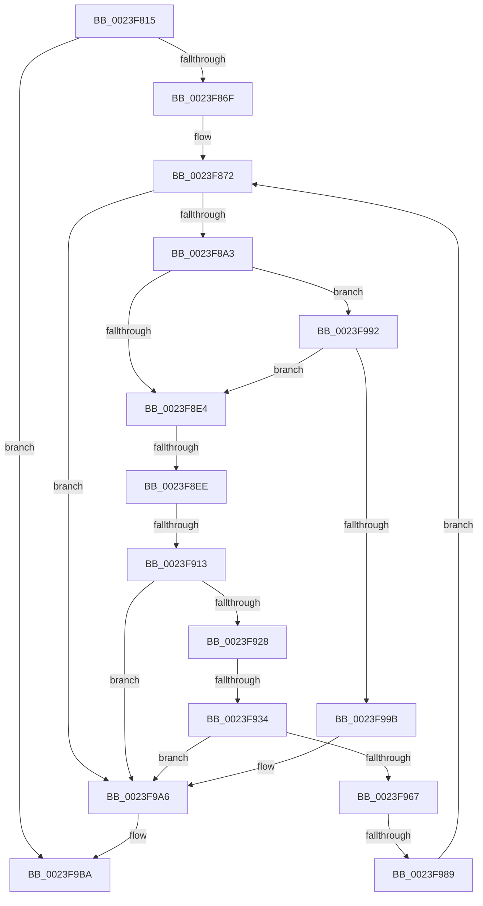

# sub_0023F815

- RVA: `0x0023F815`–`0x0023F9D7` (길이 `450` bytes)
- VA: `0x000000014023F815`
- 실행 섹션: `.text`
- PDB 이름 있음: `아니요`; PDB Function 태그: `아니요`
- unwind 정보 RVA: `0x000615F0`
- 디코드: `99`개 명령, `450/450` bytes 표시
- 미해석 바이트: `0` (있으면 어셈블리에 `.byte`로 보존)

> 이 문서는 커널 이미지의 기계어와 PDB 기호를 분석해 생성했습니다. 4번과 5번은 함수 원형과 자료형을 바이너리 사용 방식에서 추정한 C 해석이며 원본 소스 복구 결과는 아닙니다.

## 1. Dependencies

- 직접 호출 지점: **7**; 고유 호출 대상: **7**
- 직접 호출자로 확인된 함수: **0**
- RIP 상대 이미지 참조: **2**

### Outgoing calls
- `0x0023F83A` → [memcpy](../6C/memcpy_function_006C6840.md) (function, `0x006C6840`)
- `0x0023F860` → [MiProbeAndLockPrepare](MiProbeAndLockPrepare_function_0023BB40.md) (function, `0x0023BB40`)
- `0x0023F8FB` → [MiLockPageLeafPageTable](MiLockPageLeafPageTable_function_0023D160.md) (function, `0x0023D160`)
- `0x0023F91D` → [MiProbeLeafPteAccess](MiProbeLeafPteAccess_function_0023D640.md) (function, `0x0023D640`)
- `0x0023F948` → [MiSetProbePagesAhead](MiSetProbePagesAhead_function_0023DC80.md) (function, `0x0023DC80`)
- `0x0023F95C` → [MiProbeLockFrame](MiProbeLockFrame_function_0023C1B0.md) (function, `0x0023C1B0`)
- `0x0023F9B3` → [MiProbeAndLockComplete](../49/MiProbeAndLockComplete_function_0049A18C.md) (function, `0x0049A18C`)

### Direct callers
- 이 함수 시작 RVA로 연결되는 직접 call은 확인되지 않았습니다. 간접 호출은 완전히 역산할 수 없습니다.

### Static image references
- `0x0023F902` → RVA `0x00010880` (`.rdata`; read)
- `0x0023F99B` → RVA `0x00E30200` (`.data`; read/write)

## 2. Other-region calls and transfers

- 다른 실행 섹션으로 향하는 call: **0**
- call이 아닌 외부 분기/꼬리 이동: **5**
  - `0x0023F8E8` → [sub_0023F9E7](Unknown_function_0023F9E7.md) (`tail-transfer`)
  - `0x0023F90D` → [sub_0023FA7A + 0x13](Unknown_function_0023FA7A.md) (`tail-transfer`)
  - `0x0023F92E` → [sub_0023FA7A + 0x20](Unknown_function_0023FA7A.md) (`tail-transfer`)
  - `0x0023F983` → [sub_0023F9E7 + 0x39](Unknown_function_0023F9E7.md) (`tail-transfer`)
  - `0x0023F9D1` → [sub_0023FAC2 + 0x20](Unknown_function_0023FAC2.md) (`tail-transfer`)

## 3. Assembly (complete function range)

```asm
0023F815  4C 89 B4 24 20 11 00 00         mov qword ptr [rsp + 0x1120], r14
0023F81D  49 8B D4                        mov rdx, r12
0023F820  4C 8B 64 24 40                  mov r12, qword ptr [rsp + 0x40]
0023F825  4C 8B C3                        mov r8, rbx
0023F828  4C 89 BC 24 18 11 00 00         mov qword ptr [rsp + 0x1118], r15
0023F830  45 33 F6                        xor r14d, r14d
0023F833  4C 8D 3C 0B                     lea r15, [rbx + rcx]
0023F837  49 8B CC                        mov rcx, r12
0023F83A  E8 01 70 48 00                  call 0x1406c6840
0023F83F  4D 8B 04 24                     mov r8, qword ptr [r12]
0023F843  45 8D 4E 01                     lea r9d, [r14 + 1]
0023F847  C7 44 24 30 01 00 00 00         mov dword ptr [rsp + 0x30], 1
0023F84F  48 8D 4C 24 50                  lea rcx, [rsp + 0x50]
0023F854  89 7C 24 28                     mov dword ptr [rsp + 0x28], edi
0023F858  48 8B D6                        mov rdx, rsi
0023F85B  44 88 6C 24 20                  mov byte ptr [rsp + 0x20], r13b
0023F860  E8 DB C2 FF FF                  call 0x14023bb40
0023F865  8B F8                           mov edi, eax
0023F867  85 C0                           test eax, eax
0023F869  0F 88 4B 01 00 00               js 0x14023f9ba
0023F86F  49 8B DC                        mov rbx, r12
0023F872  48 BA 00 00 00 00 80 F6 FF FF   movabs rdx, 0xfffff68000000000
0023F87C  49 B9 FF FF FE FF FF 7F 00 00   movabs r9, 0x7ffffffeffff
0023F886  48 BE FF FF FF FF FF 00 00 00   movabs rsi, 0xffffffffff
0023F890  49 B8 F8 FF FF FF 7F 00 00 00   movabs r8, 0x7ffffffff8
0023F89A  49 3B DF                        cmp rbx, r15
0023F89D  0F 83 03 01 00 00               jae 0x14023f9a6
0023F8A3  48 8B 0B                        mov rcx, qword ptr [rbx]
0023F8A6  48 89 4C 24 58                  mov qword ptr [rsp + 0x58], rcx
0023F8AB  48 8D 41 01                     lea rax, [rcx + 1]
0023F8AF  48 C1 E9 09                     shr rcx, 9
0023F8B3  49 23 C8                        and rcx, r8
0023F8B6  48 89 44 24 60                  mov qword ptr [rsp + 0x60], rax
0023F8BB  48 8B C2                        mov rax, rdx
0023F8BE  48 03 C8                        add rcx, rax
0023F8C1  48 8B 45 88                     mov rax, qword ptr [rbp - 0x78]
0023F8C5  48 89 4C 24 68                  mov qword ptr [rsp + 0x68], rcx
0023F8CA  48 89 4C 24 70                  mov qword ptr [rsp + 0x70], rcx
0023F8CF  48 C7 00 FF FF FF FF            mov qword ptr [rax], 0xffffffffffffffff
0023F8D6  48 8B 44 24 58                  mov rax, qword ptr [rsp + 0x58]
0023F8DB  49 3B C1                        cmp rax, r9
0023F8DE  0F 87 AE 00 00 00               ja 0x14023f992
0023F8E4  F6 45 98 20                     test byte ptr [rbp - 0x68], 0x20
0023F8E8  0F 85 F9 00 00 00               jne 0x14023f9e7
0023F8EE  C7 44 24 40 00 00 00 00         mov dword ptr [rsp + 0x40], 0
0023F8F6  48 8D 4C 24 50                  lea rcx, [rsp + 0x50]
0023F8FB  E8 60 D8 FF FF                  call 0x14023d160
0023F900  8B F8                           mov edi, eax
0023F902  48 8B 05 77 0F DD FF            mov rax, qword ptr [rip - 0x22f089]
0023F909  48 39 45 80                     cmp qword ptr [rbp - 0x80], rax
0023F90D  0F 84 7A 01 00 00               je 0x14023fa8d
0023F913  48 8D 54 24 40                  lea rdx, [rsp + 0x40]
0023F918  48 8D 4C 24 50                  lea rcx, [rsp + 0x50]
0023F91D  E8 1E DD FF FF                  call 0x14023d640
0023F922  8B F8                           mov edi, eax
0023F924  85 C0                           test eax, eax
0023F926  78 7E                           js 0x14023f9a6
0023F928  8B 44 24 40                     mov eax, dword ptr [rsp + 0x40]
0023F92C  85 C0                           test eax, eax
0023F92E  0F 85 66 01 00 00               jne 0x14023fa9a
0023F934  48 8B 45 80                     mov rax, qword ptr [rbp - 0x80]
0023F938  48 8D 4C 24 50                  lea rcx, [rsp + 0x50]
0023F93D  48 C1 E8 0C                     shr rax, 0xc
0023F941  48 23 C6                        and rax, rsi
0023F944  48 89 45 D8                     mov qword ptr [rbp - 0x28], rax
0023F948  E8 33 E3 FF FF                  call 0x14023dc80
0023F94D  BE 10 00 00 00                  mov esi, 0x10
0023F952  BA 01 00 00 00                  mov edx, 1
0023F957  48 8D 4C 24 50                  lea rcx, [rsp + 0x50]
0023F95C  E8 4F C8 FF FF                  call 0x14023c1b0
0023F961  8B F8                           mov edi, eax
0023F963  85 C0                           test eax, eax
0023F965  78 3F                           js 0x14023f9a6
0023F967  48 8B 4D 88                     mov rcx, qword ptr [rbp - 0x78]
0023F96B  41 FF C6                        inc r14d
0023F96E  48 8B 45 D8                     mov rax, qword ptr [rbp - 0x28]
0023F972  33 D2                           xor edx, edx
0023F974  48 89 01                        mov qword ptr [rcx], rax
0023F977  41 8B C6                        mov eax, r14d
0023F97A  48 83 45 88 08                  add qword ptr [rbp - 0x78], 8
0023F97F  F7 F6                           div esi
0023F981  85 D2                           test edx, edx
0023F983  0F 84 97 00 00 00               je 0x14023fa20
0023F989  48 83 C3 08                     add rbx, 8
0023F98D  E9 E0 FE FF FF                  jmp 0x14023f872
0023F992  45 84 ED                        test r13b, r13b
0023F995  0F 84 49 FF FF FF               je 0x14023f8e4
0023F99B  FF 05 5F 08 BF 00               inc dword ptr [rip + 0xbf085f]
0023F9A1  BF 05 00 00 C0                  mov edi, 0xc0000005
0023F9A6  41 B8 07 00 00 00               mov r8d, 7
0023F9AC  48 8D 4C 24 50                  lea rcx, [rsp + 0x50]
0023F9B1  8B D7                           mov edx, edi
0023F9B3  E8 D4 A7 25 00                  call 0x14049a18c
0023F9B8  8B F8                           mov edi, eax
0023F9BA  4C 8B BC 24 18 11 00 00         mov r15, qword ptr [rsp + 0x1118]
0023F9C2  48 8D 45 00                     lea rax, [rbp]
0023F9C6  4C 8B B4 24 20 11 00 00         mov r14, qword ptr [rsp + 0x1120]
0023F9CE  4C 3B E0                        cmp r12, rax
0023F9D1  0F 85 0B 01 00 00               jne 0x14023fae2
```

## 4. C-style interpretation (structured pseudocode)

```c
__int64 __fastcall sub_0023F815(__int64 a1, __int64 a2, __int64 a3, __int64 a4, __int64 a5, __int64 a6, __int64 a7, unsigned int a8, __int64 a9, __int64 a10, __int64 a11, __int64 a12, __int64 a13, __int64 a14, __int64 a15, __int64 a16, __int64 a17, __int64 a18, __int64 a19, __int64 a20, __int64 a21, __int64 a22, __int64 a23, __int64 a24, __int64 a25, __int64 a26, __int64 a27, __int64 a28, __int64 a29, __int64 a30, __int64 a31, __int64 a32, __int64 a33, __int64 a34, __int64 a35, __int64 a36, __int64 a37, __int64 a38, __int64 a39, __int64 a40, __int64 a41, __int64 a42, __int64 a43, __int64 a44, __int64 a45, __int64 a46, __int64 a47, __int64 a48, __int64 a49, __int64 a50, __int64 a51, __int64 a52, __int64 a53, __int64 a54, __int64 a55, __int64 a56, __int64 a57, __int64 a58, __int64 a59, __int64 a60, __int64 a61, __int64 a62, __int64 a63, __int64 a64, __int64 a65, __int64 a66, __int64 a67, __int64 a68, __int64 a69, __int64 a70, __int64 a71, __int64 a72, __int64 a73, __int64 a74, __int64 a75, __int64 a76, __int64 a77, __int64 a78, __int64 a79, __int64 a80, __int64 a81, __int64 a82, __int64 a83, __int64 a84, __int64 a85, __int64 a86, __int64 a87, __int64 a88, __int64 a89, __int64 a90, __int64 a91, __int64 a92, __int64 a93, __int64 a94, __int64 a95, __int64 a96, __int64 a97, __int64 a98, __int64 a99, __int64 a100, __int64 a101, __int64 a102, __int64 a103, __int64 a104, __int64 a105, __int64 a106, __int64 a107, __int64 a108, __int64 a109, __int64 a110, __int64 a111, __int64 a112, __int64 a113, __int64 a114, __int64 a115, __int64 a116, __int64 a117, __int64 a118, __int64 a119, __int64 a120, __int64 a121, __int64 a122, __int64 a123, __int64 a124, __int64 a125, __int64 a126, __int64 a127, __int64 a128, __int64 a129, __int64 a130, __int64 a131, __int64 a132, __int64 a133, __int64 a134, __int64 a135, __int64 a136, __int64 a137, __int64 a138, __int64 a139, __int64 a140, __int64 a141, __int64 a142, __int64 a143, __int64 a144, __int64 a145, __int64 a146, __int64 a147, __int64 a148, __int64 a149, __int64 a150, __int64 a151, __int64 a152, __int64 a153, __int64 a154, __int64 a155, __int64 a156, __int64 a157, __int64 a158, __int64 a159, __int64 a160, __int64 a161, __int64 a162, __int64 a163, __int64 a164, __int64 a165, __int64 a166, __int64 a167, __int64 a168, __int64 a169, __int64 a170, __int64 a171, __int64 a172, __int64 a173, __int64 a174, __int64 a175, __int64 a176, __int64 a177, __int64 a178, __int64 a179, __int64 a180, __int64 a181, __int64 a182, __int64 a183, __int64 a184, __int64 a185, __int64 a186, __int64 a187, __int64 a188, __int64 a189, __int64 a190, __int64 a191, __int64 a192, __int64 a193, __int64 a194, __int64 a195, __int64 a196, __int64 a197, __int64 a198, __int64 a199, __int64 a200, __int64 a201, __int64 a202, __int64 a203, __int64 a204, __int64 a205, __int64 a206, __int64 a207, __int64 a208, __int64 a209, __int64 a210, __int64 a211, __int64 a212, __int64 a213, __int64 a214, __int64 a215, __int64 a216, __int64 a217, __int64 a218, __int64 a219, __int64 a220, __int64 a221, __int64 a222, __int64 a223, __int64 a224, __int64 a225, __int64 a226, __int64 a227, __int64 a228, __int64 a229, __int64 a230, __int64 a231, __int64 a232, __int64 a233, __int64 a234, __int64 a235, __int64 a236, __int64 a237, __int64 a238, __int64 a239, __int64 a240, __int64 a241, __int64 a242, __int64 a243, __int64 a244, __int64 a245, __int64 a246, __int64 a247, __int64 a248, __int64 a249, __int64 a250, __int64 a251, __int64 a252, __int64 a253, __int64 a254, __int64 a255, __int64 a256, __int64 a257, __int64 a258, __int64 a259, __int64 a260, __int64 a261, __int64 a262, __int64 a263, __int64 a264, __int64 a265, __int64 a266, __int64 a267, __int64 a268, __int64 a269, __int64 a270, __int64 a271, __int64 a272, __int64 a273, __int64 a274, __int64 a275, __int64 a276, __int64 a277, __int64 a278, __int64 a279, __int64 a280, __int64 a281, __int64 a282, __int64 a283, __int64 a284, __int64 a285, __int64 a286, __int64 a287, __int64 a288, __int64 a289, __int64 a290, __int64 a291, __int64 a292, __int64 a293, __int64 a294, __int64 a295, __int64 a296, __int64 a297, __int64 a298, __int64 a299, __int64 a300, __int64 a301, __int64 a302, __int64 a303, __int64 a304, __int64 a305, __int64 a306, __int64 a307, __int64 a308, __int64 a309, __int64 a310, __int64 a311, __int64 a312, __int64 a313, __int64 a314, __int64 a315, __int64 a316, __int64 a317, __int64 a318, __int64 a319, __int64 a320, __int64 a321, __int64 a322, __int64 a323, __int64 a324, __int64 a325, __int64 a326, __int64 a327, __int64 a328, __int64 a329, __int64 a330, __int64 a331, __int64 a332, __int64 a333, __int64 a334, __int64 a335, __int64 a336, __int64 a337, __int64 a338, __int64 a339, __int64 a340, __int64 a341, __int64 a342, __int64 a343, __int64 a344, __int64 a345, __int64 a346, __int64 a347, __int64 a348, __int64 a349, __int64 a350, __int64 a351, __int64 a352, __int64 a353, __int64 a354, __int64 a355, __int64 a356, __int64 a357, __int64 a358, __int64 a359, __int64 a360, __int64 a361, __int64 a362, __int64 a363, __int64 a364, __int64 a365, __int64 a366, __int64 a367, __int64 a368, __int64 a369, __int64 a370, __int64 a371, __int64 a372, __int64 a373, __int64 a374, __int64 a375, __int64 a376, __int64 a377, __int64 a378, __int64 a379, __int64 a380, __int64 a381, __int64 a382, __int64 a383, __int64 a384, __int64 a385, __int64 a386, __int64 a387, __int64 a388, __int64 a389, __int64 a390, __int64 a391, __int64 a392, __int64 a393, __int64 a394, __int64 a395, __int64 a396, __int64 a397, __int64 a398, __int64 a399, __int64 a400, __int64 a401, __int64 a402, __int64 a403, __int64 a404, __int64 a405, __int64 a406, __int64 a407, __int64 a408, __int64 a409, __int64 a410, __int64 a411, __int64 a412, __int64 a413, __int64 a414, __int64 a415, __int64 a416, __int64 a417, __int64 a418, __int64 a419, __int64 a420, __int64 a421, __int64 a422, __int64 a423, __int64 a424, __int64 a425, __int64 a426, __int64 a427, __int64 a428, __int64 a429, __int64 a430, __int64 a431, __int64 a432, __int64 a433, __int64 a434, __int64 a435, __int64 a436, __int64 a437, __int64 a438, __int64 a439, __int64 a440, __int64 a441, __int64 a442, __int64 a443, __int64 a444, __int64 a445, __int64 a446, __int64 a447, __int64 a448, __int64 a449, __int64 a450, __int64 a451, __int64 a452, __int64 a453, __int64 a454, __int64 a455, __int64 a456, __int64 a457, __int64 a458, __int64 a459, __int64 a460, __int64 a461, __int64 a462, __int64 a463, __int64 a464, __int64 a465, __int64 a466, __int64 a467, __int64 a468, __int64 a469, __int64 a470, __int64 a471, __int64 a472, __int64 a473, __int64 a474, __int64 a475, __int64 a476, __int64 a477, __int64 a478, __int64 a479, __int64 a480, __int64 a481, __int64 a482, __int64 a483, __int64 a484, __int64 a485, __int64 a486, __int64 a487, __int64 a488, __int64 a489, __int64 a490, __int64 a491, __int64 a492, __int64 a493, __int64 a494, __int64 a495, __int64 a496, __int64 a497, __int64 a498, __int64 a499, __int64 a500, __int64 a501, __int64 a502, __int64 a503, __int64 a504, __int64 a505, __int64 a506, __int64 a507, __int64 a508, __int64 a509, __int64 a510, __int64 a511, __int64 a512, __int64 a513, __int64 a514, __int64 a515, __int64 a516, __int64 a517, __int64 a518, __int64 a519, __int64 a520, __int64 a521, __int64 a522, __int64 a523, __int64 a524, __int64 a525, __int64 a526, __int64 a527, __int64 a528, __int64 a529, __int64 a530, __int64 a531, __int64 a532, __int64 a533, __int64 a534, __int64 a535, __int64 a536, __int64 a537, __int64 a538, __int64 a539, __int64 a540, __int64 a541, __int64 a542, __int64 a543, __int64 a544, __int64 a545, __int64 a546, __int64 a547, __int64 a548)
{
    __int64 result;
    __int64 v_r14;
    __int64 v_rbx;
    unsigned __int64 v_stack_p1118;
    unsigned __int64 v_stack_p1120;
    unsigned __int8 v_stack_p20;
    unsigned int v_stack_p28;
    unsigned int v_stack_p30;
    unsigned int v_stack_p40;
    unsigned __int64 v_stack_p58;
    unsigned __int64 v_stack_p60;
    unsigned __int64 v_stack_p68;
    unsigned __int64 v_stack_p70;

    v_stack_p1120 = v_r14;
    v_stack_p1118 = v_r15;
    v_r14 = 0;
    result = memcpy(a8, v_r12, v_rbx, a4);
    v_stack_p30 = 1;
    v_stack_p28 = (unsigned int)(v_rdi);
    v_stack_p20 = (unsigned __int8)(v_r13);
    result = MiProbeAndLockPrepare(a10, v_rsi, *(unsigned __int64 *)(a8), v_r14 + 1);
    if (sign_flag) goto loc_0023F9BA;
loc_0023F872:
    if (a8 >= (v_rbx + a1 * 1)) goto loc_0023F9A6;
    v_stack_p58 = *(unsigned __int64 *)(a8);
    a1 = (*(unsigned __int64 *)(a8)) >> (9);
    a1 = (a1) & (*(unsigned __int64 *)(a8));
    v_stack_p60 = *(unsigned __int64 *)(a8) + 1;
    a1 = (a1) + (v_rsi);
    v_stack_p68 = a1;
    v_stack_p70 = a1;
    *(unsigned __int64 *)(*(unsigned __int64 *)(v_rbp - 120)) = -1;
    if (a11 > (v_r14 + 1)) goto loc_0023F992;
loc_0023F8E4:
    v_stack_p40 = 0;
    result = MiLockPageLeafPageTable(a10, v_rsi, *(unsigned __int64 *)(a8), v_r14 + 1);
    result = MiProbeLeafPteAccess(a10, a8, *(unsigned __int64 *)(a8), v_r14 + 1);
    if (sign_flag) goto loc_0023F9A6;
    result = (*(unsigned __int64 *)(v_rbp - 128)) >> (12);
    result = (result) & (v_rsi);
    *(unsigned __int64 *)(v_rbp - 40) = result;
    result = MiSetProbePagesAhead(a10, a8, *(unsigned __int64 *)(a8), v_r14 + 1);
    result = MiProbeLockFrame(a10, 1, *(unsigned __int64 *)(a8), v_r14 + 1);
    if (sign_flag) goto loc_0023F9A6;
    v_r14 = (unsigned int)((v_r14) + 1);
    a2 = 0;
    *(unsigned __int64 *)(*(unsigned __int64 *)(v_rbp - 120)) = *(unsigned __int64 *)(v_rbp - 40);
    v_rbx = (a8) + (8);
    goto loc_0023F872;
loc_0023F992:
    if ((unsigned __int8)(v_r13) == 0) goto loc_0023F8E4;
loc_0023F9A6:
    result = MiProbeAndLockComplete(a10, (unsigned int)((unsigned int)((unsigned int)(0xC0000005ULL))), 7, v_r14 + 1);
loc_0023F9BA:
}
```

## 5. (Beta) C Style

```c
int64_t sub_0023F815(int64_t Arg1, int64_t Arg2, int64_t Arg3, int64_t Arg4, uint64_t Arg5, uint64_t Arg6, uint64_t Arg7, void *Arg8, uint64_t Arg9, int64_t Arg10, int64_t Arg11, uint64_t Arg12, uint64_t Arg13, uint64_t Arg14, uint64_t Arg15, uint64_t Arg16, uint64_t Arg17, uint64_t Arg18, uint64_t Arg19, uint64_t Arg20, uint64_t Arg21, uint64_t Arg22, uint64_t Arg23, uint64_t Arg24, uint64_t Arg25, uint64_t Arg26, uint64_t Arg27, uint64_t Arg28, uint64_t Arg29, uint64_t Arg30, uint64_t Arg31, uint64_t Arg32, uint64_t Arg33, uint64_t Arg34, uint64_t Arg35, uint64_t Arg36, uint64_t Arg37, uint64_t Arg38, uint64_t Arg39, uint64_t Arg40, uint64_t Arg41, uint64_t Arg42, uint64_t Arg43, uint64_t Arg44, uint64_t Arg45, uint64_t Arg46, uint64_t Arg47, uint64_t Arg48, uint64_t Arg49, uint64_t Arg50, uint64_t Arg51, uint64_t Arg52, uint64_t Arg53, uint64_t Arg54, uint64_t Arg55, uint64_t Arg56, uint64_t Arg57, uint64_t Arg58, uint64_t Arg59, uint64_t Arg60, uint64_t Arg61, uint64_t Arg62, uint64_t Arg63, uint64_t Arg64, uint64_t Arg65, uint64_t Arg66, uint64_t Arg67, uint64_t Arg68, uint64_t Arg69, uint64_t Arg70, uint64_t Arg71, uint64_t Arg72, uint64_t Arg73, uint64_t Arg74, uint64_t Arg75, uint64_t Arg76, uint64_t Arg77, uint64_t Arg78, uint64_t Arg79, uint64_t Arg80, uint64_t Arg81, uint64_t Arg82, uint64_t Arg83, uint64_t Arg84, uint64_t Arg85, uint64_t Arg86, uint64_t Arg87, uint64_t Arg88, uint64_t Arg89, uint64_t Arg90, uint64_t Arg91, uint64_t Arg92, uint64_t Arg93, uint64_t Arg94, uint64_t Arg95, uint64_t Arg96, uint64_t Arg97, uint64_t Arg98, uint64_t Arg99, uint64_t Arg100, uint64_t Arg101, uint64_t Arg102, uint64_t Arg103, uint64_t Arg104, uint64_t Arg105, uint64_t Arg106, uint64_t Arg107, uint64_t Arg108, uint64_t Arg109, uint64_t Arg110, uint64_t Arg111, uint64_t Arg112, uint64_t Arg113, uint64_t Arg114, uint64_t Arg115, uint64_t Arg116, uint64_t Arg117, uint64_t Arg118, uint64_t Arg119, uint64_t Arg120, uint64_t Arg121, uint64_t Arg122, uint64_t Arg123, uint64_t Arg124, uint64_t Arg125, uint64_t Arg126, uint64_t Arg127, uint64_t Arg128, uint64_t Arg129, uint64_t Arg130, uint64_t Arg131, uint64_t Arg132, uint64_t Arg133, uint64_t Arg134, uint64_t Arg135, uint64_t Arg136, uint64_t Arg137, uint64_t Arg138, uint64_t Arg139, uint64_t Arg140, uint64_t Arg141, uint64_t Arg142, uint64_t Arg143, uint64_t Arg144, uint64_t Arg145, uint64_t Arg146, uint64_t Arg147, uint64_t Arg148, uint64_t Arg149, uint64_t Arg150, uint64_t Arg151, uint64_t Arg152, uint64_t Arg153, uint64_t Arg154, uint64_t Arg155, uint64_t Arg156, uint64_t Arg157, uint64_t Arg158, uint64_t Arg159, uint64_t Arg160, uint64_t Arg161, uint64_t Arg162, uint64_t Arg163, uint64_t Arg164, uint64_t Arg165, uint64_t Arg166, uint64_t Arg167, uint64_t Arg168, uint64_t Arg169, uint64_t Arg170, uint64_t Arg171, uint64_t Arg172, uint64_t Arg173, uint64_t Arg174, uint64_t Arg175, uint64_t Arg176, uint64_t Arg177, uint64_t Arg178, uint64_t Arg179, uint64_t Arg180, uint64_t Arg181, uint64_t Arg182, uint64_t Arg183, uint64_t Arg184, uint64_t Arg185, uint64_t Arg186, uint64_t Arg187, uint64_t Arg188, uint64_t Arg189, uint64_t Arg190, uint64_t Arg191, uint64_t Arg192, uint64_t Arg193, uint64_t Arg194, uint64_t Arg195, uint64_t Arg196, uint64_t Arg197, uint64_t Arg198, uint64_t Arg199, uint64_t Arg200, uint64_t Arg201, uint64_t Arg202, uint64_t Arg203, uint64_t Arg204, uint64_t Arg205, uint64_t Arg206, uint64_t Arg207, uint64_t Arg208, uint64_t Arg209, uint64_t Arg210, uint64_t Arg211, uint64_t Arg212, uint64_t Arg213, uint64_t Arg214, uint64_t Arg215, uint64_t Arg216, uint64_t Arg217, uint64_t Arg218, uint64_t Arg219, uint64_t Arg220, uint64_t Arg221, uint64_t Arg222, uint64_t Arg223, uint64_t Arg224, uint64_t Arg225, uint64_t Arg226, uint64_t Arg227, uint64_t Arg228, uint64_t Arg229, uint64_t Arg230, uint64_t Arg231, uint64_t Arg232, uint64_t Arg233, uint64_t Arg234, uint64_t Arg235, uint64_t Arg236, uint64_t Arg237, uint64_t Arg238, uint64_t Arg239, uint64_t Arg240, uint64_t Arg241, uint64_t Arg242, uint64_t Arg243, uint64_t Arg244, uint64_t Arg245, uint64_t Arg246, uint64_t Arg247, uint64_t Arg248, uint64_t Arg249, uint64_t Arg250, uint64_t Arg251, uint64_t Arg252, uint64_t Arg253, uint64_t Arg254, uint64_t Arg255, uint64_t Arg256, uint64_t Arg257, uint64_t Arg258, uint64_t Arg259, uint64_t Arg260, uint64_t Arg261, uint64_t Arg262, uint64_t Arg263, uint64_t Arg264, uint64_t Arg265, uint64_t Arg266, uint64_t Arg267, uint64_t Arg268, uint64_t Arg269, uint64_t Arg270, uint64_t Arg271, uint64_t Arg272, uint64_t Arg273, uint64_t Arg274, uint64_t Arg275, uint64_t Arg276, uint64_t Arg277, uint64_t Arg278, uint64_t Arg279, uint64_t Arg280, uint64_t Arg281, uint64_t Arg282, uint64_t Arg283, uint64_t Arg284, uint64_t Arg285, uint64_t Arg286, uint64_t Arg287, uint64_t Arg288, uint64_t Arg289, uint64_t Arg290, uint64_t Arg291, uint64_t Arg292, uint64_t Arg293, uint64_t Arg294, uint64_t Arg295, uint64_t Arg296, uint64_t Arg297, uint64_t Arg298, uint64_t Arg299, uint64_t Arg300, uint64_t Arg301, uint64_t Arg302, uint64_t Arg303, uint64_t Arg304, uint64_t Arg305, uint64_t Arg306, uint64_t Arg307, uint64_t Arg308, uint64_t Arg309, uint64_t Arg310, uint64_t Arg311, uint64_t Arg312, uint64_t Arg313, uint64_t Arg314, uint64_t Arg315, uint64_t Arg316, uint64_t Arg317, uint64_t Arg318, uint64_t Arg319, uint64_t Arg320, uint64_t Arg321, uint64_t Arg322, uint64_t Arg323, uint64_t Arg324, uint64_t Arg325, uint64_t Arg326, uint64_t Arg327, uint64_t Arg328, uint64_t Arg329, uint64_t Arg330, uint64_t Arg331, uint64_t Arg332, uint64_t Arg333, uint64_t Arg334, uint64_t Arg335, uint64_t Arg336, uint64_t Arg337, uint64_t Arg338, uint64_t Arg339, uint64_t Arg340, uint64_t Arg341, uint64_t Arg342, uint64_t Arg343, uint64_t Arg344, uint64_t Arg345, uint64_t Arg346, uint64_t Arg347, uint64_t Arg348, uint64_t Arg349, uint64_t Arg350, uint64_t Arg351, uint64_t Arg352, uint64_t Arg353, uint64_t Arg354, uint64_t Arg355, uint64_t Arg356, uint64_t Arg357, uint64_t Arg358, uint64_t Arg359, uint64_t Arg360, uint64_t Arg361, uint64_t Arg362, uint64_t Arg363, uint64_t Arg364, uint64_t Arg365, uint64_t Arg366, uint64_t Arg367, uint64_t Arg368, uint64_t Arg369, uint64_t Arg370, uint64_t Arg371, uint64_t Arg372, uint64_t Arg373, uint64_t Arg374, uint64_t Arg375, uint64_t Arg376, uint64_t Arg377, uint64_t Arg378, uint64_t Arg379, uint64_t Arg380, uint64_t Arg381, uint64_t Arg382, uint64_t Arg383, uint64_t Arg384, uint64_t Arg385, uint64_t Arg386, uint64_t Arg387, uint64_t Arg388, uint64_t Arg389, uint64_t Arg390, uint64_t Arg391, uint64_t Arg392, uint64_t Arg393, uint64_t Arg394, uint64_t Arg395, uint64_t Arg396, uint64_t Arg397, uint64_t Arg398, uint64_t Arg399, uint64_t Arg400, uint64_t Arg401, uint64_t Arg402, uint64_t Arg403, uint64_t Arg404, uint64_t Arg405, uint64_t Arg406, uint64_t Arg407, uint64_t Arg408, uint64_t Arg409, uint64_t Arg410, uint64_t Arg411, uint64_t Arg412, uint64_t Arg413, uint64_t Arg414, uint64_t Arg415, uint64_t Arg416, uint64_t Arg417, uint64_t Arg418, uint64_t Arg419, uint64_t Arg420, uint64_t Arg421, uint64_t Arg422, uint64_t Arg423, uint64_t Arg424, uint64_t Arg425, uint64_t Arg426, uint64_t Arg427, uint64_t Arg428, uint64_t Arg429, uint64_t Arg430, uint64_t Arg431, uint64_t Arg432, uint64_t Arg433, uint64_t Arg434, uint64_t Arg435, uint64_t Arg436, uint64_t Arg437, uint64_t Arg438, uint64_t Arg439, uint64_t Arg440, uint64_t Arg441, uint64_t Arg442, uint64_t Arg443, uint64_t Arg444, uint64_t Arg445, uint64_t Arg446, uint64_t Arg447, uint64_t Arg448, uint64_t Arg449, uint64_t Arg450, uint64_t Arg451, uint64_t Arg452, uint64_t Arg453, uint64_t Arg454, uint64_t Arg455, uint64_t Arg456, uint64_t Arg457, uint64_t Arg458, uint64_t Arg459, uint64_t Arg460, uint64_t Arg461, uint64_t Arg462, uint64_t Arg463, uint64_t Arg464, uint64_t Arg465, uint64_t Arg466, uint64_t Arg467, uint64_t Arg468, uint64_t Arg469, uint64_t Arg470, uint64_t Arg471, uint64_t Arg472, uint64_t Arg473, uint64_t Arg474, uint64_t Arg475, uint64_t Arg476, uint64_t Arg477, uint64_t Arg478, uint64_t Arg479, uint64_t Arg480, uint64_t Arg481, uint64_t Arg482, uint64_t Arg483, uint64_t Arg484, uint64_t Arg485, uint64_t Arg486, uint64_t Arg487, uint64_t Arg488, uint64_t Arg489, uint64_t Arg490, uint64_t Arg491, uint64_t Arg492, uint64_t Arg493, uint64_t Arg494, uint64_t Arg495, uint64_t Arg496, uint64_t Arg497, uint64_t Arg498, uint64_t Arg499, uint64_t Arg500, uint64_t Arg501, uint64_t Arg502, uint64_t Arg503, uint64_t Arg504, uint64_t Arg505, uint64_t Arg506, uint64_t Arg507, uint64_t Arg508, uint64_t Arg509, uint64_t Arg510, uint64_t Arg511, uint64_t Arg512, uint64_t Arg513, uint64_t Arg514, uint64_t Arg515, uint64_t Arg516, uint64_t Arg517, uint64_t Arg518, uint64_t Arg519, uint64_t Arg520, uint64_t Arg521, uint64_t Arg522, uint64_t Arg523, uint64_t Arg524, uint64_t Arg525, uint64_t Arg526, uint64_t Arg527, uint64_t Arg528, uint64_t Arg529, uint64_t Arg530, uint64_t Arg531, uint64_t Arg532, uint64_t Arg533, uint64_t Arg534, uint64_t Arg535, uint64_t Arg536, uint64_t Arg537, uint64_t Arg538, uint64_t Arg539, uint64_t Arg540, uint64_t Arg541, uint64_t Arg542, uint64_t Arg543, uint64_t Arg544, uint64_t Arg545, uint64_t Arg546, int64_t Arg547, int64_t Arg548)
{
    uint8_t *arg8 = (uint8_t *)Arg8;

    int64_t result;
    int64_t local_r14;
    int64_t local_rbx;
    uint64_t v_stack_p1118;
    uint64_t v_stack_p1120;
    uint8_t v_stack_p20;
    uint32_t v_stack_p28;
    uint32_t v_stack_p30;
    uint32_t v_stack_p40;
    uint64_t v_stack_p58;
    uint64_t v_stack_p60;
    uint64_t v_stack_p68;
    uint64_t v_stack_p70;

    v_stack_p1120 = local_r14;
    v_stack_p1118 = local_r15;
    local_r14 = 0;
    result = memcpy(Arg8, local_r12, local_rbx, Arg4);
    v_stack_p30 = 1;
    v_stack_p28 = (uint32_t)(local_rdi);
    v_stack_p20 = (uint8_t)(local_r13);
    result = MiProbeAndLockPrepare(Arg10, local_rsi, *(uint64_t *)(arg8), local_r14 + 1);
    if (sign_flag) goto loc_0023F9BA;
loc_0023F872:
    if (Arg8 >= (local_rbx + Arg1 * 1)) goto loc_0023F9A6;
    v_stack_p58 = *(uint64_t *)(arg8);
    Arg1 = (*(uint64_t *)(arg8)) >> (9);
    Arg1 = (Arg1) & (*(uint64_t *)(arg8));
    v_stack_p60 = *(uint64_t *)(arg8) + 1;
    Arg1 = (Arg1) + (local_rsi);
    v_stack_p68 = Arg1;
    v_stack_p70 = Arg1;
    *(uint64_t *)(*(uint64_t *)(local_rbp - 0x78)) = -1;
    if (Arg11 > (local_r14 + 1)) goto loc_0023F992;
loc_0023F8E4:
    v_stack_p40 = 0;
    result = MiLockPageLeafPageTable(Arg10, local_rsi, *(uint64_t *)(arg8), local_r14 + 1);
    result = MiProbeLeafPteAccess(Arg10, Arg8, *(uint64_t *)(arg8), local_r14 + 1);
    if (sign_flag) goto loc_0023F9A6;
    result = (*(uint64_t *)(local_rbp - 0x80)) >> (12);
    result = (result) & (local_rsi);
    *(uint64_t *)(local_rbp - 0x28) = result;
    result = MiSetProbePagesAhead(Arg10, Arg8, *(uint64_t *)(arg8), local_r14 + 1);
    result = MiProbeLockFrame(Arg10, 1, *(uint64_t *)(arg8), local_r14 + 1);
    if (sign_flag) goto loc_0023F9A6;
    local_r14 = (uint32_t)((local_r14) + 1);
    Arg2 = 0;
    *(uint64_t *)(*(uint64_t *)(local_rbp - 0x78)) = *(uint64_t *)(local_rbp - 0x28);
    local_rbx = (Arg8) + (8);
    goto loc_0023F872;
loc_0023F992:
    if ((uint8_t)(local_r13) == 0) goto loc_0023F8E4;
loc_0023F9A6:
    result = MiProbeAndLockComplete(Arg10, (uint32_t)((uint32_t)((uint32_t)(0xC0000005ULL))), 7, local_r14 + 1);
loc_0023F9BA:
}
```

### 관측된 메모리 오프셋

구조체 형식이 확인되지 않은 접근은 인자 기준의 오프셋으로만 기록했습니다.

| 기준 인자 | 오프셋 표현 | 폭 (bit) | 접근 |
|---|---:|---:|---|
| `Arg8` | `+ 0x0` | `64` | `R` |

## 6. Execution-region graph

[열기: 2D/3D 그래프와 함수 탐색 컨트롤 패널](../../../control-panel.html?section=text&rva=0x0023F815&view=graph)

- 2D 그래프는 위에서 아래로 흐르고, 3D 그래프는 빈 공간을 드래그해 회전합니다. Shift+드래그는 이동, 휠은 확대·축소, 함수 노드 선택은 대상 보고서 이동입니다.

### Static fallback


