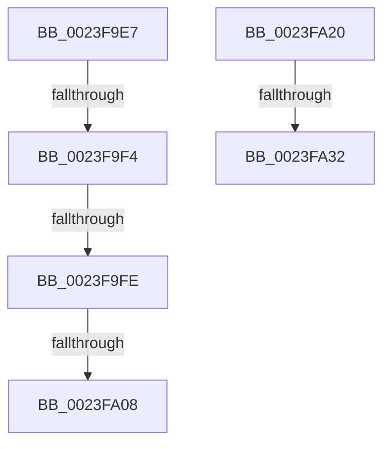

# sub_0023F9E7

- RVA: `0x0023F9E7`–`0x0023FA4B` (길이 `100` bytes)
- VA: `0x000000014023F9E7`
- 실행 섹션: `.text`
- PDB 이름 있음: `아니요`; PDB Function 태그: `아니요`
- unwind 정보 RVA: `0x00061618`
- 디코드: `23`개 명령, `100/100` bytes 표시
- 미해석 바이트: `0` (있으면 어셈블리에 `.byte`로 보존)

> 이 문서는 커널 이미지의 기계어와 PDB 기호를 분석해 생성했습니다. 4번과 5번은 함수 원형과 자료형을 바이너리 사용 방식에서 추정한 C 해석이며 원본 소스 복구 결과는 아닙니다.

## 1. Dependencies

- 직접 호출 지점: **3**; 고유 호출 대상: **3**
- 직접 호출자로 확인된 함수: **0**
- RIP 상대 이미지 참조: **0**

### Outgoing calls
- `0x0023FA25` → [MiProbePacketContended](../2A/MiProbePacketContended_function_002AE5A8.md) (function, `0x002AE5A8`)
- `0x0023FA37` → [MiUnlockProbePacketWorkingSet](MiUnlockProbePacketWorkingSet_function_0023B800.md) (function, `0x0023B800`)
- `0x0023FA41` → [MiLockProbePacketWorkingSet](../40/MiLockProbePacketWorkingSet_function_0040E500.md) (function, `0x0040E500`)

### Direct callers
- 이 함수 시작 RVA로 연결되는 직접 call은 확인되지 않았습니다. 간접 호출은 완전히 역산할 수 없습니다.

### Static image references
- 디코드된 RIP-relative 메모리 참조가 없습니다.

## 2. Other-region calls and transfers

- 다른 실행 섹션으로 향하는 call: **0**
- call이 아닌 외부 분기/꼬리 이동: **6**
  - `0x0023F9EE` → [sub_0023F815 + 0xD9](Unknown_function_0023F815.md) (`tail-transfer`)
  - `0x0023F9F8` → [sub_0023F815 + 0xD9](Unknown_function_0023F815.md) (`tail-transfer`)
  - `0x0023FA06` → [sub_0023FA7A](Unknown_function_0023FA7A.md) (`tail-transfer`)
  - `0x0023FA1B` → [sub_0023F815 + 0x13D](Unknown_function_0023F815.md) (`tail-transfer`)
  - `0x0023FA2C` → [sub_0023F815 + 0x174](Unknown_function_0023F815.md) (`tail-transfer`)
  - `0x0023FA46` → [sub_0023F815 + 0x174](Unknown_function_0023F815.md) (`tail-transfer`)

## 3. Assembly (complete function range)

```asm
0023F9E7  48 8B 55 E8                     mov rdx, qword ptr [rbp - 0x18]
0023F9EB  48 3B C2                        cmp rax, rdx
0023F9EE  0F 82 FA FE FF FF               jb 0x14023f8ee
0023F9F4  48 3B 45 F0                     cmp rax, qword ptr [rbp - 0x10]
0023F9F8  0F 87 F0 FE FF FF               ja 0x14023f8ee
0023F9FE  48 8B 4D F8                     mov rcx, qword ptr [rbp - 8]
0023FA02  48 83 F9 FF                     cmp rcx, -1
0023FA06  74 72                           je 0x14023fa7a
0023FA08  48 2B C2                        sub rax, rdx
0023FA0B  48 C1 E8 0C                     shr rax, 0xc
0023FA0F  48 03 C1                        add rax, rcx
0023FA12  48 89 45 D8                     mov qword ptr [rbp - 0x28], rax
0023FA16  BE 40 00 00 00                  mov esi, 0x40
0023FA1B  E9 32 FF FF FF                  jmp 0x14023f952
0023FA20  48 8D 4C 24 50                  lea rcx, [rsp + 0x50]
0023FA25  E8 7E EB 06 00                  call 0x1402ae5a8
0023FA2A  85 C0                           test eax, eax
0023FA2C  0F 84 57 FF FF FF               je 0x14023f989
0023FA32  48 8D 4C 24 50                  lea rcx, [rsp + 0x50]
0023FA37  E8 C4 BD FF FF                  call 0x14023b800
0023FA3C  48 8D 4C 24 50                  lea rcx, [rsp + 0x50]
0023FA41  E8 BA EA 1C 00                  call 0x14040e500
0023FA46  E9 3E FF FF FF                  jmp 0x14023f989
```

## 4. C-style interpretation (structured pseudocode)

```c
__int64 __fastcall sub_0023F9E7(void)
{
    __int64 result;
    unsigned __int64 v_stack_p50;

    result = (result) - (*(unsigned __int64 *)(v_rbp - 24));
    result = (result) >> (12);
    result = (result) + (*(unsigned __int64 *)(v_rbp - 8));
    *(unsigned __int64 *)(v_rbp - 40) = result;
}
```

## 5. (Beta) C Style

```c
void sub_0023F9E7(void)
{
    int64_t result;
    uint64_t v_stack_p50;

    result = (result) - (*(uint64_t *)(local_rbp - 0x18));
    result = (result) >> (12);
    result = (result) + (*(uint64_t *)(local_rbp - 0x8));
    *(uint64_t *)(local_rbp - 0x28) = result;
}
```

## 6. Execution-region graph

[열기: 2D/3D 그래프와 함수 탐색 컨트롤 패널](../../../control-panel.html?section=text&rva=0x0023F9E7&view=graph)

- 2D 그래프는 위에서 아래로 흐르고, 3D 그래프는 빈 공간을 드래그해 회전합니다. Shift+드래그는 이동, 휠은 확대·축소, 함수 노드 선택은 대상 보고서 이동입니다.

### Static fallback


