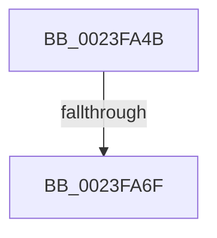

# sub_0023FA4B

- RVA: `0x0023FA4B`–`0x0023FA7A` (길이 `47` bytes)
- VA: `0x000000014023FA4B`
- 실행 섹션: `.text`
- PDB 이름 있음: `아니요`; PDB Function 태그: `아니요`
- unwind 정보 RVA: `0x00061630`
- 디코드: `11`개 명령, `47/47` bytes 표시
- 미해석 바이트: `0` (있으면 어셈블리에 `.byte`로 보존)

> 이 문서는 커널 이미지의 기계어와 PDB 기호를 분석해 생성했습니다. 4번과 5번은 함수 원형과 자료형을 바이너리 사용 방식에서 추정한 C 해석이며 원본 소스 복구 결과는 아닙니다.

## 1. Dependencies

- 직접 호출 지점: **2**; 고유 호출 대상: **2**
- 직접 호출자로 확인된 함수: **0**
- RIP 상대 이미지 참조: **0**

### Outgoing calls
- `0x0023FA59` → [MiAllocatePool](../35/MiAllocatePool_function_0035B540.md) (function, `0x0035B540`)
- `0x0023FA74` → [RtlRaiseStatus](../2F/RtlRaiseStatus_function_002F6A50.md) (function, `0x002F6A50`)

### Direct callers
- 이 함수 시작 RVA로 연결되는 직접 call은 확인되지 않았습니다. 간접 호출은 완전히 역산할 수 없습니다.

### Static image references
- 디코드된 RIP-relative 메모리 참조가 없습니다.

## 2. Other-region calls and transfers

- 다른 실행 섹션으로 향하는 call: **0**
- call이 아닌 외부 분기/꼬리 이동: **1**
  - `0x0023FA69` → [sub_0023F815](Unknown_function_0023F815.md) (`tail-transfer`)

## 3. Assembly (complete function range)

```asm
0023FA4B  41 B8 4D 6D 50 72               mov r8d, 0x72506d4d
0023FA51  48 8B D3                        mov rdx, rbx
0023FA54  B9 40 00 00 00                  mov ecx, 0x40
0023FA59  E8 E2 BA 11 00                  call 0x14035b540
0023FA5E  48 89 44 24 40                  mov qword ptr [rsp + 0x40], rax
0023FA63  48 8B C8                        mov rcx, rax
0023FA66  48 85 C0                        test rax, rax
0023FA69  0F 85 A6 FD FF FF               jne 0x14023f815
0023FA6F  B9 9A 00 00 C0                  mov ecx, 0xc000009a
0023FA74  E8 D7 6F 0B 00                  call 0x1402f6a50
0023FA79  CC                              int3
```

## 4. C-style interpretation (structured pseudocode)

```c
__int64 __fastcall sub_0023FA4B(void)
{
    __int64 result;
    unsigned __int64 v_stack_p40;

    result = MiAllocatePool(64, v_rbx, (unsigned int)(0x72506D4DULL), a4);
    v_stack_p40 = result;
    result = RtlRaiseStatus((unsigned int)(0xC000009AULL), v_rbx, (unsigned int)(0x72506D4DULL), a4);
    return result;
}
```

## 5. (Beta) C Style

```c
void sub_0023FA4B(void)
{
    int64_t result;
    uint64_t v_stack_p40;

    result = MiAllocatePool(64, local_rbx, (uint32_t)(0x72506D4DULL), a4);
    v_stack_p40 = result;
    result = RtlRaiseStatus((uint32_t)(0xC000009AULL), local_rbx, (uint32_t)(0x72506D4DULL), a4);
    return result;
}
```

## 6. Execution-region graph

[열기: 2D/3D 그래프와 함수 탐색 컨트롤 패널](../../../control-panel.html?section=text&rva=0x0023FA4B&view=graph)

- 2D 그래프는 위에서 아래로 흐르고, 3D 그래프는 빈 공간을 드래그해 회전합니다. Shift+드래그는 이동, 휠은 확대·축소, 함수 노드 선택은 대상 보고서 이동입니다.

### Static fallback


