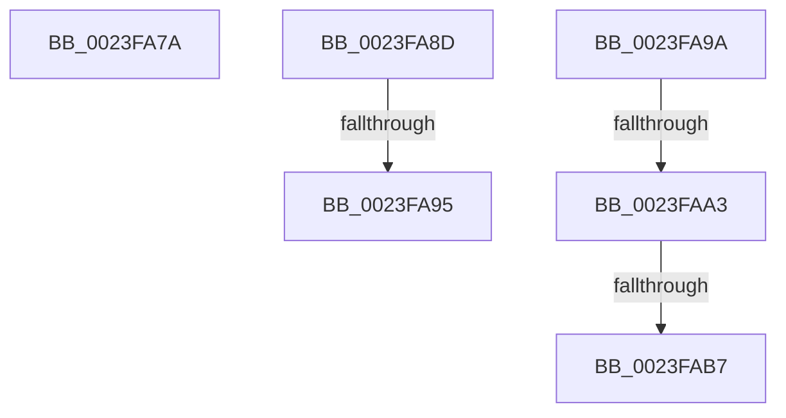

# sub_0023FA7A

- RVA: `0x0023FA7A`–`0x0023FAC2` (길이 `72` bytes)
- VA: `0x000000014023FA7A`
- 실행 섹션: `.text`
- PDB 이름 있음: `아니요`; PDB Function 태그: `아니요`
- unwind 정보 RVA: `0x00061640`
- 디코드: `17`개 명령, `72/72` bytes 표시
- 미해석 바이트: `0` (있으면 어셈블리에 `.byte`로 보존)

> 이 문서는 커널 이미지의 기계어와 PDB 기호를 분석해 생성했습니다. 4번과 5번은 함수 원형과 자료형을 바이너리 사용 방식에서 추정한 C 해석이며 원본 소스 복구 결과는 아닙니다.

## 1. Dependencies

- 직접 호출 지점: **2**; 고유 호출 대상: **2**
- 직접 호출자로 확인된 함수: **0**
- RIP 상대 이미지 참조: **1**

### Outgoing calls
- `0x0023FA7F` → [MI_READ_PTE_LOCK_FREE](../28/MI_READ_PTE_LOCK_FREE_function_002828A0.md) (function, `0x002828A0`)
- `0x0023FAA8` → [MiFaultInProbeAddress](../40/MiFaultInProbeAddress_function_0040E108.md) (function, `0x0040E108`)

### Direct callers
- 이 함수 시작 RVA로 연결되는 직접 call은 확인되지 않았습니다. 간접 호출은 완전히 역산할 수 없습니다.

### Static image references
- `0x0023FAB7` → RVA `0x00E30204` (`.data`; read/write)

## 2. Other-region calls and transfers

- 다른 실행 섹션으로 향하는 call: **0**
- call이 아닌 외부 분기/꼬리 이동: **6**
  - `0x0023FA8B` → [sub_0023F9E7 + 0x2B](Unknown_function_0023F9E7.md) (`tail-transfer`)
  - `0x0023FA8F` → [sub_0023F815 + 0x138](Unknown_function_0023F815.md) (`tail-transfer`)
  - `0x0023FA95` → [sub_0023F815 + 0x191](Unknown_function_0023F815.md) (`tail-transfer`)
  - `0x0023FA9D` → [sub_0023F815 + 0xE1](Unknown_function_0023F815.md) (`tail-transfer`)
  - `0x0023FAB1` → [sub_0023F815 + 0xE1](Unknown_function_0023F815.md) (`tail-transfer`)
  - `0x0023FABD` → [sub_0023F815 + 0x191](Unknown_function_0023F815.md) (`tail-transfer`)

## 3. Assembly (complete function range)

```asm
0023FA7A  48 8B 4C 24 68                  mov rcx, qword ptr [rsp + 0x68]
0023FA7F  E8 1C 2E 04 00                  call 0x1402828a0
0023FA84  48 C1 E8 0C                     shr rax, 0xc
0023FA88  48 23 C6                        and rax, rsi
0023FA8B  EB 85                           jmp 0x14023fa12
0023FA8D  85 FF                           test edi, edi
0023FA8F  0F 89 B8 FE FF FF               jns 0x14023f94d
0023FA95  E9 0C FF FF FF                  jmp 0x14023f9a6
0023FA9A  83 F8 01                        cmp eax, 1
0023FA9D  0F 84 53 FE FF FF               je 0x14023f8f6
0023FAA3  48 8D 4C 24 50                  lea rcx, [rsp + 0x50]
0023FAA8  E8 5B E6 1C 00                  call 0x14040e108
0023FAAD  8B F8                           mov edi, eax
0023FAAF  85 C0                           test eax, eax
0023FAB1  0F 89 3F FE FF FF               jns 0x14023f8f6
0023FAB7  FF 05 47 07 BF 00               inc dword ptr [rip + 0xbf0747]
0023FABD  E9 E4 FE FF FF                  jmp 0x14023f9a6
```

## 4. C-style interpretation (structured pseudocode)

```c
__int64 __fastcall sub_0023FA7A(__int64 a1, __int64 a2, __int64 a3, __int64 a4, __int64 a5, __int64 a6, __int64 a7, __int64 a8, __int64 a9, __int64 a10, __int64 a11, __int64 a12, __int64 a13)
{
    __int64 result;
    unsigned __int64 v_stack_p50;

    result = MI_READ_PTE_LOCK_FREE(a13, a2, a3, a4);
    result = (result) >> (12);
    result = (result) & (v_rsi);
}
```

## 5. (Beta) C Style

```c
int64_t sub_0023FA7A(int64_t Arg1, int64_t Arg2, int64_t Arg3, int64_t Arg4, uint64_t Arg5, uint64_t Arg6, uint64_t Arg7, uint64_t Arg8, uint64_t Arg9, uint64_t Arg10, uint64_t Arg11, uint64_t Arg12, int64_t Arg13)
{
    int64_t result;
    uint64_t v_stack_p50;

    result = MI_READ_PTE_LOCK_FREE(Arg13, Arg2, Arg3, Arg4);
    result = (result) >> (12);
    result = (result) & (local_rsi);
}
```

## 6. Execution-region graph

[열기: 2D/3D 그래프와 함수 탐색 컨트롤 패널](../../../control-panel.html?section=text&rva=0x0023FA7A&view=graph)

- 2D 그래프는 위에서 아래로 흐르고, 3D 그래프는 빈 공간을 드래그해 회전합니다. Shift+드래그는 이동, 휠은 확대·축소, 함수 노드 선택은 대상 보고서 이동입니다.

### Static fallback


