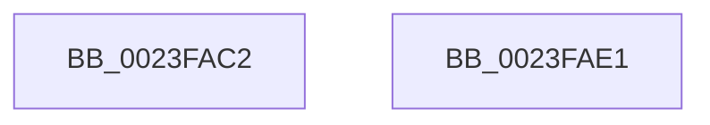

# sub_0023FAC2

- RVA: `0x0023FAC2`–`0x0023FAF1` (길이 `47` bytes)
- VA: `0x000000014023FAC2`
- 실행 섹션: `.text`
- PDB 이름 있음: `아니요`; PDB Function 태그: `아니요`
- unwind 정보 RVA: `0x00061658`
- 디코드: `16`개 명령, `47/47` bytes 표시
- 미해석 바이트: `0` (있으면 어셈블리에 `.byte`로 보존)

> 이 문서는 커널 이미지의 기계어와 PDB 기호를 분석해 생성했습니다. 4번과 5번은 함수 원형과 자료형을 바이너리 사용 방식에서 추정한 C 해석이며 원본 소스 복구 결과는 아닙니다.

## 1. Dependencies

- 직접 호출 지점: **2**; 고유 호출 대상: **2**
- 직접 호출자로 확인된 함수: **0**
- RIP 상대 이미지 참조: **0**

### Outgoing calls
- `0x0023FACC` → [_security_check_cookie](../6A/_security_check_cookie_function_006AC640.md) (function, `0x006AC640`)
- `0x0023FAE7` → [ExFreePoolWithTag](../../poolcode/B8/ExFreePoolWithTag_function_00B82870.md) (function, `0x00B82870`)

### Direct callers
- 이 함수 시작 RVA로 연결되는 직접 call은 확인되지 않았습니다. 간접 호출은 완전히 역산할 수 없습니다.

### Static image references
- 디코드된 RIP-relative 메모리 참조가 없습니다.

## 2. Other-region calls and transfers

- 다른 실행 섹션으로 향하는 call: **1**
  - `0x0023FAE7` → [ExFreePoolWithTag](../../poolcode/B8/ExFreePoolWithTag_function_00B82870.md) (`.text` → `POOLCODE`)
- call이 아닌 외부 분기/꼬리 이동: **1**
  - `0x0023FAEC` → [sub_0023F9D7](Unknown_function_0023F9D7.md) (`tail-transfer`)

## 3. Assembly (complete function range)

```asm
0023FAC2  48 8B 8D 00 10 00 00            mov rcx, qword ptr [rbp + 0x1000]
0023FAC9  48 33 CC                        xor rcx, rsp
0023FACC  E8 6F CB 46 00                  call 0x1406ac640
0023FAD1  48 81 C4 28 11 00 00            add rsp, 0x1128
0023FAD8  41 5D                           pop r13
0023FADA  41 5C                           pop r12
0023FADC  5F                              pop rdi
0023FADD  5E                              pop rsi
0023FADE  5B                              pop rbx
0023FADF  5D                              pop rbp
0023FAE0  C3                              ret
0023FAE1  CC                              int3
0023FAE2  33 D2                           xor edx, edx
0023FAE4  49 8B CC                        mov rcx, r12
0023FAE7  E8 84 2D 94 00                  call 0x140b82870
0023FAEC  E9 E6 FE FF FF                  jmp 0x14023f9d7
```

## 4. C-style interpretation (structured pseudocode)

```c
__int64 __fastcall sub_0023FAC2(__int64 a1, int a2)
{
    __int64 result;
    __int64 v_rsp;

    a1 = (*(unsigned __int64 *)(v_rbp + 4096)) ^ (v_rsp);
    result = _security_check_cookie(a1, a2, a3, a4);
    v_rsp = (v_rsp) + (0x1128ULL);
    return result;
}
```

## 5. (Beta) C Style

```c
int64_t sub_0023FAC2(int64_t Arg1, int32_t Arg2)
{
    int64_t result;
    int64_t local_rsp;

    Arg1 = (*(uint64_t *)(local_rbp + 0x1000)) ^ (local_rsp);
    result = _security_check_cookie(Arg1, Arg2, a3, a4);
    local_rsp = (local_rsp) + (0x1128ULL);
    return result;
}
```

## 6. Execution-region graph

[열기: 2D/3D 그래프와 함수 탐색 컨트롤 패널](../../../control-panel.html?section=text&rva=0x0023FAC2&view=graph)

- 2D 그래프는 위에서 아래로 흐르고, 3D 그래프는 빈 공간을 드래그해 회전합니다. Shift+드래그는 이동, 휠은 확대·축소, 함수 노드 선택은 대상 보고서 이동입니다.

### Static fallback


