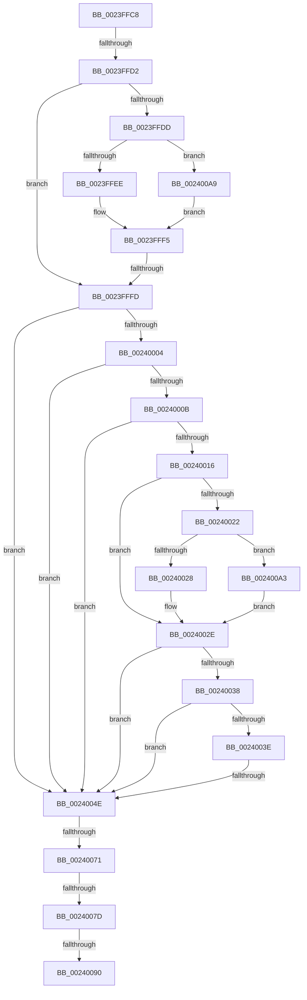

# sub_0023FFC8

- RVA: `0x0023FFC8`–`0x002400B5` (길이 `237` bytes)
- VA: `0x000000014023FFC8`
- 실행 섹션: `.text`
- PDB 이름 있음: `아니요`; PDB Function 태그: `아니요`
- unwind 정보 RVA: `0x000616BC`
- 디코드: `60`개 명령, `237/237` bytes 표시
- 미해석 바이트: `0` (있으면 어셈블리에 `.byte`로 보존)

> 이 문서는 커널 이미지의 기계어와 PDB 기호를 분석해 생성했습니다. 4번과 5번은 함수 원형과 자료형을 바이너리 사용 방식에서 추정한 C 해석이며 원본 소스 복구 결과는 아닙니다.

## 1. Dependencies

- 직접 호출 지점: **2**; 고유 호출 대상: **2**
- 직접 호출자로 확인된 함수: **0**
- RIP 상대 이미지 참조: **2**

### Outgoing calls
- `0x00240041` → [MI_READ_PTE_LOCK_FREE](../28/MI_READ_PTE_LOCK_FREE_function_002828A0.md) (function, `0x002828A0`)
- `0x00240099` → [MiReservePageFileSpace](../38/MiReservePageFileSpace_function_00383ED8.md) (function, `0x00383ED8`)

### Direct callers
- 이 함수 시작 RVA로 연결되는 직접 call은 확인되지 않았습니다. 간접 호출은 완전히 역산할 수 없습니다.

### Static image references
- `0x0023FFEE` → RVA `0x00E38858` (`.data`; read)
- `0x00240016` → RVA `0x00E2DC80` (`.data`; read)

## 2. Other-region calls and transfers

- 다른 실행 섹션으로 향하는 call: **0**
- call이 아닌 외부 분기/꼬리 이동: **7**
  - `0x0023FFD0` → [sub_0023FF9D + 0x13](Unknown_function_0023FF9D.md) (`tail-transfer`)
  - `0x0023FFFB` → [sub_0023FF9D + 0x13](Unknown_function_0023FF9D.md) (`tail-transfer`)
  - `0x00240048` → [sub_0023FF9D + 0x13](Unknown_function_0023FF9D.md) (`tail-transfer`)
  - `0x0024006B` → [sub_0023FF9D + 0x13](Unknown_function_0023FF9D.md) (`tail-transfer`)
  - `0x00240077` → [sub_0023FF9D + 0x13](Unknown_function_0023FF9D.md) (`tail-transfer`)
  - `0x0024008A` → [sub_0023FF9D + 0x13](Unknown_function_0023FF9D.md) (`tail-transfer`)
  - `0x0024009E` → [sub_0023FF9D + 0x13](Unknown_function_0023FF9D.md) (`tail-transfer`)

## 3. Assembly (complete function range)

```asm
0023FFC8  41 0F B6 C1                     movzx eax, r9b
0023FFCC  D0 E8                           shr al, 1
0023FFCE  A8 01                           test al, 1
0023FFD0  75 DE                           jne 0x14023ffb0
0023FFD2  41 8B 80 B8 00 00 00            mov eax, dword ptr [r8 + 0xb8]
0023FFD9  A8 0F                           test al, 0xf
0023FFDB  75 20                           jne 0x14023fffd
0023FFDD  41 8B 80 B8 00 00 00            mov eax, dword ptr [r8 + 0xb8]
0023FFE4  24 0F                           and al, 0xf
0023FFE6  3C 01                           cmp al, 1
0023FFE8  0F 85 BB 00 00 00               jne 0x1402400a9
0023FFEE  48 8D 05 63 88 BF 00            lea rax, [rip + 0xbf8863]
0023FFF5  48 8B 00                        mov rax, qword ptr [rax]
0023FFF8  48 85 C0                        test rax, rax
0023FFFB  75 B3                           jne 0x14023ffb0
0023FFFD  49 0F BA E1 0A                  bt r9, 0xa
00240002  72 4A                           jb 0x14024004e
00240004  49 0F BA E1 0B                  bt r9, 0xb
00240009  72 43                           jb 0x14024004e
0024000B  41 0F B6 C1                     movzx eax, r9b
0024000F  C0 E8 02                        shr al, 2
00240012  A8 01                           test al, 1
00240014  75 38                           jne 0x14024004e
00240016  48 8B 05 63 DC BE 00            mov rax, qword ptr [rip + 0xbedc63]
0024001D  48 85 C0                        test rax, rax
00240020  74 0C                           je 0x14024002e
00240022  41 F6 C1 10                     test r9b, 0x10
00240026  75 7B                           jne 0x1402400a3
00240028  48 F7 D0                        not rax
0024002B  4C 23 C8                        and r9, rax
0024002E  49 C1 E9 20                     shr r9, 0x20
00240032  49 83 F9 01                     cmp r9, 1
00240036  75 16                           jne 0x14024004e
00240038  F6 41 22 10                     test byte ptr [rcx + 0x22], 0x10
0024003C  75 10                           jne 0x14024004e
0024003E  48 8B CE                        mov rcx, rsi
00240041  E8 5A 28 04 00                  call 0x1402828a0
00240046  A8 42                           test al, 0x42
00240048  0F 84 62 FF FF FF               je 0x14023ffb0
0024004E  48 BA 00 00 00 00 80 F6 FF FF   movabs rdx, 0xfffff68000000000
00240058  48 8B C2                        mov rax, rdx
0024005B  48 B9 78 FF FF FF 3F 00 00 00   movabs rcx, 0x3fffffff78
00240065  48 03 C1                        add rax, rcx
00240068  48 3B F0                        cmp rsi, rax
0024006B  0F 87 3F FF FF FF               ja 0x14023ffb0
00240071  48 8B C2                        mov rax, rdx
00240074  48 3B F0                        cmp rsi, rax
00240077  0F 82 33 FF FF FF               jb 0x14023ffb0
0024007D  48 B8 FF FF FF FF FF F6 FF FF   movabs rax, 0xfffff6ffffffffff
00240087  48 3B F0                        cmp rsi, rax
0024008A  0F 87 20 FF FF FF               ja 0x14023ffb0
00240090  4C 8B C3                        mov r8, rbx
00240093  48 8B D6                        mov rdx, rsi
00240096  48 8B CF                        mov rcx, rdi
00240099  E8 3A 3E 14 00                  call 0x140383ed8
0024009E  E9 0D FF FF FF                  jmp 0x14023ffb0
002400A3  49 83 E1 EF                     and r9, 0xffffffffffffffef
002400A7  EB 85                           jmp 0x14024002e
002400A9  49 8D 80 D8 00 00 00            lea rax, [r8 + 0xd8]
002400B0  E9 40 FF FF FF                  jmp 0x14023fff5
```

## 4. C-style interpretation (structured pseudocode)

```c
__int64 __fastcall sub_0023FFC8(__int64 a1, __int64 a2, __int64 a3, __int64 a4)
{
    __int64 result;

    result = (unsigned __int8)(((unsigned __int8)(a4)) >> (1));
    if ((((unsigned __int8)((unsigned int)(*(unsigned int *)(a3 + 184)))) & (15)) != 0) goto loc_0023FFFD;
    result = (unsigned __int8)(((unsigned int)(*(unsigned int *)(a3 + 184))) & (15));
    if (((unsigned __int8)(result)) != 1) goto loc_002400A9;
loc_0023FFF5:
loc_0023FFFD:
    if (condition_is_below) goto loc_0024004E;
    if (condition_is_below) goto loc_0024004E;
    result = (unsigned __int8)(((unsigned __int8)(a4)) >> (2));
    if ((((unsigned __int8)(result)) & (1)) != 0) goto loc_0024004E;
    if (*(unsigned __int64 *)(v_rip + 12508259) == 0) goto loc_0024002E;
    if ((((unsigned __int8)(a4)) & (16)) != 0) goto loc_002400A3;
    result = ~(*(unsigned __int64 *)(v_rip + 12508259));
    a4 = (a4) & (result);
loc_0024002E:
    a4 = (a4) >> (32);
    if (a4 != 1) goto loc_0024004E;
    if (((*(unsigned __int8 *)(a1 + 34)) & (16)) != 0) goto loc_0024004E;
    result = MI_READ_PTE_LOCK_FREE(v_rsi, a2, a3, a4);
loc_0024004E:
    result = (a2) + (v_rsi);
    result = MiReservePageFileSpace(v_rdi, v_rsi, v_rbx, a4);
loc_002400A3:
    a4 = (a4) & (-17);
    goto loc_0024002E;
loc_002400A9:
    goto loc_0023FFF5;
}
```

## 5. (Beta) C Style

```c
int64_t sub_0023FFC8(void *Arg1, int64_t Arg2, void *Arg3, int64_t Arg4)
{
    uint8_t *arg1 = (uint8_t *)Arg1;
    uint8_t *arg3 = (uint8_t *)Arg3;

    int64_t result;

    result = (uint8_t)(((uint8_t)(Arg4)) >> (1));
    if ((((uint8_t)((uint32_t)(*(uint32_t *)(arg3 + 0xB8)))) & (15)) != 0) goto loc_0023FFFD;
    result = (uint8_t)(((uint32_t)(*(uint32_t *)(arg3 + 0xB8))) & (15));
    if (((uint8_t)(result)) != 1) goto loc_002400A9;
loc_0023FFF5:
loc_0023FFFD:
    if (condition_is_below) goto loc_0024004E;
    if (condition_is_below) goto loc_0024004E;
    result = (uint8_t)(((uint8_t)(Arg4)) >> (2));
    if ((((uint8_t)(result)) & (1)) != 0) goto loc_0024004E;
    if (*(uint64_t *)(v_rip + 0xBEDC63) == 0) goto loc_0024002E;
    if ((((uint8_t)(Arg4)) & (16)) != 0) goto loc_002400A3;
    result = ~(*(uint64_t *)(v_rip + 0xBEDC63));
    Arg4 = (Arg4) & (result);
loc_0024002E:
    Arg4 = (Arg4) >> (32);
    if (Arg4 != 1) goto loc_0024004E;
    if (((*(uint8_t *)(arg1 + 0x22)) & (16)) != 0) goto loc_0024004E;
    result = MI_READ_PTE_LOCK_FREE(local_rsi, Arg2, Arg3, Arg4);
loc_0024004E:
    result = (Arg2) + (local_rsi);
    result = MiReservePageFileSpace(local_rdi, local_rsi, local_rbx, Arg4);
loc_002400A3:
    Arg4 = (Arg4) & (-17);
    goto loc_0024002E;
loc_002400A9:
    goto loc_0023FFF5;
}
```

### 관측된 메모리 오프셋

구조체 형식이 확인되지 않은 접근은 인자 기준의 오프셋으로만 기록했습니다.

| 기준 인자 | 오프셋 표현 | 폭 (bit) | 접근 |
|---|---:|---:|---|
| `Arg1` | `+ 0x22` | `8` | `R` |
| `Arg3` | `+ 0xB8` | `32` | `R` |
| `Arg3` | `+ 0xD8` | `64` | `R` |

## 6. Execution-region graph

[열기: 2D/3D 그래프와 함수 탐색 컨트롤 패널](../../../control-panel.html?section=text&rva=0x0023FFC8&view=graph)

- 2D 그래프는 위에서 아래로 흐르고, 3D 그래프는 빈 공간을 드래그해 회전합니다. Shift+드래그는 이동, 휠은 확대·축소, 함수 노드 선택은 대상 보고서 이동입니다.

### Static fallback


