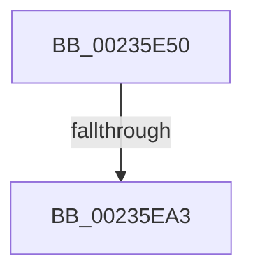

# VslpEnterIumSecureMode

- RVA: `0x00235E50`–`0x00235EB4` (길이 `100` bytes)
- VA: `0x0000000140235E50`
- 실행 섹션: `.text`
- PDB 이름 있음: `예`; PDB Function 태그: `예`
- unwind 정보 RVA: `0x000607BC`
- 디코드: `26`개 명령, `100/100` bytes 표시
- 미해석 바이트: `0` (있으면 어셈블리에 `.byte`로 보존)

> 이 문서는 커널 이미지의 기계어와 PDB 기호를 분석해 생성했습니다. 4번과 5번은 함수 원형과 자료형을 바이너리 사용 방식에서 추정한 C 해석이며 원본 소스 복구 결과는 아닙니다.

## 1. Dependencies

- 직접 호출 지점: **0**; 고유 호출 대상: **0**
- 직접 호출자로 확인된 함수: **163**
- RIP 상대 이미지 참조: **2**

### Outgoing calls
- 직접 디코드된 call 명령이 없습니다.

### Direct callers
- [sub_00235A0C](Unknown_function_00235A0C.md) at `0x00235AE7`
- [VslValidateSecureImagePages](../29/VslValidateSecureImagePages_function_0029DFA0.md) at `0x0029E0A9`
- [VslSetPlaceholderPages](../2A/VslSetPlaceholderPages_function_002A10C0.md) at `0x002A1128`
- [VslSlowFlushSecureRangeList](../31/VslSlowFlushSecureRangeList_function_00314D44.md) at `0x00314DC5`
- [VslKernelShadowStackAssist](../3D/VslKernelShadowStackAssist_function_003D5BA0.md) at `0x003D5C1D`
- [VslRemoveProtectedPage](../40/VslRemoveProtectedPage_function_004079D0.md) at `0x00407A27`
- [VslMakeProtectedPageExecutable](../40/VslMakeProtectedPageExecutable_function_00407A50.md) at `0x00407AB4`
- [VslSetPrivilegedPte](../40/VslSetPrivilegedPte_function_00407D0C.md) at `0x00407D6C`
- [VslQueryPrivilegedAccessedState](../42/VslQueryPrivilegedAccessedState_function_004292CC.md) at `0x00429374`
- [VslAccessPciDevice](../43/VslAccessPciDevice_function_004393E0.md) at `0x00439495`
- [VslFastFlushSecureRangeList](../46/VslFastFlushSecureRangeList_function_00462168.md) at `0x0046223B`
- [VslApplySecureImageFixups](../48/VslApplySecureImageFixups_function_00489500.md) at `0x0048955A`
- [VslpSecureKernelPeriodicTick](../48/VslpSecureKernelPeriodicTick_function_0048E2D0.md) at `0x0048E308`
- [VslCopyProtectedPage](../49/VslCopyProtectedPage_function_0049781C.md) at `0x0049789A`
- [VslIumEfiRuntimeService](../49/VslIumEfiRuntimeService_function_0049C0C0.md) at `0x0049C166`
- [VslFinalizeSecureImageHash](../4A/VslFinalizeSecureImageHash_function_004AA400.md) at `0x004AA4C4`
- [VslCreateSecureImageSection](../4B/VslCreateSecureImageSection_function_004B69D0.md) at `0x004B6A7E`
- [VslRelocateImage](../4B/VslRelocateImage_function_004BA470.md) at `0x004BA4BE`
- [VslFillSecureAllocation](../4B/VslFillSecureAllocation_function_004BA4F0.md) at `0x004BA5C4`
- [VslCloseSecureHandle](../4B/VslCloseSecureHandle_function_004BBF40.md) at `0x004BBF82`
- [VslQueryVirtualMemory](../4B/VslQueryVirtualMemory_function_004BBFD8.md) at `0x004BC02E`
- [VslFlushSecureAddressSpace](../4B/VslFlushSecureAddressSpace_function_004BC6FC.md) at `0x004BC758`
- [VslFreeSecureImageIat](../4B/VslFreeSecureImageIat_function_004BCD74.md) at `0x004BCDB6`
- [VslCreateSecureAllocation](../4B/VslCreateSecureAllocation_function_004BD7D0.md) at `0x004BD819`
- [VslIsTrustletRunning](../4B/VslIsTrustletRunning_function_004BDC88.md) at `0x004BDCD1`
- [VslTransferSecureImageVersionResource](../4C/VslTransferSecureImageVersionResource_function_004C3960.md) at `0x004C3A20`
- [VslMapKernelScpPages](../4C/VslMapKernelScpPages_function_004C8054.md) at `0x004C8096`
- [VslExecuteWorkItems](../4C/VslExecuteWorkItems_function_004C98D8.md) at `0x004C9910`
- [VslPrepareSecureImageRelocations](../4D/VslPrepareSecureImageRelocations_function_004D0510.md) at `0x004D06D4`
- [VslRegisterLogPages](../4D/VslRegisterLogPages_function_004D32F0.md) at `0x004D33B9`
- [VslExemptSecurePteRange](../4F/VslExemptSecurePteRange_function_004F8AFC.md) at `0x004F8B58`
- [VslRegisterProtectedPage](../4F/VslRegisterProtectedPage_function_004F99F4.md) at `0x004F9A42`
- [HvlNotifyDebugDeviceAvailable](../58/HvlNotifyDebugDeviceAvailable_function_00588D80.md) at `0x00588E2A`
- [HvlPrepareForRootCrashdump](../58/HvlPrepareForRootCrashdump_function_00588F84.md) at `0x00588FEF`
- [HvlResumeFromRootCrashdump](../58/HvlResumeFromRootCrashdump_function_005893E0.md) at `0x0058945D`
- [HvlPrepareForSecureHibernate](../58/HvlPrepareForSecureHibernate_function_0058A7EC.md) at `0x0058A884`
- [HvlCollectLivedump](../58/HvlCollectLivedump_function_0058B460.md) at `0x0058B4FE`
- [HvlpEndSecurePageListIteration](../58/HvlpEndSecurePageListIteration_function_0058D610.md) at `0x0058D674`
- [VslAbortLiveDump](../58/VslAbortLiveDump_function_0058DE64.md) at `0x0058DE9C`
- [VslApplyHotPatch](../58/VslApplyHotPatch_function_0058DEC0.md) at `0x0058DF46`
- [VslConfigureDynamicMemory](../58/VslConfigureDynamicMemory_function_0058DFA8.md) at `0x0058E012`
- [VslConfigureSecureAtsDevice](../58/VslConfigureSecureAtsDevice_function_0058E044.md) at `0x0058E0A1`
- [VslExchangeEntropy](../58/VslExchangeEntropy_function_0058E0D0.md) at `0x0058E124`
- [VslFinalizeLiveDumpInSk](../58/VslFinalizeLiveDumpInSk_function_0058E16C.md) at `0x0058E206`
- [VslFinishStartSecureProcessor](../58/VslFinishStartSecureProcessor_function_0058E25C.md) at `0x0058E31B`
- [VslFlushEntireTb](../58/VslFlushEntireTb_function_0058E358.md) at `0x0058E38D`
- [VslGetEtwDebugId](../58/VslGetEtwDebugId_function_0058E3B4.md) at `0x0058E461`
- [VslGetSecurePageList](../58/VslGetSecurePageList_function_0058E504.md) at `0x0058E55B`
- [VslGetSecurePciDeviceAlternateFunctionNumberForVtl0Dma](../58/VslGetSecurePciDeviceAlternateFunctionNumberForVtl0Dma_function_0058E5B0.md) at `0x0058E61E`
- [VslGetSecurePciDeviceBootConfiguration](../58/VslGetSecurePciDeviceBootConfiguration_function_0058E650.md) at `0x0058E6FE`
- [VslGetSecurePciEnabled](../58/VslGetSecurePciEnabled_function_0058E770.md) at `0x0058E7BB`
- [VslInitializeSecureKernelCfg](../58/VslInitializeSecureKernelCfg_function_0058E8A8.md) at `0x0058E940`
- [VslInitializeSecurePool](../58/VslInitializeSecurePool_function_0058E970.md) at `0x0058E9D0`
- [VslInitializeSecureProcess](../58/VslInitializeSecureProcess_function_0058EA00.md) at `0x0058EACE`
- [VslLiveDumpQuerySecondaryDataSize](../58/VslLiveDumpQuerySecondaryDataSize_function_0058EB20.md) at `0x0058EB80`
- [VslNotifyShutdown](../58/VslNotifyShutdown_function_0058EBC8.md) at `0x0058EC0A`
- [VslPrepareDriverForPatch](../58/VslPrepareDriverForPatch_function_0058EC30.md) at `0x0058EC79`
- [VslProvisionDumpEncryption](../58/VslProvisionDumpEncryption_function_0058ECB8.md) at `0x0058ECF0`
- [VslQueryActiveSecurePatches](../58/VslQueryActiveSecurePatches_function_0058ED14.md) at `0x0058ED8C`
- [VslQueryActiveSecurePatches](../58/VslQueryActiveSecurePatches_function_0058ED14.md) at `0x0058EE3C`
- [VslQuerySecureKernelProfileInformation](../58/VslQuerySecureKernelProfileInformation_function_0058EED8.md) at `0x0058EF9F`
- [VslQueryTscAdjustment](../58/VslQueryTscAdjustment_function_0058EFE8.md) at `0x0058F01F`
- [VslReclaimPartitionPages](../58/VslReclaimPartitionPages_function_0058F054.md) at `0x0058F096`
- [VslRegisterSecurePatch](../58/VslRegisterSecurePatch_function_0058F0BC.md) at `0x0058F154`
- [VslRegisterSecureSystemProcess](../58/VslRegisterSecureSystemProcess_function_0058F190.md) at `0x0058F1E2`
- [VslReportBugCheckProgress](../58/VslReportBugCheckProgress_function_0058F230.md) at `0x0058F300`
- [VslReportBugCheckProgress](../58/VslReportBugCheckProgress_function_0058F230.md) at `0x0058F342`
- [VslRequestSecureKernelDebuggerBreakIn](../58/VslRequestSecureKernelDebuggerBreakIn_function_0058F380.md) at `0x0058F3E8`
- [VslRequestSecureThreadExit](../58/VslRequestSecureThreadExit_function_0058F438.md) at `0x0058F485`
- [VslRetrieveMailbox](../58/VslRetrieveMailbox_function_0058F4B0.md) at `0x0058F57D`
- [VslStartSecurePageIteration](../58/VslStartSecurePageIteration_function_0058F5DC.md) at `0x0058F650`
- [VslSvcEnterIumSecureMode](../58/VslSvcEnterIumSecureMode_function_0058F688.md) at `0x0058F6F7`
- [VslSwapHiberShadowStacks](../58/VslSwapHiberShadowStacks_function_0058F750.md) at `0x0058F79B`
- [VslSynchronizeXSave](../58/VslSynchronizeXSave_function_0058F7C0.md) at `0x0058F80D`
- [VslTerminateSecureServices](../58/VslTerminateSecureServices_function_0058F83C.md) at `0x0058F874`
- [VslTestRoutine](../58/VslTestRoutine_function_0058F8A0.md) at `0x0058F8D8`
- [VslVerifyPage](../58/VslVerifyPage_function_0058F900.md) at `0x0058F96D`
- [VslWriteProtectedPage](../58/VslWriteProtectedPage_function_0058F99C.md) at `0x0058FA07`
- [VslpAddLiveDumpBufferChunk](../58/VslpAddLiveDumpBufferChunk_function_0058FA30.md) at `0x0058FAA9`
- [VslpIumPhase4Initialize](../58/VslpIumPhase4Initialize_function_0058FAE0.md) at `0x0058FB26`
- [VslpKsrEnterIumSecureMode](../58/VslpKsrEnterIumSecureMode_function_0058FB90.md) at `0x0058FBFF`
- [VslpLiveDumpStart](../58/VslpLiveDumpStart_function_0058FC58.md) at `0x0058FCB1`
- [VslpSetupLiveDumpBuffer](../58/VslpSetupLiveDumpBuffer_function_0058FCE4.md) at `0x0058FD38`
- [VslCaptureImageHotPatchMetadata](../58/VslCaptureImageHotPatchMetadata_function_0058FD90.md) at `0x0058FE67`
- [VslFinishSecureImageValidation](../58/VslFinishSecureImageValidation_function_0058FEB0.md) at `0x0058FF3A`
- [VslInitFunctionOverrideCapabilities](../58/VslInitFunctionOverrideCapabilities_function_0058FFA8.md) at `0x00590038`
- [VslMakeCodeCatalog](../59/VslMakeCodeCatalog_function_00590070.md) at `0x005900C1`
- [KeQuerySecureSpeculationInformation](../5B/KeQuerySecureSpeculationInformation_function_005BEA14.md) at `0x005BEA63`
- [MiProtectDriverSectionPte](../67/MiProtectDriverSectionPte_function_006706C0.md) at `0x00670A13`
- [MmProtectDriverSection](../67/MmProtectDriverSection_function_00670A80.md) at `0x00670D25`
- [MmWriteSystemImageTracepoint](../68/MmWriteSystemImageTracepoint_function_00684150.md) at `0x00684313`
- [sub_006DEF8A](../6D/Unknown_function_006DEF8A.md) at `0x006DEF99`
- [VslAllocateSecureHibernateResources](../../page/71/VslAllocateSecureHibernateResources_function_00718788.md) at `0x007187EF`
- [VslCapturePgoData](../../page/71/VslCapturePgoData_function_00718860.md) at `0x0071893A`
- [VslDetermineHotPatchType](../../page/71/VslDetermineHotPatchType_function_0071899C.md) at `0x007189F0`
- [VslEnableOnDemandDebugWithResponse](../../page/71/VslEnableOnDemandDebugWithResponse_function_00718A48.md) at `0x00718AC0`
- [VslFreeSecureHibernateResources](../../page/71/VslFreeSecureHibernateResources_function_00718AF4.md) at `0x00718B2C`
- [VslGetOnDemandDebugChallenge](../../page/71/VslGetOnDemandDebugChallenge_function_00718B58.md) at `0x00718C0F`
- [VslGetSetSecureContext](../../page/71/VslGetSetSecureContext_function_00718C8C.md) at `0x00718D2A`
- [VslInitializeEnclave](../../page/71/VslInitializeEnclave_function_00718D64.md) at `0x00718E0C`
- [VslLoadEnclaveData](../../page/71/VslLoadEnclaveData_function_00718E54.md) at `0x00718EFB`
- [VslObtainHotPatchUndoTable](../../page/71/VslObtainHotPatchUndoTable_function_00718F50.md) at `0x00719092`
- [VslQueryRuntimeAttestationReport](../../page/71/VslQueryRuntimeAttestationReport_function_00719100.md) at `0x00719279`
- [VslQuerySecureDevice](../../page/71/VslQuerySecureDevice_function_00719320.md) at `0x0071937B`
- [VslQueryTrustedAppRuntimeInformation](../../page/71/VslQueryTrustedAppRuntimeInformation_function_007193C4.md) at `0x00719407`
- [VslRegisterSyscallProviderServiceTableMetadata](../../page/71/VslRegisterSyscallProviderServiceTableMetadata_function_00719450.md) at `0x007194EE`
- [VslRelaxQuotas](../../page/71/VslRelaxQuotas_function_00719530.md) at `0x00719589`
- [VslRevokeSyscallProviderServiceTables](../../page/71/VslRevokeSyscallProviderServiceTables_function_007195B0.md) at `0x007195F2`
- [VslRundownSecureProcess](../../page/71/VslRundownSecureProcess_function_00719618.md) at `0x0071965A`
- [VslSendDebugAttachNotifications](../../page/71/VslSendDebugAttachNotifications_function_00719680.md) at `0x007196E2`
- [VslStartSecureProcessor](../../page/71/VslStartSecureProcessor_function_00719714.md) at `0x00719920`
- [VslTerminateSecureThread](../../page/71/VslTerminateSecureThread_function_00719974.md) at `0x007199C8`
- [VslTransformDumpKey](../../page/71/VslTransformDumpKey_function_00719A08.md) at `0x00719B53`
- [VslReapplyImportOptimizationForDriverVerifier](../../page/71/VslReapplyImportOptimizationForDriverVerifier_function_00719BD4.md) at `0x00719CAA`
- [VslSetCodeIntegrityPolicy](../../page/71/VslSetCodeIntegrityPolicy_function_00719CF0.md) at `0x00719D3C`
- [PipUnprotectDevice](../../page/74/PipUnprotectDevice_function_007409BC.md) at `0x00740A5C`
- [PsRegisterSyscallProvider](../../page/77/PsRegisterSyscallProvider_function_0077E140.md) at `0x0077E23E`
- [PsRundownVsmEnclave](../../page/78/PsRundownVsmEnclave_function_007889F8.md) at `0x00788A3E`
- [PsTerminateVsmEnclave](../../page/78/PsTerminateVsmEnclave_function_00788A64.md) at `0x00788BFA`
- [MiApplyDriverHotPatch](../../page/80/MiApplyDriverHotPatch_function_008018EC.md) at `0x00801A5A`
- [NtProtectVirtualMemory](../../page/88/NtProtectVirtualMemory_function_00880CA0.md) at `0x00881005`
- [VslDebugReadWriteSecureProcess](../../page/9B/VslDebugReadWriteSecureProcess_function_009BC670.md) at `0x009BC75D`
- [VslCallEnclave](../../page/A0/VslCallEnclave_function_00A0D838.md) at `0x00A0D9A1`
- [NtRemoveProcessDebug](../../page/A0/NtRemoveProcessDebug_function_00A0FAF0.md) at `0x00A0FBC8`
- [NtDebugActiveProcess](../../page/A0/NtDebugActiveProcess_function_00A0FC60.md) at `0x00A0FE6F`
- [VslEnableKernelCfgTarget](../../page/A4/VslEnableKernelCfgTarget_function_00A4585C.md) at `0x00A4589E`
- [VslpConnectedStandbyWnfCallback](../../page/A4/VslpConnectedStandbyWnfCallback_function_00A49D90.md) at `0x00A49E83`
- [VslUnloadSecureDriver](../../page/A4/VslUnloadSecureDriver_function_00A4BA04.md) at `0x00A4BA46`
- [VslCompleteSecureDriverLoad](../../page/A4/VslCompleteSecureDriverLoad_function_00A4BB18.md) at `0x00A4BB79`
- [VslAllocateKernelShadowStack](../../page/A5/VslAllocateKernelShadowStack_function_00A54174.md) at `0x00A541F7`
- [VslValidateDynamicCodePages](../../page/A5/VslValidateDynamicCodePages_function_00A5687C.md) at `0x00A569DE`
- [VslFreeKernelShadowStack](../../page/A6/VslFreeKernelShadowStack_function_00A6373C.md) at `0x00A6377E`
- [VslResetKernelShadowStack](../../page/A6/VslResetKernelShadowStack_function_00A6577C.md) at `0x00A657CB`
- [VslGetSecurePebAddress](../../page/A7/VslGetSecurePebAddress_function_00A71B64.md) at `0x00A71BB4`
- [VslCreateSecureSection](../../page/A7/VslCreateSecureSection_function_00A722A0.md) at `0x00A7236A`
- [VslDeleteSecureSection](../../page/A8/VslDeleteSecureSection_function_00A8AA20.md) at `0x00A8AA62`
- [VslReserveProtectedPages](../../page/A9/VslReserveProtectedPages_function_00A90ACC.md) at `0x00A90B34`
- [VslCreateEnclave](../../page/A9/VslCreateEnclave_function_00A9C18C.md) at `0x00A9C252`
- [VslCreateSecureProcess](../../page/A9/VslCreateSecureProcess_function_00A9C308.md) at `0x00A9C35E`
- [VslCreateSecureThread](../../page/A9/VslCreateSecureThread_function_00A9CB70.md) at `0x00A9CC01`
- [VslpConnectedStandbyPoCallback](../../page/A9/VslpConnectedStandbyPoCallback_function_00A9DC70.md) at `0x00A9DCE3`
- [VslIsEncryptionKeyAvailable](../../page/AA/VslIsEncryptionKeyAvailable_function_00AA1924.md) at `0x00AA195C`
- [VslLiveDumpCaptureProcess](../../page/AA/VslLiveDumpCaptureProcess_function_00AA4C48.md) at `0x00AA4C91`
- [VslUpdateFreezeTimeBias](../../page/AA/VslUpdateFreezeTimeBias_function_00AA7CF0.md) at `0x00AA7D45`
- [VslStartSecureThread](../../page/AA/VslStartSecureThread_function_00AABE64.md) at `0x00AABEA6`
- [VslLoadEnclaveModule](../../page/AB/VslLoadEnclaveModule_function_00AB200C.md) at `0x00AB20CF`
- [VslCaptureSecureImageIat](../../page/AB/VslCaptureSecureImageIat_function_00AB79F4.md) at `0x00AB7ABD`
- [VslIumEtwEnableCallback](../../page/AB/VslIumEtwEnableCallback_function_00AB8E20.md) at `0x00AB8EA6`
- [VslDebugProtectSecureProcessMemory](../../page/AD/VslDebugProtectSecureProcessMemory_function_00AD9580.md) at `0x00AD9608`
- [NtQueryInformationThread](../../page/AE/NtQueryInformationThread_function_00AE3760.md) at `0x00AE3A18`
- [sub_00B256F6](../../page/B2/Unknown_function_00B256F6.md) at `0x00B2576A`
- [VslApplyDynamicRelocations](../../init/C2/VslApplyDynamicRelocations_function_00C29AE8.md) at `0x00C29B43`
- [VslBindNtIum](../../init/C2/VslBindNtIum_function_00C29B74.md) at `0x00C29CB1`
- [VslInitializeSyscallProviders](../../init/C2/VslInitializeSyscallProviders_function_00C29CF4.md) at `0x00C29D41`
- [VslReapplyBootIndirectPatches](../../init/C2/VslReapplyBootIndirectPatches_function_00C29D68.md) at `0x00C29DB1`
- [VslpIumPhase0Initialize](../../init/C2/VslpIumPhase0Initialize_function_00C2A0A4.md) at `0x00C2A2EA`
- [PspInitPhase3](../../init/C4/PspInitPhase3_function_00C455F8.md) at `0x00C456E2`
- [MiApplyDynamicFixupsToKernelAndHal](../../init/C6/MiApplyDynamicFixupsToKernelAndHal_function_00C65EBC.md) at `0x00C65F4B`
- [MiApplyImportOptimizationToBootDriver](../../init/C6/MiApplyImportOptimizationToBootDriver_function_00C66108.md) at `0x00C6621B`
- [MiApplyRetpolineToBootDriver](../../init/C6/MiApplyRetpolineToBootDriver_function_00C66264.md) at `0x00C6638B`
- [MiCreateSlabAllocationsFromLoaderBlock](../../init/C6/MiCreateSlabAllocationsFromLoaderBlock_function_00C69E3C.md) at `0x00C6A03C`
- [MiApplyFunctionOverrideToBootDriver](../../init/C6/MiApplyFunctionOverrideToBootDriver_function_00C6B19C.md) at `0x00C6B221`
- [MiInitializeLoadedModuleList](../../init/C6/MiInitializeLoadedModuleList_function_00C6BCDC.md) at `0x00C6BFBE`
- [VslRegisterBootDrivers](../../init/C7/VslRegisterBootDrivers_function_00C7453C.md) at `0x00C746BA`
- [VslConnectSwInterrupt](../../init/C7/VslConnectSwInterrupt_function_00C75C70.md) at `0x00C75F45`

### Static image references
- `0x00235E60` → RVA `0x00E0A740` (`.data`; read)
- `0x00235E7E` → RVA `0x01201860` (`CFGRO`; read)

## 2. Other-region calls and transfers

- 다른 실행 섹션으로 향하는 call: **0**
- call이 아닌 외부 분기/꼬리 이동: **1**
  - `0x00235E9D` → [sub_002361CA](Unknown_function_002361CA.md) (`tail-transfer`)

## 3. Assembly (complete function range)

```asm
00235E50  40 53                           push rbx
00235E52  56                              push rsi
00235E53  57                              push rdi
00235E54  41 54                           push r12
00235E56  41 55                           push r13
00235E58  41 56                           push r14
00235E5A  41 57                           push r15
00235E5C  48 83 EC 70                     sub rsp, 0x70
00235E60  48 8B 05 D9 48 BD 00            mov rax, qword ptr [rip + 0xbd48d9]
00235E67  48 33 C4                        xor rax, rsp
00235E6A  48 89 44 24 68                  mov qword ptr [rsp + 0x68], rax
00235E6F  40 32 F6                        xor sil, sil
00235E72  66 89 54 24 32                  mov word ptr [rsp + 0x32], dx
00235E77  40 32 FF                        xor dil, dil
00235E7A  44 0F B6 F1                     movzx r14d, cl
00235E7E  48 83 3D DA B9 FC 00 00         cmp qword ptr [rip + 0xfcb9da], 0
00235E86  41 B5 0F                        mov r13b, 0xf
00235E89  49 8B D9                        mov rbx, r9
00235E8C  40 88 74 24 30                  mov byte ptr [rsp + 0x30], sil
00235E91  45 8B E0                        mov r12d, r8d
00235E94  4C 89 6C 24 40                  mov qword ptr [rsp + 0x40], r13
00235E99  44 0F B7 FA                     movzx r15d, dx
00235E9D  0F 84 27 03 00 00               je 0x1402361ca
00235EA3  45 88 31                        mov byte ptr [r9], r14b
00235EA6  66 41 89 51 02                  mov word ptr [r9 + 2], dx
00235EAB  65 48 8B 04 25 88 01 00 00      mov rax, qword ptr gs:[0x188]
```

## 4. C-style interpretation (structured pseudocode)

```c
__int64 __fastcall VslpEnterIumSecureMode(unsigned __int8 a1, unsigned __int16 a2, int a3, __int64 a4)
{
    __int64 result;
    __int64 v_rdi;
    __int64 v_rsi;
    __int64 v_rsp;
    unsigned __int64 v_stack_m40;
    unsigned __int64 v_stack_m68;
    unsigned __int16 v_stack_m76;
    unsigned __int8 v_stack_m78;

    v_rsp = (v_rsp) - (112);
    result = (*(unsigned __int64 *)(v_rip + 12404953)) ^ (v_rsp);
    v_stack_m40 = result;
    v_rsi = 0;
    v_stack_m76 = a2;
    v_rdi = 0;
    v_stack_m78 = 0;
    v_stack_m68 = 15;
    *(unsigned __int8 *)(a4) = a1;
    *(unsigned __int16 *)(a4 + 2) = a2;
    return *(unsigned __int64 *)(gs_base + (0 + 392));
}
```

## 5. (Beta) C Style

```c
int64_t VslpEnterIumSecureMode(uint8_t Arg1, uint16_t Arg2, int32_t Arg3, void *Arg4)
{
    uint8_t *arg4 = (uint8_t *)Arg4;

    int64_t result;
    int64_t local_rdi;
    int64_t local_rsi;
    int64_t local_rsp;
    uint64_t v_stack_m40;
    uint64_t v_stack_m68;
    uint16_t v_stack_m76;
    uint8_t v_stack_m78;

    local_rsp = (local_rsp) - (112);
    result = (*(uint64_t *)(v_rip + 0xBD48D9)) ^ (local_rsp);
    v_stack_m40 = result;
    local_rsi = 0;
    v_stack_m76 = Arg2;
    local_rdi = 0;
    v_stack_m78 = 0;
    v_stack_m68 = 15;
    *(uint8_t *)(arg4) = Arg1;
    *(uint16_t *)(arg4 + 0x2) = Arg2;
    return *(uint64_t *)(gs_base + (0 + 0x188));
}
```

### 관측된 메모리 오프셋

구조체 형식이 확인되지 않은 접근은 인자 기준의 오프셋으로만 기록했습니다.

| 기준 인자 | 오프셋 표현 | 폭 (bit) | 접근 |
|---|---:|---:|---|
| `Arg4` | `+ 0x0` | `8` | `W` |
| `Arg4` | `+ 0x2` | `16` | `W` |

## 6. Execution-region graph

[열기: 2D/3D 그래프와 함수 탐색 컨트롤 패널](../../../control-panel.html?section=text&rva=0x00235E50&view=graph)

- 2D 그래프는 위에서 아래로 흐르고, 3D 그래프는 빈 공간을 드래그해 회전합니다. Shift+드래그는 이동, 휠은 확대·축소, 함수 노드 선택은 대상 보고서 이동입니다.

### Static fallback


