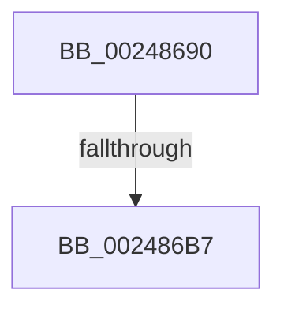

# ExAcquireSpinLockExclusive

- RVA: `0x00248690`–`0x002486C0` (길이 `48` bytes)
- VA: `0x0000000140248690`
- 실행 섹션: `.text`
- PDB 이름 있음: `예`; PDB Function 태그: `아니요`
- unwind 정보 RVA: `0x00062534`
- 디코드: `11`개 명령, `48/48` bytes 표시
- 미해석 바이트: `0` (있으면 어셈블리에 `.byte`로 보존)

> 이 문서는 커널 이미지의 기계어와 PDB 기호를 분석해 생성했습니다. 4번과 5번은 함수 원형과 자료형을 바이너리 사용 방식에서 추정한 C 해석이며 원본 소스 복구 결과는 아닙니다.

## 1. Dependencies

- 직접 호출 지점: **0**; 고유 호출 대상: **0**
- 직접 호출자로 확인된 함수: **382**
- RIP 상대 이미지 참조: **2**

### Outgoing calls
- 직접 디코드된 call 명령이 없습니다.

### Direct callers
- [sub_00238CD1](../23/Unknown_function_00238CD1.md) at `0x00238D29`
- [sub_00238DA4](../23/Unknown_function_00238DA4.md) at `0x00238DAB`
- [sub_00245F1D](Unknown_function_00245F1D.md) at `0x00245F31`
- [sub_00245F85](Unknown_function_00245F85.md) at `0x00246046`
- [sub_002467B9](Unknown_function_002467B9.md) at `0x002467C8`
- [sub_00246856](Unknown_function_00246856.md) at `0x00246909`
- [sub_00246C9F](Unknown_function_00246C9F.md) at `0x00246CB8`
- [sub_00246D01](Unknown_function_00246D01.md) at `0x00246DBF`
- [sub_00247137](Unknown_function_00247137.md) at `0x00247137`
- [sub_002484B4](Unknown_function_002484B4.md) at `0x002485D7`
- [sub_002484B4](Unknown_function_002484B4.md) at `0x002485FD`
- [sub_0024918B](Unknown_function_0024918B.md) at `0x002491B1`
- [sub_00249850](Unknown_function_00249850.md) at `0x00249866`
- [sub_00249850](Unknown_function_00249850.md) at `0x00249B12`
- [MiAddPageToInsertList](MiAddPageToInsertList_function_0024A950.md) at `0x0024AD76`
- [MiInsertSubsectionNode](../26/MiInsertSubsectionNode_function_00265C7C.md) at `0x00265CB1`
- [SMKM_STORE_MGR&lt;SM_TRAITS&gt;::SmCompressCtxProcessReadyQueue](../26/SMKM_STORE_MGR_SM_TRAITS_SmCompressCtxProcessReadyQueue_function_002678F0.md) at `0x00267A3A`
- [SMKM_STORE_MGR&lt;SM_TRAITS&gt;::SmCompressCtxWorkerThread](../26/SMKM_STORE_MGR_SM_TRAITS_SmCompressCtxWorkerThread_function_00267D20.md) at `0x00267DBD`
- [SMKM_STORE_MGR&lt;SM_TRAITS&gt;::SmCompressCtxWorkerThread](../26/SMKM_STORE_MGR_SM_TRAITS_SmCompressCtxWorkerThread_function_00267D20.md) at `0x00267E7A`
- [SMKM_STORE_MGR&lt;SM_TRAITS&gt;::SmCompressCtxWorkerThread](../26/SMKM_STORE_MGR_SM_TRAITS_SmCompressCtxWorkerThread_function_00267D20.md) at `0x00267F30`
- [SMKM_STORE_MGR&lt;SM_TRAITS&gt;::SmCompressCtxWorkerThread](../26/SMKM_STORE_MGR_SM_TRAITS_SmCompressCtxWorkerThread_function_00267D20.md) at `0x0026809E`
- [SMKM_STORE_MGR&lt;SM_TRAITS&gt;::SmCompressCtxWorkerThread](../26/SMKM_STORE_MGR_SM_TRAITS_SmCompressCtxWorkerThread_function_00267D20.md) at `0x00268147`
- [SMKM_STORE_MGR&lt;SM_TRAITS&gt;::SmCompressCtxCompleteEntry](../26/SMKM_STORE_MGR_SM_TRAITS_SmCompressCtxCompleteEntry_function_002685C0.md) at `0x00268679`
- [PopFxHandleReportDevicePoweredOn](../26/PopFxHandleReportDevicePoweredOn_function_0026D980.md) at `0x0026DA51`
- [PopFxReleasePowerIrp](../27/PopFxReleasePowerIrp_function_00270274.md) at `0x0027029C`
- [MiReleasePageFileInfo](../28/MiReleasePageFileInfo_function_00283FD0.md) at `0x0028444F`
- [sub_00285DC9](../28/Unknown_function_00285DC9.md) at `0x00285DD8`
- [MiCheckControlArea](../28/MiCheckControlArea_function_002861B0.md) at `0x00286530`
- [MiReturnCrossPartitionCharges](../28/MiReturnCrossPartitionCharges_function_002867D0.md) at `0x00286817`
- [MiChargeCommit](../28/MiChargeCommit_function_00286EB0.md) at `0x00287502`
- [MiCheckZeroFreeRebalance](../28/MiCheckZeroFreeRebalance_function_0028B1FC.md) at `0x0028B2A4`
- [sub_00293C9B](../29/Unknown_function_00293C9B.md) at `0x00293EE6`
- [MiReleaseSystemCacheView](../29/MiReleaseSystemCacheView_function_00294CE0.md) at `0x00294D3F`
- [MiCreatePrototypePtes](../29/MiCreatePrototypePtes_function_002950FC.md) at `0x00295232`
- [MiCreatePrototypePtes](../29/MiCreatePrototypePtes_function_002950FC.md) at `0x002954D7`
- [MiUpdateSystemProtoPtesTree](../29/MiUpdateSystemProtoPtesTree_function_00295F0C.md) at `0x0029608B`
- [MiRemoveFromSystemSpace](../29/MiRemoveFromSystemSpace_function_002962FC.md) at `0x002965F1`
- [MiRemoveMappedPtes](../29/MiRemoveMappedPtes_function_00296A50.md) at `0x00296B62`
- [MiDeleteCachedSubsection](../29/MiDeleteCachedSubsection_function_00297888.md) at `0x0029793D`
- [MiDeleteCachedSubsection](../29/MiDeleteCachedSubsection_function_00297888.md) at `0x00297ABB`
- [MiDecrementModifiedWriteCount](../29/MiDecrementModifiedWriteCount_function_00298184.md) at `0x0029819E`
- [MiFlushRelease](../29/MiFlushRelease_function_002982C0.md) at `0x002982FF`
- [MiRemoveViewsFromSectionWithPfn](../29/MiRemoveViewsFromSectionWithPfn_function_002986D4.md) at `0x00298710`
- [MiDecrementSubsection](../29/MiDecrementSubsection_function_00298D68.md) at `0x00298D96`
- [MiWaitForFreePage](../2A/MiWaitForFreePage_function_002A3324.md) at `0x002A33D3`
- [MiWaitForFreePage](../2A/MiWaitForFreePage_function_002A3324.md) at `0x002A34BC`
- [MiDereferenceControlAreaPfnList](../2A/MiDereferenceControlAreaPfnList_function_002A45E8.md) at `0x002A46FA`
- [MiOutlawInswaps](../2A/MiOutlawInswaps_function_002A48B8.md) at `0x002A48E7`
- [MmQueryProcessWorkingSetSwapPages](../2A/MmQueryProcessWorkingSetSwapPages_function_002A49BC.md) at `0x002A4A0A`
- [IoStopDiskIoAttributionForContext](../2A/IoStopDiskIoAttributionForContext_function_002A5614.md) at `0x002A5628`
- [MmOutSwapWorkingSet](../2A/MmOutSwapWorkingSet_function_002A6BC8.md) at `0x002A6D5D`
- [MmOutSwapWorkingSet](../2A/MmOutSwapWorkingSet_function_002A6BC8.md) at `0x002A6EFE`
- [MmFlushImageSection](../2A/MmFlushImageSection_function_002AB930.md) at `0x002AB957`
- [MiSectionCreated](../2A/MiSectionCreated_function_002ABA18.md) at `0x002ABA49`
- [MiCanFileBeTruncatedInternal](../2A/MiCanFileBeTruncatedInternal_function_002ACCB4.md) at `0x002ACCFA`
- [MiCanFileBeTruncatedInternal](../2A/MiCanFileBeTruncatedInternal_function_002ACCB4.md) at `0x002ACE09`
- [MiCanFileBeTruncatedInternal](../2A/MiCanFileBeTruncatedInternal_function_002ACCB4.md) at `0x002ACE26`
- [MiStoreWriteModifiedPages](../2B/MiStoreWriteModifiedPages_function_002B46C4.md) at `0x002B4B2C`
- [MiStoreWriteModifiedPages](../2B/MiStoreWriteModifiedPages_function_002B46C4.md) at `0x002B5131`
- [MmDoesFileHaveUserWritableReferences](../2B/MmDoesFileHaveUserWritableReferences_function_002BB690.md) at `0x002BB6B6`
- [MiComputeFlushRange](../2B/MiComputeFlushRange_function_002BB8D0.md) at `0x002BB900`
- [MiReferenceControlArea](../2B/MiReferenceControlArea_function_002BC198.md) at `0x002BC1EF`
- [PopPepComponentSetLatency](../2B/PopPepComponentSetLatency_function_002BF3D8.md) at `0x002BF457`
- [PopFxArmResidentTimer](../2C/PopFxArmResidentTimer_function_002C0680.md) at `0x002C0693`
- [PopFxAllocatePowerIrp](../2C/PopFxAllocatePowerIrp_function_002C0920.md) at `0x002C0967`
- [PopPepArmIdleTimer](../2C/PopPepArmIdleTimer_function_002C0B9C.md) at `0x002C0BB8`
- [PfSnNameQueryWorker](../2C/PfSnNameQueryWorker_function_002C0E20.md) at `0x002C0E42`
- [MiUnlinkWorkingSet](../2C/MiUnlinkWorkingSet_function_002C8B50.md) at `0x002C8B83`
- [MiUnlinkWorkingSet](../2C/MiUnlinkWorkingSet_function_002C8B50.md) at `0x002C8C21`
- [MiLockControlAreaSectionExtend](../2C/MiLockControlAreaSectionExtend_function_002C9D60.md) at `0x002C9DAA`
- [MiDeleteAcceleratorDescriptor](../2C/MiDeleteAcceleratorDescriptor_function_002CA560.md) at `0x002CA590`
- [MiReassessZeroThreads](../2C/MiReassessZeroThreads_function_002CB0C0.md) at `0x002CB122`
- [MiReplenishUltraPageTables](../2C/MiReplenishUltraPageTables_function_002CB4EC.md) at `0x002CB582`
- [MiReplenishUltraPageTables](../2C/MiReplenishUltraPageTables_function_002CB4EC.md) at `0x002CB619`
- [MiDereferenceAnyActiveHugeContext](../2C/MiDereferenceAnyActiveHugeContext_function_002CB928.md) at `0x002CB984`
- [MiBackgroundZeroNodePages](../2C/MiBackgroundZeroNodePages_function_002CB9B0.md) at `0x002CBA02`
- [MiBackgroundZeroNodePages](../2C/MiBackgroundZeroNodePages_function_002CB9B0.md) at `0x002CBA37`
- [MiBackgroundZeroNodePages](../2C/MiBackgroundZeroNodePages_function_002CB9B0.md) at `0x002CBA80`
- [sub_002CBDF6](../2C/Unknown_function_002CBDF6.md) at `0x002CBE93`
- [sub_002CC67B](../2C/Unknown_function_002CC67B.md) at `0x002CC699`
- [MiWorkingSetManager](../2D/MiWorkingSetManager_function_002DA7E0.md) at `0x002DA9F7`
- [MiFreeSlabEntries](../2D/MiFreeSlabEntries_function_002DAFC0.md) at `0x002DB092`
- [MiScheduleZeroPageThreads](../2D/MiScheduleZeroPageThreads_function_002DB1DC.md) at `0x002DB267`
- [MiPruneProcessLargePageCaches](../2D/MiPruneProcessLargePageCaches_function_002DBD60.md) at `0x002DBDB5`
- [MiAdjustModifiedPageLoad](../2D/MiAdjustModifiedPageLoad_function_002DC07C.md) at `0x002DC24D`
- [MiFreeDeferredAcceleratorPool](../2D/MiFreeDeferredAcceleratorPool_function_002DC464.md) at `0x002DC48B`
- [MiReclaimUnusedUltraMdlMaps](../2D/MiReclaimUnusedUltraMdlMaps_function_002DC4C0.md) at `0x002DC587`
- [MiManageUltraSpacePageTable](../2D/MiManageUltraSpacePageTable_function_002DCAF0.md) at `0x002DCB60`
- [sub_002E10F7](../2E/Unknown_function_002E10F7.md) at `0x002E115F`
- [MiTrimSharedPageFromViews](../2E/MiTrimSharedPageFromViews_function_002E16F8.md) at `0x002E1813`
- [SepCleanupMarkedForDeletionEntries](../2E/SepCleanupMarkedForDeletionEntries_function_002EEC84.md) at `0x002EECEE`
- [SepInitSingletonEntry](../2E/SepInitSingletonEntry_function_002EEF64.md) at `0x002EEF81`
- [RtlpCSparseBitmapPageDecommit](../2E/RtlpCSparseBitmapPageDecommit_function_002EFAD4.md) at `0x002EFCC8`
- [HalpBuddyAllocatorAllocateLogicalAddress](../30/HalpBuddyAllocatorAllocateLogicalAddress_function_00307EE0.md) at `0x00308249`
- [MiSharePages](../31/MiSharePages_function_00315110.md) at `0x003151FA`
- [MiAllocateCombineBlock](../31/MiAllocateCombineBlock_function_00317294.md) at `0x003172AC`
- [sub_0031A6F6](../31/Unknown_function_0031A6F6.md) at `0x0031AAA5`
- [MiGetBackgroundHugePageToZero](../31/MiGetBackgroundHugePageToZero_function_0031DD8C.md) at `0x0031DE07`
- [MiSetZeroPageThreadPriority](../31/MiSetZeroPageThreadPriority_function_0031E620.md) at `0x0031E67A`
- [MiBackgroundZeroLocalPages](../31/MiBackgroundZeroLocalPages_function_0031EF30.md) at `0x0031F4AE`
- [MiBackgroundZeroLocalPages](../31/MiBackgroundZeroLocalPages_function_0031EF30.md) at `0x0031F509`
- [MiBackgroundZeroLocalPages](../31/MiBackgroundZeroLocalPages_function_0031EF30.md) at `0x0031F687`
- [MiBackgroundZeroLocalPages](../31/MiBackgroundZeroLocalPages_function_0031EF30.md) at `0x0031F7DB`
- [sub_0031F8A6](../31/Unknown_function_0031F8A6.md) at `0x0031F944`
- [MiReleaseNonPagedResources](../32/MiReleaseNonPagedResources_function_0032299C.md) at `0x00322BDE`
- [MiReleaseNonPagedResources](../32/MiReleaseNonPagedResources_function_0032299C.md) at `0x00322BFD`
- [MiLockWorkingSetExclusive](../32/MiLockWorkingSetExclusive_function_003238A0.md) at `0x003238D1`
- [MiAddViewsForSection](../32/MiAddViewsForSection_function_00324990.md) at `0x00324DBF`
- [MiAddViewsForSection](../32/MiAddViewsForSection_function_00324990.md) at `0x00324E4F`
- [MiAddViewsForSection](../32/MiAddViewsForSection_function_00324990.md) at `0x00324F98`
- [MiReferenceActiveSubsection](../32/MiReferenceActiveSubsection_function_00325060.md) at `0x00325388`
- [MiReferenceActiveSubsection](../32/MiReferenceActiveSubsection_function_00325060.md) at `0x00325615`
- [MiReferenceActiveSubsection](../32/MiReferenceActiveSubsection_function_00325060.md) at `0x003256E0`
- [MiReferenceActiveSubsection](../32/MiReferenceActiveSubsection_function_00325060.md) at `0x003256ED`
- [MiReferenceActiveSubsection](../32/MiReferenceActiveSubsection_function_00325060.md) at `0x00325739`
- [MiGetCrossPartitionCharges](../32/MiGetCrossPartitionCharges_function_00325BFC.md) at `0x00325C47`
- [MiDeleteSegmentPages](../32/MiDeleteSegmentPages_function_003261D4.md) at `0x00326265`
- [MiDeleteSegmentPages](../32/MiDeleteSegmentPages_function_003261D4.md) at `0x00326320`
- [MiDeleteSubsectionPages](../32/MiDeleteSubsectionPages_function_00326340.md) at `0x003263DA`
- [MiDeleteSubsectionPages](../32/MiDeleteSubsectionPages_function_00326340.md) at `0x0032645C`
- [MiReturnPhysicalPoolPages](../32/MiReturnPhysicalPoolPages_function_00328568.md) at `0x00328868`
- [sub_003354FB](../33/Unknown_function_003354FB.md) at `0x0033600A`
- [sub_0033EABD](../33/Unknown_function_0033EABD.md) at `0x0033ED87`
- [PfSnGetFileInformation](../34/PfSnGetFileInformation_function_00343210.md) at `0x00343369`
- [sub_0034CD25](../34/Unknown_function_0034CD25.md) at `0x0034CD6B`
- [MiStoreUpdateMemoryConditions](../34/MiStoreUpdateMemoryConditions_function_0034CF3C.md) at `0x0034CF5D`
- [MiProcessWorkingSets](../34/MiProcessWorkingSets_function_0034E710.md) at `0x0034E7AE`
- [MiProcessWorkingSets](../34/MiProcessWorkingSets_function_0034E710.md) at `0x0034E8E4`
- [MiProcessWorkingSets](../34/MiProcessWorkingSets_function_0034E710.md) at `0x0034EAD2`
- [MiProcessWorkingSets](../34/MiProcessWorkingSets_function_0034E710.md) at `0x0034EC55`
- [MiCheckSystemTrimEndCriteria](../34/MiCheckSystemTrimEndCriteria_function_0034EDC8.md) at `0x0034EEC1`
- [MiCheckSystemTrimEndCriteria](../34/MiCheckSystemTrimEndCriteria_function_0034EDC8.md) at `0x0034EF89`
- [MiPulseLowAvailableEvent](../34/MiPulseLowAvailableEvent_function_0034F694.md) at `0x0034F6CE`
- [MiAllowWorkingSetExpansion](../35/MiAllowWorkingSetExpansion_function_00350490.md) at `0x003504A4`
- [MiQueueControlAreaDelete](../36/MiQueueControlAreaDelete_function_00369018.md) at `0x0036904A`
- [MiPrepareToFlushSubsection](../36/MiPrepareToFlushSubsection_function_00369094.md) at `0x00369110`
- [MiDeleteControlArea](../36/MiDeleteControlArea_function_003691F4.md) at `0x00369371`
- [MiFreeCombineBlock](../37/MiFreeCombineBlock_function_00372000.md) at `0x00372054`
- [MiFreeCombineBlock](../37/MiFreeCombineBlock_function_00372000.md) at `0x00372173`
- [MiGatherPagefilePages](../37/MiGatherPagefilePages_function_00372B08.md) at `0x00372FA2`
- [MiGatherPagefilePages](../37/MiGatherPagefilePages_function_00372B08.md) at `0x00373128`
- [MiGatherPagefilePages](../37/MiGatherPagefilePages_function_00372B08.md) at `0x003731E4`
- [MiUpdateLargePageBitMap](../37/MiUpdateLargePageBitMap_function_0037619C.md) at `0x00376466`
- [MiInsertSlabEntry](../37/MiInsertSlabEntry_function_00378AF4.md) at `0x00378B45`
- [MiReferencePageRuns](../37/MiReferencePageRuns_function_00379540.md) at `0x00379571`
- [MiFlowThroughRemoveNode](../38/MiFlowThroughRemoveNode_function_00381BB0.md) at `0x00381BF3`
- [MiWritePageFileHash](../38/MiWritePageFileHash_function_00381DC8.md) at `0x0038214F`
- [MmPurgeSection](../38/MmPurgeSection_function_0038B450.md) at `0x0038B577`
- [MmPurgeSection](../38/MmPurgeSection_function_0038B450.md) at `0x0038B603`
- [MmGetControlAreaPartition](../38/MmGetControlAreaPartition_function_0038B80C.md) at `0x0038B828`
- [PspUpdateContainerImpersonation](../39/PspUpdateContainerImpersonation_function_003931EC.md) at `0x0039323C`
- [sub_00393D34](../39/Unknown_function_00393D34.md) at `0x00393D69`
- [MiStoreEvictThread](../3A/MiStoreEvictThread_function_003A42D0.md) at `0x003A442E`
- [SMKM_STORE_MGR&lt;SM_TRAITS&gt;::SmCompressCtxBalancerThread](../3B/SMKM_STORE_MGR_SM_TRAITS_SmCompressCtxBalancerThread_function_003B22C0.md) at `0x003B2310`
- [MiUpControlAreaRefs](../3B/MiUpControlAreaRefs_function_003B2BF0.md) at `0x003B2D7D`
- [MiInsertInSystemSpace](../3B/MiInsertInSystemSpace_function_003B2F5C.md) at `0x003B3645`
- [MiMarkSystemVaAllocated](../3B/MiMarkSystemVaAllocated_function_003B3878.md) at `0x003B3910`
- [MiExpandPtes](../3B/MiExpandPtes_function_003B4B78.md) at `0x003B4D01`
- [MiObtainDynamicVa](../3B/MiObtainDynamicVa_function_003B501C.md) at `0x003B50A7`
- [MiRebalanceZeroFreeLists](../3B/MiRebalanceZeroFreeLists_function_003BB9B0.md) at `0x003BBA19`
- [MiDereferencePageRuns](../3B/MiDereferencePageRuns_function_003BD388.md) at `0x003BD3B9`
- [MiReplenishSlabAllocatorByIdentity](../3B/MiReplenishSlabAllocatorByIdentity_function_003BD8A8.md) at `0x003BD97A`
- [MmOutSwapProcess](../3C/MmOutSwapProcess_function_003C8224.md) at `0x003C830F`
- [MmStoreEvictComplete](../3E/MmStoreEvictComplete_function_003E1840.md) at `0x003E187A`
- [MiFindFreePageFileSpace](../3E/MiFindFreePageFileSpace_function_003E2CAC.md) at `0x003E30F0`
- [PspIumFreePartitionPages](../3E/PspIumFreePartitionPages_function_003E79D8.md) at `0x003E7A08`
- [MiUnmapMdlCommon](../3E/MiUnmapMdlCommon_function_003E7DF0.md) at `0x003E823F`
- [EtwpUnregisterPartitionPages](../3E/EtwpUnregisterPartitionPages_function_003EBA68.md) at `0x003EBA96`
- [MiFlushSection](../40/MiFlushSection_function_004036B0.md) at `0x00403851`
- [MiFlushSection](../40/MiFlushSection_function_004036B0.md) at `0x00403DE0`
- [MiUnlockFlushMdl](../40/MiUnlockFlushMdl_function_00404874.md) at `0x004048BF`
- [MiGatherMappedPages](../40/MiGatherMappedPages_function_00404E80.md) at `0x004053C5`
- [MiWriteComplete](../40/MiWriteComplete_function_004069B0.md) at `0x00406F82`
- [MiWriteComplete](../40/MiWriteComplete_function_004069B0.md) at `0x00406FCB`
- [MiBuildReservationCluster](../40/MiBuildReservationCluster_function_004071A0.md) at `0x004076F2`
- [MiReleaseWriteInProgressCharges](../40/MiReleaseWriteInProgressCharges_function_00407B4C.md) at `0x00407CCB`
- [MiRefPageFileSpaceBitmaps](../40/MiRefPageFileSpaceBitmaps_function_00407DC4.md) at `0x00407DE9`
- [sub_004084EC](../40/Unknown_function_004084EC.md) at `0x004084FB`
- [MiComputeAgeDistribution](../40/MiComputeAgeDistribution_function_0040A360.md) at `0x0040A3B6`
- [ExCompareExchangeCallBack](../41/ExCompareExchangeCallBack_function_0041BCD0.md) at `0x0041BD66`
- [ExpAddResourceToSystemResourceList](../41/ExpAddResourceToSystemResourceList_function_0041FA30.md) at `0x0041FA44`
- [sub_004201AA](../42/Unknown_function_004201AA.md) at `0x004204AB`
- [MmResourcesAvailable](../43/MmResourcesAvailable_function_00434FF0.md) at `0x004350E8`
- [MiUpdateCommitCounts](../43/MiUpdateCommitCounts_function_0043D9CC.md) at `0x0043DB14`
- [PfSnNameRemove](../43/PfSnNameRemove_function_0043E3C0.md) at `0x0043E3E7`
- [MiReleaseControlAreaCharges](../44/MiReleaseControlAreaCharges_function_004444BC.md) at `0x00444558`
- [ExGetBigPoolInfo](../44/ExGetBigPoolInfo_function_00446970.md) at `0x004469C5`
- [MiUnlockControlAreaSectionExtend](../44/MiUnlockControlAreaSectionExtend_function_0044BDC4.md) at `0x0044BDF2`
- [MmUpdateMdlTracker](../45/MmUpdateMdlTracker_function_00456468.md) at `0x00456531`
- [MiDereferenceControlAreaBySection](../45/MiDereferenceControlAreaBySection_function_00458348.md) at `0x0045835B`
- [MiUpdateLastSubsectionSize](../45/MiUpdateLastSubsectionSize_function_0045876C.md) at `0x0045879E`
- [MiUpdateControlAreaCommitCount](../45/MiUpdateControlAreaCommitCount_function_004588E8.md) at `0x00458933`
- [PopPepIdleTimeoutRoutine](../45/PopPepIdleTimeoutRoutine_function_00458E10.md) at `0x00458EB5`
- [MmInSwapWorkingSet](../45/MmInSwapWorkingSet_function_0045B6C4.md) at `0x0045B737`
- [MmInSwapWorkingSet](../45/MmInSwapWorkingSet_function_0045B6C4.md) at `0x0045B7EB`
- [MiCleanSection](../46/MiCleanSection_function_00462E1C.md) at `0x00462EF7`
- [MiPrepareSegmentForDeletion](../46/MiPrepareSegmentForDeletion_function_004630A8.md) at `0x004630D8`
- [MiDrainControlAreaWrites](../46/MiDrainControlAreaWrites_function_0046317C.md) at `0x00463202`
- [MiDereferenceSegmentThread](../46/MiDereferenceSegmentThread_function_00464890.md) at `0x00464A05`
- [MiSetDeleteOnCloseTimer](../46/MiSetDeleteOnCloseTimer_function_00464A24.md) at `0x00464A40`
- [MiIssueSegmentDereferenceWork](../46/MiIssueSegmentDereferenceWork_function_00464AB0.md) at `0x00464C0A`
- [MiIssueSegmentDereferenceWork](../46/MiIssueSegmentDereferenceWork_function_00464AB0.md) at `0x00464CA8`
- [MiMarkPendingCommitRequests](../46/MiMarkPendingCommitRequests_function_00464FA8.md) at `0x00464FD7`
- [MiDeleteFinalPageTables](../46/MiDeleteFinalPageTables_function_004659AC.md) at `0x00465AC8`
- [PspJobIoRateQueryHistory](../46/PspJobIoRateQueryHistory_function_0046640C.md) at `0x00466461`
- [IoStartDiskIoAttributionForContext](../46/IoStartDiskIoAttributionForContext_function_0046B434.md) at `0x0046B45B`
- [MiCreateNewProcessTopLevelMappings](../46/MiCreateNewProcessTopLevelMappings_function_0046C4A0.md) at `0x0046C4BC`
- [MiReleaseFaultCharges](../47/MiReleaseFaultCharges_function_004798C8.md) at `0x004798F8`
- [MiRefillPurgedExtents](../47/MiRefillPurgedExtents_function_00479988.md) at `0x004799B1`
- [MiDereferenceControlArea](../47/MiDereferenceControlArea_function_00479A20.md) at `0x00479A2D`
- [MiImageUnused](../47/MiImageUnused_function_0047AD6C.md) at `0x0047AE08`
- [MiDerefPageFileSpaceBitmaps](../47/MiDerefPageFileSpaceBitmaps_function_0047B478.md) at `0x0047B4A8`
- [MiComputeCommitThresholds](../47/MiComputeCommitThresholds_function_0047C904.md) at `0x0047C923`
- [MiSyncCommitSignals](../47/MiSyncCommitSignals_function_0047CA00.md) at `0x0047CACD`
- [MiPageFileNoFreeSpace](../47/MiPageFileNoFreeSpace_function_0047E45C.md) at `0x0047E4A1`
- [MiStoreCheckCompleteWriteBatch](../47/MiStoreCheckCompleteWriteBatch_function_0047EC80.md) at `0x0047ECC1`
- [MiSendParkedCoreUpdateToAllChildPartitions](../47/MiSendParkedCoreUpdateToAllChildPartitions_function_0047FAC0.md) at `0x0047FB83`
- [MiAppendSubsectionChain](../48/MiAppendSubsectionChain_function_00480228.md) at `0x0048025F`
- [MiHandlePageFileSizeChanges](../48/MiHandlePageFileSizeChanges_function_004811D0.md) at `0x0048120E`
- [MiHandlePageFileSizeChanges](../48/MiHandlePageFileSizeChanges_function_004811D0.md) at `0x00481330`
- [MiProcessingPageExtendComplete](../48/MiProcessingPageExtendComplete_function_00481370.md) at `0x00481397`
- [MiProcessingPageExtendComplete](../48/MiProcessingPageExtendComplete_function_00481370.md) at `0x004813A1`
- [MiAttemptPageFileReduction](../48/MiAttemptPageFileReduction_function_004813E4.md) at `0x0048146D`
- [MiAttemptPageFileReductionApc](../48/MiAttemptPageFileReductionApc_function_004815A0.md) at `0x004816A9`
- [MiContractPagingFiles](../48/MiContractPagingFiles_function_0048177C.md) at `0x00481811`
- [MiWakeCommitRequest](../48/MiWakeCommitRequest_function_00481C58.md) at `0x00481C88`
- [PoFxIdleDevice](../48/PoFxIdleDevice_function_00483EE8.md) at `0x00483F1E`
- [MiInsertNewCombineBlocks](../48/MiInsertNewCombineBlocks_function_00485858.md) at `0x004858B3`
- [MiMapPageFileHash](../49/MiMapPageFileHash_function_004921E0.md) at `0x00492295`
- [MiMapPageFileHash](../49/MiMapPageFileHash_function_004921E0.md) at `0x004924FE`
- [MiFreeCombinePool](../49/MiFreeCombinePool_function_00492F60.md) at `0x00492F76`
- [MiReleaseImageSection](../49/MiReleaseImageSection_function_00493044.md) at `0x00493063`
- [MiDeleteEmptyControlAreas](../49/MiDeleteEmptyControlAreas_function_0049334C.md) at `0x00493375`
- [MiFreeMdlTracker](../49/MiFreeMdlTracker_function_00494838.md) at `0x004948F2`
- [MmSetMemoryPriorityProcess](../49/MmSetMemoryPriorityProcess_function_00494EF4.md) at `0x00494F0B`
- [IoSetDiskIoAttributionOnProcess](../49/IoSetDiskIoAttributionOnProcess_function_0049521C.md) at `0x0049526B`
- [MiMakePartitionActive](../49/MiMakePartitionActive_function_004959B8.md) at `0x00495A0E`
- [MiFlushAcquire](../49/MiFlushAcquire_function_00495B70.md) at `0x00495B95`
- [FlushLookUpTableBucket](../49/FlushLookUpTableBucket_function_00497690.md) at `0x0049771C`
- [PspJobIoRateVolumeEntryRemoveAll](../49/PspJobIoRateVolumeEntryRemoveAll_function_00499D44.md) at `0x00499D63`
- [MiAddMdlTracker](../49/MiAddMdlTracker_function_0049A240.md) at `0x0049A3A0`
- [MiInsertNewProcess](../49/MiInsertNewProcess_function_0049BB40.md) at `0x0049BB50`
- [PopFxIncrementDeviceSleepCount](../49/PopFxIncrementDeviceSleepCount_function_0049C040.md) at `0x0049C066`
- [MiSetSubsectionBase](../49/MiSetSubsectionBase_function_0049CE98.md) at `0x0049CEC9`
- [PopFxActivateDevice](../4A/PopFxActivateDevice_function_004A0DC8.md) at `0x004A0E05`
- [SMKM_STORE_MGR&lt;SM_TRAITS&gt;::SmCompressCtxQueueEntries](../4A/SMKM_STORE_MGR_SM_TRAITS_SmCompressCtxQueueEntries_function_004A11CC.md) at `0x004A11E6`
- [PsIoRateControlOverQuotaNotify](../4A/PsIoRateControlOverQuotaNotify_function_004A148C.md) at `0x004A14C4`
- [MiWaitForAvailablePages](../4A/MiWaitForAvailablePages_function_004A1DCC.md) at `0x004A1DFC`
- [PopFxIsDevicePotentialDripsConstraint](../4A/PopFxIsDevicePotentialDripsConstraint_function_004A5D34.md) at `0x004A5DCB`
- [MiReplenishSlabAllocatorWorker](../4A/MiReplenishSlabAllocatorWorker_function_004A7A90.md) at `0x004A7ADB`
- [MiGetCachedPoolPages](../4A/MiGetCachedPoolPages_function_004A9324.md) at `0x004A93CD`
- [MiInsertMappingNode](../4A/MiInsertMappingNode_function_004A9560.md) at `0x004A957D`
- [MiZeroSectionObjectPointer](../4A/MiZeroSectionObjectPointer_function_004A9B90.md) at `0x004A9BC9`
- [MiAsyncSlabReplenish](../4A/MiAsyncSlabReplenish_function_004AA54C.md) at `0x004AA63B`
- [MiRemoveMappingNode](../4A/MiRemoveMappingNode_function_004AC85C.md) at `0x004AC87C`
- [MiUpdatePerSessionProto](../4A/MiUpdatePerSessionProto_function_004AD938.md) at `0x004AD961`
- [PopPepUpdateDripsDeviceVetoMask](../4B/PopPepUpdateDripsDeviceVetoMask_function_004B079C.md) at `0x004B07D4`
- [RtlpHpAcquireReleaseLockExclusive](../4B/RtlpHpAcquireReleaseLockExclusive_function_004B208C.md) at `0x004B210E`
- [MiConsumeOverCommit](../4B/MiConsumeOverCommit_function_004B3E0C.md) at `0x004B3E8C`
- [PoFxStartDevicePowerManagement](../4B/PoFxStartDevicePowerManagement_function_004B5740.md) at `0x004B5884`
- [PopPepDeviceStarted](../4B/PopPepDeviceStarted_function_004B58D4.md) at `0x004B58E5`
- [MiFreeHardwareDescriptor](../4B/MiFreeHardwareDescriptor_function_004B6078.md) at `0x004B60AC`
- [MmStoreFlushOutstandingEvictions](../4B/MmStoreFlushOutstandingEvictions_function_004B769C.md) at `0x004B76BD`
- [MiSetControlAreaSystemVa](../4B/MiSetControlAreaSystemVa_function_004B7984.md) at `0x004B799C`
- [MiAllocateHardwareDescriptor](../4B/MiAllocateHardwareDescriptor_function_004B8738.md) at `0x004B8766`
- [MiFreePrivateFixupEntryForSystemImage](../4B/MiFreePrivateFixupEntryForSystemImage_function_004B8F54.md) at `0x004B8F74`
- [MiAddPrivateFixupEntryForSystemImage](../4B/MiAddPrivateFixupEntryForSystemImage_function_004BAA18.md) at `0x004BAAE7`
- [SMKM_STORE_MGR&lt;SM_TRAITS&gt;::SmCompressCtxUpdatePriority](../4B/SMKM_STORE_MGR_SM_TRAITS_SmCompressCtxUpdatePriority_function_004BD314.md) at `0x004BD33A`
- [MiStrongCodeImage](../4B/MiStrongCodeImage_function_004BE728.md) at `0x004BE740`
- [SepExpandSingletonArrays](../4B/SepExpandSingletonArrays_function_004BFCE0.md) at `0x004BFD30`
- [PopFxAssignDeviceToDevNode](../4C/PopFxAssignDeviceToDevNode_function_004C3CAC.md) at `0x004C3CC5`
- [MiLateInitializeSystemCache](../4C/MiLateInitializeSystemCache_function_004C8104.md) at `0x004C8186`
- [IopMcAddMdlPagesToTable](../4C/IopMcAddMdlPagesToTable_function_004C82F8.md) at `0x004C8380`
- [IopMcAddMdlPagesToTable](../4C/IopMcAddMdlPagesToTable_function_004C82F8.md) at `0x004C83C4`
- [PopPepInitializeVetoMasks](../4C/PopPepInitializeVetoMasks_function_004C9350.md) at `0x004C9514`
- [SmFpPreAllocate](../4C/SmFpPreAllocate_function_004CF32C.md) at `0x004CF4B8`
- [MiRemoveSystemCacheReferences](../4C/MiRemoveSystemCacheReferences_function_004CFE50.md) at `0x004CFE8D`
- [MiMapMdlWithLargePages](../4D/MiMapMdlWithLargePages_function_004D10B8.md) at `0x004D14EA`
- [MiQueueExtentPfnDeletion](../4D/MiQueueExtentPfnDeletion_function_004D1C80.md) at `0x004D1CD6`
- [MiDecrementLargeSubsections](../4D/MiDecrementLargeSubsections_function_004D2BE0.md) at `0x004D2C10`
- [MiDecrementLargeSubsections](../4D/MiDecrementLargeSubsections_function_004D2BE0.md) at `0x004D2CD7`
- [MiIncrementLargeSubsections](../4D/MiIncrementLargeSubsections_function_004D3410.md) at `0x004D3443`
- [MiIncrementLargeSubsections](../4D/MiIncrementLargeSubsections_function_004D3410.md) at `0x004D34EB`
- [MiFinishPageFileExtension](../4D/MiFinishPageFileExtension_function_004D5EB4.md) at `0x004D5EE4`
- [MiReturnCrossPartitionControlAreaCharges](../4D/MiReturnCrossPartitionControlAreaCharges_function_004D6184.md) at `0x004D61A8`
- [MiRemovePteTracker](../4D/MiRemovePteTracker_function_004D8200.md) at `0x004D825B`
- [MiSubsectionProtosCreated](../4D/MiSubsectionProtosCreated_function_004D9570.md) at `0x004D95A8`
- [MiSetDeleteOnClose](../4D/MiSetDeleteOnClose_function_004DD8E8.md) at `0x004DD90C`
- [MiPulseCommitSignal](../4D/MiPulseCommitSignal_function_004DEFF4.md) at `0x004DF022`
- [MiDeleteEmptySubsections](../4E/MiDeleteEmptySubsections_function_004ED818.md) at `0x004ED86F`
- [MiMakeSystemRangeAvailable](../4E/MiMakeSystemRangeAvailable_function_004EE174.md) at `0x004EE21D`
- [MiQueueWorkingSetRequest](../4F/MiQueueWorkingSetRequest_function_004F7168.md) at `0x004F719C`
- [MiReplicatePteChange](../4F/MiReplicatePteChange_function_004F8A24.md) at `0x004F8A6E`
- [SmpFpReleaseResource](../4F/SmpFpReleaseResource_function_004FAC90.md) at `0x004FACA8`
- [MiFreeUltraMapping](../4F/MiFreeUltraMapping_function_004FAFD4.md) at `0x004FB005`
- [MiCreateKernelStackNode](../4F/MiCreateKernelStackNode_function_004FB0B8.md) at `0x004FB115`
- [PopPepWaitForDeviceRelease](../4F/PopPepWaitForDeviceRelease_function_004FC920.md) at `0x004FC92D`
- [IommupDomainAttachPasidDevice](../54/IommupDomainAttachPasidDevice_function_0054F984.md) at `0x0054FAE1`
- [IommupDomainAttachPasidDevice](../54/IommupDomainAttachPasidDevice_function_0054F984.md) at `0x0054FB94`
- [IommupDomainAttachPasidDevice](../54/IommupDomainAttachPasidDevice_function_0054F984.md) at `0x0054FC72`
- [IommupDomainAttachPasidDevice](../54/IommupDomainAttachPasidDevice_function_0054F984.md) at `0x0054FCB0`
- [IommupDomainDetachPasidDevice](../54/IommupDomainDetachPasidDevice_function_0054FD50.md) at `0x0054FE11`
- [HalpNumaAddRangeProximity](../55/HalpNumaAddRangeProximity_function_00558EC0.md) at `0x00558F8C`
- [HalpUpdateCoolingPacket](../56/HalpUpdateCoolingPacket_function_00569530.md) at `0x00569544`
- [IopMcRemoveMdlPagesFromTable](../5A/IopMcRemoveMdlPagesFromTable_function_005A3D94.md) at `0x005A3E08`
- [IopMcRemoveMdlPagesFromTable](../5A/IopMcRemoveMdlPagesFromTable_function_005A3D94.md) at `0x005A3E48`
- [PoFxAddComponentRelation](../5D/PoFxAddComponentRelation_function_005D15E0.md) at `0x005D165B`
- [PoFxAddDeviceRelation](../5D/PoFxAddDeviceRelation_function_005D1850.md) at `0x005D18AD`
- [PoFxRegisterDripsWatchdogCallback](../5D/PoFxRegisterDripsWatchdogCallback_function_005D1BD0.md) at `0x005D1BFD`
- [PoFxRemoveComponentRelation](../5D/PoFxRemoveComponentRelation_function_005D1C90.md) at `0x005D1D10`
- [PoFxRemoveDeviceRelation](../5D/PoFxRemoveDeviceRelation_function_005D1EF0.md) at `0x005D1F49`
- [PopFxGetParentFxDevice](../5D/PopFxGetParentFxDevice_function_005D2B9C.md) at `0x005D2BBF`
- [PspJobIoRateVolumeEntryInsert](../5E/PspJobIoRateVolumeEntryInsert_function_005E39C8.md) at `0x005E39F1`
- [PspJobIoRateVolumeEntryRemove](../5E/PspJobIoRateVolumeEntryRemove_function_005E3B6C.md) at `0x005E3B9F`
- [PspAddPartitionToGlobalList](../5E/PspAddPartitionToGlobalList_function_005E4B24.md) at `0x005E4B34`
- [PspRemovePartitionFromGlobalList](../5E/PspRemovePartitionFromGlobalList_function_005E4B84.md) at `0x005E4B94`
- [SepSetSingletonEntry](../60/SepSetSingletonEntry_function_00609DA0.md) at `0x00609DD5`
- [SmpFpWaitForResource](../61/SmpFpWaitForResource_function_006102A4.md) at `0x00610311`
- [SmRecordDecompressionFailureDumpPayload](../61/SmRecordDecompressionFailureDumpPayload_function_00611120.md) at `0x0061131A`
- [ViIrpDatabaseAcquireLockExclusive](../61/ViIrpDatabaseAcquireLockExclusive_function_006176D8.md) at `0x006176E8`
- [EtwpRegisterPartitionPages](../65/EtwpRegisterPartitionPages_function_00652960.md) at `0x006529B7`
- [MmReleaseCommitForMemResetPages](../66/MmReleaseCommitForMemResetPages_function_0066FDCC.md) at `0x0066FE66`
- [MiZeroPageFile](../67/MiZeroPageFile_function_00671180.md) at `0x00671229`
- [MiZeroPageFile](../67/MiZeroPageFile_function_00671180.md) at `0x006712ED`
- [MiComputeNodeMemory](../67/MiComputeNodeMemory_function_00671AA4.md) at `0x00671CD8`
- [MiPerformMemoryChange](../67/MiPerformMemoryChange_function_006733A8.md) at `0x00673439`
- [MmUpdateMdlTrackerForMdlSwitch](../67/MmUpdateMdlTrackerForMdlSwitch_function_00674298.md) at `0x00674307`
- [MiAddPartitionHugeRange](../67/MiAddPartitionHugeRange_function_006750D8.md) at `0x00675159`
- [MiHotRemoveHugeRange](../67/MiHotRemoveHugeRange_function_00675DD0.md) at `0x00675F72`
- [MiInitializeHugePfnDatabase](../67/MiInitializeHugePfnDatabase_function_00676410.md) at `0x00676426`
- [MiDeleteCachedEntries](../67/MiDeleteCachedEntries_function_00677A28.md) at `0x00677A90`
- [MiDeleteCachedEntries](../67/MiDeleteCachedEntries_function_00677A28.md) at `0x00677C70`
- [MiDeleteCachedEntries](../67/MiDeleteCachedEntries_function_00677A28.md) at `0x00677CE3`
- [MiDeleteDeleteOnCloseSubsections](../67/MiDeleteDeleteOnCloseSubsections_function_00677D20.md) at `0x00677D49`
- [MiDeleteDeleteOnCloseSubsections](../67/MiDeleteDeleteOnCloseSubsections_function_00677D20.md) at `0x00677D82`
- [MiMakeUnusedSegmentDeleteOnClose](../67/MiMakeUnusedSegmentDeleteOnClose_function_00678078.md) at `0x006780BF`
- [MiMakeUnusedSegmentDeleteOnClose](../67/MiMakeUnusedSegmentDeleteOnClose_function_00678078.md) at `0x0067816B`
- [MiNotifyUserOfLostData](../67/MiNotifyUserOfLostData_function_00678280.md) at `0x0067829F`
- [MiProcessDeleteOnClose](../67/MiProcessDeleteOnClose_function_006783D8.md) at `0x00678406`
- [MiProcessDeleteOnClose](../67/MiProcessDeleteOnClose_function_006783D8.md) at `0x006784AD`
- [MiReferenceMappedControlArea](../67/MiReferenceMappedControlArea_function_00678F50.md) at `0x00678F61`
- [MiProtectPageListLocks](../67/MiProtectPageListLocks_function_006792B0.md) at `0x006792C4`
- [MiProtectPageListLocks](../67/MiProtectPageListLocks_function_006792B0.md) at `0x006792D3`
- [MiBadPageSignaler](../67/MiBadPageSignaler_function_006794C0.md) at `0x006794CB`
- [MiCheckLostBadPageNode](../67/MiCheckLostBadPageNode_function_00679550.md) at `0x00679590`
- [MiDeletePendingBadPageNodesAwaitingDeleteList](../67/MiDeletePendingBadPageNodesAwaitingDeleteList_function_00679660.md) at `0x00679671`
- [MiDeletePendingBadPageNodesAwaitingDeleteList](../67/MiDeletePendingBadPageNodesAwaitingDeleteList_function_00679660.md) at `0x006796BC`
- [MiEnumeratePartitionBadPages](../67/MiEnumeratePartitionBadPages_function_00679700.md) at `0x0067977D`
- [MiDeleteKernelStackNode](../67/MiDeleteKernelStackNode_function_0067B1B0.md) at `0x0067B1C4`
- [MiDeleteStaleCacheMaps](../67/MiDeleteStaleCacheMaps_function_0067B780.md) at `0x0067BBB5`
- [MiDeleteUnmappedSystemCacheViews](../67/MiDeleteUnmappedSystemCacheViews_function_0067C9A0.md) at `0x0067C9C6`
- [MiInitializeNonPagedPoolThresholds](../67/MiInitializeNonPagedPoolThresholds_function_0067CA64.md) at `0x0067CA7E`
- [MiSignalNonPagedPoolWatchers](../67/MiSignalNonPagedPoolWatchers_function_0067CAC8.md) at `0x0067CAEC`
- [MiReleaseFaultPte](../67/MiReleaseFaultPte_function_0067E5B4.md) at `0x0067E60C`
- [MiReserveFaultPte](../67/MiReserveFaultPte_function_0067E64C.md) at `0x0067E677`
- [MiEmptyTargetedWorkingSet](../67/MiEmptyTargetedWorkingSet_function_0067E6F8.md) at `0x0067E713`
- [MiEmptyTargetedWorkingSet](../67/MiEmptyTargetedWorkingSet_function_0067E6F8.md) at `0x0067E799`
- [MiInitializeWorkingSetManagerParameters](../67/MiInitializeWorkingSetManagerParameters_function_0067E7F8.md) at `0x0067E8DC`
- [MiSubsectionNeedsExtents](../67/MiSubsectionNeedsExtents_function_0067EFF8.md) at `0x0067F00C`
- [MiUpdateActiveSubsection](../67/MiUpdateActiveSubsection_function_0067F034.md) at `0x0067F064`
- [MiUpdateActiveSubsection](../67/MiUpdateActiveSubsection_function_0067F034.md) at `0x0067F0D7`
- [MiChangePagingFileMaximum](../67/MiChangePagingFileMaximum_function_0067FEFC.md) at `0x0067FF63`
- [MiCheckAndUpdatePagingFileMinimum](../68/MiCheckAndUpdatePagingFileMinimum_function_006802D4.md) at `0x006802F2`
- [MiCheckPageFileMapping](../68/MiCheckPageFileMapping_function_0068032C.md) at `0x0068034C`
- [MiUpdatePageFileList](../68/MiUpdatePageFileList_function_006803AC.md) at `0x006803F4`
- [MiUpdatePagingFileMinimum](../68/MiUpdatePagingFileMinimum_function_00680498.md) at `0x006804B6`
- [MiChangingSubsectionProtos](../68/MiChangingSubsectionProtos_function_0068057C.md) at `0x006805C0`
- [MiDeleteExtentPfns](../68/MiDeleteExtentPfns_function_006808B0.md) at `0x006808FC`
- [MiEnableImageDirectMap](../68/MiEnableImageDirectMap_function_00680A78.md) at `0x00680AD0`
- [MiGetDanglingExtent](../68/MiGetDanglingExtent_function_006812C4.md) at `0x006812ED`
- [MiMergeCopyExtents](../68/MiMergeCopyExtents_function_00681844.md) at `0x006819A8`
- [MiPurgeBadFileOnlyPages](../68/MiPurgeBadFileOnlyPages_function_00681ADC.md) at `0x00681BFD`
- [MiPurgeBadFileOnlyPages](../68/MiPurgeBadFileOnlyPages_function_00681ADC.md) at `0x00681CA5`
- [MiUnlinkSubsectionWaitBlock](../68/MiUnlinkSubsectionWaitBlock_function_00681EDC.md) at `0x00681F01`
- [MiCompactDebuggerPatchTable](../68/MiCompactDebuggerPatchTable_function_006844C0.md) at `0x006844FF`
- [MiMarkPxeAsShadowed](../68/MiMarkPxeAsShadowed_function_00686360.md) at `0x0068637F`
- [MmManageFaultRange](../68/MmManageFaultRange_function_00686AD4.md) at `0x00686BB0`
- [MiPrepareEnclaveMetadataPage](../68/MiPrepareEnclaveMetadataPage_function_00686EAC.md) at `0x00686F0C`
- [MiRemoveUserPhysicalPagesView](../68/MiRemoveUserPhysicalPagesView_function_00689658.md) at `0x00689703`
- [MiEmptyAccessLogs](../68/MiEmptyAccessLogs_function_00689FF0.md) at `0x0068A032`
- [MiEmptyAccessLogs](../68/MiEmptyAccessLogs_function_00689FF0.md) at `0x0068A10A`
- [MmSetAccessLogging](../68/MmSetAccessLogging_function_0068A188.md) at `0x0068A1B3`
- [MiCombiningInProgress](../68/MiCombiningInProgress_function_0068BD6C.md) at `0x0068BD97`
- [MiZeroHugeRangeWorker](../68/MiZeroHugeRangeWorker_function_0068C960.md) at `0x0068C9A7`
- [MiZeroHugeRangeWorker](../68/MiZeroHugeRangeWorker_function_0068C960.md) at `0x0068CA21`
- [MiImageCantMove](../68/MiImageCantMove_function_0068CAA4.md) at `0x0068CAB5`
- [MiIncreaseCommitLimits](../68/MiIncreaseCommitLimits_function_0068CADC.md) at `0x0068CB0A`
- [MiReduceCommitLimits](../68/MiReduceCommitLimits_function_0068CDA0.md) at `0x0068CDCC`
- [MiDeleteSlabEntriesForIdentity](../68/MiDeleteSlabEntriesForIdentity_function_0068DE10.md) at `0x0068DE80`
- [MiInitializeSlabAllocator](../68/MiInitializeSlabAllocator_function_0068E85C.md) at `0x0068E8B4`
- [MiClearPartitionPageBitMap](../69/MiClearPartitionPageBitMap_function_00690614.md) at `0x0069067D`
- [MiDrainCrossPartitionUsage](../69/MiDrainCrossPartitionUsage_function_00690984.md) at `0x006909C4`
- [MiDrainCrossPartitionUsage](../69/MiDrainCrossPartitionUsage_function_00690984.md) at `0x00690A52`
- [MiFinishChildPartitionHotAdd](../69/MiFinishChildPartitionHotAdd_function_00690C00.md) at `0x00690C9B`
- [MiInsertPartitionPageNodes](../69/MiInsertPartitionPageNodes_function_00690F94.md) at `0x0069108E`
- [MiInsertPartitionPageNodes](../69/MiInsertPartitionPageNodes_function_00690F94.md) at `0x006910E9`
- [MiManagePartitionCharges](../69/MiManagePartitionCharges_function_006915C8.md) at `0x006915F7`
- [MiPartitionDeleteMemoryNode](../69/MiPartitionDeleteMemoryNode_function_00691A20.md) at `0x00691A8D`
- [MiReturnPartitionPagesToParent](../69/MiReturnPartitionPagesToParent_function_00691B5C.md) at `0x00691CA1`
- [MiTransferPartitionPageRun](../69/MiTransferPartitionPageRun_function_00691DCC.md) at `0x00691E1D`
- [MiTransferPartitionPageRun](../69/MiTransferPartitionPageRun_function_00691DCC.md) at `0x00691E7E`
- [MiUpdatePartitionMemory](../69/MiUpdatePartitionMemory_function_00692294.md) at `0x006922BF`
- [MiUpdatePhysicalPages](../69/MiUpdatePhysicalPages_function_0069232C.md) at `0x00692350`
- [MmManagePartitionSetMemoryThresholds](../69/MmManagePartitionSetMemoryThresholds_function_0069249C.md) at `0x006924CF`
- [MiStoreChargeReservedPages](../69/MiStoreChargeReservedPages_function_006926A0.md) at `0x006926CA`
- [MiStoreDeletePartition](../69/MiStoreDeletePartition_function_006926F4.md) at `0x006927B7`
- [MiStoreReleaseReservedPageCharges](../69/MiStoreReleaseReservedPageCharges_function_00693054.md) at `0x0069306E`
- [MiInsertPageFileMemoryExtents](../69/MiInsertPageFileMemoryExtents_function_006950C8.md) at `0x006950F1`
- [MiAbsorbPossibleEngineChanges](../69/MiAbsorbPossibleEngineChanges_function_006958B4.md) at `0x00695C16`
- [MiAbsorbPossibleEngineChanges](../69/MiAbsorbPossibleEngineChanges_function_006958B4.md) at `0x00695C83`
- [MiDeleteThreadContext](../69/MiDeleteThreadContext_function_00695E54.md) at `0x00695E89`
- [MiDrainEngineDescriptors](../69/MiDrainEngineDescriptors_function_00695F20.md) at `0x00695F46`
- [MiDrainEngineDescriptors](../69/MiDrainEngineDescriptors_function_00695F20.md) at `0x00695FB3`
- [MiInsertNewZeroThread](../69/MiInsertNewZeroThread_function_00696140.md) at `0x006961C7`
- [MiInsertNewZeroThread](../69/MiInsertNewZeroThread_function_00696140.md) at `0x006962DA`
- [MiPreserveBootDecisions](../69/MiPreserveBootDecisions_function_00696388.md) at `0x006964F4`
- [MiSignalZeroingPassComplete](../69/MiSignalZeroingPassComplete_function_00696690.md) at `0x006966C5`
- [MiWakeAllZeroConductors](../69/MiWakeAllZeroConductors_function_00696724.md) at `0x0069677D`
- [MiZeroBootCalibratorStarted](../69/MiZeroBootCalibratorStarted_function_006967E8.md) at `0x006967FF`
- [MiZeroEngineSetOptimalCount](../69/MiZeroEngineSetOptimalCount_function_0069682C.md) at `0x00696869`
- [MiZeroNodeExiting](../69/MiZeroNodeExiting_function_00696A04.md) at `0x00696A4A`
- [MiZeroNodeExiting](../69/MiZeroNodeExiting_function_00696A04.md) at `0x00696A70`
- [MiZeroNodeExiting](../69/MiZeroNodeExiting_function_00696A04.md) at `0x00696B29`
- [MiZeroNodeExiting](../69/MiZeroNodeExiting_function_00696A04.md) at `0x00696B76`
- [MiAllocateAcceleratorDescriptor](../69/MiAllocateAcceleratorDescriptor_function_00697124.md) at `0x00697172`
- [MiDeleteHardwareAccelerators](../69/MiDeleteHardwareAccelerators_function_006972DC.md) at `0x0069732B`
- [MiDeleteHardwareAccelerators](../69/MiDeleteHardwareAccelerators_function_006972DC.md) at `0x00697350`
- [MiSignalNewAcceleratorsAvailable](../69/MiSignalNewAcceleratorsAvailable_function_006974E4.md) at `0x0069753A`
- [MiSignalNewAcceleratorsAvailable](../69/MiSignalNewAcceleratorsAvailable_function_006974E4.md) at `0x006977DD`
- [MiInsertPteTracker](../69/MiInsertPteTracker_function_00697BE4.md) at `0x00697DBF`
- [MiAllocateLargeProcessPagesFromCache](../69/MiAllocateLargeProcessPagesFromCache_function_0069818C.md) at `0x00698333`
- [MiAllocateLargeProcessPagesFromCache](../69/MiAllocateLargeProcessPagesFromCache_function_0069818C.md) at `0x00698676`
- [MiCreateProcessLargePageCacheAnchor](../69/MiCreateProcessLargePageCacheAnchor_function_00698A44.md) at `0x00698ABC`
- [MiFreeLargeProcessPagesToCache](../69/MiFreeLargeProcessPagesToCache_function_00698F24.md) at `0x00698FF0`
- [MiFreeLargeProcessPagesToCache](../69/MiFreeLargeProcessPagesToCache_function_00698F24.md) at `0x0069910E`
- [MiFreeProcessLargePageCache](../69/MiFreeProcessLargePageCache_function_00699204.md) at `0x006992C7`
- [MiReplaceSystemProtoPtesNode](../69/MiReplaceSystemProtoPtesNode_function_00699658.md) at `0x00699685`
- [MiComputeCacheAttributeSpeeds](../69/MiComputeCacheAttributeSpeeds_function_006999E8.md) at `0x00699D74`
- [MiMergeCalibrationResults](../69/MiMergeCalibrationResults_function_0069A104.md) at `0x0069A136`
- [sub_006DA254](../6D/Unknown_function_006DA254.md) at `0x006DA284`
- [sub_006DA254](../6D/Unknown_function_006DA254.md) at `0x006DA306`
- [sub_006DDD7C](../6D/Unknown_function_006DDD7C.md) at `0x006DDD8B`
- [sub_006E19B0](../6E/Unknown_function_006E19B0.md) at `0x006E1A33`
- [sub_006E19B0](../6E/Unknown_function_006E19B0.md) at `0x006E1AAB`
- [sub_006E19B0](../6E/Unknown_function_006E19B0.md) at `0x006E1B2E`
- [sub_006E65B0](../6E/Unknown_function_006E65B0.md) at `0x006E65C1`
- [sub_006E7378](../6E/Unknown_function_006E7378.md) at `0x006E7378`
- [sub_006E82CE](../6E/Unknown_function_006E82CE.md) at `0x006E8311`
- [sub_006E82CE](../6E/Unknown_function_006E82CE.md) at `0x006E84D0`
- [sub_006ED466](../6E/Unknown_function_006ED466.md) at `0x006ED4C5`
- [sub_006F421A](../6F/Unknown_function_006F421A.md) at `0x006F4329`
- [sub_006F4DB8](../6F/Unknown_function_006F4DB8.md) at `0x006F4DD3`
- [sub_006F503A](../6F/Unknown_function_006F503A.md) at `0x006F51CC`
- [sub_006F5238](../6F/Unknown_function_006F5238.md) at `0x006F5238`
- [sub_006F5914](../6F/Unknown_function_006F5914.md) at `0x006F591B`
- [sub_006F602E](../6F/Unknown_function_006F602E.md) at `0x006F6031`
- [sub_006F639E](../6F/Unknown_function_006F639E.md) at `0x006F63A5`
- [sub_006F64F4](../6F/Unknown_function_006F64F4.md) at `0x006F6510`
- [sub_006F9120](../6F/Unknown_function_006F9120.md) at `0x006F91A3`
- [sub_006FA052](../6F/Unknown_function_006FA052.md) at `0x006FA052`
- [PopSystemIrpCompletion](../../pagelk/B7/PopSystemIrpCompletion_function_00B70CC0.md) at `0x00B70DC1`
- [MiInitializeBootProcess](../../init/C5/MiInitializeBootProcess_function_00C5EEFC.md) at `0x00C5F00A`
- [MmUpdateSlabRangeType](../../init/C6/MmUpdateSlabRangeType_function_00C6A10C.md) at `0x00C6A20B`

### Static image references
- `0x002486AA` → RVA `0x00FC6D20` (`ALMOSTRO`; read)
- `0x002486B7` → RVA `0x00FC6B06` (`ALMOSTRO`; read)

## 2. Other-region calls and transfers

- 다른 실행 섹션으로 향하는 call: **0**
- call이 아닌 외부 분기/꼬리 이동: **2**
  - `0x002486B1` → [sub_00248728 + 0x27](Unknown_function_00248728.md) (`tail-transfer`)
  - `0x002486BE` → [sub_00248728 + 0x1](Unknown_function_00248728.md) (`tail-transfer`)

## 3. Assembly (complete function range)

```asm
00248690  48 89 5C 24 18                  mov qword ptr [rsp + 0x18], rbx
00248695  57                              push rdi
00248696  48 83 EC 20                     sub rsp, 0x20
0024869A  48 8B D9                        mov rbx, rcx
0024869D  44 0F 20 C7                     mov rdi, cr8
002486A1  B8 02 00 00 00                  mov eax, 2
002486A6  44 0F 22 C0                     mov cr8, rax
002486AA  83 3D 6F E6 D7 00 00            cmp dword ptr [rip + 0xd7e66f], 0
002486B1  0F 85 98 00 00 00               jne 0x14024874f
002486B7  F6 05 48 E4 D7 00 21            test byte ptr [rip + 0xd7e448], 0x21
002486BE  75 69                           jne 0x140248729
```

## 4. C-style interpretation (structured pseudocode)

```c
__int64 __fastcall ExAcquireSpinLockExclusive(__int64 a1)
{
    __int64 v_rsp;
    unsigned __int64 v_stack_p18;

    v_stack_p18 = v_rbx;
    v_rsp = (v_rsp) - (32);
}
```

## 5. (Beta) C Style

```c
int64_t ExAcquireSpinLockExclusive(int64_t Arg1)
{
    int64_t local_rsp;
    uint64_t v_stack_p18;

    v_stack_p18 = local_rbx;
    local_rsp = (local_rsp) - (32);
}
```

## 6. Execution-region graph

[열기: 2D/3D 그래프와 함수 탐색 컨트롤 패널](../../../control-panel.html?section=text&rva=0x00248690&view=graph)

- 2D 그래프는 위에서 아래로 흐르고, 3D 그래프는 빈 공간을 드래그해 회전합니다. Shift+드래그는 이동, 휠은 확대·축소, 함수 노드 선택은 대상 보고서 이동입니다.

### Static fallback


