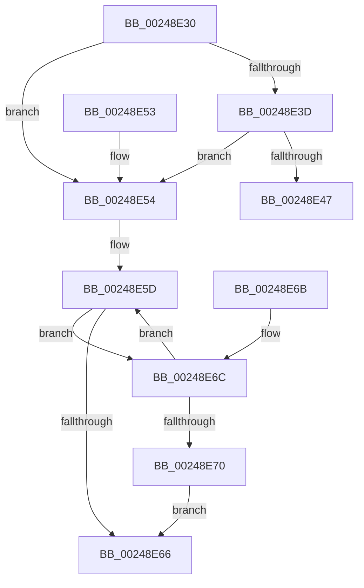

# ExAcquireSpinLockSharedAtDpcLevel

- RVA: `0x00248E30`–`0x00248E79` (길이 `73` bytes)
- VA: `0x0000000140248E30`
- 실행 섹션: `.text`
- PDB 이름 있음: `예`; PDB Function 태그: `아니요`
- unwind 정보 RVA: `0x0006260C`
- 디코드: `25`개 명령, `73/73` bytes 표시
- 미해석 바이트: `0` (있으면 어셈블리에 `.byte`로 보존)

> 이 문서는 커널 이미지의 기계어와 PDB 기호를 분석해 생성했습니다. 4번과 5번은 함수 원형과 자료형을 바이너리 사용 방식에서 추정한 C 해석이며 원본 소스 복구 결과는 아닙니다.

## 1. Dependencies

- 직접 호출 지점: **2**; 고유 호출 대상: **2**
- 직접 호출자로 확인된 함수: **75**
- RIP 상대 이미지 참조: **2**

### Outgoing calls
- `0x00248E49` → [ExpAcquireSpinLockSharedAtDpcLevelInstrumented](../27/ExpAcquireSpinLockSharedAtDpcLevelInstrumented_function_0027CD20.md) (function, `0x0027CD20`)
- `0x00248E72` → [ExpWaitForSpinLockSharedAndAcquire](../36/ExpWaitForSpinLockSharedAndAcquire_function_00362380.md) (function, `0x00362380`)

### Direct callers
- [KiAbConvertWaiterToOwnerEntry](../21/KiAbConvertWaiterToOwnerEntry_function_00219430.md) at `0x002194F1`
- [MiCreateCombineAnchor](../22/MiCreateCombineAnchor_function_0022B178.md) at `0x0022B1B3`
- [MiLockWorkingSetSharedAtDpc](../23/MiLockWorkingSetSharedAtDpc_function_00239574.md) at `0x002395B3`
- [sub_00248832](Unknown_function_00248832.md) at `0x002488D9`
- [sub_0024A15A](Unknown_function_0024A15A.md) at `0x0024A1AB`
- [MiFastLockLeafPageTable](../27/MiFastLockLeafPageTable_function_00276340.md) at `0x0027711B`
- [MiFastLockLeafPageTable](../27/MiFastLockLeafPageTable_function_00276340.md) at `0x00277184`
- [sub_00281DA7](../28/Unknown_function_00281DA7.md) at `0x00281DDF`
- [MiChargeCommit](../28/MiChargeCommit_function_00286EB0.md) at `0x00287152`
- [MmIsFileObjectAPagingFile](../29/MmIsFileObjectAPagingFile_function_0029BDAC.md) at `0x0029BEE3`
- [MiFreePageToSlabAllocator](../2A/MiFreePageToSlabAllocator_function_002A0A60.md) at `0x002A0AB7`
- [MiFreePageToSlabAllocator](../2A/MiFreePageToSlabAllocator_function_002A0A60.md) at `0x002A0C1B`
- [MiAbortCombineScan](../2A/MiAbortCombineScan_function_002A1160.md) at `0x002A11AB`
- [MiPageFileLargestBitmapsRun](../2A/MiPageFileLargestBitmapsRun_function_002AA708.md) at `0x002AA73A`
- [MiLockIoPfnTree](../2A/MiLockIoPfnTree_function_002AC8A4.md) at `0x002AC8F2`
- [MiFinishMdlForMappedFileFault](../2A/MiFinishMdlForMappedFileFault_function_002AC974.md) at `0x002ACA6A`
- [sub_002ADE82](../2A/Unknown_function_002ADE82.md) at `0x002ADF05`
- [MiGetSlabRepurposedStandbyListWorker](../2A/MiGetSlabRepurposedStandbyListWorker_function_002AF534.md) at `0x002AF57F`
- [MiStealPage](../2B/MiStealPage_function_002B28D0.md) at `0x002B3B94`
- [MiSynchronizeFastPageInsert](../2B/MiSynchronizeFastPageInsert_function_002BAE80.md) at `0x002BB250`
- [MiDoesControlAreaHaveUserWritableReferences](../2B/MiDoesControlAreaHaveUserWritableReferences_function_002BB830.md) at `0x002BB8A7`
- [sub_002BC157](../2B/Unknown_function_002BC157.md) at `0x002BC15B`
- [MiReassessZeroThreads](../2C/MiReassessZeroThreads_function_002CB0C0.md) at `0x002CB1CB`
- [MiAddZeroingThreads](../2C/MiAddZeroingThreads_function_002CBF78.md) at `0x002CC038`
- [MiFindBestZeroingProcessor](../2C/MiFindBestZeroingProcessor_function_002CC73C.md) at `0x002CC7F6`
- [KeSetUserGroupAffinityThread](../2C/KeSetUserGroupAffinityThread_function_002CD1C4.md) at `0x002CD316`
- [KiSetLegacyAffinityThread](../2C/KiSetLegacyAffinityThread_function_002CDD94.md) at `0x002CDE33`
- [KeQueryAffinityProcess](../2C/KeQueryAffinityProcess_function_002CE710.md) at `0x002CE74F`
- [MiEmptyDecayClusterTimers](../2D/MiEmptyDecayClusterTimers_function_002DAB50.md) at `0x002DACA6`
- [InsertEventEntryInLookUpTable](../2F/InsertEventEntryInLookUpTable_function_002F1424.md) at `0x002F149B`
- [MmLockLoadedModuleListShared](../2F/MmLockLoadedModuleListShared_function_002F21E4.md) at `0x002F220F`
- [MiProcessorParked](../30/MiProcessorParked_function_003044A4.md) at `0x003044C3`
- [MiCompleteProtoPteFault](../34/MiCompleteProtoPteFault_function_00345710.md) at `0x003464EE`
- [sub_003484C0](../34/Unknown_function_003484C0.md) at `0x003484C3`
- [MiKernelStackVaToStackNode](../34/MiKernelStackVaToStackNode_function_00348A4C.md) at `0x00348A6C`
- [MiCheckSlabPage](../34/MiCheckSlabPage_function_00348AC8.md) at `0x00348B59`
- [MiTransientCombineAddress](../34/MiTransientCombineAddress_function_00348C84.md) at `0x00348D1A`
- [MiObtainParkedCoreMasks](../34/MiObtainParkedCoreMasks_function_00348DE0.md) at `0x00348E12`
- [MiGenerateAccessViolation](../34/MiGenerateAccessViolation_function_0034B50C.md) at `0x0034B592`
- [vDbgPrintExWithPrefixInternalHelper](../35/vDbgPrintExWithPrefixInternalHelper_function_003593C0.md) at `0x003595B7`
- [MiZeroCfgSystemWideBitmapWorker](../36/MiZeroCfgSystemWideBitmapWorker_function_00367060.md) at `0x00367503`
- [MiLockPageListAndFirstPage](../37/MiLockPageListAndFirstPage_function_0037573C.md) at `0x003757A2`
- [MiGetPageFromSlabAllocator](../37/MiGetPageFromSlabAllocator_function_00377294.md) at `0x003772F0`
- [MiInsertSlabEntry](../37/MiInsertSlabEntry_function_00378AF4.md) at `0x00378D08`
- [sub_00380A68](../38/Unknown_function_00380A68.md) at `0x00380A6B`
- [MiObtainPagefileHashes](../38/MiObtainPagefileHashes_function_00381AC8.md) at `0x00381AF6`
- [MiGetPartitionNodeInformation](../3B/MiGetPartitionNodeInformation_function_003B8D48.md) at `0x003B8DCC`
- [MiGetPartitionNodeInformation](../3B/MiGetPartitionNodeInformation_function_003B8D48.md) at `0x003B8DFB`
- [KiUpdateProcessAvailableCpuState](../3C/KiUpdateProcessAvailableCpuState_function_003C00B4.md) at `0x003C0114`
- [sub_003C67DC](../3C/Unknown_function_003C67DC.md) at `0x003C67F4`
- [MiGetPrototypePteRanges](../3E/MiGetPrototypePteRanges_function_003E0720.md) at `0x003E0756`
- [MiFindFreePageFileSpace](../3E/MiFindFreePageFileSpace_function_003E2CAC.md) at `0x003E3065`
- [MmUnmapReservedMapping](../3E/MmUnmapReservedMapping_function_003E7BE0.md) at `0x003E7C41`
- [MmMapLockedPagesWithReservedMapping](../3E/MmMapLockedPagesWithReservedMapping_function_003E8910.md) at `0x003E8981`
- [ViAvlAcquireTableLockAtDpcLevel](../3E/ViAvlAcquireTableLockAtDpcLevel_function_003EF7D4.md) at `0x003EF7FC`
- [MiLockPageListAndLastPage](../41/MiLockPageListAndLastPage_function_00411BA0.md) at `0x00411CC9`
- [VmpProcessContextLockShared](../42/VmpProcessContextLockShared_function_00429DB0.md) at `0x00429DD6`
- [MiGetSharedProtosAtDpc](../42/MiGetSharedProtosAtDpc_function_0042F924.md) at `0x0042F93F`
- [MiSystemImageHasPrivateFixups](../45/MiSystemImageHasPrivateFixups_function_004507E0.md) at `0x0045085D`
- [VmpInvalidateOutstandingFaults](../46/VmpInvalidateOutstandingFaults_function_004639AC.md) at `0x004639DB`
- [MiGetOptimalEngineMix](../49/MiGetOptimalEngineMix_function_0049EF44.md) at `0x0049F08E`
- [MiIsCalibrationWorthwhile](../4A/MiIsCalibrationWorthwhile_function_004A0770.md) at `0x004A07C5`
- [KiVpBackingThreadYieldExecution](../4D/KiVpBackingThreadYieldExecution_function_004DF1A4.md) at `0x004DF224`
- [MiStopHugePageAccessor](../4F/MiStopHugePageAccessor_function_004F6A68.md) at `0x004F6AB6`
- [DbgEnumerateCallback](../5E/DbgEnumerateCallback_function_005E5740.md) at `0x005E5763`
- [DbgpRemoveDebugPrintCallback](../5E/DbgpRemoveDebugPrintCallback_function_005E59E4.md) at `0x005E5A28`
- [RtlpAcquirePropStoreLockShared](../5E/RtlpAcquirePropStoreLockShared_function_005E850C.md) at `0x005E8539`
- [ViPtAcquireTreeLockAtDpcLevelSafe](../61/ViPtAcquireTreeLockAtDpcLevelSafe_function_0061388C.md) at `0x006138D9`
- [CarAcquireDbLockAtDpcLevelSafe](../61/CarAcquireDbLockAtDpcLevelSafe_function_0061B00C.md) at `0x0061B066`
- [DifAcquireSpinLockAtDpcLevelSafe](../61/DifAcquireSpinLockAtDpcLevelSafe_function_0061BDF4.md) at `0x0061BE7E`
- [MiGetPageInHugePageBadStatus](../67/MiGetPageInHugePageBadStatus_function_00675ADC.md) at `0x00675B46`
- [MiFindPageFileMemoryExtent](../69/MiFindPageFileMemoryExtent_function_00694F70.md) at `0x00694F9E`
- [MiGetPrototypePteBoundaries](../69/MiGetPrototypePteBoundaries_function_006995B8.md) at `0x006995D9`
- [sub_006E2BF8](../6E/Unknown_function_006E2BF8.md) at `0x006E2C15`
- [sub_006E362E](../6E/Unknown_function_006E362E.md) at `0x006E38CC`
- [sub_006E3F8C](../6E/Unknown_function_006E3F8C.md) at `0x006E3FFB`
- [sub_006F59B4](../6F/Unknown_function_006F59B4.md) at `0x006F5A1F`
- [ViDeadlockDetectionLock](../../pagevrfy/BA/ViDeadlockDetectionLock_function_00BA91C4.md) at `0x00BA91D3`

### Static image references
- `0x00248E34` → RVA `0x00FC6B06` (`ALMOSTRO`; read)
- `0x00248E3D` → RVA `0x00F0DE58` (`.data`; read)

## 2. Other-region calls and transfers

- 다른 실행 섹션으로 향하는 call: **0**
- 별도 외부 분기/꼬리 이동을 확인하지 못했습니다.

## 3. Assembly (complete function range)

```asm
00248E30  48 83 EC 28                     sub rsp, 0x28
00248E34  F6 05 CB DC D7 00 21            test byte ptr [rip + 0xd7dccb], 0x21
00248E3B  74 17                           je 0x140248e54
00248E3D  8B 05 15 50 CC 00               mov eax, dword ptr [rip + 0xcc5015]
00248E43  85 C0                           test eax, eax
00248E45  75 0D                           jne 0x140248e54
00248E47  B2 FF                           mov dl, 0xff
00248E49  E8 D2 3E 03 00                  call 0x14027cd20
00248E4E  48 83 C4 28                     add rsp, 0x28
00248E52  C3                              ret
00248E53  CC                              int3
00248E54  0F 0D 09                        prefetchw byte ptr [rcx]
00248E57  8B 01                           mov eax, dword ptr [rcx]
00248E59  0F BA F0 1F                     btr eax, 0x1f
00248E5D  8D 50 01                        lea edx, [rax + 1]
00248E60  F0 0F B1 11                     lock cmpxchg dword ptr [rcx], edx
00248E64  75 06                           jne 0x140248e6c
00248E66  48 83 C4 28                     add rsp, 0x28
00248E6A  C3                              ret
00248E6B  CC                              int3
00248E6C  85 C0                           test eax, eax
00248E6E  79 ED                           jns 0x140248e5d
00248E70  B2 FF                           mov dl, 0xff
00248E72  E8 09 95 11 00                  call 0x140362380
00248E77  EB ED                           jmp 0x140248e66
```

## 4. C-style interpretation (structured pseudocode)

```c
__int64 __fastcall ExAcquireSpinLockSharedAtDpcLevel(__int64 a1)
{
    __int64 result;
    __int64 v_rsp;

    v_rsp = (v_rsp) - (40);
    if (((*(unsigned __int8 *)(v_rip + 14146763)) & (33)) == 0) goto loc_00248E54;
    if ((unsigned int)((unsigned int)(*(unsigned int *)(v_rip + 13389845))) != 0) goto loc_00248E54;
    result = ExpAcquireSpinLockSharedAtDpcLevelInstrumented(a1, 255, a3, a4);
    v_rsp = (v_rsp) + (40);
    return result;
loc_00248E54:
loc_00248E5D:
    if (condition_is_not_equal) goto loc_00248E6C;
loc_00248E66:
    v_rsp = (v_rsp) + (40);
    return (unsigned int)(*(unsigned int *)(a1));
loc_00248E6C:
    if (!sign_flag) goto loc_00248E5D;
    result = ExpWaitForSpinLockSharedAndAcquire(a1, 255, a3, a4);
    goto loc_00248E66;
}
```

## 5. (Beta) C Style

```c
int64_t ExAcquireSpinLockSharedAtDpcLevel(void *Arg1)
{
    uint8_t *arg1 = (uint8_t *)Arg1;

    int64_t result;
    int64_t local_rsp;

    local_rsp = (local_rsp) - (40);
    if (((*(uint8_t *)(v_rip + 0xD7DCCB)) & (33)) == 0) goto loc_00248E54;
    if ((uint32_t)((uint32_t)(*(uint32_t *)(v_rip + 0xCC5015))) != 0) goto loc_00248E54;
    result = ExpAcquireSpinLockSharedAtDpcLevelInstrumented(Arg1, 255, a3, a4);
    local_rsp = (local_rsp) + (40);
    return result;
loc_00248E54:
loc_00248E5D:
    if (condition_is_not_equal) goto loc_00248E6C;
loc_00248E66:
    local_rsp = (local_rsp) + (40);
    return (uint32_t)(*(uint32_t *)(arg1));
loc_00248E6C:
    if (!sign_flag) goto loc_00248E5D;
    result = ExpWaitForSpinLockSharedAndAcquire(Arg1, 255, a3, a4);
    goto loc_00248E66;
}
```

### 관측된 메모리 오프셋

구조체 형식이 확인되지 않은 접근은 인자 기준의 오프셋으로만 기록했습니다.

| 기준 인자 | 오프셋 표현 | 폭 (bit) | 접근 |
|---|---:|---:|---|
| `Arg1` | `+ 0x0` | `8` | `R` |
| `Arg1` | `+ 0x0` | `32` | `R` |

## 6. Execution-region graph

[열기: 2D/3D 그래프와 함수 탐색 컨트롤 패널](../../../control-panel.html?section=text&rva=0x00248E30&view=graph)

- 2D 그래프는 위에서 아래로 흐르고, 3D 그래프는 빈 공간을 드래그해 회전합니다. Shift+드래그는 이동, 휠은 확대·축소, 함수 노드 선택은 대상 보고서 이동입니다.

### Static fallback


