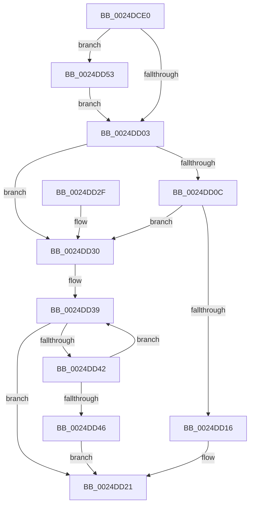

# ExAcquireSpinLockShared

- RVA: `0x0024DCE0`–`0x0024DD60` (길이 `128` bytes)
- VA: `0x000000014024DCE0`
- 실행 섹션: `.text`
- PDB 이름 있음: `예`; PDB Function 태그: `아니요`
- unwind 정보 RVA: `0x00062F94`
- 디코드: `39`개 명령, `128/128` bytes 표시
- 미해석 바이트: `0` (있으면 어셈블리에 `.byte`로 보존)

> 이 문서는 커널 이미지의 기계어와 PDB 기호를 분석해 생성했습니다. 4번과 5번은 함수 원형과 자료형을 바이너리 사용 방식에서 추정한 C 해석이며 원본 소스 복구 결과는 아닙니다.

## 1. Dependencies

- 직접 호출 지점: **3**; 고유 호출 대상: **3**
- 직접 호출자로 확인된 함수: **88**
- RIP 상대 이미지 참조: **3**

### Outgoing calls
- `0x0024DD1C` → [ExpAcquireSpinLockSharedAtDpcLevelInstrumented](../27/ExpAcquireSpinLockSharedAtDpcLevelInstrumented_function_0027CD20.md) (function, `0x0027CD20`)
- `0x0024DD4C` → [ExpWaitForSpinLockSharedAndAcquire](../36/ExpWaitForSpinLockSharedAndAcquire_function_00362380.md) (function, `0x00362380`)
- `0x0024DD59` → [KiRaiseIrqlProcessIrqlFlags](../4F/KiRaiseIrqlProcessIrqlFlags_function_004F56FC.md) (function, `0x004F56FC`)

### Direct callers
- [MiLocateCombineBlock](../22/MiLocateCombineBlock_function_0022B3A8.md) at `0x0022B3F9`
- [PopPepProcessEvent](PopPepProcessEvent_function_0024B930.md) at `0x0024C51C`
- [sub_0024D8F3](Unknown_function_0024D8F3.md) at `0x0024D907`
- [sub_0024E38F](Unknown_function_0024E38F.md) at `0x0024E3F7`
- [sub_0024EAB1](Unknown_function_0024EAB1.md) at `0x0024EB1C`
- [ExProtectPoolEx](../26/ExProtectPoolEx_function_002695D8.md) at `0x00269631`
- [sub_0026F8B2](../26/Unknown_function_0026F8B2.md) at `0x0026F8DA`
- [PopFxLockDevice](../26/PopFxLockDevice_function_0026F950.md) at `0x0026F985`
- [MiChargeCommit](../28/MiChargeCommit_function_00286EB0.md) at `0x0028724B`
- [IoPageReadEx](../29/IoPageReadEx_function_0029ABF0.md) at `0x0029AEE9`
- [IoPageReadEx](../29/IoPageReadEx_function_0029ABF0.md) at `0x0029AF66`
- [sub_0029BFC9](../29/Unknown_function_0029BFC9.md) at `0x0029BFDE`
- [sub_0029BFC9](../29/Unknown_function_0029BFC9.md) at `0x0029C031`
- [sub_0029C55D](../29/Unknown_function_0029C55D.md) at `0x0029C562`
- [MiPageFileLargestBitmapsRun](../2A/MiPageFileLargestBitmapsRun_function_002AA708.md) at `0x002AA7F1`
- [MiFindLastSubsection](../2A/MiFindLastSubsection_function_002ACF20.md) at `0x002ACFAB`
- [MiReferencePfBackedSection](../2B/MiReferencePfBackedSection_function_002B9B70.md) at `0x002B9B95`
- [PopPepComponentSetLatency](../2B/PopPepComponentSetLatency_function_002BF3D8.md) at `0x002BF546`
- [RtlpHpVaMgrCtxAlloc](../2E/RtlpHpVaMgrCtxAlloc_function_002EDA80.md) at `0x002EDAED`
- [sub_002F0454](../2F/Unknown_function_002F0454.md) at `0x002F04BC`
- [SepGetSingletonEntryFromIndexNumber](../2F/SepGetSingletonEntryFromIndexNumber_function_002F095C.md) at `0x002F097B`
- [RtlpCSparseBitmapPageCommit](../2F/RtlpCSparseBitmapPageCommit_function_002F0B98.md) at `0x002F0C24`
- [PsGetNextPartitionUnsafe](../2F/PsGetNextPartitionUnsafe_function_002F0E38.md) at `0x002F0E5D`
- [HalpBuddyAllocatorAllocateLogicalAddress](../30/HalpBuddyAllocatorAllocateLogicalAddress_function_00307EE0.md) at `0x00308013`
- [HalpBuddyAllocatorAllocateLogicalAddress](../30/HalpBuddyAllocatorAllocateLogicalAddress_function_00307EE0.md) at `0x0030827A`
- [HalpIommuFlushDmaDomain](../30/HalpIommuFlushDmaDomain_function_003093B4.md) at `0x00309484`
- [PfSnGetFileInformation](../34/PfSnGetFileInformation_function_00343210.md) at `0x0034329C`
- [sub_0034847F](../34/Unknown_function_0034847F.md) at `0x0034848C`
- [MiKernelStackVaToStackNode](../34/MiKernelStackVaToStackNode_function_00348A4C.md) at `0x00348AB7`
- [MiCheckSlabPage](../34/MiCheckSlabPage_function_00348AC8.md) at `0x00348BC2`
- [MiTransientCombineAddress](../34/MiTransientCombineAddress_function_00348C84.md) at `0x00348CD7`
- [MiObtainParkedCoreMasks](../34/MiObtainParkedCoreMasks_function_00348DE0.md) at `0x00348E9A`
- [IopFindDiskIoAttribution](../34/IopFindDiskIoAttribution_function_00349670.md) at `0x0034968B`
- [MiSystemFault](../34/MiSystemFault_function_0034AA64.md) at `0x0034ADF2`
- [MiGenerateAccessViolation](../34/MiGenerateAccessViolation_function_0034B50C.md) at `0x0034B5A0`
- [IoQueueWorkItem](../35/IoQueueWorkItem_function_00357F80.md) at `0x00358097`
- [IoQueueWorkItemEx](../35/IoQueueWorkItemEx_function_00358140.md) at `0x00358253`
- [MiGetPageFromSlabAllocator](../37/MiGetPageFromSlabAllocator_function_00377294.md) at `0x003774BE`
- [sub_00380A2B](../38/Unknown_function_00380A2B.md) at `0x00380A38`
- [sub_003A7C07](../3A/Unknown_function_003A7C07.md) at `0x003A7C1E`
- [SMKM_STORE_MGR&lt;SM_TRAITS&gt;::SmCompressManagerGetIdealProcessor](../3B/SMKM_STORE_MGR_SM_TRAITS_SmCompressManagerGetIdealProcessor_function_003B21CC.md) at `0x003B21FC`
- [MiGetChannelInformation](../3B/MiGetChannelInformation_function_003B8738.md) at `0x003B879C`
- [MiGetPartitionNodeInformation](../3B/MiGetPartitionNodeInformation_function_003B8D48.md) at `0x003B8EE5`
- [sub_003CB529](../3C/Unknown_function_003CB529.md) at `0x003CB54B`
- [sub_003CB5DC](../3C/Unknown_function_003CB5DC.md) at `0x003CB5E3`
- [MiFindFreePageFileSpace](../3E/MiFindFreePageFileSpace_function_003E2CAC.md) at `0x003E30E3`
- [MmUnmapReservedMapping](../3E/MmUnmapReservedMapping_function_003E7BE0.md) at `0x003E7D1B`
- [MmMapLockedPagesWithReservedMapping](../3E/MmMapLockedPagesWithReservedMapping_function_003E8910.md) at `0x003E8A18`
- [ExRemovePoolTag](../3F/ExRemovePoolTag_function_003F7CBC.md) at `0x003F7CF5`
- [MiReferenceControlAreaFile](../43/MiReferenceControlAreaFile_function_00431554.md) at `0x00431638`
- [PsGetWorkOnBehalfThread](../43/PsGetWorkOnBehalfThread_function_00439560.md) at `0x004395A8`
- [sub_0043CAB1](../43/Unknown_function_0043CAB1.md) at `0x0043CAB6`
- [sub_00442C79](../44/Unknown_function_00442C79.md) at `0x00442C7E`
- [MiStartingOffsetNeedLock](../44/MiStartingOffsetNeedLock_function_00443964.md) at `0x00443A36`
- [sub_004458DF](../44/Unknown_function_004458DF.md) at `0x004458E4`
- [MiAgeAweRegions](../44/MiAgeAweRegions_function_004464A4.md) at `0x00446506`
- [PsGetEffectiveContainerId](../44/PsGetEffectiveContainerId_function_004497A0.md) at `0x00449895`
- [RtlpHpAcquireLockShared](../46/RtlpHpAcquireLockShared_function_0046205C.md) at `0x004620C0`
- [MiComputeUnusedSegmentReduction](../46/MiComputeUnusedSegmentReduction_function_00464E58.md) at `0x00464E8E`
- [MiPurgeSlabEntries](../48/MiPurgeSlabEntries_function_0048D258.md) at `0x0048D2D7`
- [ExpCheckForResource](../49/ExpCheckForResource_function_0049CA24.md) at `0x0049CA99`
- [PopPepGetDevicePlatformStateDependents](../49/PopPepGetDevicePlatformStateDependents_function_0049CAB4.md) at `0x0049CAD0`
- [MiGetPrivatePageCount](../49/MiGetPrivatePageCount_function_0049E4E4.md) at `0x0049E4FA`
- [MiGetOptimalEngineMix](../49/MiGetOptimalEngineMix_function_0049EF44.md) at `0x0049EFA1`
- [MiIsCalibrationWorthwhile](../4A/MiIsCalibrationWorthwhile_function_004A0770.md) at `0x004A082D`
- [PopPepGetMinimumDevicePowerState](../4A/PopPepGetMinimumDevicePowerState_function_004ABE50.md) at `0x004ABE8B`
- [PopPepGetComponentVetoMasks](../4B/PopPepGetComponentVetoMasks_function_004B35F4.md) at `0x004B3621`
- [SMKM_STORE_MGR&lt;SM_TRAITS&gt;::SmCompressManagerUpdateMemoryCondition](../4C/SMKM_STORE_MGR_SM_TRAITS_SmCompressManagerUpdateMemoryCondition_function_004C0040.md) at `0x004C0083`
- [MiInitializeCachedExtentWalker](../4C/MiInitializeCachedExtentWalker_function_004CAC6C.md) at `0x004CACB3`
- [PopPepGetDeviceVetoMasks](../4C/PopPepGetDeviceVetoMasks_function_004CC214.md) at `0x004CC235`
- [IommupHvFlushDomainTbs](../4D/IommupHvFlushDomainTbs_function_004DADB0.md) at `0x004DAE4F`
- [MiTransientPageListWriter](../4D/MiTransientPageListWriter_function_004DB35C.md) at `0x004DB37D`
- [MiApplyDebuggerPatches](../4F/MiApplyDebuggerPatches_function_004F7BE4.md) at `0x004F7C47`
- [SepValidateAndCopyGlobalEntry](../4F/SepValidateAndCopyGlobalEntry_function_004F825C.md) at `0x004F82E4`
- [IommupDomainDetachPasidDevice](../54/IommupDomainDetachPasidDevice_function_0054FD50.md) at `0x0054FD8D`
- [HalpQueryNumaRangeTableInformation](../55/HalpQueryNumaRangeTableInformation_function_0055A0A0.md) at `0x0055A0C9`
- [PopPepPlatformStateRegistered](../5D/PopPepPlatformStateRegistered_function_005DCDB8.md) at `0x005DCE7D`
- [PopPepRegisterComponentPerfStates](../5D/PopPepRegisterComponentPerfStates_function_005DD000.md) at `0x005DD027`
- [PspJobIoRateVolumeEntryReference](../5E/PspJobIoRateVolumeEntryReference_function_005E3AA8.md) at `0x005E3AD2`
- [ViIrpDatabaseAcquireLockShared](../61/ViIrpDatabaseAcquireLockShared_function_006176FC.md) at `0x0061770C`
- [MiReleasePartitionHugeIoSpace](../67/MiReleasePartitionHugeIoSpace_function_00677038.md) at `0x00677085`
- [MiReleasePartitionHugeIoSpace](../67/MiReleasePartitionHugeIoSpace_function_00677038.md) at `0x0067712E`
- [MiEnumerateQuarantinedBadHugeRangePages](../67/MiEnumerateQuarantinedBadHugeRangePages_function_006798AC.md) at `0x0067991E`
- [MiGetListOfPendingBadPages](../67/MiGetListOfPendingBadPages_function_006799D0.md) at `0x00679A85`
- [MiGetListOfPendingBadPages](../67/MiGetListOfPendingBadPages_function_006799D0.md) at `0x00679AE3`
- [MiDeleteAwePageTables](../68/MiDeleteAwePageTables_function_006884B0.md) at `0x00688526`
- [MiDeleteAwePageTables](../68/MiDeleteAwePageTables_function_006884B0.md) at `0x006886AC`
- [MiNoPagesLastChance](../68/MiNoPagesLastChance_function_0068B22C.md) at `0x0068B36C`
- [MiFindPageFileMemoryExtent](../69/MiFindPageFileMemoryExtent_function_00694F70.md) at `0x00694FA5`
- [MiAbsorbPossibleEngineChanges](../69/MiAbsorbPossibleEngineChanges_function_006958B4.md) at `0x00695941`
- [MiAbsorbPossibleEngineChanges](../69/MiAbsorbPossibleEngineChanges_function_006958B4.md) at `0x00695A41`
- [sub_006DEF5A](../6D/Unknown_function_006DEF5A.md) at `0x006DEF5A`
- [sub_006E3F8C](../6E/Unknown_function_006E3F8C.md) at `0x006E4002`
- [ExQuerySystemLockInformation](../../pagelk/B7/ExQuerySystemLockInformation_function_00B793DC.md) at `0x00B79432`
- [ExpAllocatePoolWithQuotaTag](../../poolcode/B8/ExpAllocatePoolWithQuotaTag_function_00B82210.md) at `0x00B8251E`
- [ExpAllocatePoolWithQuotaTag](../../poolcode/B8/ExpAllocatePoolWithQuotaTag_function_00B82210.md) at `0x00B82658`

### Static image references
- `0x0024DCFA` → RVA `0x00FC6D20` (`ALMOSTRO`; read)
- `0x0024DD03` → RVA `0x00FC6B06` (`ALMOSTRO`; read)
- `0x0024DD0C` → RVA `0x00F0DE58` (`.data`; read)

## 2. Other-region calls and transfers

- 다른 실행 섹션으로 향하는 call: **0**
- 별도 외부 분기/꼬리 이동을 확인하지 못했습니다.

## 3. Assembly (complete function range)

```asm
0024DCE0  48 89 5C 24 08                  mov qword ptr [rsp + 8], rbx
0024DCE5  57                              push rdi
0024DCE6  48 83 EC 20                     sub rsp, 0x20
0024DCEA  48 8B F9                        mov rdi, rcx
0024DCED  44 0F 20 C3                     mov rbx, cr8
0024DCF1  B8 02 00 00 00                  mov eax, 2
0024DCF6  44 0F 22 C0                     mov cr8, rax
0024DCFA  83 3D 1F 90 D7 00 00            cmp dword ptr [rip + 0xd7901f], 0
0024DD01  75 50                           jne 0x14024dd53
0024DD03  F6 05 FC 8D D7 00 21            test byte ptr [rip + 0xd78dfc], 0x21
0024DD0A  74 24                           je 0x14024dd30
0024DD0C  8B 05 46 01 CC 00               mov eax, dword ptr [rip + 0xcc0146]
0024DD12  85 C0                           test eax, eax
0024DD14  75 1A                           jne 0x14024dd30
0024DD16  0F B6 D3                        movzx edx, bl
0024DD19  48 8B CF                        mov rcx, rdi
0024DD1C  E8 FF EF 02 00                  call 0x14027cd20
0024DD21  0F B6 C3                        movzx eax, bl
0024DD24  48 8B 5C 24 30                  mov rbx, qword ptr [rsp + 0x30]
0024DD29  48 83 C4 20                     add rsp, 0x20
0024DD2D  5F                              pop rdi
0024DD2E  C3                              ret
0024DD2F  CC                              int3
0024DD30  0F 0D 0F                        prefetchw byte ptr [rdi]
0024DD33  8B 07                           mov eax, dword ptr [rdi]
0024DD35  0F BA F0 1F                     btr eax, 0x1f
0024DD39  8D 48 01                        lea ecx, [rax + 1]
0024DD3C  F0 0F B1 0F                     lock cmpxchg dword ptr [rdi], ecx
0024DD40  74 DF                           je 0x14024dd21
0024DD42  85 C0                           test eax, eax
0024DD44  79 F3                           jns 0x14024dd39
0024DD46  0F B6 D3                        movzx edx, bl
0024DD49  48 8B CF                        mov rcx, rdi
0024DD4C  E8 2F 46 11 00                  call 0x140362380
0024DD51  EB CE                           jmp 0x14024dd21
0024DD53  0F B6 D0                        movzx edx, al
0024DD56  0F B6 CB                        movzx ecx, bl
0024DD59  E8 9E 79 2A 00                  call 0x1404f56fc
0024DD5E  EB A3                           jmp 0x14024dd03
```

## 4. C-style interpretation (structured pseudocode)

```c
__int64 __fastcall ExAcquireSpinLockShared(__int64 a1)
{
    __int64 result;
    __int64 v_rsp;
    unsigned __int64 v_stack_p8;

    v_stack_p8 = v_rbx;
    v_rsp = (v_rsp) - (32);
    if ((*(unsigned int *)(v_rip + 14127135)) != 0) goto loc_0024DD53;
loc_0024DD03:
    if (((*(unsigned __int8 *)(v_rip + 14126588)) & (33)) == 0) goto loc_0024DD30;
    if ((unsigned int)((unsigned int)(*(unsigned int *)(v_rip + 13369670))) != 0) goto loc_0024DD30;
    result = ExpAcquireSpinLockSharedAtDpcLevelInstrumented(a1, (unsigned __int8)(v_cr8), a3, a4);
loc_0024DD21:
    v_rsp = (v_rsp) + (32);
    return (unsigned __int8)(v_cr8);
loc_0024DD30:
loc_0024DD39:
    if (condition_is_equal) goto loc_0024DD21;
    if (!sign_flag) goto loc_0024DD39;
    result = ExpWaitForSpinLockSharedAndAcquire(a1, (unsigned __int8)(v_stack_p8), a3, a4);
    goto loc_0024DD21;
loc_0024DD53:
    result = KiRaiseIrqlProcessIrqlFlags((unsigned __int8)(v_stack_p8), (unsigned __int8)(result), a3, a4);
    goto loc_0024DD03;
}
```

## 5. (Beta) C Style

```c
int64_t ExAcquireSpinLockShared(void *Arg1)
{
    uint8_t *arg1 = (uint8_t *)Arg1;

    int64_t result;
    int64_t local_rsp;
    uint64_t v_stack_p8;

    v_stack_p8 = local_rbx;
    local_rsp = (local_rsp) - (32);
    if ((*(uint32_t *)(v_rip + 0xD7901F)) != 0) goto loc_0024DD53;
loc_0024DD03:
    if (((*(uint8_t *)(v_rip + 0xD78DFC)) & (33)) == 0) goto loc_0024DD30;
    if ((uint32_t)((uint32_t)(*(uint32_t *)(v_rip + 0xCC0146))) != 0) goto loc_0024DD30;
    result = ExpAcquireSpinLockSharedAtDpcLevelInstrumented(Arg1, (uint8_t)(v_cr8), a3, a4);
loc_0024DD21:
    local_rsp = (local_rsp) + (32);
    return (uint8_t)(v_cr8);
loc_0024DD30:
loc_0024DD39:
    if (condition_is_equal) goto loc_0024DD21;
    if (!sign_flag) goto loc_0024DD39;
    result = ExpWaitForSpinLockSharedAndAcquire(Arg1, (uint8_t)(v_stack_p8), a3, a4);
    goto loc_0024DD21;
loc_0024DD53:
    result = KiRaiseIrqlProcessIrqlFlags((uint8_t)(v_stack_p8), (uint8_t)(result), a3, a4);
    goto loc_0024DD03;
}
```

### 관측된 메모리 오프셋

구조체 형식이 확인되지 않은 접근은 인자 기준의 오프셋으로만 기록했습니다.

| 기준 인자 | 오프셋 표현 | 폭 (bit) | 접근 |
|---|---:|---:|---|
| `Arg1` | `+ 0x0` | `8` | `R` |
| `Arg1` | `+ 0x0` | `32` | `R` |

## 6. Execution-region graph

[열기: 2D/3D 그래프와 함수 탐색 컨트롤 패널](../../../control-panel.html?section=text&rva=0x0024DCE0&view=graph)

- 2D 그래프는 위에서 아래로 흐르고, 3D 그래프는 빈 공간을 드래그해 회전합니다. Shift+드래그는 이동, 휠은 확대·축소, 함수 노드 선택은 대상 보고서 이동입니다.

### Static fallback


