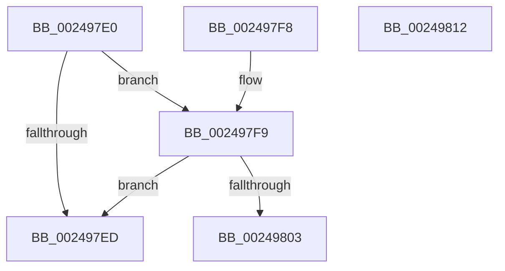

# ExReleaseSpinLockExclusiveFromDpcLevel

- RVA: `0x002497E0`–`0x00249813` (길이 `51` bytes)
- VA: `0x00000001402497E0`
- 실행 섹션: `.text`
- PDB 이름 있음: `예`; PDB Function 태그: `아니요`
- unwind 정보 RVA: `0x0005CF0C`
- 디코드: `15`개 명령, `51/51` bytes 표시
- 미해석 바이트: `0` (있으면 어셈블리에 `.byte`로 보존)

> 이 문서는 커널 이미지의 기계어와 PDB 기호를 분석해 생성했습니다. 4번과 5번은 함수 원형과 자료형을 바이너리 사용 방식에서 추정한 C 해석이며 원본 소스 복구 결과는 아닙니다.

## 1. Dependencies

- 직접 호출 지점: **1**; 고유 호출 대상: **1**
- 직접 호출자로 확인된 함수: **206**
- RIP 상대 이미지 참조: **2**

### Outgoing calls
- `0x00249808` → [ExpReleaseSpinLockExclusiveFromDpcLevelInstrumented](../2C/ExpReleaseSpinLockExclusiveFromDpcLevelInstrumented_function_002C0F44.md) (function, `0x002C0F44`)

### Direct callers
- [KeThawMultiProcess](../20/KeThawMultiProcess_function_00202A04.md) at `0x00202B13`
- [MiReplaceActivePageTableLinks](../22/MiReplaceActivePageTableLinks_function_00229B54.md) at `0x00229C8F`
- [MiReferenceIoPages](../23/MiReferenceIoPages_function_0023C804.md) at `0x0023CB5A`
- [MiReferenceIoPages](../23/MiReferenceIoPages_function_0023C804.md) at `0x0023CE41`
- [MiUnlockNestedPageTableWritePte](../23/MiUnlockNestedPageTableWritePte_function_0023F4E4.md) at `0x0023F6FA`
- [sub_00248B10](Unknown_function_00248B10.md) at `0x00248B7E`
- [sub_00248B10](Unknown_function_00248B10.md) at `0x00248D18`
- [sub_00248B10](Unknown_function_00248B10.md) at `0x00248D41`
- [sub_00248B10](Unknown_function_00248B10.md) at `0x00248DAA`
- [sub_00248B10](Unknown_function_00248B10.md) at `0x00248DB5`
- [sub_00248F71](Unknown_function_00248F71.md) at `0x00248FFE`
- [sub_0024926A](Unknown_function_0024926A.md) at `0x0024929F`
- [sub_00249850](Unknown_function_00249850.md) at `0x00249A72`
- [sub_00249C6B](Unknown_function_00249C6B.md) at `0x00249E2E`
- [MiActivateCombineBlock](../26/MiActivateCombineBlock_function_00266094.md) at `0x0026615F`
- [SMKM_STORE_MGR&lt;SM_TRAITS&gt;::SmCompressCtxWorkerThread](../26/SMKM_STORE_MGR_SM_TRAITS_SmCompressCtxWorkerThread_function_00267D20.md) at `0x00267EE7`
- [SMKM_STORE_MGR&lt;SM_TRAITS&gt;::SmCompressCtxWorkerThread](../26/SMKM_STORE_MGR_SM_TRAITS_SmCompressCtxWorkerThread_function_00267D20.md) at `0x00267FEE`
- [SMKM_STORE_MGR&lt;SM_TRAITS&gt;::SmCompressCtxCompleteEntry](../26/SMKM_STORE_MGR_SM_TRAITS_SmCompressCtxCompleteEntry_function_002685C0.md) at `0x002686DC`
- [KiAbReleaseLocksForEntry](../27/KiAbReleaseLocksForEntry_function_002721F8.md) at `0x00272241`
- [MiAcquirePageListLock](../27/MiAcquirePageListLock_function_0027C450.md) at `0x0027CB29`
- [MiAddWorkingSetEntries](../27/MiAddWorkingSetEntries_function_0027DC00.md) at `0x0027E3FB`
- [MiMakeSystemAddressValid](../27/MiMakeSystemAddressValid_function_0027FF70.md) at `0x00280CEF`
- [MiLockLowestValidPageTableEx](../28/MiLockLowestValidPageTableEx_function_00280D10.md) at `0x002817D3`
- [sub_0028271E](../28/Unknown_function_0028271E.md) at `0x0028286D`
- [MiReleasePageFileInfo](../28/MiReleasePageFileInfo_function_00283FD0.md) at `0x002842B2`
- [MiCheckControlArea](../28/MiCheckControlArea_function_002861B0.md) at `0x0028643A`
- [sub_00287E04](../28/Unknown_function_00287E04.md) at `0x00287E15`
- [MiGetPerfectColorHeadPage](../28/MiGetPerfectColorHeadPage_function_00289CA8.md) at `0x00289ED6`
- [MiGetPerfectColorHeadPage](../28/MiGetPerfectColorHeadPage_function_00289CA8.md) at `0x0028A061`
- [MiGetPerfectColorHeadPage](../28/MiGetPerfectColorHeadPage_function_00289CA8.md) at `0x0028A08B`
- [MiClearPteAccessed](../29/MiClearPteAccessed_function_00290630.md) at `0x002909F1`
- [MiClearPteAccessed](../29/MiClearPteAccessed_function_00290630.md) at `0x00290A02`
- [MiSetVaAgeList](../29/MiSetVaAgeList_function_00290A20.md) at `0x00291378`
- [MiSetVaAgeList](../29/MiSetVaAgeList_function_00290A20.md) at `0x00291645`
- [MiSetVaAgeList](../29/MiSetVaAgeList_function_00290A20.md) at `0x002917D6`
- [MiSetVaAgeList](../29/MiSetVaAgeList_function_00290A20.md) at `0x002917F8`
- [MiSetVaAgeList](../29/MiSetVaAgeList_function_00290A20.md) at `0x0029180D`
- [MiInsertActivePageTableLinksTail](../29/MiInsertActivePageTableLinksTail_function_00291D98.md) at `0x00291F13`
- [MiRemoveActivePageTableLinks](../29/MiRemoveActivePageTableLinks_function_00291FA8.md) at `0x002920C4`
- [sub_0029273F](../29/Unknown_function_0029273F.md) at `0x00292983`
- [sub_0029273F](../29/Unknown_function_0029273F.md) at `0x002929B0`
- [sub_0029273F](../29/Unknown_function_0029273F.md) at `0x002929D4`
- [MiRemoveViewsFromSectionWithPfn](../29/MiRemoveViewsFromSectionWithPfn_function_002986D4.md) at `0x00298825`
- [MiDecrementSubsection](../29/MiDecrementSubsection_function_00298D68.md) at `0x00298DD0`
- [MiFreePageToSlabEntry](../2A/MiFreePageToSlabEntry_function_002A0D94.md) at `0x002A0F19`
- [MiOutPageSingleKernelStack](../2A/MiOutPageSingleKernelStack_function_002A1790.md) at `0x002A19AD`
- [MiOutPageSingleKernelStack](../2A/MiOutPageSingleKernelStack_function_002A1790.md) at `0x002A1BDC`
- [MiDereferenceControlAreaPfnList](../2A/MiDereferenceControlAreaPfnList_function_002A45E8.md) at `0x002A4675`
- [NtGetWriteWatch](../2A/NtGetWriteWatch_function_002A7CE0.md) at `0x002A827B`
- [NtGetWriteWatch](../2A/NtGetWriteWatch_function_002A7CE0.md) at `0x002A853A`
- [MiMoveDirtyBitsToPfns](../2A/MiMoveDirtyBitsToPfns_function_002A8624.md) at `0x002A8952`
- [MiMoveDirtyBitsToPfns](../2A/MiMoveDirtyBitsToPfns_function_002A8624.md) at `0x002A8A4D`
- [MiDereferenceIoPages](../2A/MiDereferenceIoPages_function_002AB1B0.md) at `0x002AB415`
- [MmFlushImageSection](../2A/MmFlushImageSection_function_002AB930.md) at `0x002AB995`
- [MmFlushImageSection](../2A/MmFlushImageSection_function_002AB930.md) at `0x002AB9E8`
- [MmFlushImageSection](../2A/MmFlushImageSection_function_002AB930.md) at `0x002AB9FE`
- [MiSectionCreated](../2A/MiSectionCreated_function_002ABA18.md) at `0x002ABAC9`
- [MiSectionCreated](../2A/MiSectionCreated_function_002ABA18.md) at `0x002ABAD2`
- [MiCanFileBeTruncatedInternal](../2A/MiCanFileBeTruncatedInternal_function_002ACCB4.md) at `0x002ACD34`
- [MiCanFileBeTruncatedInternal](../2A/MiCanFileBeTruncatedInternal_function_002ACCB4.md) at `0x002ACE44`
- [MiLockActivePageTableInList](../2A/MiLockActivePageTableInList_function_002AD86C.md) at `0x002AD8FF`
- [MiLockActivePageTableInList](../2A/MiLockActivePageTableInList_function_002AD86C.md) at `0x002AD95E`
- [MiCopyDataPageToImagePage](../2A/MiCopyDataPageToImagePage_function_002AE818.md) at `0x002AE8EB`
- [MiCopyDataPageToImagePage](../2A/MiCopyDataPageToImagePage_function_002AE818.md) at `0x002AE8F4`
- [MiCopyDataPageToImagePage](../2A/MiCopyDataPageToImagePage_function_002AE818.md) at `0x002AE930`
- [MiCopyDataPageToImagePage](../2A/MiCopyDataPageToImagePage_function_002AE818.md) at `0x002AEBC1`
- [MiCopyDataPageToImagePage](../2A/MiCopyDataPageToImagePage_function_002AE818.md) at `0x002AEBD2`
- [MiGetSlabRepurposedStandbyListWorker](../2A/MiGetSlabRepurposedStandbyListWorker_function_002AF534.md) at `0x002AF6D0`
- [MiLockStealUserVm](../2B/MiLockStealUserVm_function_002B3EDC.md) at `0x002B4029`
- [MiInsertPageInList](../2B/MiInsertPageInList_function_002BA000.md) at `0x002BA6C5`
- [MiInsertPageInList](../2B/MiInsertPageInList_function_002BA000.md) at `0x002BA6CF`
- [MiInsertPageInList](../2B/MiInsertPageInList_function_002BA000.md) at `0x002BA88B`
- [MiInsertPageInList](../2B/MiInsertPageInList_function_002BA000.md) at `0x002BAA22`
- [MiInsertPageInList](../2B/MiInsertPageInList_function_002BA000.md) at `0x002BAAD5`
- [MmDoesFileHaveUserWritableReferences](../2B/MmDoesFileHaveUserWritableReferences_function_002BB690.md) at `0x002BB752`
- [MiComputeFlushRange](../2B/MiComputeFlushRange_function_002BB8D0.md) at `0x002BB917`
- [sub_002BBACF](../2B/Unknown_function_002BBACF.md) at `0x002BBB41`
- [sub_002BBE08](../2B/Unknown_function_002BBE08.md) at `0x002BBE0C`
- [MiRemoveUnusedSegment](../2B/MiRemoveUnusedSegment_function_002BBE74.md) at `0x002BBEBA`
- [MiReferenceControlArea](../2B/MiReferenceControlArea_function_002BC198.md) at `0x002BC2BD`
- [MiReferenceControlArea](../2B/MiReferenceControlArea_function_002BC198.md) at `0x002BC32D`
- [PopPepWork](../2B/PopPepWork_function_002BCBC0.md) at `0x002BCE25`
- [PopPepWork](../2B/PopPepWork_function_002BCBC0.md) at `0x002BCF86`
- [PopPepWork](../2B/PopPepWork_function_002BCBC0.md) at `0x002BD004`
- [MiReferenceExistingControlArea](../2B/MiReferenceExistingControlArea_function_002BDE64.md) at `0x002BDF31`
- [MmDisableModifiedWriteOfSection](../2B/MmDisableModifiedWriteOfSection_function_002BE290.md) at `0x002BE2C8`
- [PopPepComponentSetLatency](../2B/PopPepComponentSetLatency_function_002BF3D8.md) at `0x002BF4EF`
- [PopPepComponentSetLatency](../2B/PopPepComponentSetLatency_function_002BF3D8.md) at `0x002BF534`
- [PspIumReplenishPartitionPages](../2C/PspIumReplenishPartitionPages_function_002C8710.md) at `0x002C87BD`
- [MiWaitForPageWriteCompletion](../2C/MiWaitForPageWriteCompletion_function_002C9EBC.md) at `0x002C9F26`
- [KeSetUserAffinityThread](../2C/KeSetUserAffinityThread_function_002CFA2C.md) at `0x002CFAB5`
- [KeUpdateSoftParkRankList](../2D/KeUpdateSoftParkRankList_function_002D5998.md) at `0x002D5B35`
- [MiEmptyDecayClusterTimers](../2D/MiEmptyDecayClusterTimers_function_002DAB50.md) at `0x002DAC24`
- [MiEmptyDecayClusterTimers](../2D/MiEmptyDecayClusterTimers_function_002DAB50.md) at `0x002DAC62`
- [MiEmptyDecayClusterTimers](../2D/MiEmptyDecayClusterTimers_function_002DAB50.md) at `0x002DACF6`
- [MiEmptyDecayClusterTimers](../2D/MiEmptyDecayClusterTimers_function_002DAB50.md) at `0x002DAD3B`
- [MiEmptyDecayClusterTimers](../2D/MiEmptyDecayClusterTimers_function_002DAB50.md) at `0x002DAD4D`
- [MiEmptyDecayClusterTimers](../2D/MiEmptyDecayClusterTimers_function_002DAB50.md) at `0x002DAE34`
- [MiFreeSlabEntries](../2D/MiFreeSlabEntries_function_002DAFC0.md) at `0x002DB12C`
- [MiSignalLargePageRebuild](../2D/MiSignalLargePageRebuild_function_002DB4C8.md) at `0x002DB55C`
- [MmReportParkedProcessors](../30/MmReportParkedProcessors_function_00305600.md) at `0x003056E1`
- [MmReportParkedProcessors](../30/MmReportParkedProcessors_function_00305600.md) at `0x00305705`
- [MiMoveBackgroundZeroThreads](../30/MiMoveBackgroundZeroThreads_function_00305810.md) at `0x0030591E`
- [KiSoftParkElectionUnparkProcessor](../30/KiSoftParkElectionUnparkProcessor_function_0030B818.md) at `0x0030BD08`
- [sub_0031CD16](../31/Unknown_function_0031CD16.md) at `0x0031CD9D`
- [sub_0031D18E](../31/Unknown_function_0031D18E.md) at `0x0031D19E`
- [MiBackgroundZeroLocalPages](../31/MiBackgroundZeroLocalPages_function_0031EF30.md) at `0x0031F4C7`
- [MiBackgroundZeroLocalPages](../31/MiBackgroundZeroLocalPages_function_0031EF30.md) at `0x0031F523`
- [MiRewritePteWithLockBit](../32/MiRewritePteWithLockBit_function_00322FEC.md) at `0x00323254`
- [MiAddViewsForSection](../32/MiAddViewsForSection_function_00324990.md) at `0x00324CD7`
- [MiReferenceActiveSubsection](../32/MiReferenceActiveSubsection_function_00325060.md) at `0x00325132`
- [MiReferenceActiveSubsection](../32/MiReferenceActiveSubsection_function_00325060.md) at `0x003254EE`
- [RtlpHpSegPageRangeCoalesce](../32/RtlpHpSegPageRangeCoalesce_function_00325860.md) at `0x003259FE`
- [MiDeleteSegmentPages](../32/MiDeleteSegmentPages_function_003261D4.md) at `0x0032627B`
- [MiAllocateWsle](../33/MiAllocateWsle_function_003332C0.md) at `0x00333D8E`
- [sub_00336094](../33/Unknown_function_00336094.md) at `0x00336150`
- [sub_00336094](../33/Unknown_function_00336094.md) at `0x003361DE`
- [sub_0033C441](../33/Unknown_function_0033C441.md) at `0x0033C6A5`
- [sub_0033DA89](../33/Unknown_function_0033DA89.md) at `0x0033DBE3`
- [sub_0033EABD](../33/Unknown_function_0033EABD.md) at `0x0033EBD9`
- [sub_0033EABD](../33/Unknown_function_0033EABD.md) at `0x0033ED01`
- [sub_0033EABD](../33/Unknown_function_0033EABD.md) at `0x0033EE7D`
- [sub_0033EABD](../33/Unknown_function_0033EABD.md) at `0x0033EF0E`
- [KiAcquireReleaseObjectRundownLockExclusive](../35/KiAcquireReleaseObjectRundownLockExclusive_function_00351A0C.md) at `0x00351A35`
- [KiUnparkCurrentProcessor](../35/KiUnparkCurrentProcessor_function_00352214.md) at `0x00352267`
- [KeTransitionProcessorParkState](../35/KeTransitionProcessorParkState_function_003527EC.md) at `0x00352963`
- [sub_00353372](../35/Unknown_function_00353372.md) at `0x00353386`
- [KiParkCurrentProcessor](../35/KiParkCurrentProcessor_function_003533A4.md) at `0x00353404`
- [KeTerminateThread](../35/KeTerminateThread_function_00355138.md) at `0x0035526F`
- [MiReferenceControlAreaPfn](../36/MiReferenceControlAreaPfn_function_00364084.md) at `0x003640CA`
- [MiCopyFileOnlyGlobalSubsectionPage](../36/MiCopyFileOnlyGlobalSubsectionPage_function_0036A9EC.md) at `0x0036AB64`
- [sub_00371C01](../37/Unknown_function_00371C01.md) at `0x00371CAE`
- [sub_00371F84](../37/Unknown_function_00371F84.md) at `0x00371FA2`
- [MiUpdateSlabTypeAvailablePages](../37/MiUpdateSlabTypeAvailablePages_function_00378DC0.md) at `0x00378E7A`
- [MiReferencePageRuns](../37/MiReferencePageRuns_function_00379540.md) at `0x003795AB`
- [MiReferencePageRuns](../37/MiReferencePageRuns_function_00379540.md) at `0x00379634`
- [MiSwapNumaStandbyPage](../38/MiSwapNumaStandbyPage_function_00385144.md) at `0x0038539A`
- [MiSwapNumaStandbyPage](../38/MiSwapNumaStandbyPage_function_00385144.md) at `0x003855B8`
- [MiSwapNumaStandbyPage](../38/MiSwapNumaStandbyPage_function_00385144.md) at `0x00385651`
- [MiSwapNumaStandbyPage](../38/MiSwapNumaStandbyPage_function_00385144.md) at `0x0038576D`
- [MiRepurposeStandbySlabPage](../38/MiRepurposeStandbySlabPage_function_00385780.md) at `0x00385937`
- [MiLockLowestPrioritySecondaryStandbyPage](../38/MiLockLowestPrioritySecondaryStandbyPage_function_00385A2C.md) at `0x00385B42`
- [MiLockLowestPrioritySecondaryStandbyPage](../38/MiLockLowestPrioritySecondaryStandbyPage_function_00385A2C.md) at `0x00385B80`
- [MiLockLowestPrioritySecondaryStandbyPage](../38/MiLockLowestPrioritySecondaryStandbyPage_function_00385A2C.md) at `0x00385C85`
- [MiExpandSystemCache](../3B/MiExpandSystemCache_function_003B3DC8.md) at `0x003B3F8E`
- [MiWalkPagesOnLists](../3B/MiWalkPagesOnLists_function_003B6AA4.md) at `0x003B6B9E`
- [MiWalkPagesOnLists](../3B/MiWalkPagesOnLists_function_003B6AA4.md) at `0x003B6CA0`
- [MiWalkPagesOnLists](../3B/MiWalkPagesOnLists_function_003B6AA4.md) at `0x003B6E07`
- [MiWakeLargePageRebuild](../3B/MiWakeLargePageRebuild_function_003BA2C8.md) at `0x003BA319`
- [MiRebuildLargePages](../3B/MiRebuildLargePages_function_003BA700.md) at `0x003BA7EE`
- [MiRebuildLargePages](../3B/MiRebuildLargePages_function_003BA700.md) at `0x003BA9AE`
- [MiSlabDemotionLowMemoryConditionUpdate](../3B/MiSlabDemotionLowMemoryConditionUpdate_function_003BB7E0.md) at `0x003BB837`
- [MiAllocateEnclavePages](../3B/MiAllocateEnclavePages_function_003BC43C.md) at `0x003BC55F`
- [MiAllocateEnclavePages](../3B/MiAllocateEnclavePages_function_003BC43C.md) at `0x003BC58F`
- [MiAllocateEnclavePages](../3B/MiAllocateEnclavePages_function_003BC43C.md) at `0x003BC610`
- [MiAllocateEnclavePages](../3B/MiAllocateEnclavePages_function_003BC43C.md) at `0x003BC741`
- [MiUpdateAvailableEventsAtDpc](../3B/MiUpdateAvailableEventsAtDpc_function_003BC804.md) at `0x003BC85E`
- [sub_003BCD6B](../3B/Unknown_function_003BCD6B.md) at `0x003BCD9F`
- [sub_003BCDBD](../3B/Unknown_function_003BCDBD.md) at `0x003BCE25`
- [MiDereferencePageRuns](../3B/MiDereferencePageRuns_function_003BD388.md) at `0x003BD3D2`
- [MiFreeListPageContentsChanged](../3B/MiFreeListPageContentsChanged_function_003BD4BC.md) at `0x003BD5FD`
- [KeSetAffinityProcess](../3C/KeSetAffinityProcess_function_003C0A60.md) at `0x003C0C26`
- [KeSetDisableBoostProcess](../3C/KeSetDisableBoostProcess_function_003C18B4.md) at `0x003C193D`
- [KeForceResumeProcess](../3C/KeForceResumeProcess_function_003C1BE4.md) at `0x003C1C8F`
- [KeSetPriorityAndQuantumProcess](../3C/KeSetPriorityAndQuantumProcess_function_003C2EC0.md) at `0x003C3197`
- [MiCheckAndUpdateIoAttribution](../3C/MiCheckAndUpdateIoAttribution_function_003CB3C4.md) at `0x003CB473`
- [MiLockStandbyOldestPage](../3D/MiLockStandbyOldestPage_function_003D4EA4.md) at `0x003D503F`
- [MiLockStandbyOldestPage](../3D/MiLockStandbyOldestPage_function_003D4EA4.md) at `0x003D50A5`
- [MiRepurposeDecayNode](../3D/MiRepurposeDecayNode_function_003D5774.md) at `0x003D580A`
- [ViAvlReleaseTableLockFromDpcLevel](../3E/ViAvlReleaseTableLockFromDpcLevel_function_003EF5D0.md) at `0x003EF5F7`
- [MiUnlockFlushMdl](../40/MiUnlockFlushMdl_function_00404874.md) at `0x004048E2`
- [MiGatherMappedPages](../40/MiGatherMappedPages_function_00404E80.md) at `0x00404FB3`
- [MiGatherMappedPages](../40/MiGatherMappedPages_function_00404E80.md) at `0x004053F0`
- [VmpFaultEntryInsert](../42/VmpFaultEntryInsert_function_00429558.md) at `0x00429630`
- [VmpFaultEntryRemove](../42/VmpFaultEntryRemove_function_0042969C.md) at `0x00429703`
- [MmUnlockLoadedModuleListExclusive](../43/MmUnlockLoadedModuleListExclusive_function_004322E0.md) at `0x004322F0`
- [MiInsertHugeRangeInList](../43/MiInsertHugeRangeInList_function_004371E8.md) at `0x00437499`
- [MiInsertUnusedSegment](../44/MiInsertUnusedSegment_function_004443DC.md) at `0x0044448F`
- [MiReleaseControlAreaCharges](../44/MiReleaseControlAreaCharges_function_004444BC.md) at `0x00444571`
- [MiDecayPfnFullyInitialized](../44/MiDecayPfnFullyInitialized_function_00447748.md) at `0x0044795E`
- [MiDemoteSlabEntry](../44/MiDemoteSlabEntry_function_0044CB0C.md) at `0x0044CB64`
- [KiSoftParkElectionDpcRoutine](../45/KiSoftParkElectionDpcRoutine_function_004508F0.md) at `0x004509A1`
- [KiSoftParkElectionDpcRoutine](../45/KiSoftParkElectionDpcRoutine_function_004508F0.md) at `0x00450A5B`
- [MiUpdateControlAreaCommitCount](../45/MiUpdateControlAreaCommitCount_function_004588E8.md) at `0x00458975`
- [MiClearFilePointer](../46/MiClearFilePointer_function_00463044.md) at `0x00463089`
- [MiDeleteProcessShadow](../46/MiDeleteProcessShadow_function_00465BF8.md) at `0x00465CF6`
- [PspJobIoRateQueryHistory](../46/PspJobIoRateQueryHistory_function_0046640C.md) at `0x0046649D`
- [KeFreezeProcess](../46/KeFreezeProcess_function_0046B774.md) at `0x0046B83E`
- [MiLogStandbyRepurpose](../46/MiLogStandbyRepurpose_function_0046BD14.md) at `0x0046BDD0`
- [KeSetProcessSchedulingGroup](../46/KeSetProcessSchedulingGroup_function_0046E378.md) at `0x0046E400`
- [MiMirrorZeroFreeListsCallback](../47/MiMirrorZeroFreeListsCallback_function_00471DF0.md) at `0x00471F92`
- [MiFaultGetFileExtents](../47/MiFaultGetFileExtents_function_00479758.md) at `0x004797E3`
- [MiRetainSubsection](../47/MiRetainSubsection_function_00479864.md) at `0x004798AB`
- [MmAdjustWorkingSetSizeEx](../47/MmAdjustWorkingSetSizeEx_function_0047D8D4.md) at `0x0047DC9B`
- [MiCopyHeaderIfResident](../48/MiCopyHeaderIfResident_function_00482184.md) at `0x004822AA`
- [MiCopyHeaderIfResident](../48/MiCopyHeaderIfResident_function_00482184.md) at `0x004822F6`
- [MiCopyHeaderIfResident](../48/MiCopyHeaderIfResident_function_00482184.md) at `0x0048231E`
- [MmEnforceWorkingSetLimit](../48/MmEnforceWorkingSetLimit_function_004881E0.md) at `0x004882F1`
- [MiAllocatePfnRepurposeLogDispatch](../48/MiAllocatePfnRepurposeLogDispatch_function_00488BD0.md) at `0x00488C7B`
- [VmpProcessContextUnlockExclusive](../48/VmpProcessContextUnlockExclusive_function_004894C8.md) at `0x004894D1`
- [MiMapPageFileHash](../49/MiMapPageFileHash_function_004921E0.md) at `0x004924DC`
- [MiDeleteEmptyControlAreas](../49/MiDeleteEmptyControlAreas_function_0049334C.md) at `0x004933BC`
- [MiPerformSafePdeWrite](../49/MiPerformSafePdeWrite_function_00494300.md) at `0x00494441`
- [VslIumEfiRuntimeService](../49/VslIumEfiRuntimeService_function_0049C0C0.md) at `0x0049C174`
- [SMKM_STORE_MGR&lt;SM_TRAITS&gt;::SmCompressCtxQueueEntries](../4A/SMKM_STORE_MGR_SM_TRAITS_SmCompressCtxQueueEntries_function_004A11CC.md) at `0x004A1220`
- [MiZeroSectionObjectPointer](../4A/MiZeroSectionObjectPointer_function_004A9B90.md) at `0x004A9BF0`
- [MiFlowThroughInsertNode](../4B/MiFlowThroughInsertNode_function_004B560C.md) at `0x004B570A`
- [MiLockMemoryLists](../4B/MiLockMemoryLists_function_004BB470.md) at `0x004BB4A8`
- [MiLockMemoryLists](../4B/MiLockMemoryLists_function_004BB470.md) at `0x004BB4DA`
- [MiLockMemoryLists](../4B/MiLockMemoryLists_function_004BB470.md) at `0x004BB508`
- [MiLockMemoryLists](../4B/MiLockMemoryLists_function_004BB470.md) at `0x004BB514`
- [MiLockMemoryLists](../4B/MiLockMemoryLists_function_004BB470.md) at `0x004BB537`
- [MiLockMemoryLists](../4B/MiLockMemoryLists_function_004BB470.md) at `0x004BB55C`
- [MiLockMemoryLists](../4B/MiLockMemoryLists_function_004BB470.md) at `0x004BB62A`
- [MiLockMemoryLists](../4B/MiLockMemoryLists_function_004BB470.md) at `0x004BB65C`
- [MiLockSlabAllocator](../4B/MiLockSlabAllocator_function_004BB6A0.md) at `0x004BB6BA`
- [MiLockMemoryListsCallback](../4B/MiLockMemoryListsCallback_function_004BE790.md) at `0x004BE7DA`
- [MiConvertIoPfnTreeLockExclusiveToShared](../4C/MiConvertIoPfnTreeLockExclusiveToShared_function_004CEEC8.md) at `0x004CEF1F`
- [MiQueueExtentPfnDeletion](../4D/MiQueueExtentPfnDeletion_function_004D1C80.md) at `0x004D1CCF`
- [MiLateWritePageHash](../4D/MiLateWritePageHash_function_004D4148.md) at `0x004D4250`
- [MiBadPageInserted](../4D/MiBadPageInserted_function_004DD9A0.md) at `0x004DD9E3`
- [MiDeleteEmptySubsections](../4E/MiDeleteEmptySubsections_function_004ED818.md) at `0x004ED921`
- [MiDeleteEmptySubsections](../4E/MiDeleteEmptySubsections_function_004ED818.md) at `0x004ED986`
- [MiFreeModifiedReservations](../4F/MiFreeModifiedReservations_function_004FA318.md) at `0x004FA3CA`
- [MiFreeModifiedReservations](../4F/MiFreeModifiedReservations_function_004FA318.md) at `0x004FA3FC`
- [MiRemoveFaultNode](../4F/MiRemoveFaultNode_function_004FC440.md) at `0x004FC4CC`
- [HalpIommuCreateDevice](../54/HalpIommuCreateDevice_function_0054ED60.md) at `0x0054EF4F`
- [HalpIommuCreateDevice](../54/HalpIommuCreateDevice_function_0054ED60.md) at `0x0054F008`
- [HalpIommuCreateDevice](../54/HalpIommuCreateDevice_function_0054ED60.md) at `0x0054F2A3`
- [HalpIommuDeleteDevice](../54/HalpIommuDeleteDevice_function_0054F368.md) at `0x0054F43D`
- [IvtHandleInterrupt](../56/IvtHandleInterrupt_function_0056FF00.md) at `0x005701AC`
- [KeAdjustTimerDelayProcess](../5B/KeAdjustTimerDelayProcess_function_005B9658.md) at `0x005B96BC`
- [KeRecomputeCpuSetAffinityProcess](../5C/KeRecomputeCpuSetAffinityProcess_function_005C1078.md) at `0x005C10A7`
- [KeSetCpuSetsProcess](../5C/KeSetCpuSetsProcess_function_005C10D4.md) at `0x005C117F`
- [DbgpInsertDebugPrintCallback](../5E/DbgpInsertDebugPrintCallback_function_005E5908.md) at `0x005E59AD`
- [DbgpRemoveDebugPrintCallback](../5E/DbgpRemoveDebugPrintCallback_function_005E59E4.md) at `0x005E5AA7`
- [RtlpReleasePropStoreLockExclusive](../5E/RtlpReleasePropStoreLockExclusive_function_005E857C.md) at `0x005E8585`
- [ViPtReleaseTreeLockFromDpcLevel](../61/ViPtReleaseTreeLockFromDpcLevel_function_006139C0.md) at `0x006139E8`
- [CarReleaseDbLockFromDpcLevel](../61/CarReleaseDbLockFromDpcLevel_function_0061B5DC.md) at `0x0061B603`
- [DifReleaseSpinLockFromDpcLevelSafe](../61/DifReleaseSpinLockFromDpcLevelSafe_function_0061BEAC.md) at `0x0061BED0`
- [MiGetHugeBadRangeFromNode](../67/MiGetHugeBadRangeFromNode_function_00675818.md) at `0x0067591B`
- [MiMakeEntireHugePfnGood](../67/MiMakeEntireHugePfnGood_function_00676644.md) at `0x00676712`
- [MiMarkHugePfnBad](../67/MiMarkHugePfnBad_function_00676744.md) at `0x00676A24`
- [MiMarkHugePfnGood](../67/MiMarkHugePfnGood_function_00676BB0.md) at `0x00676D23`
- [MiMarkHugePfnGood](../67/MiMarkHugePfnGood_function_00676BB0.md) at `0x00676D7D`
- [MiMoveBadHugeRangeCrossPartition](../67/MiMoveBadHugeRangeCrossPartition_function_00676DD0.md) at `0x00676E6A`
- [MiDeleteCachedEntries](../67/MiDeleteCachedEntries_function_00677A28.md) at `0x00677B31`
- [MiDeleteCachedEntries](../67/MiDeleteCachedEntries_function_00677A28.md) at `0x00677BD9`
- [MiDeleteCachedEntries](../67/MiDeleteCachedEntries_function_00677A28.md) at `0x00677C20`
- [MiDeleteDeleteOnCloseSubsections](../67/MiDeleteDeleteOnCloseSubsections_function_00677D20.md) at `0x00677D94`
- [MiInsertUnusedSubsectionInternal](../67/MiInsertUnusedSubsectionInternal_function_00677EDC.md) at `0x00678033`
- [MiMakeUnusedSegmentDeleteOnClose](../67/MiMakeUnusedSegmentDeleteOnClose_function_00678078.md) at `0x00678133`
- [MiPrepareDeleteOnClose](../67/MiPrepareDeleteOnClose_function_0067835C.md) at `0x006783A8`
- [MiProcessDeleteOnClose](../67/MiProcessDeleteOnClose_function_006783D8.md) at `0x00678463`
- [MiProcessDeleteOnClose](../67/MiProcessDeleteOnClose_function_006783D8.md) at `0x00678485`
- [MiProcessDeleteOnClose](../67/MiProcessDeleteOnClose_function_006783D8.md) at `0x00678497`
- [MiAddPendingBadPageNode](../67/MiAddPendingBadPageNode_function_006793B4.md) at `0x0067943A`
- [MiRemovePendingBadPageNode](../67/MiRemovePendingBadPageNode_function_0067A0DC.md) at `0x0067A1C3`
- [MiMarkHugeRangeIoPfnDeleted](../67/MiMarkHugeRangeIoPfnDeleted_function_0067C770.md) at `0x0067C80D`
- [MiChangePagingFileMaximum](../67/MiChangePagingFileMaximum_function_0067FEFC.md) at `0x00680268`
- [MiMarkFileOnlyPfnGood](../68/MiMarkFileOnlyPfnGood_function_0068178C.md) at `0x006817EE`
- [MiPurgeBadFileOnlyPages](../68/MiPurgeBadFileOnlyPages_function_00681ADC.md) at `0x00681B86`
- [MiDbgUnTranslatePhysicalAddress](../68/MiDbgUnTranslatePhysicalAddress_function_00685AF8.md) at `0x00685B9D`
- [MiResolveAwePageConflict](../68/MiResolveAwePageConflict_function_00689758.md) at `0x006897D1`
- [MiWakeWaitersForAweCacheAttributeChange](../68/MiWakeWaitersForAweCacheAttributeChange_function_00689A58.md) at `0x00689AD2`
- [MiConvertWorkingSetLockExclusiveToShared](../68/MiConvertWorkingSetLockExclusiveToShared_function_0068B040.md) at `0x0068B0D7`
- [MiConvertWorkingSetLockSharedToExclusive](../68/MiConvertWorkingSetLockSharedToExclusive_function_0068B104.md) at `0x0068B1F7`
- [MiNoPagesLastChance](../68/MiNoPagesLastChance_function_0068B22C.md) at `0x0068B52B`
- [MiNoPagesLastChance](../68/MiNoPagesLastChance_function_0068B22C.md) at `0x0068B55B`
- [MiNoPagesLastChance](../68/MiNoPagesLastChance_function_0068B22C.md) at `0x0068B627`
- [MiNoPagesLastChance](../68/MiNoPagesLastChance_function_0068B22C.md) at `0x0068B639`
- [MiUnlockAllMemoryLists](../68/MiUnlockAllMemoryLists_function_0068B820.md) at `0x0068B82B`
- [MiUnlockAllMemoryLists](../68/MiUnlockAllMemoryLists_function_0068B820.md) at `0x0068B837`
- [MiDeleteSlabEntriesForIdentity](../68/MiDeleteSlabEntriesForIdentity_function_0068DE10.md) at `0x0068DF34`
- [MiDeleteSlabEntriesForIdentity](../68/MiDeleteSlabEntriesForIdentity_function_0068DE10.md) at `0x0068DF90`
- [MiLockSlabRepurposedStandbyList](../68/MiLockSlabRepurposedStandbyList_function_0068ED78.md) at `0x0068ED90`
- [MiDrainCrossPartitionUsage](../69/MiDrainCrossPartitionUsage_function_00690984.md) at `0x006909F1`
- [MiTransferPartitionPageRun](../69/MiTransferPartitionPageRun_function_00691DCC.md) at `0x00691E68`
- [MiTransferPartitionPageRun](../69/MiTransferPartitionPageRun_function_00691DCC.md) at `0x006921A8`
- [MiAllocateAcceleratorDescriptor](../69/MiAllocateAcceleratorDescriptor_function_00697124.md) at `0x006971F9`
- [MiSignalNewAcceleratorsAvailable](../69/MiSignalNewAcceleratorsAvailable_function_006974E4.md) at `0x0069762F`
- [MiSignalNewAcceleratorsAvailable](../69/MiSignalNewAcceleratorsAvailable_function_006974E4.md) at `0x0069763F`
- [MiUnlinkAccelerator](../69/MiUnlinkAccelerator_function_00697860.md) at `0x006978E3`
- [MiCreateProcessLargePageCacheAnchor](../69/MiCreateProcessLargePageCacheAnchor_function_00698A44.md) at `0x00698B17`
- [sub_006D7254](../6D/Unknown_function_006D7254.md) at `0x006D735A`
- [sub_006DB2D0](../6D/Unknown_function_006DB2D0.md) at `0x006DB32B`
- [sub_006DB548](../6D/Unknown_function_006DB548.md) at `0x006DB556`
- [sub_006DB548](../6D/Unknown_function_006DB548.md) at `0x006DB585`
- [sub_006E362E](../6E/Unknown_function_006E362E.md) at `0x006E3975`
- [sub_006EF650](../6E/Unknown_function_006EF650.md) at `0x006EF6CF`
- [sub_006F15CE](../6F/Unknown_function_006F15CE.md) at `0x006F1734`
- [sub_006F2D78](../6F/Unknown_function_006F2D78.md) at `0x006F2DD7`
- [sub_006FBD3C](../6F/Unknown_function_006FBD3C.md) at `0x006FBE54`
- [ViDeadlockDetectionUnlock](../../pagevrfy/BA/ViDeadlockDetectionUnlock_function_00BA91FC.md) at `0x00BA921A`

### Static image references
- `0x002497E4` → RVA `0x00FC6B06` (`ALMOSTRO`; read)
- `0x002497F9` → RVA `0x00F0DE58` (`.data`; read)

## 2. Other-region calls and transfers

- 다른 실행 섹션으로 향하는 call: **0**
- 별도 외부 분기/꼬리 이동을 확인하지 못했습니다.

## 3. Assembly (complete function range)

```asm
002497E0  48 83 EC 28                     sub rsp, 0x28
002497E4  F6 05 1B D3 D7 00 01            test byte ptr [rip + 0xd7d31b], 1
002497EB  75 0C                           jne 0x1402497f9
002497ED  C7 01 00 00 00 00               mov dword ptr [rcx], 0
002497F3  48 83 C4 28                     add rsp, 0x28
002497F7  C3                              ret
002497F8  CC                              int3
002497F9  8B 05 59 46 CC 00               mov eax, dword ptr [rip + 0xcc4659]
002497FF  85 C0                           test eax, eax
00249801  75 EA                           jne 0x1402497ed
00249803  48 8B 54 24 28                  mov rdx, qword ptr [rsp + 0x28]
00249808  E8 37 77 07 00                  call 0x1402c0f44
0024980D  48 83 C4 28                     add rsp, 0x28
00249811  C3                              ret
00249812  CC                              int3
```

## 4. C-style interpretation (structured pseudocode)

```c
__int64 __fastcall ExReleaseSpinLockExclusiveFromDpcLevel(__int64 a1)
{
    __int64 result;
    __int64 v_rsp;
    unsigned __int64 v_stack_p28;

    v_rsp = (v_rsp) - (40);
    if (((*(unsigned __int8 *)(v_rip + 14144283)) & (1)) != 0) goto loc_002497F9;
loc_002497ED:
    *(unsigned int *)(a1) = 0;
    v_rsp = (v_rsp) + (40);
    return result;
loc_002497F9:
    if ((unsigned int)((unsigned int)(*(unsigned int *)(v_rip + 13387353))) != 0) goto loc_002497ED;
    result = ExpReleaseSpinLockExclusiveFromDpcLevelInstrumented(a1, v_stack_p28, a3, a4);
    v_rsp = (v_rsp) + (40);
    return result;
}
```

## 5. (Beta) C Style

```c
int64_t ExReleaseSpinLockExclusiveFromDpcLevel(void *Arg1)
{
    uint8_t *arg1 = (uint8_t *)Arg1;

    int64_t result;
    int64_t local_rsp;
    uint64_t v_stack_p28;

    local_rsp = (local_rsp) - (40);
    if (((*(uint8_t *)(v_rip + 0xD7D31B)) & (1)) != 0) goto loc_002497F9;
loc_002497ED:
    *(uint32_t *)(arg1) = 0;
    local_rsp = (local_rsp) + (40);
    return result;
loc_002497F9:
    if ((uint32_t)((uint32_t)(*(uint32_t *)(v_rip + 0xCC4659))) != 0) goto loc_002497ED;
    result = ExpReleaseSpinLockExclusiveFromDpcLevelInstrumented(Arg1, v_stack_p28, a3, a4);
    local_rsp = (local_rsp) + (40);
    return result;
}
```

### 관측된 메모리 오프셋

구조체 형식이 확인되지 않은 접근은 인자 기준의 오프셋으로만 기록했습니다.

| 기준 인자 | 오프셋 표현 | 폭 (bit) | 접근 |
|---|---:|---:|---|
| `Arg1` | `+ 0x0` | `32` | `W` |

## 6. Execution-region graph

[열기: 2D/3D 그래프와 함수 탐색 컨트롤 패널](../../../control-panel.html?section=text&rva=0x002497E0&view=graph)

- 2D 그래프는 위에서 아래로 흐르고, 3D 그래프는 빈 공간을 드래그해 회전합니다. Shift+드래그는 이동, 휠은 확대·축소, 함수 노드 선택은 대상 보고서 이동입니다.

### Static fallback


