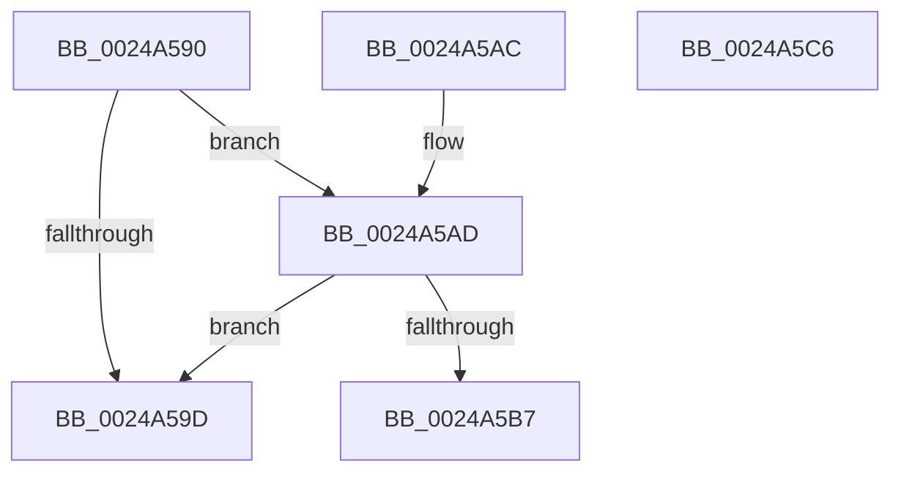

# ExReleaseSpinLockSharedFromDpcLevel

- RVA: `0x0024A590`–`0x0024A5C7` (길이 `55` bytes)
- VA: `0x000000014024A590`
- 실행 섹션: `.text`
- PDB 이름 있음: `예`; PDB Function 태그: `아니요`
- unwind 정보 RVA: `0x0005CF0C`
- 디코드: `16`개 명령, `55/55` bytes 표시
- 미해석 바이트: `0` (있으면 어셈블리에 `.byte`로 보존)

> 이 문서는 커널 이미지의 기계어와 PDB 기호를 분석해 생성했습니다. 4번과 5번은 함수 원형과 자료형을 바이너리 사용 방식에서 추정한 C 해석이며 원본 소스 복구 결과는 아닙니다.

## 1. Dependencies

- 직접 호출 지점: **1**; 고유 호출 대상: **1**
- 직접 호출자로 확인된 함수: **89**
- RIP 상대 이미지 참조: **2**

### Outgoing calls
- `0x0024A5BC` → [ExpReleaseSpinLockSharedFromDpcLevelInstrumented](../2F/ExpReleaseSpinLockSharedFromDpcLevelInstrumented_function_002F0F48.md) (function, `0x002F0F48`)

### Direct callers
- [KiAbConvertWaiterToOwnerEntry](../21/KiAbConvertWaiterToOwnerEntry_function_00219430.md) at `0x00219569`
- [KiAbConvertWaiterToOwnerEntry](../21/KiAbConvertWaiterToOwnerEntry_function_00219430.md) at `0x00219702`
- [MiCreateCombineAnchor](../22/MiCreateCombineAnchor_function_0022B178.md) at `0x0022B20F`
- [MiReferenceIoPages](../23/MiReferenceIoPages_function_0023C804.md) at `0x0023C9F8`
- [sub_00248832](Unknown_function_00248832.md) at `0x002489CC`
- [sub_00248B10](Unknown_function_00248B10.md) at `0x00248C00`
- [sub_00248B10](Unknown_function_00248B10.md) at `0x00248D00`
- [sub_00248B10](Unknown_function_00248B10.md) at `0x00248D58`
- [sub_00248B10](Unknown_function_00248B10.md) at `0x00248D77`
- [sub_00248B10](Unknown_function_00248B10.md) at `0x00248DFD`
- [sub_0024A15A](Unknown_function_0024A15A.md) at `0x0024A1C2`
- [sub_0024A238](Unknown_function_0024A238.md) at `0x0024A383`
- [PopPepProcessEvent](PopPepProcessEvent_function_0024B930.md) at `0x0024C3AC`
- [sub_0024D9E9](Unknown_function_0024D9E9.md) at `0x0024D9ED`
- [sub_0024DC36](Unknown_function_0024DC36.md) at `0x0024DC75`
- [KiAbEntryRemoveFromTree](../26/KiAbEntryRemoveFromTree_function_00262410.md) at `0x00262B2F`
- [ExProtectPoolEx](../26/ExProtectPoolEx_function_002695D8.md) at `0x002696DB`
- [ExProtectPoolEx](../26/ExProtectPoolEx_function_002695D8.md) at `0x00269743`
- [KiAbReleaseLocksForEntry](../27/KiAbReleaseLocksForEntry_function_002721F8.md) at `0x00272236`
- [MiWalkPageTablesRecursively](../27/MiWalkPageTablesRecursively_function_002796C0.md) at `0x00279BB4`
- [MiChargeCommit](../28/MiChargeCommit_function_00286EB0.md) at `0x002871B8`
- [MmIsFileObjectAPagingFile](../29/MmIsFileObjectAPagingFile_function_0029BDAC.md) at `0x0029BECB`
- [sub_0029BFC9](../29/Unknown_function_0029BFC9.md) at `0x0029C056`
- [sub_0029C55D](../29/Unknown_function_0029C55D.md) at `0x0029C581`
- [MiFreePageToSlabAllocator](../2A/MiFreePageToSlabAllocator_function_002A0A60.md) at `0x002A0BA2`
- [MiFreePageToSlabAllocator](../2A/MiFreePageToSlabAllocator_function_002A0A60.md) at `0x002A0BE7`
- [MiAbortCombineScan](../2A/MiAbortCombineScan_function_002A1160.md) at `0x002A11D4`
- [MiDereferenceIoPages](../2A/MiDereferenceIoPages_function_002AB1B0.md) at `0x002AB502`
- [MiUnlockIoPfnTree](../2A/MiUnlockIoPfnTree_function_002AC7F8.md) at `0x002AC83C`
- [MiUnlockIoPfnTree](../2A/MiUnlockIoPfnTree_function_002AC7F8.md) at `0x002AC85E`
- [MiFinishMdlForMappedFileFault](../2A/MiFinishMdlForMappedFileFault_function_002AC974.md) at `0x002ACA7E`
- [MiGetSlabRepurposedStandbyListWorker](../2A/MiGetSlabRepurposedStandbyListWorker_function_002AF534.md) at `0x002AF608`
- [MiStealPage](../2B/MiStealPage_function_002B28D0.md) at `0x002B3BCB`
- [MiStealPage](../2B/MiStealPage_function_002B28D0.md) at `0x002B3BF4`
- [MiLockStealUserVm](../2B/MiLockStealUserVm_function_002B3EDC.md) at `0x002B40EB`
- [MiReferencePfBackedSection](../2B/MiReferencePfBackedSection_function_002B9B70.md) at `0x002B9BE0`
- [MiReferencePfBackedSection](../2B/MiReferencePfBackedSection_function_002B9B70.md) at `0x002B9C94`
- [sub_002BC0AF](../2B/Unknown_function_002BC0AF.md) at `0x002BC0AF`
- [PopPepComponentSetLatency](../2B/PopPepComponentSetLatency_function_002BF3D8.md) at `0x002BF53C`
- [MiReassessZeroThreads](../2C/MiReassessZeroThreads_function_002CB0C0.md) at `0x002CB1E5`
- [MiAddZeroingThreads](../2C/MiAddZeroingThreads_function_002CBF78.md) at `0x002CC1E2`
- [MiAddZeroingThreads](../2C/MiAddZeroingThreads_function_002CBF78.md) at `0x002CC428`
- [KeSetUserGroupAffinityThread](../2C/KeSetUserGroupAffinityThread_function_002CD1C4.md) at `0x002CD27D`
- [KeSetUserGroupAffinityThread](../2C/KeSetUserGroupAffinityThread_function_002CD1C4.md) at `0x002CD360`
- [KiSetLegacyAffinityThread](../2C/KiSetLegacyAffinityThread_function_002CDD94.md) at `0x002CDEEE`
- [MiEmptyDecayClusterTimers](../2D/MiEmptyDecayClusterTimers_function_002DAB50.md) at `0x002DACFE`
- [MiEmptyDecayClusterTimers](../2D/MiEmptyDecayClusterTimers_function_002DAB50.md) at `0x002DAD43`
- [MiEmptyDecayClusterTimers](../2D/MiEmptyDecayClusterTimers_function_002DAB50.md) at `0x002DADC0`
- [MiEmptyDecayClusterTimers](../2D/MiEmptyDecayClusterTimers_function_002DAB50.md) at `0x002DADF0`
- [sub_002E0B15](../2E/Unknown_function_002E0B15.md) at `0x002E0F5C`
- [InsertEventEntryInLookUpTable](../2F/InsertEventEntryInLookUpTable_function_002F1424.md) at `0x002F15DB`
- [KeSetSelectedCpuSetsThread](../30/KeSetSelectedCpuSetsThread_function_003033D0.md) at `0x003034A1`
- [MiProcessorParked](../30/MiProcessorParked_function_003044A4.md) at `0x003044D8`
- [MiSharePages](../31/MiSharePages_function_00315110.md) at `0x003155DD`
- [MiVadSupportsCombine](../31/MiVadSupportsCombine_function_00316610.md) at `0x0031664C`
- [MiObtainReferencedVadEx](../31/MiObtainReferencedVadEx_function_00316690.md) at `0x0031672C`
- [MiReturnLockedVadOrNextVa](../31/MiReturnLockedVadOrNextVa_function_00316980.md) at `0x00316AEC`
- [MiReturnLockedVadOrNextVa](../31/MiReturnLockedVadOrNextVa_function_00316980.md) at `0x00316D35`
- [MiIsFaultPteIntact](../32/MiIsFaultPteIntact_function_003288A0.md) at `0x00328984`
- [sub_0032F7AB](../32/Unknown_function_0032F7AB.md) at `0x0032FB6F`
- [PfSnGetFileInformation](../34/PfSnGetFileInformation_function_00343210.md) at `0x003432FA`
- [MiCompleteProtoPteFault](../34/MiCompleteProtoPteFault_function_00345710.md) at `0x0034613A`
- [IopFindDiskIoAttribution](../34/IopFindDiskIoAttribution_function_00349670.md) at `0x003496EB`
- [vDbgPrintExWithPrefixInternalHelper](../35/vDbgPrintExWithPrefixInternalHelper_function_003593C0.md) at `0x003595DE`
- [vDbgPrintExWithPrefixInternalHelper](../35/vDbgPrintExWithPrefixInternalHelper_function_003593C0.md) at `0x003596D1`
- [MiZeroCfgSystemWideBitmapWorker](../36/MiZeroCfgSystemWideBitmapWorker_function_00367060.md) at `0x003675CA`
- [MiLockPageListAndFirstPage](../37/MiLockPageListAndFirstPage_function_0037573C.md) at `0x00375832`
- [MiLockPageListAndFirstPage](../37/MiLockPageListAndFirstPage_function_0037573C.md) at `0x003758B9`
- [MiObtainPagefileHashes](../38/MiObtainPagefileHashes_function_00381AC8.md) at `0x00381B76`
- [MiGetPartitionNodeInformation](../3B/MiGetPartitionNodeInformation_function_003B8D48.md) at `0x003B8E13`
- [KiUpdateProcessAvailableCpuState](../3C/KiUpdateProcessAvailableCpuState_function_003C00B4.md) at `0x003C012D`
- [sub_003C67DC](../3C/Unknown_function_003C67DC.md) at `0x003C6808`
- [sub_003C67DC](../3C/Unknown_function_003C67DC.md) at `0x003C6866`
- [sub_003CB529](../3C/Unknown_function_003CB529.md) at `0x003CB582`
- [MiGetPrototypePteRanges](../3E/MiGetPrototypePteRanges_function_003E0720.md) at `0x003E099B`
- [ViAvlReleaseTableLockFromDpcLevel](../3E/ViAvlReleaseTableLockFromDpcLevel_function_003EF5D0.md) at `0x003EF5FE`
- [MiInPagePageTable](../3E/MiInPagePageTable_function_003EF8DC.md) at `0x003EFA9E`
- [MiInPagePageTable](../3E/MiInPagePageTable_function_003EF8DC.md) at `0x003EFB04`
- [MiUpdatePrefetchPriority](../40/MiUpdatePrefetchPriority_function_00402CB0.md) at `0x00402E36`
- [MiEndingOffsetWithLock](../40/MiEndingOffsetWithLock_function_00404718.md) at `0x00404845`
- [MiLockPageListAndLastPage](../41/MiLockPageListAndLastPage_function_00411BA0.md) at `0x00411DC4`
- [MiLockPageListAndLastPage](../41/MiLockPageListAndLastPage_function_00411BA0.md) at `0x00411DF7`
- [VmpProcessContextUnlockShared](../42/VmpProcessContextUnlockShared_function_00429DFC.md) at `0x00429E05`
- [MiGetSharedProtosAtDpc](../42/MiGetSharedProtosAtDpc_function_0042F924.md) at `0x0042F954`
- [MiStartingOffsetNeedLock](../44/MiStartingOffsetNeedLock_function_00443964.md) at `0x004439E6`
- [sub_004458DF](../44/Unknown_function_004458DF.md) at `0x0044590B`
- [MiDecayPfnFullyInitialized](../44/MiDecayPfnFullyInitialized_function_00447748.md) at `0x0044789F`
- [MiSystemImageHasPrivateFixups](../45/MiSystemImageHasPrivateFixups_function_004507E0.md) at `0x004508B2`
- [VmpInvalidateOutstandingFaults](../46/VmpInvalidateOutstandingFaults_function_004639AC.md) at `0x00463ADA`
- [MiPurgeSlabEntries](../48/MiPurgeSlabEntries_function_0048D258.md) at `0x0048D376`
- [KiVpBackingThreadYieldExecution](../4D/KiVpBackingThreadYieldExecution_function_004DF1A4.md) at `0x004DF308`
- [MiStopHugePageAccessor](../4F/MiStopHugePageAccessor_function_004F6A68.md) at `0x004F6B66`
- [DbgEnumerateCallback](../5E/DbgEnumerateCallback_function_005E5740.md) at `0x005E57B2`
- [DbgpRemoveDebugPrintCallback](../5E/DbgpRemoveDebugPrintCallback_function_005E59E4.md) at `0x005E5A6A`
- [DbgpRemoveDebugPrintCallback](../5E/DbgpRemoveDebugPrintCallback_function_005E59E4.md) at `0x005E5ADE`
- [RtlpReleasePropStoreLockShared](../5E/RtlpReleasePropStoreLockShared_function_005E85B0.md) at `0x005E85B9`
- [ViPtReleaseTreeLockFromDpcLevel](../61/ViPtReleaseTreeLockFromDpcLevel_function_006139C0.md) at `0x006139EF`
- [CarReleaseDbLockFromDpcLevel](../61/CarReleaseDbLockFromDpcLevel_function_0061B5DC.md) at `0x0061B60E`
- [DifReleaseSpinLockFromDpcLevelSafe](../61/DifReleaseSpinLockFromDpcLevelSafe_function_0061BEAC.md) at `0x0061BED7`
- [MiGetPageInHugePageBadStatus](../67/MiGetPageInHugePageBadStatus_function_00675ADC.md) at `0x00675BD0`
- [MiFreezeIoPfnNode](../67/MiFreezeIoPfnNode_function_0067BDAC.md) at `0x0067BE61`
- [MiDbgUnTranslatePhysicalAddress](../68/MiDbgUnTranslatePhysicalAddress_function_00685AF8.md) at `0x00685BA9`
- [MmReadProcessPageTables](../68/MmReadProcessPageTables_function_006866C8.md) at `0x0068697C`
- [MiFindPageFileMemoryExtent](../69/MiFindPageFileMemoryExtent_function_00694F70.md) at `0x0069500F`
- [MiGetPrototypePteBoundaries](../69/MiGetPrototypePteBoundaries_function_006995B8.md) at `0x00699637`
- [sub_006DBEFE](../6D/Unknown_function_006DBEFE.md) at `0x006DBF16`
- [sub_006DDDE8](../6D/Unknown_function_006DDDE8.md) at `0x006DDDF3`
- [sub_006E362E](../6E/Unknown_function_006E362E.md) at `0x006E391D`
- [sub_006E362E](../6E/Unknown_function_006E362E.md) at `0x006E39DA`
- [sub_006E42AA](../6E/Unknown_function_006E42AA.md) at `0x006E42FC`
- [sub_006F59B4](../6F/Unknown_function_006F59B4.md) at `0x006F5A44`
- [ViDeadlockDetectionUnlock](../../pagevrfy/BA/ViDeadlockDetectionUnlock_function_00BA91FC.md) at `0x00BA920B`

### Static image references
- `0x0024A594` → RVA `0x00FC6B06` (`ALMOSTRO`; read)
- `0x0024A5AD` → RVA `0x00F0DE58` (`.data`; read)

## 2. Other-region calls and transfers

- 다른 실행 섹션으로 향하는 call: **0**
- 별도 외부 분기/꼬리 이동을 확인하지 못했습니다.

## 3. Assembly (complete function range)

```asm
0024A590  48 83 EC 28                     sub rsp, 0x28
0024A594  F6 05 6B C5 D7 00 01            test byte ptr [rip + 0xd7c56b], 1
0024A59B  75 10                           jne 0x14024a5ad
0024A59D  F0 81 21 FF FF FF BF            lock and dword ptr [rcx], 0xbfffffff
0024A5A4  F0 FF 09                        lock dec dword ptr [rcx]
0024A5A7  48 83 C4 28                     add rsp, 0x28
0024A5AB  C3                              ret
0024A5AC  CC                              int3
0024A5AD  8B 05 A5 38 CC 00               mov eax, dword ptr [rip + 0xcc38a5]
0024A5B3  85 C0                           test eax, eax
0024A5B5  75 E6                           jne 0x14024a59d
0024A5B7  48 8B 54 24 28                  mov rdx, qword ptr [rsp + 0x28]
0024A5BC  E8 87 69 0A 00                  call 0x1402f0f48
0024A5C1  48 83 C4 28                     add rsp, 0x28
0024A5C5  C3                              ret
0024A5C6  CC                              int3
```

## 4. C-style interpretation (structured pseudocode)

```c
__int64 __fastcall ExReleaseSpinLockSharedFromDpcLevel(__int64 a1)
{
    __int64 result;
    __int64 v_rsp;
    unsigned __int64 v_stack_p28;

    v_rsp = (v_rsp) - (40);
    if (((*(unsigned __int8 *)(v_rip + 14140779)) & (1)) != 0) goto loc_0024A5AD;
loc_0024A59D:
    v_rsp = (v_rsp) + (40);
    return result;
loc_0024A5AD:
    if ((unsigned int)((unsigned int)(*(unsigned int *)(v_rip + 13383845))) != 0) goto loc_0024A59D;
    result = ExpReleaseSpinLockSharedFromDpcLevelInstrumented(a1, v_stack_p28, a3, a4);
    v_rsp = (v_rsp) + (40);
    return result;
}
```

## 5. (Beta) C Style

```c
int64_t ExReleaseSpinLockSharedFromDpcLevel(void *Arg1)
{
    uint8_t *arg1 = (uint8_t *)Arg1;

    int64_t result;
    int64_t local_rsp;
    uint64_t v_stack_p28;

    local_rsp = (local_rsp) - (40);
    if (((*(uint8_t *)(v_rip + 0xD7C56B)) & (1)) != 0) goto loc_0024A5AD;
loc_0024A59D:
    local_rsp = (local_rsp) + (40);
    return result;
loc_0024A5AD:
    if ((uint32_t)((uint32_t)(*(uint32_t *)(v_rip + 0xCC38A5))) != 0) goto loc_0024A59D;
    result = ExpReleaseSpinLockSharedFromDpcLevelInstrumented(Arg1, v_stack_p28, a3, a4);
    local_rsp = (local_rsp) + (40);
    return result;
}
```

### 관측된 메모리 오프셋

구조체 형식이 확인되지 않은 접근은 인자 기준의 오프셋으로만 기록했습니다.

| 기준 인자 | 오프셋 표현 | 폭 (bit) | 접근 |
|---|---:|---:|---|
| `Arg1` | `+ 0x0` | `32` | `R/W` |

## 6. Execution-region graph

[열기: 2D/3D 그래프와 함수 탐색 컨트롤 패널](../../../control-panel.html?section=text&rva=0x0024A590&view=graph)

- 2D 그래프는 위에서 아래로 흐르고, 3D 그래프는 빈 공간을 드래그해 회전합니다. Shift+드래그는 이동, 휠은 확대·축소, 함수 노드 선택은 대상 보고서 이동입니다.

### Static fallback


