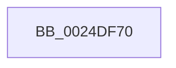

# IoFreeIrp

- RVA: `0x0024DF70`–`0x0024DF8A` (길이 `26` bytes)
- VA: `0x000000014024DF70`
- 실행 섹션: `.text`
- PDB 이름 있음: `예`; PDB Function 태그: `아니요`
- unwind 정보 RVA: `0x00062FDC`
- 디코드: `6`개 명령, `26/26` bytes 표시
- 미해석 바이트: `0` (있으면 어셈블리에 `.byte`로 보존)

> 이 문서는 커널 이미지의 기계어와 PDB 기호를 분석해 생성했습니다. 4번과 5번은 함수 원형과 자료형을 바이너리 사용 방식에서 추정한 C 해석이며 원본 소스 복구 결과는 아닙니다.

## 1. Dependencies

- 직접 호출 지점: **0**; 고유 호출 대상: **0**
- 직접 호출자로 확인된 함수: **50**
- RIP 상대 이미지 참조: **1**

### Outgoing calls
- 직접 디코드된 call 명령이 없습니다.

### Direct callers
- [IopBuildDeviceIoControlRequest](../20/IopBuildDeviceIoControlRequest_function_00205B00.md) at `0x00205D82`
- [IopBuildDeviceIoControlRequest](../20/IopBuildDeviceIoControlRequest_function_00205B00.md) at `0x00205D91`
- [sub_002072CB](../20/Unknown_function_002072CB.md) at `0x0020734C`
- [IopCompleteRequest](../20/IopCompleteRequest_function_0020AF50.md) at `0x0020B12B`
- [IopCompleteRequest](../20/IopCompleteRequest_function_0020AF50.md) at `0x0020B1A1`
- [IopCompleteRequest](../20/IopCompleteRequest_function_0020AF50.md) at `0x0020B3EB`
- [IopCompleteRequest](../20/IopCompleteRequest_function_0020AF50.md) at `0x0020B4C4`
- [IoRemoveIoCompletion](../20/IoRemoveIoCompletion_function_0020B580.md) at `0x0020B854`
- [sub_00210801](../21/Unknown_function_00210801.md) at `0x002108FE`
- [IopCompleteIrpInFileObjectList](IopCompleteIrpInFileObjectList_function_0024F330.md) at `0x0024F888`
- [PnpDeviceCompletionRoutine](../26/PnpDeviceCompletionRoutine_function_0026E6C0.md) at `0x0026E737`
- [PopFreeIrp](../26/PopFreeIrp_function_0026FAA0.md) at `0x0026FB6F`
- [IopCompletePageWrite](../29/IopCompletePageWrite_function_00298010.md) at `0x00298041`
- [IopCompletePageWrite](../29/IopCompletePageWrite_function_00298010.md) at `0x0029808C`
- [IopfCompleteRequest](../29/IopfCompleteRequest_function_0029B5F8.md) at `0x0029B81E`
- [IopfCompleteRequest](../29/IopfCompleteRequest_function_0029B5F8.md) at `0x0029B98C`
- [IopBuildAsynchronousFsdRequest](../29/IopBuildAsynchronousFsdRequest_function_0029DD40.md) at `0x0029DEB6`
- [IopBuildAsynchronousFsdRequest](../29/IopBuildAsynchronousFsdRequest_function_0029DD40.md) at `0x0029DEDC`
- [PopFxDestroyDeviceDpm](../4E/PopFxDestroyDeviceDpm_function_004E394C.md) at `0x004E39A4`
- [FsRtlGetFileExtents](../58/FsRtlGetFileExtents_function_00580F40.md) at `0x00581027`
- [IopDeviceEjectComplete](../5A/IopDeviceEjectComplete_function_005AA4E0.md) at `0x005AA51F`
- [PnpDiagnosticCompletionRoutine](../5A/PnpDiagnosticCompletionRoutine_function_005AA540.md) at `0x005AA56B`
- [SmpDeviceIoCompletion](../61/SmpDeviceIoCompletion_function_00610CC0.md) at `0x00610D1D`
- [DifIoFreeIrpWrapper](../62/DifIoFreeIrpWrapper_function_0062A470.md) at `0x0062A536`
- [IoCancelFileOpen](../../page/70/IoCancelFileOpen_function_007034A0.md) at `0x0070358F`
- [NT_DISK::Read](../../page/71/NT_DISK_Read_function_00717100.md) at `0x0071717A`
- [NT_DISK::Write](../../page/71/NT_DISK_Write_function_007171A0.md) at `0x0071721A`
- [IopCancelPendingEject](../../page/73/IopCancelPendingEject_function_0073DBF4.md) at `0x0073DC2A`
- [PopAcquirePowerLimitInterface](../../page/75/PopAcquirePowerLimitInterface_function_00755E10.md) at `0x00755EAA`
- [PopAcquireCoolingInterface](../../page/75/PopAcquireCoolingInterface_function_00756DF0.md) at `0x00756E5E`
- [PopConnectToPolicyDevice](../../page/76/PopConnectToPolicyDevice_function_00765D20.md) at `0x00765E69`
- [PopPolicyDeviceRemove](../../page/76/PopPolicyDeviceRemove_function_00766414.md) at `0x0076645E`
- [SmKmIsVolumeIoPossible](../../page/7A/SmKmIsVolumeIoPossible_function_007A84BC.md) at `0x007A85B0`
- [sub_00863F57](../../page/86/Unknown_function_00863F57.md) at `0x00863F89`
- [IopCloseFile](../../page/86/IopCloseFile_function_008640C0.md) at `0x00864238`
- [CmpGetVolumeClusterSize](../../page/87/CmpGetVolumeClusterSize_function_0087B3D4.md) at `0x0087B539`
- [IopParseDevice](../../page/89/IopParseDevice_function_0089E510.md) at `0x0089ED3A`
- [IopParseDevice](../../page/89/IopParseDevice_function_0089E510.md) at `0x0089F129`
- [IopParseDevice](../../page/89/IopParseDevice_function_0089E510.md) at `0x0089FA2F`
- [IopParseDevice](../../page/89/IopParseDevice_function_0089E510.md) at `0x0089FAFF`
- [IopParseDevice](../../page/89/IopParseDevice_function_0089E510.md) at `0x0089FD2F`
- [IopParseDevice](../../page/89/IopParseDevice_function_0089E510.md) at `0x008A01AC`
- [IopParseDevice](../../page/89/IopParseDevice_function_0089E510.md) at `0x008A0650`
- [IopParseDevice](../../page/89/IopParseDevice_function_0089E510.md) at `0x008A083A`
- [IopExceptionCleanupEx](../../page/8A/IopExceptionCleanupEx_function_008AE5C8.md) at `0x008AE62E`
- [IopFreeCompletionListPackets](../../page/9A/IopFreeCompletionListPackets_function_009A8248.md) at `0x009A8295`
- [CmpFileFlushAndPurge](../../page/9B/CmpFileFlushAndPurge_function_009B2BAC.md) at `0x009B2D1B`
- [WmipSendWmiIrp](../../page/9E/WmipSendWmiIrp_function_009E0484.md) at `0x009E0535`
- [WmipSendWmiIrpToTraceDeviceList](../../page/9E/WmipSendWmiIrpToTraceDeviceList_function_009E2988.md) at `0x009E2A8F`
- [FsRtlQueryKernelEaFile](../../page/A0/FsRtlQueryKernelEaFile_function_00A0C680.md) at `0x00A0C874`
- [FsRtlSetKernelEaFile](../../page/A0/FsRtlSetKernelEaFile_function_00A0C8B0.md) at `0x00A0CA3D`
- [FsRtlKernelFsControlFile](../../page/A0/FsRtlKernelFsControlFile_function_00A0CA70.md) at `0x00A0CD98`
- [IopUserCompletion](../../page/A3/IopUserCompletion_function_00A34070.md) at `0x00A34078`
- [FsRtlQueryInformationFile](../../page/A3/FsRtlQueryInformationFile_function_00A38780.md) at `0x00A3891F`
- [WmipSetTraceNotify](../../page/AB/WmipSetTraceNotify_function_00ABF0E0.md) at `0x00ABF1E1`
- [SmKmFileInfoCleanup](../../page/AC/SmKmFileInfoCleanup_function_00AC9A90.md) at `0x00AC9AEA`
- [FsRtlQueryKernelEaFile$fin$0](../../page/B1/FsRtlQueryKernelEaFile_fin_0_function_00B10F8B.md) at `0x00B10FB6`
- [FsRtlSetKernelEaFile$fin$0](../../page/B1/FsRtlSetKernelEaFile_fin_0_function_00B10FCA.md) at `0x00B10FF5`
- [FsRtlKernelFsControlFile$fin$0](../../page/B1/FsRtlKernelFsControlFile_fin_0_function_00B11009.md) at `0x00B11034`
- [FsRtlQueryInformationFile$fin$0](../../page/B1/FsRtlQueryInformationFile_fin_0_function_00B1159D.md) at `0x00B115C8`
- [sub_00B406D6](../../page/B4/Unknown_function_00B406D6.md) at `0x00B4071A`
- [sub_00B42864](../../page/B4/Unknown_function_00B42864.md) at `0x00B42867`
- [sub_00B4A87C](../../page/B4/Unknown_function_00B4A87C.md) at `0x00B4A87F`
- [VfIrpSendSynchronousIrp](../../pagevrfy/B9/VfIrpSendSynchronousIrp_function_00B9DEF0.md) at `0x00B9E044`

### Static image references
- `0x0024DF79` → RVA `0x00FC6E98` (`ALMOSTRO`; read)

## 2. Other-region calls and transfers

- 다른 실행 섹션으로 향하는 call: **0**
- call이 아닌 외부 분기/꼬리 이동: **1**
  - `0x0024DF84` → [sub_0024E5B0](Unknown_function_0024E5B0.md) (`tail-transfer`)

## 3. Assembly (complete function range)

```asm
0024DF70  40 53                           push rbx
0024DF72  48 81 EC 80 00 00 00            sub rsp, 0x80
0024DF79  8B 05 19 8F D7 00               mov eax, dword ptr [rip + 0xd78f19]
0024DF7F  48 8B D9                        mov rbx, rcx
0024DF82  85 C0                           test eax, eax
0024DF84  0F 85 26 06 00 00               jne 0x14024e5b0
```

## 4. C-style interpretation (structured pseudocode)

```c
__int64 __fastcall IoFreeIrp(__int64 a1)
{
    __int64 v_rsp;

    v_rsp = (v_rsp) - (128);
}
```

## 5. (Beta) C Style

```c
int64_t IoFreeIrp(int64_t Arg1)
{
    int64_t local_rsp;

    local_rsp = (local_rsp) - (128);
}
```

## 6. Execution-region graph

[열기: 2D/3D 그래프와 함수 탐색 컨트롤 패널](../../../control-panel.html?section=text&rva=0x0024DF70&view=graph)

- 2D 그래프는 위에서 아래로 흐르고, 3D 그래프는 빈 공간을 드래그해 회전합니다. Shift+드래그는 이동, 휠은 확대·축소, 함수 노드 선택은 대상 보고서 이동입니다.

### Static fallback


