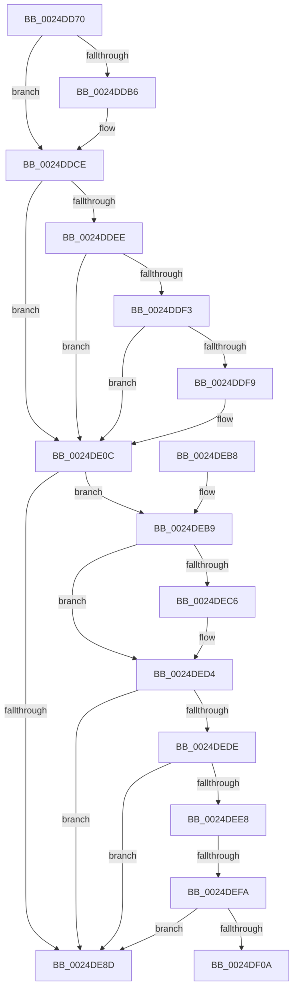

# IoReuseIrp

- RVA: `0x0024DD70`–`0x0024DF0F` (길이 `415` bytes)
- VA: `0x000000014024DD70`
- 실행 섹션: `.text`
- PDB 이름 있음: `예`; PDB Function 태그: `예`
- unwind 정보 RVA: `0x00062FA4`
- 디코드: `108`개 명령, `415/415` bytes 표시
- 미해석 바이트: `0` (있으면 어셈블리에 `.byte`로 보존)

> 이 문서는 커널 이미지의 기계어와 PDB 기호를 분석해 생성했습니다. 4번과 5번은 함수 원형과 자료형을 바이너리 사용 방식에서 추정한 C 해석이며 원본 소스 복구 결과는 아닙니다.

## 1. Dependencies

- 직접 호출 지점: **7**; 고유 호출 대상: **7**
- 직접 호출자로 확인된 함수: **8**
- RIP 상대 이미지 참조: **5**

### Outgoing calls
- `0x0024DDC1` → [VfIoInitializeIrp](../../pagevrfy/BB/VfIoInitializeIrp_function_00BB66D4.md) (function, `0x00BB66D4`)
- `0x0024DDC9` → [IovpLogStackTrace](../../pagevrfy/BB/IovpLogStackTrace_function_00BB6A5C.md) (function, `0x00BB6A5C`)
- `0x0024DE16` → [IopFreeIrpExtension](IopFreeIrpExtension_function_0024EDB0.md) (function, `0x0024EDB0`)
- `0x0024DE2E` → [memset](../6C/memset_function_006C6C40.md) (function, `0x006C6C40`)
- `0x0024DE95` → [_security_check_cookie](../6A/_security_check_cookie_function_006AC640.md) (function, `0x006AC640`)
- `0x0024DEED` → [IopIrpHasExtensionType](../3F/IopIrpHasExtensionType_function_003F4080.md) (function, `0x003F4080`)
- `0x0024DF01` → [IopIsActivityTracingEventEnabled](../4B/IopIsActivityTracingEventEnabled_function_004BA134.md) (function, `0x004BA134`)

### Direct callers
- [PopAllocateIrp](../27/PopAllocateIrp_function_0027116C.md) at `0x002712AD`
- [PopThermalWorker](../../page/A4/PopThermalWorker_function_00A4E200.md) at `0x00A4E352`
- [PopThermalWorker](../../page/A4/PopThermalWorker_function_00A4E200.md) at `0x00A4E4D3`
- [PopPrepareIoctl](../../page/A7/PopPrepareIoctl_function_00A74A98.md) at `0x00A74ABC`
- [PopBatteryQueryEstimatedTime](../../page/A9/PopBatteryQueryEstimatedTime_function_00A98E80.md) at `0x00A98EBB`
- [PopFanWorker](../../page/A9/PopFanWorker_function_00A9B050.md) at `0x00A9B1FF`
- [PopBatteryReadTag](../../page/AC/PopBatteryReadTag_function_00AC5E1C.md) at `0x00AC5E44`
- [SmKmFileInfoCleanup](../../page/AC/SmKmFileInfoCleanup_function_00AC9A90.md) at `0x00AC9ACE`
- [PopBatteryWaitTag](../../page/AD/PopBatteryWaitTag_function_00AD2BF8.md) at `0x00AD2C24`

### Static image references
- `0x0024DD8C` → RVA `0x00E0A740` (`.data`; read)
- `0x0024DD9B` → RVA `0x00F04A20` (`.data`; read)
- `0x0024DED4` → RVA `0x00E66114` (`.data`; read)
- `0x0024DEDE` → RVA `0x00E66108` (`.data`; read)
- `0x0024DEFA` → RVA `0x00023048` (`.rdata`; read)

## 2. Other-region calls and transfers

- 다른 실행 섹션으로 향하는 call: **2**
  - `0x0024DDC1` → [VfIoInitializeIrp](../../pagevrfy/BB/VfIoInitializeIrp_function_00BB66D4.md) (`.text` → `PAGEVRFY`)
  - `0x0024DDC9` → [IovpLogStackTrace](../../pagevrfy/BB/IovpLogStackTrace_function_00BB6A5C.md) (`.text` → `PAGEVRFY`)
- call이 아닌 외부 분기/꼬리 이동: **2**
  - `0x0024DEF4` → [sub_006D81E4](../6D/Unknown_function_006D81E4.md) (`tail-transfer`)
  - `0x0024DF0A` → [sub_006D81E4](../6D/Unknown_function_006D81E4.md) (`tail-transfer`)

## 3. Assembly (complete function range)

```asm
0024DD70  48 89 5C 24 10                  mov qword ptr [rsp + 0x10], rbx
0024DD75  48 89 6C 24 18                  mov qword ptr [rsp + 0x18], rbp
0024DD7A  48 89 74 24 20                  mov qword ptr [rsp + 0x20], rsi
0024DD7F  57                              push rdi
0024DD80  41 54                           push r12
0024DD82  41 55                           push r13
0024DD84  41 56                           push r14
0024DD86  41 57                           push r15
0024DD88  48 83 EC 60                     sub rsp, 0x60
0024DD8C  48 8B 05 AD C9 BB 00            mov rax, qword ptr [rip + 0xbbc9ad]
0024DD93  48 33 C4                        xor rax, rsp
0024DD96  48 89 44 24 50                  mov qword ptr [rsp + 0x50], rax
0024DD9B  8B 05 7F 6C CB 00               mov eax, dword ptr [rip + 0xcb6c7f]
0024DDA1  45 32 F6                        xor r14b, r14b
0024DDA4  0F 57 C0                        xorps xmm0, xmm0
0024DDA7  44 8B E2                        mov r12d, edx
0024DDAA  48 8B D9                        mov rbx, rcx
0024DDAD  0F 11 44 24 40                  movups xmmword ptr [rsp + 0x40], xmm0
0024DDB2  A8 10                           test al, 0x10
0024DDB4  74 18                           je 0x14024ddce
0024DDB6  48 8B 94 24 88 00 00 00         mov rdx, qword ptr [rsp + 0x88]
0024DDBE  41 B0 01                        mov r8b, 1
0024DDC1  E8 0E 89 96 00                  call 0x140bb66d4
0024DDC6  48 8B CB                        mov rcx, rbx
0024DDC9  E8 8E 8C 96 00                  call 0x140bb6a5c
0024DDCE  0F B6 73 47                     movzx esi, byte ptr [rbx + 0x47]
0024DDD2  4C 0F BE 7B 42                  movsx r15, byte ptr [rbx + 0x42]
0024DDD7  40 80 E6 6D                     and sil, 0x6d
0024DDDB  44 0F B7 6B 02                  movzx r13d, word ptr [rbx + 2]
0024DDE0  48 8B 83 C8 00 00 00            mov rax, qword ptr [rbx + 0xc8]
0024DDE7  90                              nop
0024DDE8  44 38 73 47                     cmp byte ptr [rbx + 0x47], r14b
0024DDEC  7C 1E                           jl 0x14024de0c
0024DDEE  48 85 C0                        test rax, rax
0024DDF1  74 19                           je 0x14024de0c
0024DDF3  F6 40 02 01                     test byte ptr [rax + 2], 1
0024DDF7  74 13                           je 0x14024de0c
0024DDF9  48 8B 83 C8 00 00 00            mov rax, qword ptr [rbx + 0xc8]
0024DE00  41 B6 01                        mov r14b, 1
0024DE03  0F 10 40 18                     movups xmm0, xmmword ptr [rax + 0x18]
0024DE07  0F 11 44 24 40                  movups xmmword ptr [rsp + 0x40], xmm0
0024DE0C  45 33 C0                        xor r8d, r8d
0024DE0F  48 8B CB                        mov rcx, rbx
0024DE12  41 8D 50 FF                     lea edx, [r8 - 1]
0024DE16  E8 95 0F 00 00                  call 0x14024edb0
0024DE1B  48 8B AB C8 00 00 00            mov rbp, qword ptr [rbx + 0xc8]
0024DE22  4D 8B C5                        mov r8, r13
0024DE25  0F B7 7B 04                     movzx edi, word ptr [rbx + 4]
0024DE29  33 D2                           xor edx, edx
0024DE2B  48 8B CB                        mov rcx, rbx
0024DE2E  E8 0D 8E 47 00                  call 0x1406c6c40
0024DE33  66 C7 03 06 00                  mov word ptr [rbx], 6
0024DE38  41 8D 47 01                     lea eax, [r15 + 1]
0024DE3C  88 43 43                        mov byte ptr [rbx + 0x43], al
0024DE3F  66 44 89 6B 02                  mov word ptr [rbx + 2], r13w
0024DE44  44 88 7B 42                     mov byte ptr [rbx + 0x42], r15b
0024DE48  65 48 8B 04 25 88 01 00 00      mov rax, qword ptr gs:[0x188]
0024DE51  0F B6 88 4A 02 00 00            movzx ecx, byte ptr [rax + 0x24a]
0024DE58  48 8D 43 20                     lea rax, [rbx + 0x20]
0024DE5C  88 4B 46                        mov byte ptr [rbx + 0x46], cl
0024DE5F  48 89 40 08                     mov qword ptr [rax + 8], rax
0024DE63  48 89 00                        mov qword ptr [rax], rax
0024DE66  4A 8D 04 FD 1A 00 00 00         lea rax, [r15*8 + 0x1a]
0024DE6E  49 03 C7                        add rax, r15
0024DE71  66 89 7B 04                     mov word ptr [rbx + 4], di
0024DE75  40 88 73 47                     mov byte ptr [rbx + 0x47], sil
0024DE79  44 89 63 30                     mov dword ptr [rbx + 0x30], r12d
0024DE7D  48 8D 04 C3                     lea rax, [rbx + rax*8]
0024DE81  48 89 83 B8 00 00 00            mov qword ptr [rbx + 0xb8], rax
0024DE88  48 85 ED                        test rbp, rbp
0024DE8B  75 2C                           jne 0x14024deb9
0024DE8D  48 8B 4C 24 50                  mov rcx, qword ptr [rsp + 0x50]
0024DE92  48 33 CC                        xor rcx, rsp
0024DE95  E8 A6 E7 45 00                  call 0x1406ac640
0024DE9A  4C 8D 5C 24 60                  lea r11, [rsp + 0x60]
0024DE9F  49 8B 5B 38                     mov rbx, qword ptr [r11 + 0x38]
0024DEA3  49 8B 6B 40                     mov rbp, qword ptr [r11 + 0x40]
0024DEA7  49 8B 73 48                     mov rsi, qword ptr [r11 + 0x48]
0024DEAB  49 8B E3                        mov rsp, r11
0024DEAE  41 5F                           pop r15
0024DEB0  41 5E                           pop r14
0024DEB2  41 5D                           pop r13
0024DEB4  41 5C                           pop r12
0024DEB6  5F                              pop rdi
0024DEB7  C3                              ret
0024DEB8  CC                              int3
0024DEB9  48 89 AB C8 00 00 00            mov qword ptr [rbx + 0xc8], rbp
0024DEC0  41 80 FE 01                     cmp r14b, 1
0024DEC4  75 0E                           jne 0x14024ded4
0024DEC6  0F 10 44 24 40                  movups xmm0, xmmword ptr [rsp + 0x40]
0024DECB  66 83 4D 02 01                  or word ptr [rbp + 2], 1
0024DED0  0F 11 45 18                     movups xmmword ptr [rbp + 0x18], xmm0
0024DED4  8B 05 3A 82 C1 00               mov eax, dword ptr [rip + 0xc1823a]
0024DEDA  A8 04                           test al, 4
0024DEDC  74 AF                           je 0x14024de8d
0024DEDE  8B 05 24 82 C1 00               mov eax, dword ptr [rip + 0xc18224]
0024DEE4  A8 01                           test al, 1
0024DEE6  74 A5                           je 0x14024de8d
0024DEE8  33 D2                           xor edx, edx
0024DEEA  48 8B CB                        mov rcx, rbx
0024DEED  E8 8E 61 1A 00                  call 0x1403f4080
0024DEF2  84 C0                           test al, al
0024DEF4  0F 84 EA A2 48 00               je 0x1406d81e4
0024DEFA  48 8D 0D 47 51 DD FF            lea rcx, [rip - 0x22aeb9]
0024DF01  E8 2E C2 26 00                  call 0x1404ba134
0024DF06  84 C0                           test al, al
0024DF08  74 83                           je 0x14024de8d
0024DF0A  E9 D5 A2 48 00                  jmp 0x1406d81e4
```

## 4. C-style interpretation (structured pseudocode)

```c
__int64 __fastcall IoReuseIrp(__int64 a1, int a2)
{
    __int64 result;
    __int64 v_r14;
    __int64 v_rsi;
    __int64 v_rsp;
    unsigned __int64 v_stack_m20;
    unsigned __int64 v_stack_m28;
    unsigned __int64 v_stack_m38;
    unsigned __int64 v_stack_m48;
    unsigned __int64 v_stack_p0;
    unsigned __int64 v_stack_p10;
    unsigned __int64 v_stack_p18;
    unsigned __int64 v_stack_p20;

    v_stack_p10 = v_rbx;
    v_stack_p18 = v_rbp;
    v_stack_p20 = v_rsi;
    v_rsp = (v_rsp) - (96);
    result = (*(unsigned __int64 *)(v_rip + 12306861)) ^ (v_rsp);
    v_stack_m38 = result;
    v_r14 = 0;
    v_stack_m48 = v_xmm0;
    result = (unsigned int)(*(unsigned int *)(v_rip + 13331583));
    if ((((unsigned __int8)((unsigned int)(*(unsigned int *)(v_rip + 13331583)))) & (16)) != 0) {
        a2 = v_stack_p0;
        a3 = 1;
        result = VfIoInitializeIrp(a1, a2, a3, a4);
        a1 = a1;
        result = IovpLogStackTrace(a1, a2, a3, a4);
    }
    v_rsi = (unsigned __int8)((*(unsigned __int8 *)(a1 + 71)) & (109));
    if ((*(unsigned __int8 *)(a1 + 71)) < 0) goto loc_0024DE0C;
    if (*(unsigned __int64 *)(a1 + 200) == 0) goto loc_0024DE0C;
    result = *(unsigned __int64 *)(a1 + 200);
    if (((*(unsigned __int8 *)(*(unsigned __int64 *)(a1 + 200) + 2)) & (1)) != 0) {
        result = *(unsigned __int64 *)(a1 + 200);
        v_r14 = 1;
        v_stack_m48 = v_xmm0;
    }
    a3 = 0;
    result = IopFreeIrpExtension(a1, a3 - 1, a3, a4);
    a2 = 0;
    result = memset(a1, a2, *(unsigned __int16 *)(a1 + 2), a4);
    *(unsigned __int16 *)(a1) = 6;
    *(unsigned __int8 *)(a1 + 67) = (unsigned __int8)((__int8)(*(unsigned __int8 *)(a1 + 66)) + 1);
    *(unsigned __int16 *)(a1 + 2) = (unsigned __int16)(*(unsigned __int16 *)(a1 + 2));
    *(unsigned __int8 *)(a1 + 66) = (unsigned __int8)((__int8)(*(unsigned __int8 *)(a1 + 66)));
    *(unsigned __int8 *)(a1 + 70) = (unsigned __int8)(*(unsigned __int8 *)(*(unsigned __int64 *)(gs_base + (0 + 392)) + 586));
    *(unsigned __int64 *)(a1 + 32 + 8) = a1 + 32;
    *(unsigned __int64 *)(a1 + 32) = a1 + 32;
    result = ((__int8)(*(unsigned __int8 *)(a1 + 66)) * 8 + 26) + ((__int8)(*(unsigned __int8 *)(a1 + 66)));
    *(unsigned __int16 *)(a1 + 4) = (unsigned __int16)(*(unsigned __int16 *)(a1 + 4));
    *(unsigned __int8 *)(a1 + 71) = (unsigned __int8)(v_rsi);
    *(unsigned int *)(a1 + 48) = (unsigned int)((unsigned int)(a2));
    *(unsigned __int64 *)(a1 + 184) = a1 + result * 8;
    if (*(unsigned __int64 *)(a1 + 200) != 0) goto loc_0024DEB9;
loc_0024DE8D:
    a1 = (v_stack_m38) ^ (v_rsp);
    result = _security_check_cookie(a1, a2, *(unsigned __int16 *)(a1 + 2), a4);
    return result;
loc_0024DEB9:
    *(unsigned __int64 *)(*(unsigned __int64 *)(v_stack_m28 + 56) + 200) = *(unsigned __int64 *)(v_stack_m28 + 64);
    if (((unsigned __int8)(v_r14)) == 1) {
        *(unsigned __int64 *)(*(unsigned __int64 *)(v_stack_m28 + 64) + 24) = v_xmm0;
    }
    if ((((unsigned __int8)((unsigned int)(*(unsigned int *)(v_rip + 12681786)))) & (4)) == 0) goto loc_0024DE8D;
    if ((((unsigned __int8)((unsigned int)(*(unsigned int *)(v_rip + 12681764)))) & (1)) == 0) goto loc_0024DE8D;
    a2 = 0;
    result = IopIrpHasExtensionType(*(unsigned __int64 *)(v_stack_m28 + 56), a2, *(unsigned __int16 *)(a1 + 2), a4);
    result = IopIsActivityTracingEventEnabled(v_rip - 2272953, a2, *(unsigned __int16 *)(a1 + 2), a4);
    if ((unsigned __int8)(result) == 0) goto loc_0024DE8D;
}
```

## 5. (Beta) C Style

```c
int64_t IoReuseIrp(void *Arg1, int32_t Arg2)
{
    uint8_t *arg1 = (uint8_t *)Arg1;

    int64_t result;
    int64_t local_r14;
    int64_t local_rsi;
    int64_t local_rsp;
    uint64_t v_stack_m20;
    uint64_t v_stack_m28;
    uint64_t v_stack_m38;
    uint64_t v_stack_m48;
    uint64_t v_stack_p0;
    uint64_t v_stack_p10;
    uint64_t v_stack_p18;
    uint64_t v_stack_p20;

    v_stack_p10 = local_rbx;
    v_stack_p18 = local_rbp;
    v_stack_p20 = local_rsi;
    local_rsp = (local_rsp) - (96);
    result = (*(uint64_t *)(v_rip + 0xBBC9AD)) ^ (local_rsp);
    v_stack_m38 = result;
    local_r14 = 0;
    v_stack_m48 = v_xmm0;
    result = (uint32_t)(*(uint32_t *)(v_rip + 0xCB6C7F));
    if ((((uint8_t)((uint32_t)(*(uint32_t *)(v_rip + 0xCB6C7F)))) & (16)) != 0) {
        Arg2 = v_stack_p0;
        a3 = 1;
        result = VfIoInitializeIrp(Arg1, Arg2, a3, a4);
        Arg1 = Arg1;
        result = IovpLogStackTrace(Arg1, Arg2, a3, a4);
    }
    local_rsi = (uint8_t)((*(uint8_t *)(arg1 + 0x47)) & (109));
    if ((*(uint8_t *)(arg1 + 0x47)) < 0) goto loc_0024DE0C;
    if (*(uint64_t *)(arg1 + 0xC8) == 0) goto loc_0024DE0C;
    result = *(uint64_t *)(arg1 + 0xC8);
    if (((*(uint8_t *)(*(uint64_t *)(arg1 + 0xC8) + 0x2)) & (1)) != 0) {
        result = *(uint64_t *)(arg1 + 0xC8);
        local_r14 = 1;
        v_stack_m48 = v_xmm0;
    }
    a3 = 0;
    result = IopFreeIrpExtension(Arg1, a3 - 1, a3, a4);
    Arg2 = 0;
    result = memset(Arg1, Arg2, *(uint16_t *)(arg1 + 0x2), a4);
    *(uint16_t *)(arg1) = 6;
    *(uint8_t *)(arg1 + 0x43) = (uint8_t)((int8_t)(*(uint8_t *)(arg1 + 0x42)) + 1);
    *(uint16_t *)(arg1 + 0x2) = (uint16_t)(*(uint16_t *)(arg1 + 0x2));
    *(uint8_t *)(arg1 + 0x42) = (uint8_t)((int8_t)(*(uint8_t *)(arg1 + 0x42)));
    *(uint8_t *)(arg1 + 0x46) = (uint8_t)(*(uint8_t *)(*(uint64_t *)(gs_base + (0 + 0x188)) + 0x24A));
    *(void **)(arg1 + 0x20 + 0x8) = Arg1 + 32;
    *(void **)(arg1 + 0x20) = Arg1 + 32;
    result = ((int8_t)(*(uint8_t *)(arg1 + 0x42)) * 8 + 26) + ((int8_t)(*(uint8_t *)(arg1 + 0x42)));
    *(uint16_t *)(arg1 + 0x4) = (uint16_t)(*(uint16_t *)(arg1 + 0x4));
    *(uint8_t *)(arg1 + 0x47) = (uint8_t)(local_rsi);
    *(uint32_t *)(arg1 + 0x30) = (uint32_t)((uint32_t)(Arg2));
    *(void **)(arg1 + 0xB8) = Arg1 + result * 8;
    if (*(uint64_t *)(arg1 + 0xC8) != 0) goto loc_0024DEB9;
loc_0024DE8D:
    Arg1 = (v_stack_m38) ^ (local_rsp);
    result = _security_check_cookie(Arg1, Arg2, *(uint16_t *)(arg1 + 0x2), a4);
    return result;
loc_0024DEB9:
    *(uint64_t *)(*(uint64_t *)(v_stack_m28 + 0x38) + 0xC8) = *(uint64_t *)(v_stack_m28 + 0x40);
    if (((uint8_t)(local_r14)) == 1) {
        *(uint64_t *)(*(uint64_t *)(v_stack_m28 + 0x40) + 0x18) = v_xmm0;
    }
    if ((((uint8_t)((uint32_t)(*(uint32_t *)(v_rip + 0xC1823A)))) & (4)) == 0) goto loc_0024DE8D;
    if ((((uint8_t)((uint32_t)(*(uint32_t *)(v_rip + 0xC18224)))) & (1)) == 0) goto loc_0024DE8D;
    Arg2 = 0;
    result = IopIrpHasExtensionType(*(uint64_t *)(v_stack_m28 + 0x38), Arg2, *(uint16_t *)(arg1 + 0x2), a4);
    result = IopIsActivityTracingEventEnabled(v_rip - 2272953, Arg2, *(uint16_t *)(arg1 + 0x2), a4);
    if ((uint8_t)(result) == 0) goto loc_0024DE8D;
}
```

### 관측된 메모리 오프셋

구조체 형식이 확인되지 않은 접근은 인자 기준의 오프셋으로만 기록했습니다.

| 기준 인자 | 오프셋 표현 | 폭 (bit) | 접근 |
|---|---:|---:|---|
| `Arg1` | `+ 0x0` | `16` | `W` |
| `Arg1` | `+ 0x0` | `64` | `W` |
| `Arg1` | `+ 0x0 + rax*8` | `64` | `R` |
| `Arg1` | `+ 0x2` | `16` | `R` |
| `Arg1` | `+ 0x2` | `16` | `W` |
| `Arg1` | `+ 0x4` | `16` | `R` |
| `Arg1` | `+ 0x4` | `16` | `W` |
| `Arg1` | `+ 0x8` | `64` | `W` |
| `Arg1` | `+ 0x20` | `64` | `R` |
| `Arg1` | `+ 0x30` | `32` | `W` |
| `Arg1` | `+ 0x42` | `8` | `R` |
| `Arg1` | `+ 0x42` | `8` | `W` |
| `Arg1` | `+ 0x43` | `8` | `W` |
| `Arg1` | `+ 0x46` | `8` | `W` |
| `Arg1` | `+ 0x47` | `8` | `R` |
| `Arg1` | `+ 0x47` | `8` | `W` |
| `Arg1` | `+ 0xB8` | `64` | `W` |
| `Arg1` | `+ 0xC8` | `64` | `R` |
| `Arg1` | `+ 0xC8` | `64` | `W` |

## 6. Execution-region graph

[열기: 2D/3D 그래프와 함수 탐색 컨트롤 패널](../../../control-panel.html?section=text&rva=0x0024DD70&view=graph)

- 2D 그래프는 위에서 아래로 흐르고, 3D 그래프는 빈 공간을 드래그해 회전합니다. Shift+드래그는 이동, 휠은 확대·축소, 함수 노드 선택은 대상 보고서 이동입니다.

### Static fallback


