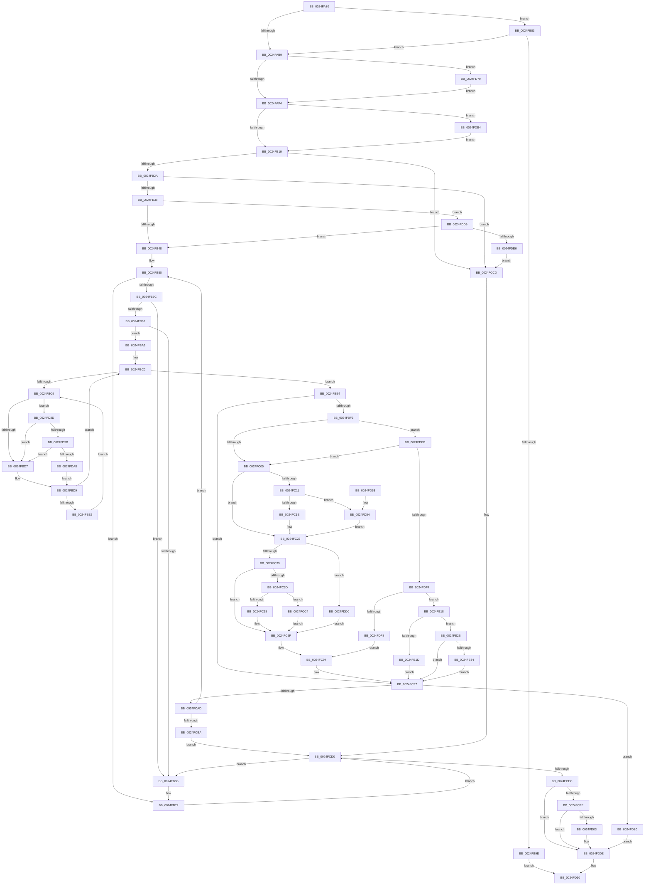

# IoSetIoCompletionEx

- RVA: `0x0024FA80`–`0x0024FE3D` (길이 `957` bytes)
- VA: `0x000000014024FA80`
- 실행 섹션: `.text`
- PDB 이름 있음: `예`; PDB Function 태그: `아니요`
- unwind 정보 RVA: `0x00063318`
- 디코드: `228`개 명령, `957/957` bytes 표시
- 미해석 바이트: `0` (있으면 어셈블리에 `.byte`로 보존)

> 이 문서는 커널 이미지의 기계어와 PDB 기호를 분석해 생성했습니다. 4번과 5번은 함수 원형과 자료형을 바이너리 사용 방식에서 추정한 C 해석이며 원본 소스 복구 결과는 아닙니다.

## 1. Dependencies

- 직접 호출 지점: **10**; 고유 호출 대상: **10**
- 직접 호출자로 확인된 함수: **7**
- RIP 상대 이미지 참조: **4**

### Outgoing calls
- `0x0024FB1C` → [KiAcquireKobjectLockSafe](../25/KiAcquireKobjectLockSafe_function_00251C90.md) (function, `0x00251C90`)
- `0x0024FB8D` → [IopAllocateMiniCompletionPacket](../../page/9D/IopAllocateMiniCompletionPacket_function_009DA2E0.md) (function, `0x009DA2E0`)
- `0x0024FC25` → [KiRemovePrcbWaitEntry](../25/KiRemovePrcbWaitEntry_function_002502D0.md) (function, `0x002502D0`)
- `0x0024FD09` → [KiWakeOtherQueueWaiters](../39/KiWakeOtherQueueWaiters_function_003964D0.md) (function, `0x003964D0`)
- `0x0024FD2B` → [KiExitDispatcher](../25/KiExitDispatcher_function_00251CF0.md) (function, `0x00251CF0`)
- `0x0024FD76` → [KiRaiseIrqlProcessIrqlFlags](../4F/KiRaiseIrqlProcessIrqlFlags_function_004F56FC.md) (function, `0x004F56FC`)
- `0x0024FD9B` → [KiCheckVpBackingLongSpinWaitHypercall](../30/KiCheckVpBackingLongSpinWaitHypercall_function_0030F490.md) (function, `0x0030F490`)
- `0x0024FDAA` → [HvlNotifyLongSpinWait](../30/HvlNotifyLongSpinWait_function_0030F460.md) (function, `0x0030F460`)
- `0x0024FDB7` → [KeIsThreadRunning](../39/KeIsThreadRunning_function_00396720.md) (function, `0x00396720`)
- `0x0024FDC6` → [EtwTraceEnqueueWork](../39/EtwTraceEnqueueWork_function_0039674C.md) (function, `0x0039674C`)

### Direct callers
- [IopXxxControlFile](../../page/8E/IopXxxControlFile_function_008E9AD0.md) at `0x008EAB6A`
- [PspSendReliableJobNotification](../../page/91/PspSendReliableJobNotification_function_009171D4.md) at `0x00917279`
- [sub_009A7D0D](../../page/9A/Unknown_function_009A7D0D.md) at `0x009A7D74`
- [NtSetIoCompletion](../../page/9D/NtSetIoCompletion_function_009DB700.md) at `0x009DB778`
- [IoSetIoCompletion](../../page/9F/IoSetIoCompletion_function_009FDCA0.md) at `0x009FDCBC`
- [PspNotificationPacketCallback](../../page/A6/PspNotificationPacketCallback_function_00A67B30.md) at `0x00A67C4D`
- [sub_00B2FAB0](../../page/B2/Unknown_function_00B2FAB0.md) at `0x00B2FB31`

### Static image references
- `0x0024FAE7` → RVA `0x00FC6D20` (`ALMOSTRO`; read)
- `0x0024FAFD` → RVA `0x00FC6B04` (`ALMOSTRO`; read)
- `0x0024FBCB` → RVA `0x00FC52AC` (`ALMOSTRO`; reference)
- `0x0024FD8D` → RVA `0x00FC6AB8` (`ALMOSTRO`; read)

## 2. Other-region calls and transfers

- 다른 실행 섹션으로 향하는 call: **1**
  - `0x0024FB8D` → [IopAllocateMiniCompletionPacket](../../page/9D/IopAllocateMiniCompletionPacket_function_009DA2E0.md) (`.text` → `PAGE`)
- 별도 외부 분기/꼬리 이동을 확인하지 못했습니다.

## 3. Assembly (complete function range)

```asm
0024FA80  48 89 5C 24 08                  mov qword ptr [rsp + 8], rbx
0024FA85  48 89 6C 24 10                  mov qword ptr [rsp + 0x10], rbp
0024FA8A  48 89 74 24 18                  mov qword ptr [rsp + 0x18], rsi
0024FA8F  57                              push rdi
0024FA90  41 54                           push r12
0024FA92  41 55                           push r13
0024FA94  41 56                           push r14
0024FA96  41 57                           push r15
0024FA98  48 83 EC 40                     sub rsp, 0x40
0024FA9C  4C 8B B4 24 A0 00 00 00         mov r14, qword ptr [rsp + 0xa0]
0024FAA4  41 8B D9                        mov ebx, r9d
0024FAA7  49 8B F8                        mov rdi, r8
0024FAAA  48 8B F2                        mov rsi, rdx
0024FAAD  4C 8B F9                        mov r15, rcx
0024FAB0  4D 85 F6                        test r14, r14
0024FAB3  0F 84 CA 00 00 00               je 0x14024fb83
0024FAB9  48 8B 84 24 90 00 00 00         mov rax, qword ptr [rsp + 0x90]
0024FAC1  49 89 7E 20                     mov qword ptr [r14 + 0x20], rdi
0024FAC5  49 8D 7F 08                     lea rdi, [r15 + 8]
0024FAC9  49 89 46 30                     mov qword ptr [r14 + 0x30], rax
0024FACD  49 89 76 18                     mov qword ptr [r14 + 0x18], rsi
0024FAD1  41 89 5E 28                     mov dword ptr [r14 + 0x28], ebx
0024FAD5  44 0F 20 C0                     mov rax, cr8
0024FAD9  48 89 44 24 30                  mov qword ptr [rsp + 0x30], rax
0024FADE  B9 02 00 00 00                  mov ecx, 2
0024FAE3  44 0F 22 C1                     mov cr8, rcx
0024FAE7  83 3D 32 72 D7 00 00            cmp dword ptr [rip + 0xd77232], 0
0024FAEE  0F 85 7C 02 00 00               jne 0x14024fd70
0024FAF4  65 48 8B 34 25 20 00 00 00      mov rsi, qword ptr gs:[0x20]
0024FAFD  F7 05 FD 6F D7 00 00 00 00 01   test dword ptr [rip + 0xd76ffd], 0x1000000
0024FB07  48 89 B4 24 A0 00 00 00         mov qword ptr [rsp + 0xa0], rsi
0024FB0F  48 8B 5E 08                     mov rbx, qword ptr [rsi + 8]
0024FB13  0F 85 9B 02 00 00               jne 0x14024fdb4
0024FB19  49 8B CF                        mov rcx, r15
0024FB1C  E8 6F 21 00 00                  call 0x140251c90
0024FB21  48 39 3F                        cmp qword ptr [rdi], rdi
0024FB24  0F 84 A3 01 00 00               je 0x14024fccd
0024FB2A  41 8B 47 28                     mov eax, dword ptr [r15 + 0x28]
0024FB2E  41 3B 47 2C                     cmp eax, dword ptr [r15 + 0x2c]
0024FB32  0F 83 95 01 00 00               jae 0x14024fccd
0024FB38  48 8B 83 E8 00 00 00            mov rax, qword ptr [rbx + 0xe8]
0024FB3F  49 3B C7                        cmp rax, r15
0024FB42  0F 84 91 02 00 00               je 0x14024fdd9
0024FB48  48 8B 37                        mov rsi, qword ptr [rdi]
0024FB4B  45 33 ED                        xor r13d, r13d
0024FB4E  66 90                           nop
0024FB50  48 8B FE                        mov rdi, rsi
0024FB53  48 8B 36                        mov rsi, qword ptr [rsi]
0024FB56  80 7F 10 03                     cmp byte ptr [rdi + 0x10], 3
0024FB5A  75 16                           jne 0x14024fb72
0024FB5C  48 8B 47 08                     mov rax, qword ptr [rdi + 8]
0024FB60  48 39 7E 08                     cmp qword ptr [rsi + 8], rdi
0024FB64  75 05                           jne 0x14024fb6b
0024FB66  48 39 38                        cmp qword ptr [rax], rdi
0024FB69  74 3E                           je 0x14024fba9
0024FB6B  B9 03 00 00 00                  mov ecx, 3
0024FB70  CD 29                           int 0x29
0024FB72  48 8B B4 24 A0 00 00 00         mov rsi, qword ptr [rsp + 0xa0]
0024FB7A  49 8D 7F 08                     lea rdi, [r15 + 8]
0024FB7E  E9 4D 01 00 00                  jmp 0x14024fcd0
0024FB83  0F B6 94 24 98 00 00 00         movzx edx, byte ptr [rsp + 0x98]
0024FB8B  B1 01                           mov cl, 1
0024FB8D  E8 4E A7 78 00                  call 0x1409da2e0
0024FB92  4C 8B F0                        mov r14, rax
0024FB95  48 85 C0                        test rax, rax
0024FB98  0F 85 1B FF FF FF               jne 0x14024fab9
0024FB9E  41 BD 9A 00 00 C0               mov r13d, 0xc000009a
0024FBA4  E9 87 01 00 00                  jmp 0x14024fd30
0024FBA9  48 89 30                        mov qword ptr [rax], rsi
0024FBAC  45 32 E4                        xor r12b, r12b
0024FBAF  48 89 46 08                     mov qword ptr [rsi + 8], rax
0024FBB3  41 8B ED                        mov ebp, r13d
0024FBB6  48 8B 5F 18                     mov rbx, qword ptr [rdi + 0x18]
0024FBBA  66 0F 1F 44 00 00               nop word ptr [rax + rax]
0024FBC0  F0 48 0F BA 6B 40 00            lock bts qword ptr [rbx + 0x40], 0
0024FBC7  73 1B                           jae 0x14024fbe4
0024FBC9  FF C5                           inc ebp
0024FBCB  85 2D DB 56 D7 00               test dword ptr [rip + 0xd756db], ebp
0024FBD1  0F 84 B6 01 00 00               je 0x14024fd8d
0024FBD7  F3 90                           pause
0024FBD9  48 8B 43 40                     mov rax, qword ptr [rbx + 0x40]
0024FBDD  48 85 C0                        test rax, rax
0024FBE0  74 DE                           je 0x14024fbc0
0024FBE2  EB E5                           jmp 0x14024fbc9
0024FBE4  0F B6 83 84 01 00 00            movzx eax, byte ptr [rbx + 0x184]
0024FBEB  3C 05                           cmp al, 5
0024FBED  0F 85 A4 00 00 00               jne 0x14024fc97
0024FBF3  0F B6 4B 70                     movzx ecx, byte ptr [rbx + 0x70]
0024FBF7  8B C1                           mov eax, ecx
0024FBF9  83 E0 07                        and eax, 7
0024FBFC  83 F8 01                        cmp eax, 1
0024FBFF  0F 85 E6 01 00 00               jne 0x14024fdeb
0024FC05  48 8B 93 E8 00 00 00            mov rdx, qword ptr [rbx + 0xe8]
0024FC0C  48 85 D2                        test rdx, rdx
0024FC0F  74 11                           je 0x14024fc22
0024FC11  0F B6 02                        movzx eax, byte ptr [rdx]
0024FC14  24 7F                           and al, 0x7f
0024FC16  3C 15                           cmp al, 0x15
0024FC18  0F 84 36 01 00 00               je 0x14024fd54
0024FC1E  F0 FF 42 28                     lock inc dword ptr [rdx + 0x28]
0024FC22  48 8B CB                        mov rcx, rbx
0024FC25  E8 A6 06 00 00                  call 0x1402502d0
0024FC2A  0F B6 83 84 01 00 00            movzx eax, byte ptr [rbx + 0x184]
0024FC31  3C 01                           cmp al, 1
0024FC33  0F 84 97 01 00 00               je 0x14024fdd0
0024FC39  3C 05                           cmp al, 5
0024FC3B  75 22                           jne 0x14024fc5f
0024FC3D  48 B8 20 03 00 00 80 F7 FF FF   movabs rax, 0xfffff78000000320
0024FC47  8B 08                           mov ecx, dword ptr [rax]
0024FC49  2B 8B B4 01 00 00               sub ecx, dword ptr [rbx + 0x1b4]
0024FC4F  44 38 A3 87 01 00 00            cmp byte ptr [rbx + 0x187], r12b
0024FC56  74 6C                           je 0x14024fcc4
0024FC58  48 01 8B E8 03 00 00            add qword ptr [rbx + 0x3e8], rcx
0024FC5F  48 8B 94 24 A0 00 00 00         mov rdx, qword ptr [rsp + 0xa0]
0024FC67  48 8D 8B D8 00 00 00            lea rcx, [rbx + 0xd8]
0024FC6E  C6 83 84 01 00 00 07            mov byte ptr [rbx + 0x184], 7
0024FC75  48 8B 82 08 2D 00 00            mov rax, qword ptr [rdx + 0x2d08]
0024FC7C  48 89 01                        mov qword ptr [rcx], rax
0024FC7F  48 89 8A 08 2D 00 00            mov qword ptr [rdx + 0x2d08], rcx
0024FC86  4C 89 B3 C8 00 00 00            mov qword ptr [rbx + 0xc8], r14
0024FC8D  4C 89 AB D0 03 00 00            mov qword ptr [rbx + 0x3d0], r13
0024FC94  41 B4 01                        mov r12b, 1
0024FC97  4C 89 6B 40                     mov qword ptr [rbx + 0x40], r13
0024FC9B  0F B6 47 11                     movzx eax, byte ptr [rdi + 0x11]
0024FC9F  FE C0                           inc al
0024FCA1  88 47 11                        mov byte ptr [rdi + 0x11], al
0024FCA4  45 84 E4                        test r12b, r12b
0024FCA7  0F 85 D3 00 00 00               jne 0x14024fd80
0024FCAD  49 8D 7F 08                     lea rdi, [r15 + 8]
0024FCB1  48 3B F7                        cmp rsi, rdi
0024FCB4  0F 85 96 FE FF FF               jne 0x14024fb50
0024FCBA  48 8B B4 24 A0 00 00 00         mov rsi, qword ptr [rsp + 0xa0]
0024FCC2  EB 0C                           jmp 0x14024fcd0
0024FCC4  48 01 8B E0 03 00 00            add qword ptr [rbx + 0x3e0], rcx
0024FCCB  EB 92                           jmp 0x14024fc5f
0024FCCD  45 33 ED                        xor r13d, r13d
0024FCD0  41 8B 57 04                     mov edx, dword ptr [r15 + 4]
0024FCD4  8D 42 01                        lea eax, [rdx + 1]
0024FCD7  41 89 47 04                     mov dword ptr [r15 + 4], eax
0024FCDB  49 8D 47 18                     lea rax, [r15 + 0x18]
0024FCDF  48 8B 48 08                     mov rcx, qword ptr [rax + 8]
0024FCE3  48 39 01                        cmp qword ptr [rcx], rax
0024FCE6  0F 85 7F FE FF FF               jne 0x14024fb6b
0024FCEC  49 89 06                        mov qword ptr [r14], rax
0024FCEF  49 89 4E 08                     mov qword ptr [r14 + 8], rcx
0024FCF3  4C 89 31                        mov qword ptr [rcx], r14
0024FCF6  4C 89 70 08                     mov qword ptr [rax + 8], r14
0024FCFA  85 D2                           test edx, edx
0024FCFC  75 10                           jne 0x14024fd0e
0024FCFE  48 39 3F                        cmp qword ptr [rdi], rdi
0024FD01  74 0B                           je 0x14024fd0e
0024FD03  49 8B D7                        mov rdx, r15
0024FD06  48 8B CE                        mov rcx, rsi
0024FD09  E8 C2 67 14 00                  call 0x1403964d0
0024FD0E  F0 41 81 27 7F FF FF FF         lock and dword ptr [r15], 0xffffff7f
0024FD16  48 8B 44 24 30                  mov rax, qword ptr [rsp + 0x30]
0024FD1B  45 33 C9                        xor r9d, r9d
0024FD1E  33 D2                           xor edx, edx
0024FD20  88 44 24 20                     mov byte ptr [rsp + 0x20], al
0024FD24  48 8B CE                        mov rcx, rsi
0024FD27  45 8D 41 01                     lea r8d, [r9 + 1]
0024FD2B  E8 C0 1F 00 00                  call 0x140251cf0
0024FD30  48 8B 5C 24 70                  mov rbx, qword ptr [rsp + 0x70]
0024FD35  41 8B C5                        mov eax, r13d
0024FD38  48 8B 6C 24 78                  mov rbp, qword ptr [rsp + 0x78]
0024FD3D  48 8B B4 24 80 00 00 00         mov rsi, qword ptr [rsp + 0x80]
0024FD45  48 83 C4 40                     add rsp, 0x40
0024FD49  41 5F                           pop r15
0024FD4B  41 5E                           pop r14
0024FD4D  41 5D                           pop r13
0024FD4F  41 5C                           pop r12
0024FD51  5F                              pop rdi
0024FD52  C3                              ret
0024FD53  CC                              int3
0024FD54  8B 83 1C 02 00 00               mov eax, dword ptr [rbx + 0x21c]
0024FD5A  0F B6 C0                        movzx eax, al
0024FD5D  89 83 1C 02 00 00               mov dword ptr [rbx + 0x21c], eax
0024FD63  F0 FF 84 82 18 02 00 00         lock inc dword ptr [rdx + rax*4 + 0x218]
0024FD6B  E9 B2 FE FF FF                  jmp 0x14024fc22
0024FD70  0F B6 D1                        movzx edx, cl
0024FD73  0F B6 C8                        movzx ecx, al
0024FD76  E8 81 59 2A 00                  call 0x1404f56fc
0024FD7B  E9 74 FD FF FF                  jmp 0x14024faf4
0024FD80  48 8B B4 24 A0 00 00 00         mov rsi, qword ptr [rsp + 0xa0]
0024FD88  4D 89 2E                        mov qword ptr [r14], r13
0024FD8B  EB 81                           jmp 0x14024fd0e
0024FD8D  8B 05 25 6D D7 00               mov eax, dword ptr [rip + 0xd76d25]
0024FD93  A8 40                           test al, 0x40
0024FD95  0F 84 3C FE FF FF               je 0x14024fbd7
0024FD9B  E8 F0 F6 0B 00                  call 0x14030f490
0024FDA0  84 C0                           test al, al
0024FDA2  0F 84 2F FE FF FF               je 0x14024fbd7
0024FDA8  8B CD                           mov ecx, ebp
0024FDAA  E8 B1 F6 0B 00                  call 0x14030f460
0024FDAF  E9 25 FE FF FF                  jmp 0x14024fbd9
0024FDB4  48 8B CB                        mov rcx, rbx
0024FDB7  E8 64 69 14 00                  call 0x140396720
0024FDBC  44 0F B6 C0                     movzx r8d, al
0024FDC0  48 8B CB                        mov rcx, rbx
0024FDC3  49 8B D6                        mov rdx, r14
0024FDC6  E8 81 69 14 00                  call 0x14039674c
0024FDCB  E9 49 FD FF FF                  jmp 0x14024fb19
0024FDD0  83 4B 74 02                     or dword ptr [rbx + 0x74], 2
0024FDD4  E9 86 FE FF FF                  jmp 0x14024fc5f
0024FDD9  80 BB 83 02 00 00 0F            cmp byte ptr [rbx + 0x283], 0xf
0024FDE0  0F 85 62 FD FF FF               jne 0x14024fb48
0024FDE6  E9 E2 FE FF FF                  jmp 0x14024fccd
0024FDEB  83 F8 04                        cmp eax, 4
0024FDEE  0F 84 11 FE FF FF               je 0x14024fc05
0024FDF4  85 C0                           test eax, eax
0024FDF6  75 20                           jne 0x14024fe18
0024FDF8  80 E1 FA                        and cl, 0xfa
0024FDFB  80 C9 02                        or cl, 2
0024FDFE  88 4B 70                        mov byte ptr [rbx + 0x70], cl
0024FE01  4C 89 B3 C8 00 00 00            mov qword ptr [rbx + 0xc8], r14
0024FE08  4C 89 AB D0 03 00 00            mov qword ptr [rbx + 0x3d0], r13
0024FE0F  44 88 6F 11                     mov byte ptr [rdi + 0x11], r13b
0024FE13  E9 7C FE FF FF                  jmp 0x14024fc94
0024FE18  83 F8 05                        cmp eax, 5
0024FE1B  75 0E                           jne 0x14024fe2b
0024FE1D  80 E1 FE                        and cl, 0xfe
0024FE20  80 C9 06                        or cl, 6
0024FE23  88 4B 70                        mov byte ptr [rbx + 0x70], cl
0024FE26  E9 6C FE FF FF                  jmp 0x14024fc97
0024FE2B  83 F8 03                        cmp eax, 3
0024FE2E  0F 85 63 FE FF FF               jne 0x14024fc97
0024FE34  C6 47 11 02                     mov byte ptr [rdi + 0x11], 2
0024FE38  E9 5A FE FF FF                  jmp 0x14024fc97
```

## 4. C-style interpretation (structured pseudocode)

```c
__int64 __fastcall IoSetIoCompletionEx(__int64 a1, __int64 a2, __int64 a3, int a4, __int64 a5, unsigned __int8 a6, __int64 a7)
{
    __int64 result;
    __int64 v_r12;
    __int64 v_r13;
    __int64 v_rbp;
    __int64 v_rsp;
    unsigned __int64 v_stack_m38;
    unsigned __int8 v_stack_m48;
    unsigned __int64 v_stack_p10;
    unsigned __int64 v_stack_p18;
    unsigned __int64 v_stack_p38;
    unsigned __int64 v_stack_p8;

    v_stack_p8 = v_rbx;
    v_stack_p10 = v_rbp;
    v_stack_p18 = v_rsi;
    v_rsp = (v_rsp) - (64);
    if (a7 == 0) goto loc_0024FB83;
loc_0024FAB9:
    *(unsigned __int64 *)(a7 + 32) = a3;
    *(unsigned __int64 *)(a7 + 48) = a5;
    *(unsigned __int64 *)(a7 + 24) = a2;
    *(unsigned int *)(a7 + 40) = (unsigned int)((unsigned int)(a4));
    v_stack_m38 = v_cr8;
    if ((*(unsigned int *)(v_rip + 14119474)) != 0) goto loc_0024FD70;
loc_0024FAF4:
    v_stack_p38 = *(unsigned __int64 *)(gs_base + (0 + 32));
    if (((*(unsigned int *)(v_rip + 14118909)) & (0x1000000ULL)) != 0) goto loc_0024FDB4;
loc_0024FB19:
    result = KiAcquireKobjectLockSafe(a1, a2, a3, a4);
    if ((*(unsigned __int64 *)(a1 + 8)) == (a1 + 8)) goto loc_0024FCCD;
    if (((unsigned int)((unsigned int)(*(unsigned int *)(a1 + 40)))) >= (*(unsigned int *)(a1 + 44))) goto loc_0024FCCD;
    if ((*(unsigned __int64 *)(*(unsigned __int64 *)(*(unsigned __int64 *)(gs_base + (0 + 32)) + 8) + 232)) == a1) goto loc_0024FDD9;
loc_0024FB48:
    v_r13 = 0;
loc_0024FB50:
    if ((*(unsigned __int8 *)(*(unsigned __int64 *)(a1 + 8) + 16)) != 3) goto loc_0024FB72;
    if ((*(unsigned __int64 *)(*(unsigned __int64 *)(*(unsigned __int64 *)(a1 + 8)) + 8)) != (*(unsigned __int64 *)(a1 + 8))) goto loc_0024FB6B;
    if ((*(unsigned __int64 *)(*(unsigned __int64 *)(*(unsigned __int64 *)(a1 + 8) + 8))) == (*(unsigned __int64 *)(a1 + 8))) goto loc_0024FBA9;
loc_0024FB6B:
loc_0024FB72:
    goto loc_0024FCD0;
loc_0024FB83:
    result = IopAllocateMiniCompletionPacket(1, a6, a3, a4);
    if (result != 0) goto loc_0024FAB9;
    goto loc_0024FD30;
loc_0024FBA9:
    *(unsigned __int64 *)(result) = a7;
    v_r12 = 0;
    *(unsigned __int64 *)(a7 + 8) = result;
loc_0024FBC0:
    if (condition_is_above_or_equal) goto loc_0024FBE4;
loc_0024FBC9:
    v_rbp = (unsigned int)(((unsigned int)((unsigned int)((unsigned int)(0xC000009AULL)))) + 1);
    if (((*(unsigned int *)(v_rip + 14112475)) & ((unsigned int)(v_rbp))) == 0) goto loc_0024FD8D;
loc_0024FBD7:
loc_0024FBD9:
    if (*(unsigned __int64 *)(*(unsigned __int64 *)(a1 + 8 + 24) + 64) == 0) goto loc_0024FBC0;
    goto loc_0024FBC9;
loc_0024FBE4:
    if (((unsigned __int8)(*(unsigned __int8 *)(*(unsigned __int64 *)(a1 + 8 + 24) + 388))) != 5) goto loc_0024FC97;
    result = (unsigned int)(((unsigned int)((unsigned int)(*(unsigned __int8 *)(*(unsigned __int64 *)(a1 + 8 + 24) + 112)))) & (7));
    if (((unsigned int)(result)) != 1) goto loc_0024FDEB;
loc_0024FC05:
    if (*(unsigned __int64 *)(*(unsigned __int64 *)(a1 + 8 + 24) + 232) == 0) goto loc_0024FC22;
    result = (unsigned __int8)((*(unsigned __int8 *)(*(unsigned __int64 *)(*(unsigned __int64 *)(a1 + 8 + 24) + 232))) & (127));
    if (((unsigned __int8)(result)) == 21) goto loc_0024FD54;
loc_0024FC22:
    result = KiRemovePrcbWaitEntry(*(unsigned __int64 *)(a1 + 8 + 24), *(unsigned __int64 *)(*(unsigned __int64 *)(a1 + 8 + 24) + 232), a3, a4);
    if (((unsigned __int8)(*(unsigned __int8 *)(*(unsigned __int64 *)(a1 + 8 + 24) + 388))) == 1) goto loc_0024FDD0;
    if (((unsigned __int8)(*(unsigned __int8 *)(*(unsigned __int64 *)(a1 + 8 + 24) + 388))) != 5) goto loc_0024FC5F;
    a1 = (unsigned int)(((unsigned int)(*(unsigned int *)(*(unsigned __int8 *)(*(unsigned __int64 *)(a1 + 8 + 24) + 388)))) - (*(unsigned int *)(*(unsigned __int64 *)(a1 + 8 + 24) + 436)));
    if ((*(unsigned __int8 *)(*(unsigned __int64 *)(a1 + 8 + 24) + 391)) == 0) goto loc_0024FCC4;
loc_0024FC5F:
    *(unsigned __int8 *)(*(unsigned __int64 *)(a1 + 8 + 24) + 388) = 7;
    *(unsigned __int64 *)(*(unsigned __int64 *)(a1 + 8 + 24) + 216) = *(unsigned __int64 *)(a7 + 11528);
    *(unsigned __int64 *)(a7 + 11528) = *(unsigned __int64 *)(a1 + 8 + 24) + 216;
    *(unsigned __int64 *)(*(unsigned __int64 *)(a1 + 8 + 24) + 200) = result;
    *(unsigned __int64 *)(*(unsigned __int64 *)(a1 + 8 + 24) + 976) = (unsigned int)(0xC000009AULL);
loc_0024FC94:
loc_0024FC97:
    *(unsigned __int64 *)(*(unsigned __int64 *)(a1 + 8 + 24) + 64) = (unsigned int)(0xC000009AULL);
    result = (unsigned __int8)((*(unsigned __int8 *)(a1 + 8 + 17)) + 1);
    *(unsigned __int8 *)(a1 + 8 + 17) = (unsigned __int8)(result);
    if (1 != 0) goto loc_0024FD80;
    if (a7 != (a1 + 8)) goto loc_0024FB50;
    goto loc_0024FCD0;
loc_0024FCC4:
    goto loc_0024FC5F;
loc_0024FCCD:
    v_r13 = 0;
loc_0024FCD0:
    *(unsigned int *)(a1 + 4) = (unsigned int)((unsigned int)(*(unsigned int *)(a1 + 4)) + 1);
    if ((*(unsigned __int64 *)(*(unsigned __int64 *)(a1 + 24 + 8))) != (a1 + 24)) goto loc_0024FB6B;
    *(unsigned __int64 *)(result) = a1 + 24;
    *(unsigned __int64 *)(result + 8) = *(unsigned __int64 *)(a1 + 24 + 8);
    *(unsigned __int64 *)(*(unsigned __int64 *)(a1 + 24 + 8)) = result;
    *(unsigned __int64 *)(a1 + 24 + 8) = result;
    if ((unsigned int)((unsigned int)(*(unsigned int *)(a1 + 4))) != 0) goto loc_0024FD0E;
    result = a1 + 24;
    if ((*(unsigned __int64 *)(a1 + 8)) != (a1 + 8)) {
        a2 = a1;
        a1 = a7;
        result = KiWakeOtherQueueWaiters(a1, a2, a3, a4);
    }
    a4 = 0;
    a2 = 0;
    v_stack_m48 = (unsigned __int8)(v_stack_m38);
    result = KiExitDispatcher(a7, a2, a4 + 1, a4);
loc_0024FD30:
    v_rsp = (v_rsp) + (64);
    return 0;
loc_0024FD54:
    *(unsigned int *)(v_stack_p8 + 540) = (unsigned int)((unsigned __int8)((unsigned int)(*(unsigned int *)(v_stack_p8 + 540))));
    goto loc_0024FC22;
loc_0024FD70:
    result = KiRaiseIrqlProcessIrqlFlags((unsigned __int8)((unsigned __int8)((unsigned int)(*(unsigned int *)(v_stack_p8 + 540)))), (unsigned __int8)(a7), a4 + 1, a4);
    goto loc_0024FAF4;
loc_0024FD80:
    *(unsigned __int64 *)(result) = 0;
    goto loc_0024FD0E;
loc_0024FD8D:
    if ((((unsigned __int8)((unsigned int)(*(unsigned int *)(v_rip + 14118181)))) & (64)) == 0) goto loc_0024FBD7;
    result = KiCheckVpBackingLongSpinWaitHypercall((unsigned __int8)((unsigned __int8)((unsigned int)(*(unsigned int *)(v_stack_p8 + 540)))), (unsigned __int8)(a7), a4 + 1, a4);
    if ((unsigned __int8)(result) == 0) goto loc_0024FBD7;
    result = HvlNotifyLongSpinWait((unsigned int)((unsigned int)(v_stack_p10)), (unsigned __int8)(a7), a4 + 1, a4);
    goto loc_0024FBD9;
loc_0024FDB4:
    result = KeIsThreadRunning(v_stack_p8, (unsigned __int8)(a7), a4 + 1, a4);
    result = EtwTraceEnqueueWork(v_stack_p8, result, (unsigned __int8)(result), a4);
    goto loc_0024FB19;
loc_0024FDD0:
    goto loc_0024FC5F;
loc_0024FDD9:
    if ((*(unsigned __int8 *)(v_stack_p8 + 643)) != 15) goto loc_0024FB48;
    goto loc_0024FCCD;
loc_0024FDEB:
    if (((unsigned int)(result)) == 4) goto loc_0024FC05;
    if ((unsigned int)(result) != 0) goto loc_0024FE18;
    a1 = (unsigned __int8)((v_stack_p8) & (250));
    a1 = (unsigned __int8)((a1) | (2));
    *(unsigned __int8 *)(v_stack_p8 + 112) = (unsigned __int8)(a1);
    *(unsigned __int64 *)(v_stack_p8 + 200) = result;
    *(unsigned __int64 *)(v_stack_p8 + 976) = 0;
    *(unsigned __int8 *)(a1 + 8 + 17) = 0;
    goto loc_0024FC94;
loc_0024FE18:
    if (((unsigned int)(result)) != 5) goto loc_0024FE2B;
    a1 = (unsigned __int8)((a1) & (254));
    a1 = (unsigned __int8)((a1) | (6));
    *(unsigned __int8 *)(v_stack_p8 + 112) = (unsigned __int8)(a1);
    goto loc_0024FC97;
loc_0024FE2B:
    if (((unsigned int)(result)) != 3) goto loc_0024FC97;
    *(unsigned __int8 *)(a1 + 8 + 17) = 2;
    goto loc_0024FC97;
}
```

## 5. (Beta) C Style

```c
int64_t IoSetIoCompletionEx(void *Arg1, int64_t Arg2, int64_t Arg3, int32_t Arg4, int64_t Arg5, uint8_t Arg6, void *Arg7)
{
    uint8_t *arg1 = (uint8_t *)Arg1;
    uint8_t *arg7 = (uint8_t *)Arg7;

    int64_t result;
    int64_t local_r12;
    int64_t local_r13;
    int64_t local_rbp;
    int64_t local_rsp;
    uint64_t v_stack_m38;
    uint8_t v_stack_m48;
    uint64_t v_stack_p10;
    uint64_t v_stack_p18;
    uint64_t v_stack_p38;
    uint64_t v_stack_p8;

    v_stack_p8 = local_rbx;
    v_stack_p10 = local_rbp;
    v_stack_p18 = local_rsi;
    local_rsp = (local_rsp) - (64);
    if (Arg7 == NULL) goto loc_0024FB83;
loc_0024FAB9:
    *(uint64_t *)(arg7 + 0x20) = Arg3;
    *(uint64_t *)(arg7 + 0x30) = Arg5;
    *(uint64_t *)(arg7 + 0x18) = Arg2;
    *(uint32_t *)(arg7 + 0x28) = (uint32_t)((uint32_t)(Arg4));
    v_stack_m38 = v_cr8;
    if ((*(uint32_t *)(v_rip + 0xD77232)) != 0) goto loc_0024FD70;
loc_0024FAF4:
    v_stack_p38 = *(uint64_t *)(gs_base + (0 + 0x20));
    if (((*(uint32_t *)(v_rip + 0xD76FFD)) & (0x1000000ULL)) != 0) goto loc_0024FDB4;
loc_0024FB19:
    result = KiAcquireKobjectLockSafe(Arg1, Arg2, Arg3, Arg4);
    if ((*(uint64_t *)(arg1 + 0x8)) == (Arg1 + 8)) goto loc_0024FCCD;
    if (((uint32_t)((uint32_t)(*(uint32_t *)(arg1 + 0x28)))) >= (*(uint32_t *)(arg1 + 0x2C))) goto loc_0024FCCD;
    if ((*(uint64_t *)(*(uint64_t *)(*(uint64_t *)(gs_base + (0 + 0x20)) + 0x8) + 0xE8)) == Arg1) goto loc_0024FDD9;
loc_0024FB48:
    local_r13 = 0;
loc_0024FB50:
    if ((*(uint8_t *)(*(uint64_t *)(arg1 + 0x8) + 0x10)) != 3) goto loc_0024FB72;
    if ((*(uint64_t *)(*(uint64_t *)(*(uint64_t *)(arg1 + 0x8)) + 0x8)) != (*(uint64_t *)(arg1 + 0x8))) goto loc_0024FB6B;
    if ((*(uint64_t *)(*(uint64_t *)(*(uint64_t *)(arg1 + 0x8) + 0x8))) == (*(uint64_t *)(arg1 + 0x8))) goto loc_0024FBA9;
loc_0024FB6B:
loc_0024FB72:
    goto loc_0024FCD0;
loc_0024FB83:
    result = IopAllocateMiniCompletionPacket(1, Arg6, Arg3, Arg4);
    if (result != 0) goto loc_0024FAB9;
    goto loc_0024FD30;
loc_0024FBA9:
    *(void **)(result) = Arg7;
    local_r12 = 0;
    *(uint64_t *)(arg7 + 0x8) = result;
loc_0024FBC0:
    if (condition_is_above_or_equal) goto loc_0024FBE4;
loc_0024FBC9:
    local_rbp = (uint32_t)(((uint32_t)((uint32_t)((uint32_t)(0xC000009AULL)))) + 1);
    if (((*(uint32_t *)(v_rip + 0xD756DB)) & ((uint32_t)(local_rbp))) == 0) goto loc_0024FD8D;
loc_0024FBD7:
loc_0024FBD9:
    if (*(uint64_t *)(*(uint64_t *)(arg1 + 0x8 + 0x18) + 0x40) == 0) goto loc_0024FBC0;
    goto loc_0024FBC9;
loc_0024FBE4:
    if (((uint8_t)(*(uint8_t *)(*(uint64_t *)(arg1 + 0x8 + 0x18) + 0x184))) != 5) goto loc_0024FC97;
    result = (uint32_t)(((uint32_t)((uint32_t)(*(uint8_t *)(*(uint64_t *)(arg1 + 0x8 + 0x18) + 0x70)))) & (7));
    if (((uint32_t)(result)) != 1) goto loc_0024FDEB;
loc_0024FC05:
    if (*(uint64_t *)(*(uint64_t *)(arg1 + 0x8 + 0x18) + 0xE8) == 0) goto loc_0024FC22;
    result = (uint8_t)((*(uint8_t *)(*(uint64_t *)(*(uint64_t *)(arg1 + 0x8 + 0x18) + 0xE8))) & (127));
    if (((uint8_t)(result)) == 21) goto loc_0024FD54;
loc_0024FC22:
    result = KiRemovePrcbWaitEntry(*(uint64_t *)(arg1 + 0x8 + 0x18), *(uint64_t *)(*(uint64_t *)(arg1 + 0x8 + 0x18) + 0xE8), Arg3, Arg4);
    if (((uint8_t)(*(uint8_t *)(*(uint64_t *)(arg1 + 0x8 + 0x18) + 0x184))) == 1) goto loc_0024FDD0;
    if (((uint8_t)(*(uint8_t *)(*(uint64_t *)(arg1 + 0x8 + 0x18) + 0x184))) != 5) goto loc_0024FC5F;
    Arg1 = (uint32_t)(((uint32_t)(*(uint32_t *)(*(uint8_t *)(*(uint64_t *)(arg1 + 0x8 + 0x18) + 0x184)))) - (*(uint32_t *)(*(uint64_t *)(arg1 + 0x8 + 0x18) + 0x1B4)));
    if ((*(uint8_t *)(*(uint64_t *)(arg1 + 0x8 + 0x18) + 0x187)) == 0) goto loc_0024FCC4;
loc_0024FC5F:
    *(uint8_t *)(*(uint64_t *)(arg1 + 0x8 + 0x18) + 0x184) = 7;
    *(uint64_t *)(*(uint64_t *)(arg1 + 0x8 + 0x18) + 0xD8) = *(uint64_t *)(arg7 + 0x2D08);
    *(uint64_t *)(arg7 + 0x2D08) = *(uint64_t *)(arg1 + 0x8 + 0x18) + 216;
    *(uint64_t *)(*(uint64_t *)(arg1 + 0x8 + 0x18) + 0xC8) = result;
    *(uint64_t *)(*(uint64_t *)(arg1 + 0x8 + 0x18) + 0x3D0) = (uint32_t)(0xC000009AULL);
loc_0024FC94:
loc_0024FC97:
    *(uint64_t *)(*(uint64_t *)(arg1 + 0x8 + 0x18) + 0x40) = (uint32_t)(0xC000009AULL);
    result = (uint8_t)((*(uint8_t *)(arg1 + 0x8 + 0x11)) + 1);
    *(uint8_t *)(arg1 + 0x8 + 0x11) = (uint8_t)(result);
    if (1 != 0) goto loc_0024FD80;
    if (Arg7 != (Arg1 + 8)) goto loc_0024FB50;
    goto loc_0024FCD0;
loc_0024FCC4:
    goto loc_0024FC5F;
loc_0024FCCD:
    local_r13 = 0;
loc_0024FCD0:
    *(uint32_t *)(arg1 + 0x4) = (uint32_t)((uint32_t)(*(uint32_t *)(arg1 + 0x4)) + 1);
    if ((*(uint64_t *)(*(uint64_t *)(arg1 + 0x18 + 0x8))) != (Arg1 + 24)) goto loc_0024FB6B;
    *(void **)(result) = Arg1 + 24;
    *(uint64_t *)(result + 0x8) = *(uint64_t *)(arg1 + 0x18 + 0x8);
    *(uint64_t *)(*(uint64_t *)(arg1 + 0x18 + 0x8)) = result;
    *(uint64_t *)(arg1 + 0x18 + 0x8) = result;
    if ((uint32_t)((uint32_t)(*(uint32_t *)(arg1 + 0x4))) != 0) goto loc_0024FD0E;
    result = Arg1 + 24;
    if ((*(uint64_t *)(arg1 + 0x8)) != (Arg1 + 8)) {
        Arg2 = Arg1;
        Arg1 = Arg7;
        result = KiWakeOtherQueueWaiters(Arg1, Arg2, Arg3, Arg4);
    }
    Arg4 = 0;
    Arg2 = 0;
    v_stack_m48 = (uint8_t)(v_stack_m38);
    result = KiExitDispatcher(Arg7, Arg2, Arg4 + 1, Arg4);
loc_0024FD30:
    local_rsp = (local_rsp) + (64);
    return 0;
loc_0024FD54:
    *(uint32_t *)(v_stack_p8 + 0x21C) = (uint32_t)((uint8_t)((uint32_t)(*(uint32_t *)(v_stack_p8 + 0x21C))));
    goto loc_0024FC22;
loc_0024FD70:
    result = KiRaiseIrqlProcessIrqlFlags((uint8_t)((uint8_t)((uint32_t)(*(uint32_t *)(v_stack_p8 + 0x21C)))), (uint8_t)(Arg7), Arg4 + 1, Arg4);
    goto loc_0024FAF4;
loc_0024FD80:
    *(uint64_t *)(result) = 0;
    goto loc_0024FD0E;
loc_0024FD8D:
    if ((((uint8_t)((uint32_t)(*(uint32_t *)(v_rip + 0xD76D25)))) & (64)) == 0) goto loc_0024FBD7;
    result = KiCheckVpBackingLongSpinWaitHypercall((uint8_t)((uint8_t)((uint32_t)(*(uint32_t *)(v_stack_p8 + 0x21C)))), (uint8_t)(Arg7), Arg4 + 1, Arg4);
    if ((uint8_t)(result) == 0) goto loc_0024FBD7;
    result = HvlNotifyLongSpinWait((uint32_t)((uint32_t)(v_stack_p10)), (uint8_t)(Arg7), Arg4 + 1, Arg4);
    goto loc_0024FBD9;
loc_0024FDB4:
    result = KeIsThreadRunning(v_stack_p8, (uint8_t)(Arg7), Arg4 + 1, Arg4);
    result = EtwTraceEnqueueWork(v_stack_p8, result, (uint8_t)(result), Arg4);
    goto loc_0024FB19;
loc_0024FDD0:
    goto loc_0024FC5F;
loc_0024FDD9:
    if ((*(uint8_t *)(v_stack_p8 + 0x283)) != 15) goto loc_0024FB48;
    goto loc_0024FCCD;
loc_0024FDEB:
    if (((uint32_t)(result)) == 4) goto loc_0024FC05;
    if ((uint32_t)(result) != 0) goto loc_0024FE18;
    Arg1 = (uint8_t)((v_stack_p8) & (250));
    Arg1 = (uint8_t)((Arg1) | (2));
    *(uint8_t *)(v_stack_p8 + 0x70) = (uint8_t)(Arg1);
    *(uint64_t *)(v_stack_p8 + 0xC8) = result;
    *(uint64_t *)(v_stack_p8 + 0x3D0) = 0;
    *(uint8_t *)(arg1 + 0x8 + 0x11) = 0;
    goto loc_0024FC94;
loc_0024FE18:
    if (((uint32_t)(result)) != 5) goto loc_0024FE2B;
    Arg1 = (uint8_t)((Arg1) & (254));
    Arg1 = (uint8_t)((Arg1) | (6));
    *(uint8_t *)(v_stack_p8 + 0x70) = (uint8_t)(Arg1);
    goto loc_0024FC97;
loc_0024FE2B:
    if (((uint32_t)(result)) != 3) goto loc_0024FC97;
    *(uint8_t *)(arg1 + 0x8 + 0x11) = 2;
    goto loc_0024FC97;
}
```

### 관측된 메모리 오프셋

구조체 형식이 확인되지 않은 접근은 인자 기준의 오프셋으로만 기록했습니다.

| 기준 인자 | 오프셋 표현 | 폭 (bit) | 접근 |
|---|---:|---:|---|
| `Arg1` | `+ 0x0` | `32` | `R/W` |
| `Arg1` | `+ 0x0` | `64` | `R` |
| `Arg1` | `+ 0x4` | `32` | `R` |
| `Arg1` | `+ 0x4` | `32` | `W` |
| `Arg1` | `+ 0x8` | `64` | `R` |
| `Arg1` | `+ 0x8` | `64` | `W` |
| `Arg1` | `+ 0x18` | `64` | `R` |
| `Arg1` | `+ 0x28` | `32` | `R` |
| `Arg1` | `+ 0x2C` | `32` | `R` |
| `Arg7` | `+ 0x2D08` | `64` | `R` |
| `Arg7` | `+ 0x2D08` | `64` | `W` |

## 6. Execution-region graph

[열기: 2D/3D 그래프와 함수 탐색 컨트롤 패널](../../../control-panel.html?section=text&rva=0x0024FA80&view=graph)

- 2D 그래프는 위에서 아래로 흐르고, 3D 그래프는 빈 공간을 드래그해 회전합니다. Shift+드래그는 이동, 휠은 확대·축소, 함수 노드 선택은 대상 보고서 이동입니다.

### Static fallback


