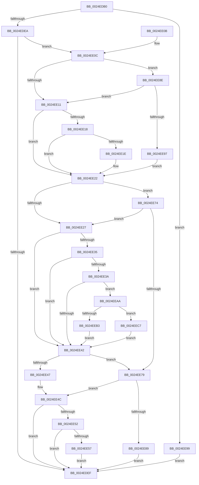

# IopFreeIrpExtension

- RVA: `0x0024EDB0`–`0x0024EED5` (길이 `293` bytes)
- VA: `0x000000014024EDB0`
- 실행 섹션: `.text`
- PDB 이름 있음: `예`; PDB Function 태그: `아니요`
- unwind 정보 RVA: `0x000632C0`
- 디코드: `84`개 명령, `293/293` bytes 표시
- 미해석 바이트: `0` (있으면 어셈블리에 `.byte`로 보존)

> 이 문서는 커널 이미지의 기계어와 PDB 기호를 분석해 생성했습니다. 4번과 5번은 함수 원형과 자료형을 바이너리 사용 방식에서 추정한 C 해석이며 원본 소스 복구 결과는 아닙니다.

## 1. Dependencies

- 직접 호출 지점: **2**; 고유 호출 대상: **2**
- 직접 호출자로 확인된 함수: **11**
- RIP 상대 이미지 참조: **1**

### Outgoing calls
- `0x0024EE5F` → [ExFreePoolWithTag](../../poolcode/B8/ExFreePoolWithTag_function_00B82870.md) (function, `0x00B82870`)
- `0x0024EEC7` → [IopFreeCopyObjectsFromIrp](../4E/IopFreeCopyObjectsFromIrp_function_004E8834.md) (function, `0x004E8834`)

### Direct callers
- [IoReuseIrp](IoReuseIrp_function_0024DD70.md) at `0x0024DE16`
- [IoCleanupIrp](IoCleanupIrp_function_0024DF20.md) at `0x0024DF57`
- [sub_0024DF8A](Unknown_function_0024DF8A.md) at `0x0024DFCE`
- [sub_0024E6D3](Unknown_function_0024E6D3.md) at `0x0024E6EB`
- [IopfCompleteRequest](../29/IopfCompleteRequest_function_0029B5F8.md) at `0x0029B90D`
- [IopFreeCopyObjectsFromDataBuffer](../4C/IopFreeCopyObjectsFromDataBuffer_function_004C201C.md) at `0x004C208E`
- [IopCopyCompleteReadIrp](../4E/IopCopyCompleteReadIrp_function_004E83F0.md) at `0x004E8735`
- [IoClearAdapterCryptoEngineExtension](../59/IoClearAdapterCryptoEngineExtension_function_00598450.md) at `0x00598485`
- [IoClearFsTrackOffsetState](../59/IoClearFsTrackOffsetState_function_005984A0.md) at `0x005984C2`
- [sub_006F1ED8](../6F/Unknown_function_006F1ED8.md) at `0x006F1EE5`
- [sub_006F997E](../6F/Unknown_function_006F997E.md) at `0x006F99D3`

### Static image references
- `0x0024EEB7` → RVA `0x004E83F0` (`IopCopyCompleteReadIrp`; read)

## 2. Other-region calls and transfers

- 다른 실행 섹션으로 향하는 call: **1**
  - `0x0024EE5F` → [ExFreePoolWithTag](../../poolcode/B8/ExFreePoolWithTag_function_00B82870.md) (`.text` → `POOLCODE`)
- 별도 외부 분기/꼬리 이동을 확인하지 못했습니다.

## 3. Assembly (complete function range)

```asm
0024EDB0  48 89 5C 24 08                  mov qword ptr [rsp + 8], rbx
0024EDB5  48 89 6C 24 10                  mov qword ptr [rsp + 0x10], rbp
0024EDBA  48 89 74 24 18                  mov qword ptr [rsp + 0x18], rsi
0024EDBF  57                              push rdi
0024EDC0  41 56                           push r14
0024EDC2  41 57                           push r15
0024EDC4  48 83 EC 20                     sub rsp, 0x20
0024EDC8  0F B6 41 47                     movzx eax, byte ptr [rcx + 0x47]
0024EDCC  45 33 FF                        xor r15d, r15d
0024EDCF  48 8B 99 C8 00 00 00            mov rbx, qword ptr [rcx + 0xc8]
0024EDD6  45 0F B6 F0                     movzx r14d, r8b
0024EDDA  8B F2                           mov esi, edx
0024EDDC  48 8B F9                        mov rdi, rcx
0024EDDF  41 8B EF                        mov ebp, r15d
0024EDE2  84 C0                           test al, al
0024EDE4  0F 88 AF 00 00 00               js 0x14024ee99
0024EDEA  48 85 DB                        test rbx, rbx
0024EDED  75 1D                           jne 0x14024ee0c
0024EDEF  48 8B 5C 24 40                  mov rbx, qword ptr [rsp + 0x40]
0024EDF4  48 8B C5                        mov rax, rbp
0024EDF7  48 8B 6C 24 48                  mov rbp, qword ptr [rsp + 0x48]
0024EDFC  48 8B 74 24 50                  mov rsi, qword ptr [rsp + 0x50]
0024EE01  48 83 C4 20                     add rsp, 0x20
0024EE05  41 5F                           pop r15
0024EE07  41 5E                           pop r14
0024EE09  5F                              pop rdi
0024EE0A  C3                              ret
0024EE0B  CC                              int3
0024EE0C  83 FE 05                        cmp esi, 5
0024EE0F  75 7D                           jne 0x14024ee8e
0024EE11  90                              nop
0024EE12  40 38 69 47                     cmp byte ptr [rcx + 0x47], bpl
0024EE16  7C 0A                           jl 0x14024ee22
0024EE18  F6 43 02 20                     test byte ptr [rbx + 2], 0x20
0024EE1C  74 04                           je 0x14024ee22
0024EE1E  4C 89 7B 28                     mov qword ptr [rbx + 0x28], r15
0024EE22  83 FE 09                        cmp esi, 9
0024EE25  75 4D                           jne 0x14024ee74
0024EE27  48 8B 81 C8 00 00 00            mov rax, qword ptr [rcx + 0xc8]
0024EE2E  90                              nop
0024EE2F  40 38 69 47                     cmp byte ptr [rcx + 0x47], bpl
0024EE33  7C 0D                           jl 0x14024ee42
0024EE35  48 85 C0                        test rax, rax
0024EE38  74 08                           je 0x14024ee42
0024EE3A  66 0F BA 60 02 09               bt word ptr [rax + 2], 9
0024EE40  72 68                           jb 0x14024eeaa
0024EE42  83 FE FF                        cmp esi, -1
0024EE45  75 32                           jne 0x14024ee79
0024EE47  66 44 89 7B 02                  mov word ptr [rbx + 2], r15w
0024EE4C  F6 47 47 40                     test byte ptr [rdi + 0x47], 0x40
0024EE50  74 9D                           je 0x14024edef
0024EE52  45 84 F6                        test r14b, r14b
0024EE55  74 98                           je 0x14024edef
0024EE57  BA 49 72 70 58                  mov edx, 0x58707249
0024EE5C  48 8B CB                        mov rcx, rbx
0024EE5F  E8 0C 3A 93 00                  call 0x140b82870
0024EE64  80 67 47 BF                     and byte ptr [rdi + 0x47], 0xbf
0024EE68  4C 89 BF C8 00 00 00            mov qword ptr [rdi + 0xc8], r15
0024EE6F  E9 7B FF FF FF                  jmp 0x14024edef
0024EE74  83 FE FF                        cmp esi, -1
0024EE77  74 AE                           je 0x14024ee27
0024EE79  0F B7 43 02                     movzx eax, word ptr [rbx + 2]
0024EE7D  0F B3 F0                        btr eax, esi
0024EE80  66 89 43 02                     mov word ptr [rbx + 2], ax
0024EE84  66 85 C0                        test ax, ax
0024EE87  74 C3                           je 0x14024ee4c
0024EE89  E9 61 FF FF FF                  jmp 0x14024edef
0024EE8E  83 FE FF                        cmp esi, -1
0024EE91  0F 84 7A FF FF FF               je 0x14024ee11
0024EE97  EB 89                           jmp 0x14024ee22
0024EE99  24 7F                           and al, 0x7f
0024EE9B  4C 89 B9 C8 00 00 00            mov qword ptr [rcx + 0xc8], r15
0024EEA2  88 41 47                        mov byte ptr [rcx + 0x47], al
0024EEA5  E9 45 FF FF FF                  jmp 0x14024edef
0024EEAA  8B 41 10                        mov eax, dword ptr [rcx + 0x10]
0024EEAD  0F BA E0 09                     bt eax, 9
0024EEB1  72 14                           jb 0x14024eec7
0024EEB3  0F BA E0 08                     bt eax, 8
0024EEB7  48 8D 05 32 95 29 00            lea rax, [rip + 0x299532]
0024EEBE  48 0F 42 E8                     cmovb rbp, rax
0024EEC2  E9 7B FF FF FF                  jmp 0x14024ee42
0024EEC7  E8 68 99 29 00                  call 0x1404e8834
0024EECC  C6 47 41 01                     mov byte ptr [rdi + 0x41], 1
0024EED0  E9 6D FF FF FF                  jmp 0x14024ee42
```

## 4. C-style interpretation (structured pseudocode)

```c
__int64 __fastcall IopFreeIrpExtension(__int64 a1, int a2, unsigned __int8 a3)
{
    __int64 result;
    __int64 v_r15;
    __int64 v_rbp;
    __int64 v_rsp;
    unsigned __int64 v_stack_p10;
    unsigned __int64 v_stack_p18;
    unsigned __int64 v_stack_p8;

    v_stack_p8 = v_rbx;
    v_stack_p10 = v_rbp;
    v_stack_p18 = v_rsi;
    v_rsp = (v_rsp) - (32);
    v_r15 = 0;
    if (sign_flag) goto loc_0024EE99;
    if (*(unsigned __int64 *)(a1 + 200) != 0) goto loc_0024EE0C;
loc_0024EDEF:
    v_rsp = (v_rsp) + (32);
    return 0;
loc_0024EE0C:
    if (((unsigned int)(v_stack_p18)) != 5) goto loc_0024EE8E;
loc_0024EE11:
    if ((*(unsigned __int8 *)(a1 + 71)) < ((unsigned __int8)(v_stack_p10))) goto loc_0024EE22;
    if (((*(unsigned __int8 *)(v_stack_p8 + 2)) & (32)) != 0) {
        *(unsigned __int64 *)(v_stack_p8 + 40) = 0;
    }
    if (((unsigned int)(v_stack_p18)) != 9) goto loc_0024EE74;
loc_0024EE27:
    if ((*(unsigned __int8 *)(a1 + 71)) < ((unsigned __int8)(v_stack_p10))) goto loc_0024EE42;
    if (*(unsigned __int64 *)(a1 + 200) == 0) goto loc_0024EE42;
    if (condition_is_below) goto loc_0024EEAA;
loc_0024EE42:
    if (((unsigned int)(v_stack_p18)) != -1) goto loc_0024EE79;
    *(unsigned __int16 *)(v_stack_p8 + 2) = 0;
loc_0024EE4C:
    if (((*(unsigned __int8 *)(a1 + 71)) & (64)) == 0) goto loc_0024EDEF;
    if (a3 == 0) goto loc_0024EDEF;
    result = ExFreePoolWithTag(v_stack_p8, (unsigned int)(0x58707249ULL), a3, a4);
    *(unsigned __int64 *)(a1 + 200) = 0;
    goto loc_0024EDEF;
loc_0024EE74:
    if (((unsigned int)(v_stack_p18)) == -1) goto loc_0024EE27;
loc_0024EE79:
    *(unsigned __int16 *)(v_stack_p8 + 2) = (unsigned __int16)(*(unsigned __int16 *)(v_stack_p8 + 2));
    if ((unsigned __int16)(*(unsigned __int16 *)(v_stack_p8 + 2)) == 0) goto loc_0024EE4C;
    goto loc_0024EDEF;
loc_0024EE8E:
    if (((unsigned int)(v_stack_p18)) == -1) goto loc_0024EE11;
    goto loc_0024EE22;
loc_0024EE99:
    result = (unsigned __int8)((*(unsigned __int16 *)(v_stack_p8 + 2)) & (127));
    *(unsigned __int64 *)(v_stack_p8 + 200) = 0;
    *(unsigned __int8 *)(v_stack_p8 + 71) = (unsigned __int8)(result);
    goto loc_0024EDEF;
loc_0024EEAA:
    if (condition_is_below) goto loc_0024EEC7;
    v_rbp = v_stack_p10;
    if (condition_is_below) { v_rbp = v_rip + 2725170; }
    goto loc_0024EE42;
loc_0024EEC7:
    result = IopFreeCopyObjectsFromIrp(v_stack_p8, (unsigned int)(0x58707249ULL), a3, a4);
    *(unsigned __int8 *)(a1 + 65) = 1;
    goto loc_0024EE42;
}
```

## 5. (Beta) C Style

```c
int64_t IopFreeIrpExtension(void *Arg1, int32_t Arg2, uint8_t Arg3)
{
    uint8_t *arg1 = (uint8_t *)Arg1;

    int64_t result;
    int64_t local_r15;
    int64_t local_rbp;
    int64_t local_rsp;
    uint64_t v_stack_p10;
    uint64_t v_stack_p18;
    uint64_t v_stack_p8;

    v_stack_p8 = local_rbx;
    v_stack_p10 = local_rbp;
    v_stack_p18 = local_rsi;
    local_rsp = (local_rsp) - (32);
    local_r15 = 0;
    if (sign_flag) goto loc_0024EE99;
    if (*(uint64_t *)(arg1 + 0xC8) != 0) goto loc_0024EE0C;
loc_0024EDEF:
    local_rsp = (local_rsp) + (32);
    return 0;
loc_0024EE0C:
    if (((uint32_t)(v_stack_p18)) != 5) goto loc_0024EE8E;
loc_0024EE11:
    if ((*(uint8_t *)(arg1 + 0x47)) < ((uint8_t)(v_stack_p10))) goto loc_0024EE22;
    if (((*(uint8_t *)(v_stack_p8 + 0x2)) & (32)) != 0) {
        *(uint64_t *)(v_stack_p8 + 0x28) = 0;
    }
    if (((uint32_t)(v_stack_p18)) != 9) goto loc_0024EE74;
loc_0024EE27:
    if ((*(uint8_t *)(arg1 + 0x47)) < ((uint8_t)(v_stack_p10))) goto loc_0024EE42;
    if (*(uint64_t *)(arg1 + 0xC8) == 0) goto loc_0024EE42;
    if (condition_is_below) goto loc_0024EEAA;
loc_0024EE42:
    if (((uint32_t)(v_stack_p18)) != -1) goto loc_0024EE79;
    *(uint16_t *)(v_stack_p8 + 0x2) = 0;
loc_0024EE4C:
    if (((*(uint8_t *)(arg1 + 0x47)) & (64)) == 0) goto loc_0024EDEF;
    if (Arg3 == 0) goto loc_0024EDEF;
    result = ExFreePoolWithTag(v_stack_p8, (uint32_t)(0x58707249ULL), Arg3, a4);
    *(uint64_t *)(arg1 + 0xC8) = 0;
    goto loc_0024EDEF;
loc_0024EE74:
    if (((uint32_t)(v_stack_p18)) == -1) goto loc_0024EE27;
loc_0024EE79:
    *(uint16_t *)(v_stack_p8 + 0x2) = (uint16_t)(*(uint16_t *)(v_stack_p8 + 0x2));
    if ((uint16_t)(*(uint16_t *)(v_stack_p8 + 0x2)) == 0) goto loc_0024EE4C;
    goto loc_0024EDEF;
loc_0024EE8E:
    if (((uint32_t)(v_stack_p18)) == -1) goto loc_0024EE11;
    goto loc_0024EE22;
loc_0024EE99:
    result = (uint8_t)((*(uint16_t *)(v_stack_p8 + 0x2)) & (127));
    *(uint64_t *)(v_stack_p8 + 0xC8) = 0;
    *(uint8_t *)(v_stack_p8 + 0x47) = (uint8_t)(result);
    goto loc_0024EDEF;
loc_0024EEAA:
    if (condition_is_below) goto loc_0024EEC7;
    local_rbp = v_stack_p10;
    if (condition_is_below) { local_rbp = v_rip + 2725170; }
    goto loc_0024EE42;
loc_0024EEC7:
    result = IopFreeCopyObjectsFromIrp(v_stack_p8, (uint32_t)(0x58707249ULL), Arg3, a4);
    *(uint8_t *)(arg1 + 0x41) = 1;
    goto loc_0024EE42;
}
```

### 관측된 메모리 오프셋

구조체 형식이 확인되지 않은 접근은 인자 기준의 오프셋으로만 기록했습니다.

| 기준 인자 | 오프셋 표현 | 폭 (bit) | 접근 |
|---|---:|---:|---|
| `Arg1` | `+ 0x10` | `32` | `R` |
| `Arg1` | `+ 0x41` | `8` | `W` |
| `Arg1` | `+ 0x47` | `8` | `R` |
| `Arg1` | `+ 0x47` | `8` | `R/W` |
| `Arg1` | `+ 0x47` | `8` | `W` |
| `Arg1` | `+ 0xC8` | `64` | `R` |
| `Arg1` | `+ 0xC8` | `64` | `W` |

## 6. Execution-region graph

[열기: 2D/3D 그래프와 함수 탐색 컨트롤 패널](../../../control-panel.html?section=text&rva=0x0024EDB0&view=graph)

- 2D 그래프는 위에서 아래로 흐르고, 3D 그래프는 빈 공간을 드래그해 회전합니다. Shift+드래그는 이동, 휠은 확대·축소, 함수 노드 선택은 대상 보고서 이동입니다.

### Static fallback


