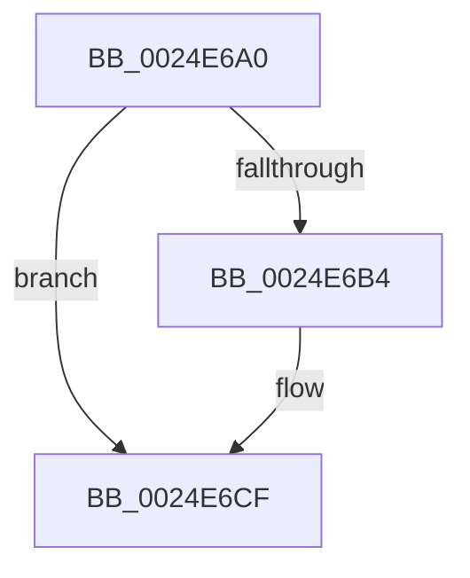

# IopFreeIrp

- RVA: `0x0024E6A0`–`0x0024E6D3` (길이 `51` bytes)
- VA: `0x000000014024E6A0`
- 실행 섹션: `.text`
- PDB 이름 있음: `예`; PDB Function 태그: `아니요`
- unwind 정보 RVA: `0x00063180`
- 디코드: `15`개 명령, `51/51` bytes 표시
- 미해석 바이트: `0` (있으면 어셈블리에 `.byte`로 보존)

> 이 문서는 커널 이미지의 기계어와 PDB 기호를 분석해 생성했습니다. 4번과 5번은 함수 원형과 자료형을 바이너리 사용 방식에서 추정한 C 해석이며 원본 소스 복구 결과는 아닙니다.

## 1. Dependencies

- 직접 호출 지점: **1**; 고유 호출 대상: **1**
- 직접 호출자로 확인된 함수: **1**
- RIP 상대 이미지 참조: **0**

### Outgoing calls
- `0x0024E6C9` → [KeBugCheckEx](../4F/KeBugCheckEx_function_004FD660.md) (function, `0x004FD660`)

### Direct callers
- [IovFreeIrpPrivate](../../pagevrfy/BB/IovFreeIrpPrivate_function_00BB6F20.md) at `0x00BB6F5C`

### Static image references
- 디코드된 RIP-relative 메모리 참조가 없습니다.

## 2. Other-region calls and transfers

- 다른 실행 섹션으로 향하는 call: **0**
- 별도 외부 분기/꼬리 이동을 확인하지 못했습니다.

## 3. Assembly (complete function range)

```asm
0024E6A0  40 53                           push rbx
0024E6A2  41 56                           push r14
0024E6A4  48 83 EC 78                     sub rsp, 0x78
0024E6A8  45 33 F6                        xor r14d, r14d
0024E6AB  48 8B D9                        mov rbx, rcx
0024E6AE  66 83 39 06                     cmp word ptr [rcx], 6
0024E6B2  74 1B                           je 0x14024e6cf
0024E6B4  48 8B D1                        mov rdx, rcx
0024E6B7  4C 89 74 24 20                  mov qword ptr [rsp + 0x20], r14
0024E6BC  41 8D 4E 44                     lea ecx, [r14 + 0x44]
0024E6C0  45 33 C9                        xor r9d, r9d
0024E6C3  41 B8 EE 27 00 00               mov r8d, 0x27ee
0024E6C9  E8 92 EF 2A 00                  call 0x1404fd660
0024E6CE  CC                              int3
0024E6CF  F6 41 47 40                     test byte ptr [rcx + 0x47], 0x40
```

## 4. C-style interpretation (structured pseudocode)

```c
__int64 __fastcall IopFreeIrp(__int64 a1, __int64 a2, __int64 a3, int a4)
{
    __int64 result;
    __int64 v_r14;
    __int64 v_rsp;
    unsigned __int64 v_stack_m68;

    v_rsp = (v_rsp) - (120);
    v_r14 = 0;
    if ((*(unsigned __int16 *)(a1)) != 6) {
        a2 = a1;
        v_stack_m68 = 0;
        a1 = v_r14 + 68;
        a4 = 0;
        a3 = 0x27EEULL;
        result = KeBugCheckEx(a1, a2, a3, a4);
    }
    return result;
}
```

## 5. (Beta) C Style

```c
int64_t IopFreeIrp(void *Arg1, int64_t Arg2, int64_t Arg3, int32_t Arg4)
{
    uint8_t *arg1 = (uint8_t *)Arg1;

    int64_t result;
    int64_t local_r14;
    int64_t local_rsp;
    uint64_t v_stack_m68;

    local_rsp = (local_rsp) - (120);
    local_r14 = 0;
    if ((*(uint16_t *)(arg1)) != 6) {
        Arg2 = Arg1;
        v_stack_m68 = 0;
        Arg1 = local_r14 + 68;
        Arg4 = 0;
        Arg3 = 0x27EEULL;
        result = KeBugCheckEx(Arg1, Arg2, Arg3, Arg4);
    }
    return result;
}
```

### 관측된 메모리 오프셋

구조체 형식이 확인되지 않은 접근은 인자 기준의 오프셋으로만 기록했습니다.

| 기준 인자 | 오프셋 표현 | 폭 (bit) | 접근 |
|---|---:|---:|---|
| `Arg1` | `+ 0x0` | `16` | `R` |

## 6. Execution-region graph

[열기: 2D/3D 그래프와 함수 탐색 컨트롤 패널](../../../control-panel.html?section=text&rva=0x0024E6A0&view=graph)

- 2D 그래프는 위에서 아래로 흐르고, 3D 그래프는 빈 공간을 드래그해 회전합니다. Shift+드래그는 이동, 휠은 확대·축소, 함수 노드 선택은 대상 보고서 이동입니다.

### Static fallback


