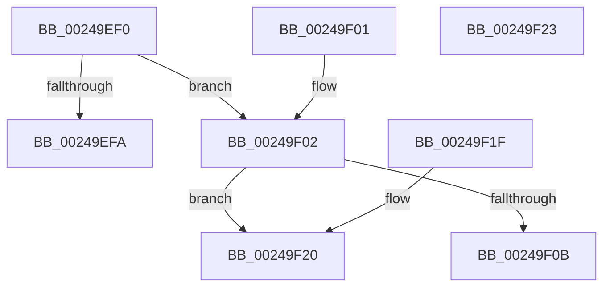

# KeQueryActiveProcessorCountEx

- RVA: `0x00249EF0`–`0x00249F24` (길이 `52` bytes)
- VA: `0x0000000140249EF0`
- 실행 섹션: `.text`
- PDB 이름 있음: `예`; PDB Function 태그: `아니요`
- unwind 정보 RVA: `0x000DB714`
- 디코드: `17`개 명령, `52/52` bytes 표시
- 미해석 바이트: `0` (있으면 어셈블리에 `.byte`로 보존)

> 이 문서는 커널 이미지의 기계어와 PDB 기호를 분석해 생성했습니다. 4번과 5번은 함수 원형과 자료형을 바이너리 사용 방식에서 추정한 C 해석이며 원본 소스 복구 결과는 아닙니다.

## 1. Dependencies

- 직접 호출 지점: **0**; 고유 호출 대상: **0**
- 직접 호출자로 확인된 함수: **77**
- RIP 상대 이미지 참조: **3**

### Outgoing calls
- 직접 디코드된 call 명령이 없습니다.

### Direct callers
- [sub_00249C6B](Unknown_function_00249C6B.md) at `0x00249CD8`
- [KiOutSwapKernelStacks](../29/KiOutSwapKernelStacks_function_0029F628.md) at `0x0029F78F`
- [KiInitiateGenericCallDpc](../2C/KiInitiateGenericCallDpc_function_002C9C40.md) at `0x002C9C5D`
- [KeQueryLogicalProcessorRelationship](../2C/KeQueryLogicalProcessorRelationship_function_002CEA60.md) at `0x002CF00B`
- [KeIntSteerSnapPerf](../2D/KeIntSteerSnapPerf_function_002D76C0.md) at `0x002D79B3`
- [KiIntSteerCalculatePriorityDistribution](../2D/KiIntSteerCalculatePriorityDistribution_function_002D8760.md) at `0x002D87F5`
- [PoGetPerfStateAndParkingInfo](../2D/PoGetPerfStateAndParkingInfo_function_002DD484.md) at `0x002DD4E1`
- [SMKM_STORE_MGR&lt;SM_TRAITS&gt;::SmAsyncReadQueueInsert](../39/SMKM_STORE_MGR_SM_TRAITS_SmAsyncReadQueueInsert_function_0039120C.md) at `0x003912AF`
- [CcInitializePrivateVolumeCacheMap](../3C/CcInitializePrivateVolumeCacheMap_function_003CE088.md) at `0x003CE4F3`
- [KeCapturePersistentThreadState](../43/KeCapturePersistentThreadState_function_00435D90.md) at `0x00435EA7`
- [KeIpiGenericCall](../47/KeIpiGenericCall_function_00471720.md) at `0x00471769`
- [KeInitializeQueue](../48/KeInitializeQueue_function_00480C90.md) at `0x00480CD4`
- [PopCheckForIdleness](../48/PopCheckForIdleness_function_00482530.md) at `0x0048254D`
- [KeSetTargetProcessorDpc](../48/KeSetTargetProcessorDpc_function_0048B830.md) at `0x0048B853`
- [KeAdjustInterruptTime](../4C/KeAdjustInterruptTime_function_004C9EB0.md) at `0x004C9EF9`
- [KeCheckForTimer](../4D/KeCheckForTimer_function_004D870C.md) at `0x004D873A`
- [KdpSetCommonState](../4E/KdpSetCommonState_function_004E0298.md) at `0x004E02D7`
- [HalpTimerInitSystem](../53/HalpTimerInitSystem_function_0053CB70.md) at `0x0053CC72`
- [HalpGetFullPmuOwnership](../53/HalpGetFullPmuOwnership_function_0053FFB8.md) at `0x0053FFC6`
- [HalpMceHandlerWithRendezvous](../54/HalpMceHandlerWithRendezvous_function_005421E0.md) at `0x0054220B`
- [HalpPmuGetNumberOfReservedCounters](../54/HalpPmuGetNumberOfReservedCounters_function_00547570.md) at `0x00547584`
- [HalpTscFallbackToPlatformSource](../54/HalpTscFallbackToPlatformSource_function_0054AD14.md) at `0x0054AD44`
- [HalpTscInitializeSynchronizationContext](../54/HalpTscInitializeSynchronizationContext_function_0054ADB8.md) at `0x0054ADE9`
- [HalpTscSynchronization](../54/HalpTscSynchronization_function_0054AFC0.md) at `0x0054B009`
- [HalpTimerMeasureProcessorsWorker](../54/HalpTimerMeasureProcessorsWorker_function_0054D910.md) at `0x0054D94E`
- [EmonReleaseProfileResourcesInternal](../55/EmonReleaseProfileResourcesInternal_function_0055EF54.md) at `0x0055EFBB`
- [EmonRemoveProfileSourceEnhanced](../55/EmonRemoveProfileSourceEnhanced_function_0055F1C0.md) at `0x0055F1F2`
- [EmonRemoveProfileSourceOriginal](../55/EmonRemoveProfileSourceOriginal_function_0055F2C0.md) at `0x0055F2F2`
- [Amd64InitializeUncoreProfilingEnhanced](../56/Amd64InitializeUncoreProfilingEnhanced_function_0056CF58.md) at `0x0056CFAF`
- [Amd64InitializeUncoreProfilingOriginal](../56/Amd64InitializeUncoreProfilingOriginal_function_0056D068.md) at `0x0056D0BF`
- [Amd64RemoveProfileSource](../56/Amd64RemoveProfileSource_function_0056D900.md) at `0x0056D933`
- [CcInitializePartition](../57/CcInitializePartition_function_0057E4D8.md) at `0x0057E843`
- [DbgkpLkmdSnapGlobals](../57/DbgkpLkmdSnapGlobals_function_0057FE0C.md) at `0x0057FE2D`
- [HvlpMarkHvlPagesForHibernation](../58/HvlpMarkHvlPagesForHibernation_function_0058AD34.md) at `0x0058ADB8`
- [HvlGetProcessorIndexFromVpIndex](../58/HvlGetProcessorIndexFromVpIndex_function_0058D370.md) at `0x0058D39D`
- [IoFillDumpHeader](../59/IoFillDumpHeader_function_00591ECC.md) at `0x00591FCC`
- [KiAssignProcessorNumberToPrcb](../5B/KiAssignProcessorNumberToPrcb_function_005BC510.md) at `0x005BC59D`
- [KeOptimizeSpecCtrlSettings](../5B/KeOptimizeSpecCtrlSettings_function_005BE95C.md) at `0x005BE9CC`
- [KeSwitchFrozenProcessor](../5C/KeSwitchFrozenProcessor_function_005C2F40.md) at `0x005C2F4D`
- [KeBalanceSetManager](../5C/KeBalanceSetManager_function_005C5B30.md) at `0x005C5C21`
- [KeInitializePriQueue](../5C/KeInitializePriQueue_function_005CA8B4.md) at `0x005CA916`
- [MiReapplyImportOptimizationForDriverVerifier](../68/MiReapplyImportOptimizationForDriverVerifier_function_00682268.md) at `0x0068265B`
- [sub_006FBE7C](../6F/Unknown_function_006FBE7C.md) at `0x006FBE8F`
- [HalAllocateHardwareCounters](../../page/70/HalAllocateHardwareCounters_function_00707050.md) at `0x007070DB`
- [HalAllocateHardwareCounters](../../page/70/HalAllocateHardwareCounters_function_00707050.md) at `0x0070714B`
- [HalFreeHardwareCounters](../../page/70/HalFreeHardwareCounters_function_007071E0.md) at `0x0070720C`
- [HalpLoadMicrocode](../../page/70/HalpLoadMicrocode_function_0070B200.md) at `0x0070B3B7`
- [HalpLoadMicrocodeSerialized](../../page/70/HalpLoadMicrocodeSerialized_function_0070B450.md) at `0x0070B483`
- [HalpLbrConfigurationWorker](../../page/70/HalpLbrConfigurationWorker_function_0070DA78.md) at `0x0070DA8C`
- [PnpReplacePartitionUnit](../../page/73/PnpReplacePartitionUnit_function_00738550.md) at `0x007385C0`
- [PopCheckSkipTick](../../page/75/PopCheckSkipTick_function_007538CC.md) at `0x007538FB`
- [PspInitializeQuotaBlock](../../page/78/PspInitializeQuotaBlock_function_00780EB0.md) at `0x0078100B`
- [EtwpProcessorRundown](../../page/7C/EtwpProcessorRundown_function_007C0868.md) at `0x007C08B5`
- [NtStartProfile](../../page/7D/NtStartProfile_function_007D22C0.md) at `0x007D234C`
- [ExProcessorCounterSetCallback](../../page/9E/ExProcessorCounterSetCallback_function_009E4880.md) at `0x009E4A98`
- [PopInitializeHeteroProcessors](../../page/A5/PopInitializeHeteroProcessors_function_00A53570.md) at `0x00A535F0`
- [ExpQuerySystemInformation](../../page/A5/ExpQuerySystemInformation_function_00A57858.md) at `0x00A57BCC`
- [KiSynchCounterSetCallback](../../page/A5/KiSynchCounterSetCallback_function_00A5F5B0.md) at `0x00A5F603`
- [FsRtlAddDiskIOCounterInstance](../../page/A6/FsRtlAddDiskIOCounterInstance_function_00A615C0.md) at `0x00A615F4`
- [HalpCmcWorkerRoutine](../../page/A6/HalpCmcWorkerRoutine_function_00A637B0.md) at `0x00A6380C`
- [HalpQueryProfileInformation](../../page/AD/HalpQueryProfileInformation_function_00AD621C.md) at `0x00AD6328`
- [NtSetSystemInformation](../../page/AF/NtSetSystemInformation_function_00AF4A60.md) at `0x00AF4C84`
- [HalpCorrectErrSrc](../../pagelk/B5/HalpCorrectErrSrc_function_00B5B820.md) at `0x00B5B888`
- [HalpHandlePreviousMcaErrors](../../pagelk/B5/HalpHandlePreviousMcaErrors_function_00B5B8E4.md) at `0x00B5B94C`
- [HalpInitializeMce](../../pagelk/B5/HalpInitializeMce_function_00B5BC04.md) at `0x00B5BCE4`
- [HalpBuildResumeStructures](../../pagelk/B5/HalpBuildResumeStructures_function_00B5D0F0.md) at `0x00B5D0FB`
- [KeRestoreMtrrBroadcast](../../pagelk/B6/KeRestoreMtrrBroadcast_function_00B67C90.md) at `0x00B67CA8`
- [HalpMceInit](../../pagelk/B7/HalpMceInit_function_00B7B144.md) at `0x00B7B1AF`
- [HalpCmciInit](../../pagelk/B7/HalpCmciInit_function_00B7C348.md) at `0x00B7C39F`
- [KdpAllowDisable](../../pagekd/B8/KdpAllowDisable_function_00B895A0.md) at `0x00B895A9`
- [KdpGetStateChange](../../pagekd/B8/KdpGetStateChange_function_00B895E4.md) at `0x00B89615`
- [KdpSysReadControlSpace](../../pagekd/B8/KdpSysReadControlSpace_function_00B89658.md) at `0x00B8968E`
- [KdpSysWriteControlSpace](../../pagekd/B8/KdpSysWriteControlSpace_function_00B89740.md) at `0x00B89772`
- [IoInitSystemPreDrivers](../../init/C2/IoInitSystemPreDrivers_function_00C2AC3C.md) at `0x00C2B014`
- [KeStartAllProcessors](../../init/C3/KeStartAllProcessors_function_00C36F78.md) at `0x00C37751`
- [KiIntSteerInit](../../init/C3/KiIntSteerInit_function_00C3A1CC.md) at `0x00C3A292`
- [KiIntSteerInit](../../init/C3/KiIntSteerInit_function_00C3A1CC.md) at `0x00C3A341`
- [IntpAllocateProcessorContext](../../init/C6/IntpAllocateProcessorContext_function_00C6D844.md) at `0x00C6D861`
- [KeInitSystem](../../init/C7/KeInitSystem_function_00C71660.md) at `0x00C7179E`

### Static image references
- `0x00249EFA` → RVA `0x00FC6A80` (`ALMOSTRO`; read)
- `0x00249F02` → RVA `0x00FC5018` (`ALMOSTRO`; read)
- `0x00249F0E` → RVA `0x00FC7128` (`ALMOSTRO`; read)

## 2. Other-region calls and transfers

- 다른 실행 섹션으로 향하는 call: **0**
- 별도 외부 분기/꼬리 이동을 확인하지 못했습니다.

## 3. Assembly (complete function range)

```asm
00249EF0  B8 FF FF 00 00                  mov eax, 0xffff
00249EF5  66 3B C8                        cmp cx, ax
00249EF8  75 08                           jne 0x140249f02
00249EFA  8B 05 80 CB D7 00               mov eax, dword ptr [rip + 0xd7cb80]
00249F00  C3                              ret
00249F01  CC                              int3
00249F02  66 3B 0D 0F B1 D7 00            cmp cx, word ptr [rip + 0xd7b10f]
00249F09  73 15                           jae 0x140249f20
00249F0B  0F B7 C1                        movzx eax, cx
00249F0E  48 8D 0D 13 D2 D7 00            lea rcx, [rip + 0xd7d213]
00249F15  48 8B 04 C1                     mov rax, qword ptr [rcx + rax*8]
00249F19  F3 48 0F B8 C0                  popcnt rax, rax
00249F1E  C3                              ret
00249F1F  CC                              int3
00249F20  33 C0                           xor eax, eax
00249F22  C3                              ret
00249F23  CC                              int3
```

## 4. C-style interpretation (structured pseudocode)

```c
__int64 __fastcall KeQueryActiveProcessorCountEx(unsigned __int16 a1)
{
    __int64 result;

    if (a1 != ((unsigned __int16)((unsigned int)(0xFFFFULL)))) goto loc_00249F02;
    return (unsigned int)(*(unsigned int *)(v_rip + 14142336));
loc_00249F02:
    if (a1 >= (*(unsigned __int16 *)(v_rip + 14135567))) goto loc_00249F20;
    return *(unsigned __int64 *)(v_rip + 14144019 + a1 * 8);
loc_00249F20:
    result = 0;
    return result;
}
```

## 5. (Beta) C Style

```c
int64_t KeQueryActiveProcessorCountEx(uint16_t Arg1)
{
    int64_t result;

    if (Arg1 != ((uint16_t)((uint32_t)(0xFFFFULL)))) goto loc_00249F02;
    return (uint32_t)(*(uint32_t *)(v_rip + 0xD7CB80));
loc_00249F02:
    if (Arg1 >= (*(uint16_t *)(v_rip + 0xD7B10F))) goto loc_00249F20;
    return *(uint64_t *)(v_rip + 0xD7D213 + Arg1 * 8);
loc_00249F20:
    result = 0;
    return result;
}
```

## 6. Execution-region graph

[열기: 2D/3D 그래프와 함수 탐색 컨트롤 패널](../../../control-panel.html?section=text&rva=0x00249EF0&view=graph)

- 2D 그래프는 위에서 아래로 흐르고, 3D 그래프는 빈 공간을 드래그해 회전합니다. Shift+드래그는 이동, 휠은 확대·축소, 함수 노드 선택은 대상 보고서 이동입니다.

### Static fallback


