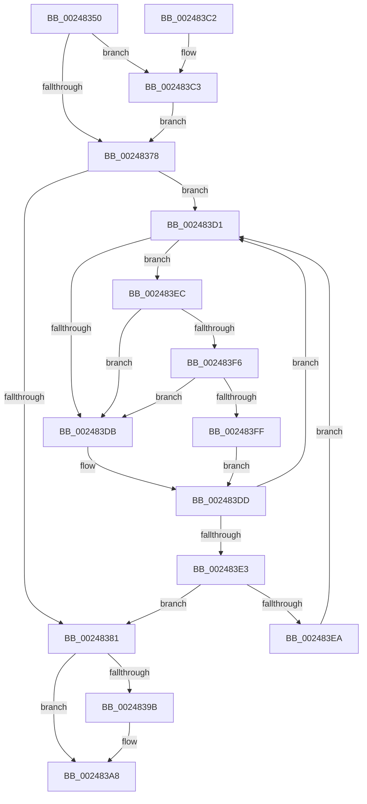

# KeResetEvent

- RVA: `0x00248350`–`0x00248408` (길이 `184` bytes)
- VA: `0x0000000140248350`
- 실행 섹션: `.text`
- PDB 이름 있음: `예`; PDB Function 태그: `아니요`
- unwind 정보 RVA: `0x000624B4`
- 디코드: `53`개 명령, `184/184` bytes 표시
- 미해석 바이트: `0` (있으면 어셈블리에 `.byte`로 보존)

> 이 문서는 커널 이미지의 기계어와 PDB 기호를 분석해 생성했습니다. 4번과 5번은 함수 원형과 자료형을 바이너리 사용 방식에서 추정한 C 해석이며 원본 소스 복구 결과는 아닙니다.

## 1. Dependencies

- 직접 호출 지점: **4**; 고유 호출 대상: **4**
- 직접 호출자로 확인된 함수: **113**
- RIP 상대 이미지 참조: **3**

### Outgoing calls
- `0x002483A3` → [KiLowerIrqlProcessIrqlFlags](../4F/KiLowerIrqlProcessIrqlFlags_function_004F5698.md) (function, `0x004F5698`)
- `0x002483CA` → [KiRaiseIrqlProcessIrqlFlags](../4F/KiRaiseIrqlProcessIrqlFlags_function_004F56FC.md) (function, `0x004F56FC`)
- `0x002483F6` → [KiCheckVpBackingLongSpinWaitHypercall](../30/KiCheckVpBackingLongSpinWaitHypercall_function_0030F490.md) (function, `0x0030F490`)
- `0x00248401` → [HvlNotifyLongSpinWait](../30/HvlNotifyLongSpinWait_function_0030F460.md) (function, `0x0030F460`)

### Direct callers
- [SMKM_STORE&lt;SM_TRAITS&gt;::SmStReadThread](../20/SMKM_STORE_SM_TRAITS_SmStReadThread_function_00203230.md) at `0x00203311`
- [sub_00206865](../20/Unknown_function_00206865.md) at `0x002068F6`
- [sub_00245F85](Unknown_function_00245F85.md) at `0x00245FDC`
- [sub_00245F85](Unknown_function_00245F85.md) at `0x00246010`
- [sub_00245F85](Unknown_function_00245F85.md) at `0x00246073`
- [sub_00245F85](Unknown_function_00245F85.md) at `0x0024607F`
- [sub_00246856](Unknown_function_00246856.md) at `0x0024689F`
- [sub_00246856](Unknown_function_00246856.md) at `0x002468D3`
- [sub_00246856](Unknown_function_00246856.md) at `0x00246931`
- [sub_00246856](Unknown_function_00246856.md) at `0x0024693D`
- [sub_00246D01](Unknown_function_00246D01.md) at `0x00246D56`
- [sub_00246D01](Unknown_function_00246D01.md) at `0x00246D89`
- [sub_00246D01](Unknown_function_00246D01.md) at `0x00246DEC`
- [sub_00246D01](Unknown_function_00246D01.md) at `0x00246DF8`
- [sub_002484B4](Unknown_function_002484B4.md) at `0x00248595`
- [sub_002484B4](Unknown_function_002484B4.md) at `0x002485C9`
- [sub_002484B4](Unknown_function_002484B4.md) at `0x00248673`
- [sub_002484B4](Unknown_function_002484B4.md) at `0x0024867F`
- [sub_002490EA](Unknown_function_002490EA.md) at `0x00249133`
- [sub_00249157](Unknown_function_00249157.md) at `0x00249171`
- [sub_0024918B](Unknown_function_0024918B.md) at `0x002491D8`
- [sub_0024918B](Unknown_function_0024918B.md) at `0x002491E4`
- [PopPepUpdateConstraints](../26/PopPepUpdateConstraints_function_0026F5C8.md) at `0x0026F722`
- [MiChargeCommit](../28/MiChargeCommit_function_00286EB0.md) at `0x002874B4`
- [MiChargeCommit](../28/MiChargeCommit_function_00286EB0.md) at `0x002874E8`
- [MiChargeCommit](../28/MiChargeCommit_function_00286EB0.md) at `0x00287571`
- [MiChargeCommit](../28/MiChargeCommit_function_00286EB0.md) at `0x0028757D`
- [MiWaitForFreePage](../2A/MiWaitForFreePage_function_002A3324.md) at `0x002A3408`
- [MiTrimUnusedPageFileRegionsWorker](../2A/MiTrimUnusedPageFileRegionsWorker_function_002AA320.md) at `0x002AA5A9`
- [MiTrimUnusedPageFileRegionsWorker](../2A/MiTrimUnusedPageFileRegionsWorker_function_002AA320.md) at `0x002AA6E4`
- [PopFxIdleWorker](../2C/PopFxIdleWorker_function_002C04A0.md) at `0x002C04F9`
- [PopFxAllocatePowerIrp](../2C/PopFxAllocatePowerIrp_function_002C0920.md) at `0x002C0AFC`
- [MiReleaseNonPagedResources](../32/MiReleaseNonPagedResources_function_0032299C.md) at `0x00322BA1`
- [MiReleaseNonPagedResources](../32/MiReleaseNonPagedResources_function_0032299C.md) at `0x00322BD0`
- [MiReleaseNonPagedResources](../32/MiReleaseNonPagedResources_function_0032299C.md) at `0x00322C6A`
- [MiReleaseNonPagedResources](../32/MiReleaseNonPagedResources_function_0032299C.md) at `0x00322C76`
- [sub_0034D7E9](../34/Unknown_function_0034D7E9.md) at `0x0034D861`
- [MiRebuildLargePagesThread](../37/MiRebuildLargePagesThread_function_00379AC0.md) at `0x00379CE5`
- [MiStoreEvictThread](../3A/MiStoreEvictThread_function_003A42D0.md) at `0x003A43F5`
- [SmKmStoreHelperCheckWaitCommand](../3B/SmKmStoreHelperCheckWaitCommand_function_003B06E0.md) at `0x003B073B`
- [SmKmStoreHelperWaitForCommand](../3B/SmKmStoreHelperWaitForCommand_function_003B075C.md) at `0x003B07A1`
- [SMKM_STORE_MGR&lt;SM_TRAITS&gt;::SmCompressCtxBalancerThread](../3B/SMKM_STORE_MGR_SM_TRAITS_SmCompressCtxBalancerThread_function_003B22C0.md) at `0x003B231B`
- [MiUpdateAvailableEventsAtDpc](../3B/MiUpdateAvailableEventsAtDpc_function_003BC804.md) at `0x003BC83C`
- [MiUpdateAvailableEventsAtDpc](../3B/MiUpdateAvailableEventsAtDpc_function_003BC804.md) at `0x003BC874`
- [SmKmStoreHelperWorker](../3C/SmKmStoreHelperWorker_function_003C2BC0.md) at `0x003C2C71`
- [CcInsertPrivateVolumeCacheMap](../3C/CcInsertPrivateVolumeCacheMap_function_003CE714.md) at `0x003CE91E`
- [IopValidateAndGetWriteParameters](../40/IopValidateAndGetWriteParameters_function_00400C30.md) at `0x00400FE3`
- [EtwpCovSampCaptureContextStop](../43/EtwpCovSampCaptureContextStop_function_0043BE5C.md) at `0x0043BED3`
- [MiUpdateCommitCounts](../43/MiUpdateCommitCounts_function_0043D9CC.md) at `0x0043DAD7`
- [MiUpdateCommitCounts](../43/MiUpdateCommitCounts_function_0043D9CC.md) at `0x0043DB06`
- [MiUpdateCommitCounts](../43/MiUpdateCommitCounts_function_0043D9CC.md) at `0x0043DB55`
- [MiUpdateCommitCounts](../43/MiUpdateCommitCounts_function_0043D9CC.md) at `0x0043DB61`
- [PopUpdateWatchdogNoWorkersEvent](../46/PopUpdateWatchdogNoWorkersEvent_function_00461078.md) at `0x004610A0`
- [MiDereferenceSegmentThread](../46/MiDereferenceSegmentThread_function_00464890.md) at `0x004649EA`
- [PopPowerRequestEvaluatePendingRequestStatus](../47/PopPowerRequestEvaluatePendingRequestStatus_function_00477914.md) at `0x004779FD`
- [PnpRequestDeviceAction](../47/PnpRequestDeviceAction_function_00477FF8.md) at `0x0047828B`
- [PnpRequestDeviceAction](../47/PnpRequestDeviceAction_function_00477FF8.md) at `0x004782EF`
- [MiSyncCommitSignals](../47/MiSyncCommitSignals_function_0047CA00.md) at `0x0047CA60`
- [MiSyncCommitSignals](../47/MiSyncCommitSignals_function_0047CA00.md) at `0x0047CAA3`
- [MiSyncCommitSignals](../47/MiSyncCommitSignals_function_0047CA00.md) at `0x0047CB00`
- [MiSyncCommitSignals](../47/MiSyncCommitSignals_function_0047CA00.md) at `0x0047CB0C`
- [MiModifiedPageWriter](../47/MiModifiedPageWriter_function_0047E5F0.md) at `0x0047E9E6`
- [MiModifiedPageWriter](../47/MiModifiedPageWriter_function_0047E5F0.md) at `0x0047EA7D`
- [MiModifiedPageWriter](../47/MiModifiedPageWriter_function_0047E5F0.md) at `0x0047EB9E`
- [MiWaitForAvailablePages](../4A/MiWaitForAvailablePages_function_004A1DCC.md) at `0x004A1E49`
- [PnpLockDeviceActionQueue](../4A/PnpLockDeviceActionQueue_function_004A4388.md) at `0x004A43BD`
- [MmStoreFlushOutstandingEvictions](../4B/MmStoreFlushOutstandingEvictions_function_004B769C.md) at `0x004B76D8`
- [ExUnregisterCallback](../4B/ExUnregisterCallback_function_004B7F80.md) at `0x004B7FAC`
- [PopFxIssueComponentPerfStateChanges](../4C/PopFxIssueComponentPerfStateChanges_function_004C1940.md) at `0x004C1A14`
- [MiQueueWorkingSetRequest](../4F/MiQueueWorkingSetRequest_function_004F7168.md) at `0x004F71AE`
- [HvlPhase2Initialize](../58/HvlPhase2Initialize_function_00583EA0.md) at `0x0058420F`
- [PopCheckPowerSourceAfterRtcWakeSet](../5D/PopCheckPowerSourceAfterRtcWakeSet_function_005D5A88.md) at `0x005D5A93`
- [PopIdleWakeAssignAccountingToSource](../5D/PopIdleWakeAssignAccountingToSource_function_005DBFA8.md) at `0x005DC03B`
- [PdcResetEvent](../60/PdcResetEvent_function_006058CC.md) at `0x006058D0`
- [SmTerminateStoreProcess](../60/SmTerminateStoreProcess_function_0060EB18.md) at `0x0060EBBC`
- [DifKeClearEventWrapper](../62/DifKeClearEventWrapper_function_0062EF90.md) at `0x0062F056`
- [DifKeResetEventWrapper](../63/DifKeResetEventWrapper_function_006324E0.md) at `0x006325AD`
- [MiSignalNonPagedPoolWatchers](../67/MiSignalNonPagedPoolWatchers_function_0067CAC8.md) at `0x0067CB21`
- [MiSignalNonPagedPoolWatchers](../67/MiSignalNonPagedPoolWatchers_function_0067CAC8.md) at `0x0067CB61`
- [MiDrainCrossPartitionUsage](../69/MiDrainCrossPartitionUsage_function_00690984.md) at `0x00690A7C`
- [MiDrainCrossPartitionUsage](../69/MiDrainCrossPartitionUsage_function_00690984.md) at `0x00690AB1`
- [sub_0069B640](../69/Unknown_function_0069B640.md) at `0x0069B741`
- [WdtpTimerCallback](../6A/WdtpTimerCallback_function_006A31B0.md) at `0x006A31EC`
- [sub_006E532A](../6E/Unknown_function_006E532A.md) at `0x006E5334`
- [sub_006F4C8C](../6F/Unknown_function_006F4C8C.md) at `0x006F4CCA`
- [sub_006F639E](../6F/Unknown_function_006F639E.md) at `0x006F63FF`
- [IoCancelFileOpen](../../page/70/IoCancelFileOpen_function_007034A0.md) at `0x0070359B`
- [sub_00703B14](../../page/70/Unknown_function_00703B14.md) at `0x00703C35`
- [DbgkpRemoveErrorPort](../../page/71/DbgkpRemoveErrorPort_function_00711038.md) at `0x00711116`
- [IoRegisterFsRegistrationChangeMountAware](../../page/71/IoRegisterFsRegistrationChangeMountAware_function_0071D890.md) at `0x0071DA3A`
- [IoSetInformation](../../page/71/IoSetInformation_function_0071DBF0.md) at `0x0071DC95`
- [PfGenerateTrace](../../page/75/PfGenerateTrace_function_0075101C.md) at `0x00751073`
- [PfTInitialize](../../page/75/PfTInitialize_function_00751554.md) at `0x0075168A`
- [PfTInitialize](../../page/75/PfTInitialize_function_00751554.md) at `0x00751692`
- [PfTInitialize](../../page/75/PfTInitialize_function_00751554.md) at `0x0075169A`
- [PfTInitialize](../../page/75/PfTInitialize_function_00751554.md) at `0x007516A2`
- [PopSetSystemAwayMode](../../page/75/PopSetSystemAwayMode_function_0075EF00.md) at `0x0075EF47`
- [PopPowerAggregatorSystemTransitionExitStateHandler](../../page/76/PopPowerAggregatorSystemTransitionExitStateHandler_function_00765180.md) at `0x00765190`
- [PopPowerAggregatorSystemTransitionExitStateHandler](../../page/76/PopPowerAggregatorSystemTransitionExitStateHandler_function_00765180.md) at `0x007651E0`
- [PopPowerAdapterQueryStatus](../../page/76/PopPowerAdapterQueryStatus_function_00767C44.md) at `0x00767CD2`
- [TtmiRetrieveEventFromQueue](../../page/77/TtmiRetrieveEventFromQueue_function_0077DCB8.md) at `0x0077DD4E`
- [EtwpCovSampCaptureWorkerThread](../../page/7C/EtwpCovSampCaptureWorkerThread_function_007C19B0.md) at `0x007C1A27`
- [sub_00863E45](../../page/86/Unknown_function_00863E45.md) at `0x00863E9B`
- [CmpLinkHiveToMaster](../../page/87/CmpLinkHiveToMaster_function_00877D6C.md) at `0x008781CB`
- [sub_008A8B60](../../page/8A/Unknown_function_008A8B60.md) at `0x008A8BC7`
- [NtResetEvent](../../page/8A/NtResetEvent_function_008AA2D0.md) at `0x008AA349`
- [IopReadFile](../../page/8A/IopReadFile_function_008AEFF0.md) at `0x008AF325`
- [IopCancelIrpsInThreadList](../../page/8C/IopCancelIrpsInThreadList_function_008C9E18.md) at `0x008C9EC9`
- [IopCancelIrpsInThreadList](../../page/8C/IopCancelIrpsInThreadList_function_008C9E18.md) at `0x008C9F40`
- [IopXxxControlFile](../../page/8E/IopXxxControlFile_function_008E9AD0.md) at `0x008E9DAF`
- [IopXxxControlFile](../../page/8E/IopXxxControlFile_function_008E9AD0.md) at `0x008EA20A`
- [BuildQueryDirectoryIrp](../../page/8E/BuildQueryDirectoryIrp_function_008EC770.md) at `0x008ECE17`
- [NtCopyFileChunk](../../page/94/NtCopyFileChunk_function_0094B600.md) at `0x0094BBDA`
- [PnpInsertEventInQueue](../../page/95/PnpInsertEventInQueue_function_00951B78.md) at `0x00951C7E`
- [SPCallServerHandleQueryPolicy](../../page/96/SPCallServerHandleQueryPolicy_function_0096AF24.md) at `0x0096BC5D`
- [sub_0096C058](../../page/96/Unknown_function_0096C058.md) at `0x0096C17E`
- [PfTLoggingWorker](../../page/97/PfTLoggingWorker_function_0097B140.md) at `0x0097B252`
- [IopInvalidateVolumesForDevice](../../page/9A/IopInvalidateVolumesForDevice_function_009A5E74.md) at `0x009A5FF1`
- [NtClearEvent](../../page/9A/NtClearEvent_function_009A91A0.md) at `0x009A91FE`
- [CmUnloadKey](../../page/9A/CmUnloadKey_function_009AF2FC.md) at `0x009AF8CF`
- [CmpLockRegistryFreezeAware](../../page/9B/CmpLockRegistryFreezeAware_function_009B4AE4.md) at `0x009B4B47`
- [EtwpStopTrace](../../page/9B/EtwpStopTrace_function_009BCE84.md) at `0x009BCF39`
- [EtwpLogger](../../page/9B/EtwpLogger_function_009BE310.md) at `0x009BE457`
- [NtLockFile](../../page/9D/NtLockFile_function_009D86D0.md) at `0x009D8B6D`
- [NtNotifyChangeMultipleKeys](../../page/9D/NtNotifyChangeMultipleKeys_function_009DC6B0.md) at `0x009DCACA`
- [NtSetInformationJobObject](../../page/9F/NtSetInformationJobObject_function_009F84C0.md) at `0x009F943F`
- [NtSetInformationJobObject](../../page/9F/NtSetInformationJobObject_function_009F84C0.md) at `0x009FA148`
- [PopThermalReadCounters](../../page/A0/PopThermalReadCounters_function_00A0E5B8.md) at `0x00A0E661`
- [NtNotifyChangeDirectoryFileEx](../../page/A1/NtNotifyChangeDirectoryFileEx_function_00A1DEA0.md) at `0x00A1E1D4`
- [IopMountVolume](../../page/A3/IopMountVolume_function_00A329D0.md) at `0x00A32BCD`
- [NtWaitForDebugEvent](../../page/A4/NtWaitForDebugEvent_function_00A464E0.md) at `0x00A466FC`
- [EtwpSynchronizeWithLogger](../../page/A6/EtwpSynchronizeWithLogger_function_00A66250.md) at `0x00A6626E`
- [EtwpSynchronizeWithLogger](../../page/A6/EtwpSynchronizeWithLogger_function_00A66250.md) at `0x00A662B0`
- [WmipCopyFromEventQueues](../../page/A6/WmipCopyFromEventQueues_function_00A6C92C.md) at `0x00A6CAC2`
- [SshpSessionManagerSendControlEventSlimEtl](../../page/A8/SshpSessionManagerSendControlEventSlimEtl_function_00A87200.md) at `0x00A872AC`
- [IopCreateArcName](../../page/A8/IopCreateArcName_function_00A8D580.md) at `0x00A8D88E`
- [RawQueryFsSizeInfo](../../page/AA/RawQueryFsSizeInfo_function_00AA1DC8.md) at `0x00AA1F38`
- [IopReadFileScatter](../../page/AA/IopReadFileScatter_function_00AA5D78.md) at `0x00AA6187`
- [IopWriteFileGather](../../page/AA/IopWriteFileGather_function_00AAA95C.md) at `0x00AAAD60`
- [PopFxUpdateVetoMaskWork](../../page/AB/PopFxUpdateVetoMaskWork_function_00AB2800.md) at `0x00AB289E`
- [IopSendMessageToTrackService](../../page/AC/IopSendMessageToTrackService_function_00AC0E5C.md) at `0x00AC0F33`
- [ArbArbiterHandler](../../page/AC/ArbArbiterHandler_function_00ACCFD0.md) at `0x00ACD0E2`
- [PopCancelIgnoreBatteryStatusChange](../../page/AD/PopCancelIgnoreBatteryStatusChange_function_00AD4338.md) at `0x00AD4343`
- [sub_00B465F2](../../page/B4/Unknown_function_00B465F2.md) at `0x00B4661E`
- [sub_00B49880](../../page/B4/Unknown_function_00B49880.md) at `0x00B49884`
- [IoShutdownSystem](../../pagelk/B6/IoShutdownSystem_function_00B63B8C.md) at `0x00B63CAC`
- [IoShutdownSystem](../../pagelk/B6/IoShutdownSystem_function_00B63B8C.md) at `0x00B63DD7`
- [IopShutdownBaseFileSystems](../../pagelk/B6/IopShutdownBaseFileSystems_function_00B63E10.md) at `0x00B63F17`
- [PfpScenCtxPrefetchWait](../../pagelk/B6/PfpScenCtxPrefetchWait_function_00B6B5B0.md) at `0x00B6B65B`
- [PopNewWakeInfo](../../pagelk/B7/PopNewWakeInfo_function_00B7D220.md) at `0x00B7D2D9`
- [PfpScenCtxQueryScenarioInformation](../../pagelk/B7/PfpScenCtxQueryScenarioInformation_function_00B7D400.md) at `0x00B7D479`
- [sub_00BC65EE](../../pagebgfx/BC/Unknown_function_00BC65EE.md) at `0x00BC6762`
- [IopGetBootDiskInformation](../../init/C2/IopGetBootDiskInformation_function_00C2DAAC.md) at `0x00C2DD38`
- [MiInitializePagedPoolEvents](../../init/C6/MiInitializePagedPoolEvents_function_00C64C44.md) at `0x00C64CC3`
- [MiInitializePagedPoolEvents](../../init/C6/MiInitializePagedPoolEvents_function_00C64C44.md) at `0x00C64CE4`

### Static image references
- `0x0024836F` → RVA `0x00FC6D20` (`ALMOSTRO`; read)
- `0x002483D3` → RVA `0x00FC52AC` (`ALMOSTRO`; reference)
- `0x002483EC` → RVA `0x00FC6AB8` (`ALMOSTRO`; read)

## 2. Other-region calls and transfers

- 다른 실행 섹션으로 향하는 call: **0**
- 별도 외부 분기/꼬리 이동을 확인하지 못했습니다.

## 3. Assembly (complete function range)

```asm
00248350  48 89 5C 24 10                  mov qword ptr [rsp + 0x10], rbx
00248355  48 89 74 24 18                  mov qword ptr [rsp + 0x18], rsi
0024835A  57                              push rdi
0024835B  48 83 EC 20                     sub rsp, 0x20
0024835F  48 8B D9                        mov rbx, rcx
00248362  44 0F 20 C7                     mov rdi, cr8
00248366  B8 02 00 00 00                  mov eax, 2
0024836B  44 0F 22 C0                     mov cr8, rax
0024836F  83 3D AA E9 D7 00 00            cmp dword ptr [rip + 0xd7e9aa], 0
00248376  75 4B                           jne 0x1402483c3
00248378  33 F6                           xor esi, esi
0024837A  F0 0F BA 2B 07                  lock bts dword ptr [rbx], 7
0024837F  72 50                           jb 0x1402483d1
00248381  8B 73 04                        mov esi, dword ptr [rbx + 4]
00248384  C7 43 04 00 00 00 00            mov dword ptr [rbx + 4], 0
0024838B  F0 81 23 7F FF FF FF            lock and dword ptr [rbx], 0xffffff7f
00248392  83 3D 87 E9 D7 00 00            cmp dword ptr [rip + 0xd7e987], 0
00248399  74 0D                           je 0x1402483a8
0024839B  44 0F 20 C1                     mov rcx, cr8
0024839F  40 0F B6 D7                     movzx edx, dil
002483A3  E8 F0 D2 2A 00                  call 0x1404f5698
002483A8  40 0F B6 CF                     movzx ecx, dil
002483AC  44 0F 22 C1                     mov cr8, rcx
002483B0  48 8B 5C 24 38                  mov rbx, qword ptr [rsp + 0x38]
002483B5  8B C6                           mov eax, esi
002483B7  48 8B 74 24 40                  mov rsi, qword ptr [rsp + 0x40]
002483BC  48 83 C4 20                     add rsp, 0x20
002483C0  5F                              pop rdi
002483C1  C3                              ret
002483C2  CC                              int3
002483C3  0F B6 D0                        movzx edx, al
002483C6  40 0F B6 CF                     movzx ecx, dil
002483CA  E8 2D D3 2A 00                  call 0x1404f56fc
002483CF  EB A7                           jmp 0x140248378
002483D1  FF C6                           inc esi
002483D3  85 35 D3 CE D7 00               test dword ptr [rip + 0xd7ced3], esi
002483D9  74 11                           je 0x1402483ec
002483DB  F3 90                           pause
002483DD  8B 03                           mov eax, dword ptr [rbx]
002483DF  84 C0                           test al, al
002483E1  78 EE                           js 0x1402483d1
002483E3  F0 0F BA 2B 07                  lock bts dword ptr [rbx], 7
002483E8  73 97                           jae 0x140248381
002483EA  EB E5                           jmp 0x1402483d1
002483EC  8B 05 C6 E6 D7 00               mov eax, dword ptr [rip + 0xd7e6c6]
002483F2  A8 40                           test al, 0x40
002483F4  74 E5                           je 0x1402483db
002483F6  E8 95 70 0C 00                  call 0x14030f490
002483FB  84 C0                           test al, al
002483FD  74 DC                           je 0x1402483db
002483FF  8B CE                           mov ecx, esi
00248401  E8 5A 70 0C 00                  call 0x14030f460
00248406  EB D5                           jmp 0x1402483dd
```

## 4. C-style interpretation (structured pseudocode)

```c
__int64 __fastcall KeResetEvent(__int64 a1)
{
    __int64 result;
    __int64 v_rsi;
    __int64 v_rsp;
    unsigned __int64 v_stack_p10;
    unsigned __int64 v_stack_p18;

    v_stack_p10 = v_rbx;
    v_stack_p18 = v_rsi;
    v_rsp = (v_rsp) - (32);
    if ((*(unsigned int *)(v_rip + 14150058)) != 0) goto loc_002483C3;
loc_00248378:
    v_rsi = 0;
    if (condition_is_below) goto loc_002483D1;
loc_00248381:
    *(unsigned int *)(a1 + 4) = 0;
    result = 2;
    if ((*(unsigned int *)(v_rip + 14150023)) != 0) {
        a1 = 2;
        a2 = (unsigned __int8)(v_cr8);
        result = KiLowerIrqlProcessIrqlFlags(a1, a2, a3, a4);
    }
    v_rsp = (v_rsp) + (32);
    return (unsigned int)((unsigned int)((unsigned int)(*(unsigned int *)(a1 + 4))));
loc_002483C3:
    result = KiRaiseIrqlProcessIrqlFlags((unsigned __int8)(v_cr8), (unsigned __int8)((unsigned int)((unsigned int)((unsigned int)(*(unsigned int *)(a1 + 4))))), a3, a4);
    goto loc_00248378;
loc_002483D1:
    v_rsi = (unsigned int)((v_stack_p18) + 1);
    if (((*(unsigned int *)(v_rip + 14143187)) & ((unsigned int)(v_rsi))) == 0) goto loc_002483EC;
loc_002483DB:
loc_002483DD:
    if (sign_flag) goto loc_002483D1;
    if (condition_is_above_or_equal) goto loc_00248381;
    goto loc_002483D1;
loc_002483EC:
    if ((((unsigned __int8)((unsigned int)(*(unsigned int *)(v_rip + 14149318)))) & (64)) == 0) goto loc_002483DB;
    result = KiCheckVpBackingLongSpinWaitHypercall((unsigned __int8)(v_cr8), (unsigned __int8)((unsigned int)((unsigned int)((unsigned int)(*(unsigned int *)(a1 + 4))))), a3, a4);
    if ((unsigned __int8)(result) == 0) goto loc_002483DB;
    result = HvlNotifyLongSpinWait((unsigned int)((unsigned int)(v_rsi)), (unsigned __int8)((unsigned int)((unsigned int)((unsigned int)(*(unsigned int *)(a1 + 4))))), a3, a4);
    goto loc_002483DD;
}
```

## 5. (Beta) C Style

```c
int64_t KeResetEvent(void *Event)
{
    uint8_t *event = (uint8_t *)Event;

    int64_t result;
    int64_t local_rsi;
    int64_t local_rsp;
    uint64_t v_stack_p10;
    uint64_t v_stack_p18;

    v_stack_p10 = local_rbx;
    v_stack_p18 = local_rsi;
    local_rsp = (local_rsp) - (32);
    if ((*(uint32_t *)(v_rip + 0xD7E9AA)) != 0) goto loc_002483C3;
loc_00248378:
    local_rsi = 0;
    if (condition_is_below) goto loc_002483D1;
loc_00248381:
    *(uint32_t *)(event + 0x4) = 0;
    result = 2;
    if ((*(uint32_t *)(v_rip + 0xD7E987)) != 0) {
        Event = 2;
        a2 = (uint8_t)(v_cr8);
        result = KiLowerIrqlProcessIrqlFlags(Event, a2, a3, a4);
    }
    local_rsp = (local_rsp) + (32);
    return (uint32_t)((uint32_t)((uint32_t)(*(uint32_t *)(event + 0x4))));
loc_002483C3:
    result = KiRaiseIrqlProcessIrqlFlags((uint8_t)(v_cr8), (uint8_t)((uint32_t)((uint32_t)((uint32_t)(*(uint32_t *)(event + 0x4))))), a3, a4);
    goto loc_00248378;
loc_002483D1:
    local_rsi = (uint32_t)((v_stack_p18) + 1);
    if (((*(uint32_t *)(v_rip + 0xD7CED3)) & ((uint32_t)(local_rsi))) == 0) goto loc_002483EC;
loc_002483DB:
loc_002483DD:
    if (sign_flag) goto loc_002483D1;
    if (condition_is_above_or_equal) goto loc_00248381;
    goto loc_002483D1;
loc_002483EC:
    if ((((uint8_t)((uint32_t)(*(uint32_t *)(v_rip + 0xD7E6C6)))) & (64)) == 0) goto loc_002483DB;
    result = KiCheckVpBackingLongSpinWaitHypercall((uint8_t)(v_cr8), (uint8_t)((uint32_t)((uint32_t)((uint32_t)(*(uint32_t *)(event + 0x4))))), a3, a4);
    if ((uint8_t)(result) == 0) goto loc_002483DB;
    result = HvlNotifyLongSpinWait((uint32_t)((uint32_t)(local_rsi)), (uint8_t)((uint32_t)((uint32_t)((uint32_t)(*(uint32_t *)(event + 0x4))))), a3, a4);
    goto loc_002483DD;
}
```

### 관측된 메모리 오프셋

구조체 형식이 확인되지 않은 접근은 인자 기준의 오프셋으로만 기록했습니다.

| 기준 인자 | 오프셋 표현 | 폭 (bit) | 접근 |
|---|---:|---:|---|
| `Event` | `+ 0x0` | `32` | `R` |
| `Event` | `+ 0x0` | `32` | `R/W` |
| `Event` | `+ 0x4` | `32` | `R` |
| `Event` | `+ 0x4` | `32` | `W` |

## 6. Execution-region graph

[열기: 2D/3D 그래프와 함수 탐색 컨트롤 패널](../../../control-panel.html?section=text&rva=0x00248350&view=graph)

- 2D 그래프는 위에서 아래로 흐르고, 3D 그래프는 빈 공간을 드래그해 회전합니다. Shift+드래그는 이동, 휠은 확대·축소, 함수 노드 선택은 대상 보고서 이동입니다.

### Static fallback


