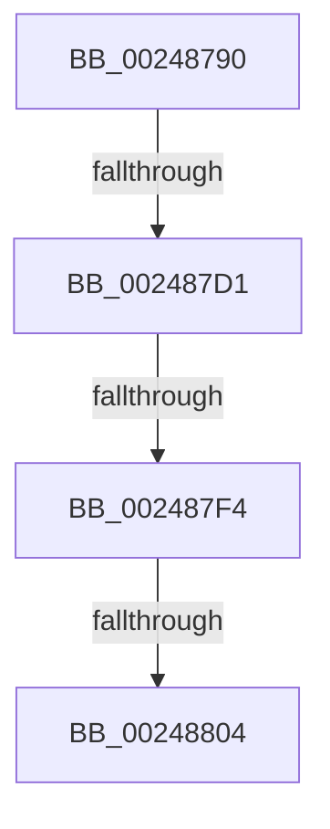

# KiAbProcessPostContextSwitch

- RVA: `0x00248790`–`0x0024880D` (길이 `125` bytes)
- VA: `0x0000000140248790`
- 실행 섹션: `.text`
- PDB 이름 있음: `예`; PDB Function 태그: `아니요`
- unwind 정보 RVA: `0x00062580`
- 디코드: `31`개 명령, `125/125` bytes 표시
- 미해석 바이트: `0` (있으면 어셈블리에 `.byte`로 보존)

> 이 문서는 커널 이미지의 기계어와 PDB 기호를 분석해 생성했습니다. 4번과 5번은 함수 원형과 자료형을 바이너리 사용 방식에서 추정한 C 해석이며 원본 소스 복구 결과는 아닙니다.

## 1. Dependencies

- 직접 호출 지점: **0**; 고유 호출 대상: **0**
- 직접 호출자로 확인된 함수: **8**
- RIP 상대 이미지 참조: **0**

### Outgoing calls
- 직접 디코드된 call 명령이 없습니다.

### Direct callers
- [KiHandleDeferredPreemption](../20/KiHandleDeferredPreemption_function_00202ECC.md) at `0x00202FA7`
- [KiHandleDeferredPreemption](../20/KiHandleDeferredPreemption_function_00202ECC.md) at `0x0020316D`
- [KeYieldExecution](../20/KeYieldExecution_function_00209FA0.md) at `0x0020A1C7`
- [KeYieldExecution](../20/KeYieldExecution_function_00209FA0.md) at `0x0020A330`
- [sub_0021B96F](../21/Unknown_function_0021B96F.md) at `0x0021B97E`
- [sub_0021C5F2](../21/Unknown_function_0021C5F2.md) at `0x0021C673`
- [sub_0021D7F8](../21/Unknown_function_0021D7F8.md) at `0x0021E0BD`
- [KiCheckForThreadDispatch](../25/KiCheckForThreadDispatch_function_00250648.md) at `0x00250760`
- [sub_00251E24](../25/Unknown_function_00251E24.md) at `0x00251EA7`
- [KiSwapThread](../35/KiSwapThread_function_00355640.md) at `0x0035588E`
- [KiSwapThread](../35/KiSwapThread_function_00355640.md) at `0x00355A1B`
- [KiSwapThread](../35/KiSwapThread_function_00355640.md) at `0x00355B3E`

### Static image references
- 디코드된 RIP-relative 메모리 참조가 없습니다.

## 2. Other-region calls and transfers

- 다른 실행 섹션으로 향하는 call: **0**
- call이 아닌 외부 분기/꼬리 이동: **3**
  - `0x002487CB` → [sub_00248B03](Unknown_function_00248B03.md) (`tail-transfer`)
  - `0x002487EE` → [sub_00248B03](Unknown_function_00248B03.md) (`tail-transfer`)
  - `0x002487FE` → [sub_00248B03](Unknown_function_00248B03.md) (`tail-transfer`)

## 3. Assembly (complete function range)

```asm
00248790  4C 8B DC                        mov r11, rsp
00248793  55                              push rbp
00248794  57                              push rdi
00248795  41 55                           push r13
00248797  49 8D 6B A1                     lea rbp, [r11 - 0x5f]
0024879B  48 81 EC 90 00 00 00            sub rsp, 0x90
002487A2  48 8B B9 78 04 00 00            mov rdi, qword ptr [rcx + 0x478]
002487A9  0F 57 C0                        xorps xmm0, xmm0
002487AC  33 C0                           xor eax, eax
002487AE  C7 45 67 00 00 00 00            mov dword ptr [rbp + 0x67], 0
002487B5  48 89 45 1F                     mov qword ptr [rbp + 0x1f], rax
002487B9  4C 8B E9                        mov r13, rcx
002487BC  0F 11 45 EF                     movups xmmword ptr [rbp - 0x11], xmm0
002487C0  0F 11 45 FF                     movups xmmword ptr [rbp - 1], xmm0
002487C4  0F 11 45 0F                     movups xmmword ptr [rbp + 0xf], xmm0
002487C8  48 85 FF                        test rdi, rdi
002487CB  0F 84 32 03 00 00               je 0x140248b03
002487D1  0F B6 4F 0C                     movzx ecx, byte ptr [rdi + 0xc]
002487D5  41 B8 01 00 00 00               mov r8d, 1
002487DB  49 D3 E0                        shl r8, cl
002487DE  0F B7 4F 08                     movzx ecx, word ptr [rdi + 8]
002487E2  41 FF C8                        dec r8d
002487E5  0F B7 57 0A                     movzx edx, word ptr [rdi + 0xa]
002487E9  0B D1                           or edx, ecx
002487EB  44 3B C2                        cmp r8d, edx
002487EE  0F 84 0F 03 00 00               je 0x140248b03
002487F4  41 0F B6 85 19 03 00 00         movzx eax, byte ptr [r13 + 0x319]
002487FC  84 C0                           test al, al
002487FE  0F 84 FF 02 00 00               je 0x140248b03
00248804  0F B7 4F 08                     movzx ecx, word ptr [rdi + 8]
00248808  B8 01 00 00 00                  mov eax, 1
```

## 4. C-style interpretation (structured pseudocode)

```c
__int64 __fastcall KiAbProcessPostContextSwitch(__int64 a1)
{
    __int64 result;
    __int64 v_rsp;

    v_rsp = (v_rsp) - (144);
    result = 0;
    *(unsigned int *)(v_rsp - 95 + 103) = 0;
    *(unsigned __int64 *)(v_rsp - 95 + 31) = 0;
    *(unsigned __int64 *)(v_rsp - 95 - 17) = v_xmm0;
    *(unsigned __int64 *)(v_rsp - 95 - 1) = v_xmm0;
    *(unsigned __int64 *)(v_rsp - 95 + 15) = v_xmm0;
    a3 = (1) << ((unsigned __int8)(*(unsigned __int8 *)(*(unsigned __int64 *)(a1 + 1144) + 12)));
    a3 = (unsigned int)((a3) - 1);
    a2 = (unsigned int)((*(unsigned __int16 *)(*(unsigned __int64 *)(a1 + 1144) + 10)) | ((unsigned int)(*(unsigned __int16 *)(*(unsigned __int64 *)(a1 + 1144) + 8))));
    return 1;
}
```

## 5. (Beta) C Style

```c
int64_t KiAbProcessPostContextSwitch(void *Arg1)
{
    uint8_t *arg1 = (uint8_t *)Arg1;

    int64_t result;
    int64_t local_rsp;

    local_rsp = (local_rsp) - (144);
    result = 0;
    *(uint32_t *)(local_rsp - 0x5F + 0x67) = 0;
    *(uint64_t *)(local_rsp - 0x5F + 0x1F) = 0;
    *(uint64_t *)(local_rsp - 0x5F - 0x11) = v_xmm0;
    *(uint64_t *)(local_rsp - 0x5F - 0x1) = v_xmm0;
    *(uint64_t *)(local_rsp - 0x5F + 0xF) = v_xmm0;
    a3 = (1) << ((uint8_t)(*(uint8_t *)(*(uint64_t *)(arg1 + 0x478) + 0xC)));
    a3 = (uint32_t)((a3) - 1);
    a2 = (uint32_t)((*(uint16_t *)(*(uint64_t *)(arg1 + 0x478) + 0xA)) | ((uint32_t)(*(uint16_t *)(*(uint64_t *)(arg1 + 0x478) + 0x8))));
    return 1;
}
```

### 관측된 메모리 오프셋

구조체 형식이 확인되지 않은 접근은 인자 기준의 오프셋으로만 기록했습니다.

| 기준 인자 | 오프셋 표현 | 폭 (bit) | 접근 |
|---|---:|---:|---|
| `Arg1` | `+ 0x319` | `8` | `R` |
| `Arg1` | `+ 0x478` | `64` | `R` |

## 6. Execution-region graph

[열기: 2D/3D 그래프와 함수 탐색 컨트롤 패널](../../../control-panel.html?section=text&rva=0x00248790&view=graph)

- 2D 그래프는 위에서 아래로 흐르고, 3D 그래프는 빈 공간을 드래그해 회전합니다. Shift+드래그는 이동, 휠은 확대·축소, 함수 노드 선택은 대상 보고서 이동입니다.

### Static fallback


