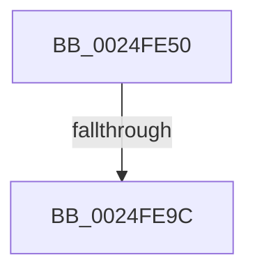

# KiInsertQueue

- RVA: `0x0024FE50`–`0x0024FEBE` (길이 `110` bytes)
- VA: `0x000000014024FE50`
- 실행 섹션: `.text`
- PDB 이름 있음: `예`; PDB Function 태그: `아니요`
- unwind 정보 RVA: `0x00063338`
- 디코드: `27`개 명령, `110/110` bytes 표시
- 미해석 바이트: `0` (있으면 어셈블리에 `.byte`로 보존)

> 이 문서는 커널 이미지의 기계어와 PDB 기호를 분석해 생성했습니다. 4번과 5번은 함수 원형과 자료형을 바이너리 사용 방식에서 추정한 C 해석이며 원본 소스 복구 결과는 아닙니다.

## 1. Dependencies

- 직접 호출 지점: **0**; 고유 호출 대상: **0**
- 직접 호출자로 확인된 함수: **1**
- RIP 상대 이미지 참조: **2**

### Outgoing calls
- 직접 디코드된 call 명령이 없습니다.

### Direct callers
- [EtwpQueueReply](../../page/9F/EtwpQueueReply_function_009FEDB0.md) at `0x009FEE03`

### Static image references
- `0x0024FE8F` → RVA `0x00FC6D20` (`ALMOSTRO`; read)
- `0x0024FEA5` → RVA `0x00FC6B04` (`ALMOSTRO`; read)

## 2. Other-region calls and transfers

- 다른 실행 섹션으로 향하는 call: **0**
- call이 아닌 외부 분기/꼬리 이동: **2**
  - `0x0024FE96` → [sub_00250185](../25/Unknown_function_00250185.md) (`tail-transfer`)
  - `0x0024FEB8` → [sub_002501D3](../25/Unknown_function_002501D3.md) (`tail-transfer`)

## 3. Assembly (complete function range)

```asm
0024FE50  44 89 4C 24 20                  mov dword ptr [rsp + 0x20], r9d
0024FE55  44 89 44 24 18                  mov dword ptr [rsp + 0x18], r8d
0024FE5A  48 89 54 24 10                  mov qword ptr [rsp + 0x10], rdx
0024FE5F  53                              push rbx
0024FE60  55                              push rbp
0024FE61  56                              push rsi
0024FE62  57                              push rdi
0024FE63  41 55                           push r13
0024FE65  41 56                           push r14
0024FE67  41 57                           push r15
0024FE69  48 83 EC 50                     sub rsp, 0x50
0024FE6D  41 8B E9                        mov ebp, r9d
0024FE70  4C 8D 69 08                     lea r13, [rcx + 8]
0024FE74  41 8B F8                        mov edi, r8d
0024FE77  4C 8B FA                        mov r15, rdx
0024FE7A  4C 8B F1                        mov r14, rcx
0024FE7D  44 0F 20 C0                     mov rax, cr8
0024FE81  48 89 44 24 38                  mov qword ptr [rsp + 0x38], rax
0024FE86  B9 02 00 00 00                  mov ecx, 2
0024FE8B  44 0F 22 C1                     mov cr8, rcx
0024FE8F  83 3D 8A 6E D7 00 00            cmp dword ptr [rip + 0xd76e8a], 0
0024FE96  0F 85 E9 02 00 00               jne 0x140250185
0024FE9C  65 48 8B 34 25 20 00 00 00      mov rsi, qword ptr gs:[0x20]
0024FEA5  F7 05 55 6C D7 00 00 00 00 01   test dword ptr [rip + 0xd76c55], 0x1000000
0024FEAF  48 89 74 24 30                  mov qword ptr [rsp + 0x30], rsi
0024FEB4  48 8B 5E 08                     mov rbx, qword ptr [rsi + 8]
0024FEB8  0F 85 15 03 00 00               jne 0x1402501d3
```

## 4. C-style interpretation (structured pseudocode)

```c
__int64 __fastcall KiInsertQueue(__int64 a1, __int64 a2, int a3, int a4)
{
    __int64 v_rsp;
    unsigned __int64 v_stack_m50;
    unsigned __int64 v_stack_m58;
    unsigned __int64 v_stack_p10;
    unsigned int v_stack_p18;
    unsigned int v_stack_p20;

    v_stack_p20 = a4;
    v_stack_p18 = a3;
    v_stack_p10 = a2;
    v_rsp = (v_rsp) - (80);
    v_stack_m50 = v_cr8;
    v_stack_m58 = *(unsigned __int64 *)(gs_base + (0 + 32));
}
```

## 5. (Beta) C Style

```c
int64_t KiInsertQueue(void *Arg1, int64_t Arg2, int32_t Arg3, int32_t Arg4)
{
    uint8_t *arg1 = (uint8_t *)Arg1;

    int64_t local_rsp;
    uint64_t v_stack_m50;
    uint64_t v_stack_m58;
    uint64_t v_stack_p10;
    uint32_t v_stack_p18;
    uint32_t v_stack_p20;

    v_stack_p20 = Arg4;
    v_stack_p18 = Arg3;
    v_stack_p10 = Arg2;
    local_rsp = (local_rsp) - (80);
    v_stack_m50 = v_cr8;
    v_stack_m58 = *(uint64_t *)(gs_base + (0 + 0x20));
}
```

### 관측된 메모리 오프셋

구조체 형식이 확인되지 않은 접근은 인자 기준의 오프셋으로만 기록했습니다.

| 기준 인자 | 오프셋 표현 | 폭 (bit) | 접근 |
|---|---:|---:|---|
| `Arg1` | `+ 0x8` | `64` | `R` |

## 6. Execution-region graph

[열기: 2D/3D 그래프와 함수 탐색 컨트롤 패널](../../../control-panel.html?section=text&rva=0x0024FE50&view=graph)

- 2D 그래프는 위에서 아래로 흐르고, 3D 그래프는 빈 공간을 드래그해 회전합니다. Shift+드래그는 이동, 휠은 확대·축소, 함수 노드 선택은 대상 보고서 이동입니다.

### Static fallback


