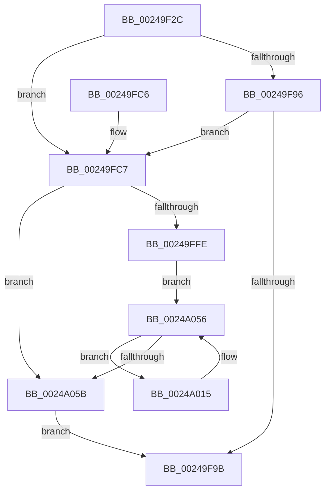

# KiSetProcessConcurrencyCount

- RVA: `0x00249F2C`–`0x0024A08C` (길이 `352` bytes)
- VA: `0x0000000140249F2C`
- 실행 섹션: `.text`
- PDB 이름 있음: `예`; PDB Function 태그: `아니요`
- unwind 정보 RVA: `0x00062A10`
- 디코드: `91`개 명령, `352/352` bytes 표시
- 미해석 바이트: `0` (있으면 어셈블리에 `.byte`로 보존)

> 이 문서는 커널 이미지의 기계어와 PDB 기호를 분석해 생성했습니다. 4번과 5번은 함수 원형과 자료형을 바이너리 사용 방식에서 추정한 C 해석이며 원본 소스 복구 결과는 아닙니다.

## 1. Dependencies

- 직접 호출 지점: **7**; 고유 호출 대상: **6**
- 직접 호출자로 확인된 함수: **2**
- RIP 상대 이미지 참조: **3**

### Outgoing calls
- `0x00249F72` → [memset](../6C/memset_function_006C6C40.md) (function, `0x006C6C40`)
- `0x00249FA6` → [_security_check_cookie](../6A/_security_check_cookie_function_006AC640.md) (function, `0x006AC640`)
- `0x00249FDA` → [memset](../6C/memset_function_006C6C40.md) (function, `0x006C6C40`)
- `0x00249FF1` → [KiSelectIdealProcessorSetsForProcess](../3C/KiSelectIdealProcessorSetsForProcess_function_003C0D40.md) (function, `0x003C0D40`)
- `0x0024A003` → [ExGenRandom](../41/ExGenRandom_function_0041B010.md) (function, `0x0041B010`)
- `0x0024A049` → [KiAdaptThreadIdealProcessorForProcessIdealSetChange](../4A/KiAdaptThreadIdealProcessorForProcessIdealSetChange_function_004AF434.md) (function, `0x004AF434`)
- `0x0024A06B` → [KiCopyAffinityEx](../2C/KiCopyAffinityEx_function_002CE860.md) (function, `0x002CE860`)

### Direct callers
- [sub_00249C6B](Unknown_function_00249C6B.md) at `0x00249E25`
- [KeSetExpectedConcurrencyCountProcess](../5C/KeSetExpectedConcurrencyCountProcess_function_005C1AC0.md) at `0x005C1B15`

### Static image references
- `0x00249F48` → RVA `0x00E0A740` (`.data`; read)
- `0x00249FF6` → RVA `0x00FC6B78` (`ALMOSTRO`; read)
- `0x0024A079` → RVA `0x00FC5084` (`ALMOSTRO`; read)

## 2. Other-region calls and transfers

- 다른 실행 섹션으로 향하는 call: **0**
- 별도 외부 분기/꼬리 이동을 확인하지 못했습니다.

## 3. Assembly (complete function range)

```asm
00249F2C  48 89 5C 24 20                  mov qword ptr [rsp + 0x20], rbx
00249F31  55                              push rbp
00249F32  56                              push rsi
00249F33  57                              push rdi
00249F34  41 54                           push r12
00249F36  41 55                           push r13
00249F38  41 56                           push r14
00249F3A  41 57                           push r15
00249F3C  48 8D 6C 24 80                  lea rbp, [rsp - 0x80]
00249F41  48 81 EC 80 01 00 00            sub rsp, 0x180
00249F48  48 8B 05 F1 07 BC 00            mov rax, qword ptr [rip + 0xbc07f1]
00249F4F  48 33 C4                        xor rax, rsp
00249F52  48 89 45 70                     mov qword ptr [rbp + 0x70], rax
00249F56  4D 8B E8                        mov r13, r8
00249F59  89 54 24 48                     mov dword ptr [rsp + 0x48], edx
00249F5D  8B DA                           mov ebx, edx
00249F5F  4C 8B F9                        mov r15, rcx
00249F62  41 BE 00 01 00 00               mov r14d, 0x100
00249F68  48 8D 4C 24 68                  lea rcx, [rsp + 0x68]
00249F6D  45 8B C6                        mov r8d, r14d
00249F70  33 D2                           xor edx, edx
00249F72  E8 C9 CC 47 00                  call 0x1406c6c40
00249F77  49 8B B7 B8 00 00 00            mov rsi, qword ptr [r15 + 0xb8]
00249F7E  33 FF                           xor edi, edi
00249F80  40 88 7C 24 41                  mov byte ptr [rsp + 0x41], dil
00249F85  40 88 7C 24 40                  mov byte ptr [rsp + 0x40], dil
00249F8A  48 89 7C 24 50                  mov qword ptr [rsp + 0x50], rdi
00249F8F  89 1E                           mov dword ptr [rsi], ebx
00249F91  39 5E 04                        cmp dword ptr [rsi + 4], ebx
00249F94  77 31                           ja 0x140249fc7
00249F96  39 5E 08                        cmp dword ptr [rsi + 8], ebx
00249F99  72 2C                           jb 0x140249fc7
00249F9B  41 88 7D 00                     mov byte ptr [r13], dil
00249F9F  48 8B 4D 70                     mov rcx, qword ptr [rbp + 0x70]
00249FA3  48 33 CC                        xor rcx, rsp
00249FA6  E8 95 26 46 00                  call 0x1406ac640
00249FAB  48 8B 9C 24 D8 01 00 00         mov rbx, qword ptr [rsp + 0x1d8]
00249FB3  48 81 C4 80 01 00 00            add rsp, 0x180
00249FBA  41 5F                           pop r15
00249FBC  41 5E                           pop r14
00249FBE  41 5D                           pop r13
00249FC0  41 5C                           pop r12
00249FC2  5F                              pop rdi
00249FC3  5E                              pop rsi
00249FC4  5D                              pop rbp
00249FC5  C3                              ret
00249FC6  CC                              int3
00249FC7  4D 8B C6                        mov r8, r14
00249FCA  48 C7 44 24 60 20 00 20 00      mov qword ptr [rsp + 0x60], 0x200020
00249FD3  33 D2                           xor edx, edx
00249FD5  48 8D 4C 24 68                  lea rcx, [rsp + 0x68]
00249FDA  E8 61 CC 47 00                  call 0x1406c6c40
00249FDF  4C 8D 4C 24 50                  lea r9, [rsp + 0x50]
00249FE4  49 8B CF                        mov rcx, r15
00249FE7  4C 8D 44 24 60                  lea r8, [rsp + 0x60]
00249FEC  48 8D 54 24 48                  lea rdx, [rsp + 0x48]
00249FF1  E8 4A 6D 17 00                  call 0x1403c0d40
00249FF6  39 3D 7C CB D7 00               cmp dword ptr [rip + 0xd7cb7c], edi
00249FFC  75 5D                           jne 0x14024a05b
00249FFE  B9 01 00 00 00                  mov ecx, 1
0024A003  E8 08 10 1D 00                  call 0x14041b010
0024A008  4D 8D 77 30                     lea r14, [r15 + 0x30]
0024A00C  89 44 24 48                     mov dword ptr [rsp + 0x48], eax
0024A010  49 8B 1E                        mov rbx, qword ptr [r14]
0024A013  EB 41                           jmp 0x14024a056
0024A015  48 8D 44 24 48                  lea rax, [rsp + 0x48]
0024A01A  49 8B CF                        mov rcx, r15
0024A01D  48 89 44 24 30                  mov qword ptr [rsp + 0x30], rax
0024A022  48 8D 93 08 FD FF FF            lea rdx, [rbx - 0x2f8]
0024A029  48 8D 44 24 40                  lea rax, [rsp + 0x40]
0024A02E  48 89 44 24 28                  mov qword ptr [rsp + 0x28], rax
0024A033  4C 8D 4C 24 60                  lea r9, [rsp + 0x60]
0024A038  48 8D 44 24 41                  lea rax, [rsp + 0x41]
0024A03D  4C 8D 86 D0 00 00 00            lea r8, [rsi + 0xd0]
0024A044  48 89 44 24 20                  mov qword ptr [rsp + 0x20], rax
0024A049  E8 E6 53 26 00                  call 0x1404af434
0024A04E  40 0A 7C 24 40                  or dil, byte ptr [rsp + 0x40]
0024A053  48 8B 1B                        mov rbx, qword ptr [rbx]
0024A056  49 3B DE                        cmp rbx, r14
0024A059  75 BA                           jne 0x14024a015
0024A05B  48 8D 8E D0 00 00 00            lea rcx, [rsi + 0xd0]
0024A062  0F B7 51 02                     movzx edx, word ptr [rcx + 2]
0024A066  4C 8D 44 24 60                  lea r8, [rsp + 0x60]
0024A06B  E8 F0 47 08 00                  call 0x1402ce860
0024A070  48 8B 44 24 50                  mov rax, qword ptr [rsp + 0x50]
0024A075  48 89 46 04                     mov qword ptr [rsi + 4], rax
0024A079  8B 05 05 B0 D7 00               mov eax, dword ptr [rip + 0xd7b005]
0024A07F  C1 E8 04                        shr eax, 4
0024A082  24 01                           and al, 1
0024A084  40 22 F8                        and dil, al
0024A087  E9 0F FF FF FF                  jmp 0x140249f9b
```

## 4. C-style interpretation (structured pseudocode)

```c
__int64 __fastcall KiSetProcessConcurrencyCount(__int64 a1, int a2, __int64 a3)
{
    __int64 result;
    __int64 v_rdi;
    __int64 v_rsp;
    unsigned __int64 v_stack_m150;
    unsigned __int64 v_stack_m168;
    unsigned int v_stack_m170;
    unsigned __int8 v_stack_m177;
    unsigned __int8 v_stack_m178;
    unsigned __int64 v_stack_m48;
    unsigned __int64 v_stack_mB8;
    unsigned __int64 v_stack_p20;
    unsigned __int64 v_stack_p28;
    unsigned __int64 v_stack_p30;
    unsigned __int64 v_stack_p40;
    unsigned __int64 v_stack_p41;
    unsigned __int64 v_stack_p48;
    unsigned __int64 v_stack_p50;
    unsigned __int64 v_stack_p60;
    unsigned __int64 v_stack_p68;

    v_stack_p20 = v_rbx;
    v_rsp = (v_rsp) - (384);
    result = (*(unsigned __int64 *)(v_rip + 12322801)) ^ (v_rsp);
    v_stack_m48 = result;
    v_stack_m170 = a2;
    a2 = 0;
    result = memset(v_stack_m150, a2, 256, a4);
    v_rdi = 0;
    v_stack_m177 = 0;
    v_stack_m178 = 0;
    v_stack_m168 = 0;
    *(unsigned int *)(*(unsigned __int64 *)(a1 + 184)) = (unsigned int)((unsigned int)(a2));
    if ((*(unsigned int *)(*(unsigned __int64 *)(a1 + 184) + 4)) > ((unsigned int)((unsigned int)(a2)))) goto loc_00249FC7;
    if ((*(unsigned int *)(*(unsigned __int64 *)(a1 + 184) + 8)) < ((unsigned int)((unsigned int)(a2)))) goto loc_00249FC7;
loc_00249F9B:
    *(unsigned __int8 *)(a3) = 0;
    a1 = (v_stack_m48) ^ (v_rsp);
    result = _security_check_cookie(a1, a2, 256, a4);
    v_rsp = (v_rsp) + (384);
    return result;
loc_00249FC7:
    v_stack_p60 = 0x200020ULL;
    a2 = 0;
    result = memset(v_stack_p68, a2, 256, a4);
    result = KiSelectIdealProcessorSetsForProcess(a1, v_stack_p48, v_stack_p60, v_stack_p50);
    if ((*(unsigned int *)(v_rip + 14142332)) != 0) goto loc_0024A05B;
    result = ExGenRandom(1, v_stack_p48, v_stack_p60, v_stack_p50);
    v_stack_p48 = (unsigned int)(result);
    goto loc_0024A056;
loc_0024A015:
    v_stack_p30 = v_stack_p48;
    v_stack_p28 = v_stack_p40;
    v_stack_p20 = v_stack_p41;
    result = KiAdaptThreadIdealProcessorForProcessIdealSetChange(a1, *(unsigned __int64 *)(a1 + 48) - 760, *(unsigned __int64 *)(a1 + 184) + 208, v_stack_p60);
    v_rdi = (unsigned __int8)((v_rdi) | (v_stack_p40));
loc_0024A056:
    if ((*(unsigned __int64 *)(*(unsigned __int64 *)(a1 + 48))) != (a1 + 48)) goto loc_0024A015;
loc_0024A05B:
    result = KiCopyAffinityEx(*(unsigned __int64 *)(a1 + 184) + 208, *(unsigned __int16 *)(*(unsigned __int64 *)(a1 + 184) + 208 + 2), v_stack_p60, v_stack_p60);
    *(unsigned __int64 *)(*(unsigned __int64 *)(a1 + 184) + 4) = v_stack_p50;
    result = (unsigned int)(((unsigned int)(*(unsigned int *)(v_rip + 14135301))) >> (4));
    result = (unsigned __int8)((result) & (1));
    v_rdi = (unsigned __int8)((v_rdi) & ((unsigned __int8)(result)));
    goto loc_00249F9B;
}
```

## 5. (Beta) C Style

```c
int64_t KiSetProcessConcurrencyCount(void *Arg1, int32_t Arg2, void *Arg3)
{
    uint8_t *arg1 = (uint8_t *)Arg1;
    uint8_t *arg3 = (uint8_t *)Arg3;

    int64_t result;
    int64_t local_rdi;
    int64_t local_rsp;
    uint64_t v_stack_m150;
    uint64_t v_stack_m168;
    uint32_t v_stack_m170;
    uint8_t v_stack_m177;
    uint8_t v_stack_m178;
    uint64_t v_stack_m48;
    uint64_t v_stack_mB8;
    uint64_t v_stack_p20;
    uint64_t v_stack_p28;
    uint64_t v_stack_p30;
    uint64_t v_stack_p40;
    uint64_t v_stack_p41;
    uint64_t v_stack_p48;
    uint64_t v_stack_p50;
    uint64_t v_stack_p60;
    uint64_t v_stack_p68;

    v_stack_p20 = local_rbx;
    local_rsp = (local_rsp) - (384);
    result = (*(uint64_t *)(v_rip + 0xBC07F1)) ^ (local_rsp);
    v_stack_m48 = result;
    v_stack_m170 = Arg2;
    Arg2 = 0;
    result = memset(v_stack_m150, Arg2, 256, a4);
    local_rdi = 0;
    v_stack_m177 = 0;
    v_stack_m178 = 0;
    v_stack_m168 = 0;
    *(uint32_t *)(*(uint64_t *)(arg1 + 0xB8)) = (uint32_t)((uint32_t)(Arg2));
    if ((*(uint32_t *)(*(uint64_t *)(arg1 + 0xB8) + 0x4)) > ((uint32_t)((uint32_t)(Arg2)))) goto loc_00249FC7;
    if ((*(uint32_t *)(*(uint64_t *)(arg1 + 0xB8) + 0x8)) < ((uint32_t)((uint32_t)(Arg2)))) goto loc_00249FC7;
loc_00249F9B:
    *(uint8_t *)(arg3) = 0;
    Arg1 = (v_stack_m48) ^ (local_rsp);
    result = _security_check_cookie(Arg1, Arg2, 256, a4);
    local_rsp = (local_rsp) + (384);
    return result;
loc_00249FC7:
    v_stack_p60 = 0x200020ULL;
    Arg2 = 0;
    result = memset(v_stack_p68, Arg2, 256, a4);
    result = KiSelectIdealProcessorSetsForProcess(Arg1, v_stack_p48, v_stack_p60, v_stack_p50);
    if ((*(uint32_t *)(v_rip + 0xD7CB7C)) != 0) goto loc_0024A05B;
    result = ExGenRandom(1, v_stack_p48, v_stack_p60, v_stack_p50);
    v_stack_p48 = (uint32_t)(result);
    goto loc_0024A056;
loc_0024A015:
    v_stack_p30 = v_stack_p48;
    v_stack_p28 = v_stack_p40;
    v_stack_p20 = v_stack_p41;
    result = KiAdaptThreadIdealProcessorForProcessIdealSetChange(Arg1, *(uint64_t *)(arg1 + 0x30) - 760, *(uint64_t *)(arg1 + 0xB8) + 208, v_stack_p60);
    local_rdi = (uint8_t)((local_rdi) | (v_stack_p40));
loc_0024A056:
    if ((*(uint64_t *)(*(uint64_t *)(arg1 + 0x30))) != (Arg1 + 48)) goto loc_0024A015;
loc_0024A05B:
    result = KiCopyAffinityEx(*(uint64_t *)(arg1 + 0xB8) + 208, *(uint16_t *)(*(uint64_t *)(arg1 + 0xB8) + 0xD0 + 0x2), v_stack_p60, v_stack_p60);
    *(uint64_t *)(*(uint64_t *)(arg1 + 0xB8) + 0x4) = v_stack_p50;
    result = (uint32_t)(((uint32_t)(*(uint32_t *)(v_rip + 0xD7B005))) >> (4));
    result = (uint8_t)((result) & (1));
    local_rdi = (uint8_t)((local_rdi) & ((uint8_t)(result)));
    goto loc_00249F9B;
}
```

### 관측된 메모리 오프셋

구조체 형식이 확인되지 않은 접근은 인자 기준의 오프셋으로만 기록했습니다.

| 기준 인자 | 오프셋 표현 | 폭 (bit) | 접근 |
|---|---:|---:|---|
| `Arg1` | `+ 0x0` | `64` | `R` |
| `Arg1` | `+ 0x30` | `64` | `R` |
| `Arg1` | `+ 0xB8` | `64` | `R` |
| `Arg3` | `+ 0x0` | `8` | `W` |

## 6. Execution-region graph

[열기: 2D/3D 그래프와 함수 탐색 컨트롤 패널](../../../control-panel.html?section=text&rva=0x00249F2C&view=graph)

- 2D 그래프는 위에서 아래로 흐르고, 3D 그래프는 빈 공간을 드래그해 회전합니다. Shift+드래그는 이동, 휠은 확대·축소, 함수 노드 선택은 대상 보고서 이동입니다.

### Static fallback


