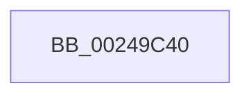

# KiUpdateProcessConcurrencyCounts

- RVA: `0x00249C40`–`0x00249C6B` (길이 `43` bytes)
- VA: `0x0000000140249C40`
- 실행 섹션: `.text`
- PDB 이름 있음: `예`; PDB Function 태그: `예`
- unwind 정보 RVA: `0x00062964`
- 디코드: `10`개 명령, `43/43` bytes 표시
- 미해석 바이트: `0` (있으면 어셈블리에 `.byte`로 보존)

> 이 문서는 커널 이미지의 기계어와 PDB 기호를 분석해 생성했습니다. 4번과 5번은 함수 원형과 자료형을 바이너리 사용 방식에서 추정한 C 해석이며 원본 소스 복구 결과는 아닙니다.

## 1. Dependencies

- 직접 호출 지점: **1**; 고유 호출 대상: **1**
- 직접 호출자로 확인된 함수: **1**
- RIP 상대 이미지 참조: **1**

### Outgoing calls
- `0x00249C5A` → [PsGetNextProcess](../../page/91/PsGetNextProcess_function_0091C900.md) (function, `0x0091C900`)

### Direct callers
- [KiIdealProcessorRebalancerWorker](../48/KiIdealProcessorRebalancerWorker_function_00484BB0.md) at `0x00484BD0`

### Static image references
- `0x00249C49` → RVA `0x00E0A740` (`.data`; read)

## 2. Other-region calls and transfers

- 다른 실행 섹션으로 향하는 call: **1**
  - `0x00249C5A` → [PsGetNextProcess](../../page/91/PsGetNextProcess_function_0091C900.md) (`.text` → `PAGE`)
- call이 아닌 외부 분기/꼬리 이동: **1**
  - `0x00249C65` → [sub_00249EA6](Unknown_function_00249EA6.md) (`tail-transfer`)

## 3. Assembly (complete function range)

```asm
00249C40  40 57                           push rdi
00249C42  48 81 EC A0 00 00 00            sub rsp, 0xa0
00249C49  48 8B 05 F0 0A BC 00            mov rax, qword ptr [rip + 0xbc0af0]
00249C50  48 33 C4                        xor rax, rsp
00249C53  48 89 44 24 78                  mov qword ptr [rsp + 0x78], rax
00249C58  33 C9                           xor ecx, ecx
00249C5A  E8 A1 2C 6D 00                  call 0x14091c900
00249C5F  48 8B F8                        mov rdi, rax
00249C62  48 85 C0                        test rax, rax
00249C65  0F 84 3B 02 00 00               je 0x140249ea6
```

## 4. C-style interpretation (structured pseudocode)

```c
__int64 __fastcall KiUpdateProcessConcurrencyCounts(int a1)
{
    __int64 result;
    __int64 v_rsp;
    unsigned __int64 v_stack_m30;

    v_rsp = (v_rsp) - (160);
    result = (*(unsigned __int64 *)(v_rip + 12323568)) ^ (v_rsp);
    v_stack_m30 = result;
    a1 = 0;
    result = PsGetNextProcess(a1, a2, a3, a4);
}
```

## 5. (Beta) C Style

```c
int64_t KiUpdateProcessConcurrencyCounts(int32_t Arg1)
{
    int64_t result;
    int64_t local_rsp;
    uint64_t v_stack_m30;

    local_rsp = (local_rsp) - (160);
    result = (*(uint64_t *)(v_rip + 0xBC0AF0)) ^ (local_rsp);
    v_stack_m30 = result;
    Arg1 = 0;
    result = PsGetNextProcess(Arg1, a2, a3, a4);
}
```

## 6. Execution-region graph

[열기: 2D/3D 그래프와 함수 탐색 컨트롤 패널](../../../control-panel.html?section=text&rva=0x00249C40&view=graph)

- 2D 그래프는 위에서 아래로 흐르고, 3D 그래프는 빈 공간을 드래그해 회전합니다. Shift+드래그는 이동, 휠은 확대·축소, 함수 노드 선택은 대상 보고서 이동입니다.

### Static fallback


