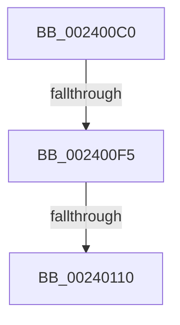

# MI_WRITE_INVALID_PTE_TB_FLUSH_NEEDED

- RVA: `0x002400C0`–`0x0024011B` (길이 `91` bytes)
- VA: `0x00000001402400C0`
- 실행 섹션: `.text`
- PDB 이름 있음: `예`; PDB Function 태그: `아니요`
- unwind 정보 RVA: `0x000616D0`
- 디코드: `22`개 명령, `91/91` bytes 표시
- 미해석 바이트: `0` (있으면 어셈블리에 `.byte`로 보존)

> 이 문서는 커널 이미지의 기계어와 PDB 기호를 분석해 생성했습니다. 4번과 5번은 함수 원형과 자료형을 바이너리 사용 방식에서 추정한 C 해석이며 원본 소스 복구 결과는 아닙니다.

## 1. Dependencies

- 직접 호출 지점: **0**; 고유 호출 대상: **0**
- 직접 호출자로 확인된 함수: **5**
- RIP 상대 이미지 참조: **1**

### Outgoing calls
- 직접 디코드된 call 명령이 없습니다.

### Direct callers
- [MiCombineWithExisting](../22/MiCombineWithExisting_function_0022B4B8.md) at `0x0022B723`
- [MiWsleFlush](../23/MiWsleFlush_function_0023FB30.md) at `0x0023FCBC`
- [MiWsleFlush](../23/MiWsleFlush_function_0023FB30.md) at `0x0023FEB3`
- [MiDecommitAddToList](MiDecommitAddToList_function_00242264.md) at `0x00242627`
- [MiCopyOnWrite](../36/MiCopyOnWrite_function_00362A0C.md) at `0x0036312D`
- [MiUnlockWsle](../40/MiUnlockWsle_function_00407F84.md) at `0x00408103`

### Static image references
- `0x002400F5` → RVA `0x00FC6A88` (`ALMOSTRO`; read)

## 2. Other-region calls and transfers

- 다른 실행 섹션으로 향하는 call: **0**
- call이 아닌 외부 분기/꼬리 이동: **3**
  - `0x002400EF` → [sub_00240188](Unknown_function_00240188.md) (`tail-transfer`)
  - `0x0024010A` → [sub_00240330](Unknown_function_00240330.md) (`tail-transfer`)
  - `0x00240115` → [sub_00240188 + 0x2F](Unknown_function_00240188.md) (`tail-transfer`)

## 3. Assembly (complete function range)

```asm
002400C0  40 53                           push rbx
002400C2  55                              push rbp
002400C3  56                              push rsi
002400C4  57                              push rdi
002400C5  48 83 EC 28                     sub rsp, 0x28
002400C9  48 8B 19                        mov rbx, qword ptr [rcx]
002400CC  48 8B FA                        mov rdi, rdx
002400CF  41 8B D0                        mov edx, r8d
002400D2  49 B9 00 D0 BE 7D FB F6 FF FF   movabs r9, 0xfffff6fb7dbed000
002400DC  41 8B E8                        mov ebp, r8d
002400DF  48 8B F1                        mov rsi, rcx
002400E2  49 B8 F8 D7 BE 7D FB F6 FF FF   movabs r8, 0xfffff6fb7dbed7f8
002400EC  83 E2 02                        and edx, 2
002400EF  0F 84 93 00 00 00               je 0x140240188
002400F5  48 8B 05 8C 69 D8 00            mov rax, qword ptr [rip + 0xd8698c]
002400FC  48 8B C8                        mov rcx, rax
002400FF  48 C1 E9 1A                     shr rcx, 0x1a
00240103  83 E1 03                        and ecx, 3
00240106  48 83 F9 01                     cmp rcx, 1
0024010A  0F 86 20 02 00 00               jbe 0x140240330
00240110  48 0F BA E0 19                  bt rax, 0x19
00240115  0F 82 9C 00 00 00               jb 0x1402401b7
```

## 4. C-style interpretation (structured pseudocode)

```c
__int64 __fastcall MI_WRITE_INVALID_PTE_TB_FLUSH_NEEDED(__int64 a1, __int64 a2, int a3)
{
    __int64 v_rsp;

    v_rsp = (v_rsp) - (40);
    a2 = (unsigned int)(((unsigned int)(a3)) & (2));
    a1 = (*(unsigned __int64 *)(v_rip + 14182796)) >> (26);
    a1 = (unsigned int)((a1) & (3));
}
```

## 5. (Beta) C Style

```c
int64_t MI_WRITE_INVALID_PTE_TB_FLUSH_NEEDED(void *Arg1, int64_t Arg2, int32_t Arg3)
{
    uint8_t *arg1 = (uint8_t *)Arg1;

    int64_t local_rsp;

    local_rsp = (local_rsp) - (40);
    Arg2 = (uint32_t)(((uint32_t)(Arg3)) & (2));
    Arg1 = (*(uint64_t *)(v_rip + 0xD8698C)) >> (26);
    Arg1 = (uint32_t)((Arg1) & (3));
}
```

### 관측된 메모리 오프셋

구조체 형식이 확인되지 않은 접근은 인자 기준의 오프셋으로만 기록했습니다.

| 기준 인자 | 오프셋 표현 | 폭 (bit) | 접근 |
|---|---:|---:|---|
| `Arg1` | `+ 0x0` | `64` | `R` |

## 6. Execution-region graph

[열기: 2D/3D 그래프와 함수 탐색 컨트롤 패널](../../../control-panel.html?section=text&rva=0x002400C0&view=graph)

- 2D 그래프는 위에서 아래로 흐르고, 3D 그래프는 빈 공간을 드래그해 회전합니다. Shift+드래그는 이동, 휠은 확대·축소, 함수 노드 선택은 대상 보고서 이동입니다.

### Static fallback


