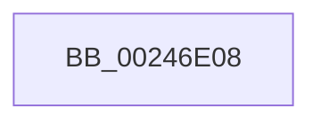

# MiBadRefCount

- RVA: `0x00246E08`–`0x00246E4D` (길이 `69` bytes)
- VA: `0x0000000140246E08`
- 실행 섹션: `.text`
- PDB 이름 있음: `예`; PDB Function 태그: `아니요`
- unwind 정보 RVA: `0x000622F0`
- 디코드: `15`개 명령, `69/69` bytes 표시
- 미해석 바이트: `0` (있으면 어셈블리에 `.byte`로 보존)

> 이 문서는 커널 이미지의 기계어와 PDB 기호를 분석해 생성했습니다. 4번과 5번은 함수 원형과 자료형을 바이너리 사용 방식에서 추정한 C 해석이며 원본 소스 복구 결과는 아닙니다.

## 1. Dependencies

- 직접 호출 지점: **1**; 고유 호출 대상: **1**
- 직접 호출자로 확인된 함수: **6**
- RIP 상대 이미지 참조: **0**

### Outgoing calls
- `0x00246E47` → [KeBugCheckEx](../4F/KeBugCheckEx_function_004FD660.md) (function, `0x004FD660`)

### Direct callers
- [MiRemoveLockedPageChargeAndDecRef](MiRemoveLockedPageChargeAndDecRef_function_002459D0.md) at `0x002459E1`
- [sub_002460E6](Unknown_function_002460E6.md) at `0x00246119`
- [MiRemoveLockedPageCharge](MiRemoveLockedPageCharge_function_00246950.md) at `0x0024695C`
- [sub_002C1E57](../2C/Unknown_function_002C1E57.md) at `0x002C1EF6`
- [sub_006E4094](../6E/Unknown_function_006E4094.md) at `0x006E409D`
- [MiFreeInitializationCode](../../page/7F/MiFreeInitializationCode_function_007F88A0.md) at `0x007F8A66`

### Static image references
- 디코드된 RIP-relative 메모리 참조가 없습니다.

## 2. Other-region calls and transfers

- 다른 실행 섹션으로 향하는 call: **0**
- 별도 외부 분기/꼬리 이동을 확인하지 못했습니다.

## 3. Assembly (complete function range)

```asm
00246E08  48 83 EC 38                     sub rsp, 0x38
00246E0C  8B 41 20                        mov eax, dword ptr [rcx + 0x20]
00246E0F  44 0F B6 49 22                  movzx r9d, byte ptr [rcx + 0x22]
00246E14  41 83 E1 07                     and r9d, 7
00246E18  0F B7 D0                        movzx edx, ax
00246E1B  48 B8 00 00 00 00 00 DE FF FF   movabs rax, 0xffffde0000000000
00246E25  48 2B C8                        sub rcx, rax
00246E28  48 89 54 24 20                  mov qword ptr [rsp + 0x20], rdx
00246E2D  48 C1 F9 04                     sar rcx, 4
00246E31  BA 9A 00 00 00                  mov edx, 0x9a
00246E36  49 B8 AB AA AA AA AA AA AA AA   movabs r8, 0xaaaaaaaaaaaaaaab
00246E40  4C 0F AF C1                     imul r8, rcx
00246E44  8D 4A B4                        lea ecx, [rdx - 0x4c]
00246E47  E8 14 68 2B 00                  call 0x1404fd660
00246E4C  CC                              int3
```

## 4. C-style interpretation (structured pseudocode)

```c
__int64 __fastcall MiBadRefCount(__int64 a1)
{
    __int64 result;
    __int64 v_rsp;
    unsigned __int64 v_stack_m18;

    v_rsp = (v_rsp) - (56);
    a4 = (unsigned int)((*(unsigned __int8 *)(a1 + 34)) & (7));
    a1 = (a1) - ((unsigned int)(*(unsigned int *)(a1 + 32)));
    v_stack_m18 = (unsigned __int16)((unsigned int)(*(unsigned int *)(a1 + 32)));
    a1 = (a1) >> (4);
    a3 = (a3) * (a1);
    result = KeBugCheckEx(154 - 76, 154, a3, a4);
    return result;
}
```

## 5. (Beta) C Style

```c
int64_t MiBadRefCount(void *Arg1)
{
    uint8_t *arg1 = (uint8_t *)Arg1;

    int64_t result;
    int64_t local_rsp;
    uint64_t v_stack_m18;

    local_rsp = (local_rsp) - (56);
    a4 = (uint32_t)((*(uint8_t *)(arg1 + 0x22)) & (7));
    Arg1 = (Arg1) - ((uint32_t)(*(uint32_t *)(arg1 + 0x20)));
    v_stack_m18 = (uint16_t)((uint32_t)(*(uint32_t *)(arg1 + 0x20)));
    Arg1 = (Arg1) >> (4);
    a3 = (a3) * (Arg1);
    result = KeBugCheckEx(154 - 76, 154, a3, a4);
    return result;
}
```

### 관측된 메모리 오프셋

구조체 형식이 확인되지 않은 접근은 인자 기준의 오프셋으로만 기록했습니다.

| 기준 인자 | 오프셋 표현 | 폭 (bit) | 접근 |
|---|---:|---:|---|
| `Arg1` | `+ 0x20` | `32` | `R` |
| `Arg1` | `+ 0x22` | `8` | `R` |

## 6. Execution-region graph

[열기: 2D/3D 그래프와 함수 탐색 컨트롤 패널](../../../control-panel.html?section=text&rva=0x00246E08&view=graph)

- 2D 그래프는 위에서 아래로 흐르고, 3D 그래프는 빈 공간을 드래그해 회전합니다. Shift+드래그는 이동, 휠은 확대·축소, 함수 노드 선택은 대상 보고서 이동입니다.

### Static fallback


