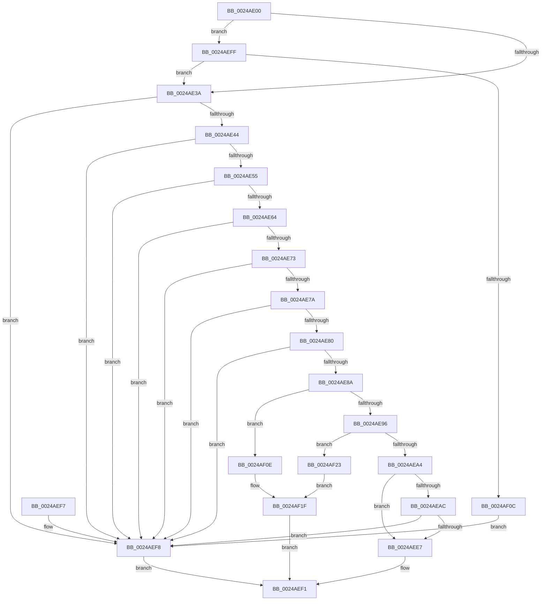

# MiCanBatchHardFaultPages

- RVA: `0x0024AE00`–`0x0024AF2D` (길이 `301` bytes)
- VA: `0x000000014024AE00`
- 실행 섹션: `.text`
- PDB 이름 있음: `예`; PDB Function 태그: `아니요`
- unwind 정보 RVA: `0x00062B98`
- 디코드: `81`개 명령, `301/301` bytes 표시
- 미해석 바이트: `0` (있으면 어셈블리에 `.byte`로 보존)

> 이 문서는 커널 이미지의 기계어와 PDB 기호를 분석해 생성했습니다. 4번과 5번은 함수 원형과 자료형을 바이너리 사용 방식에서 추정한 C 해석이며 원본 소스 복구 결과는 아닙니다.

## 1. Dependencies

- 직접 호출 지점: **5**; 고유 호출 대상: **4**
- 직접 호출자로 확인된 함수: **1**
- RIP 상대 이미지 참조: **0**

### Outgoing calls
- `0x0024AE47` → [MiGetPfnSlabType](../28/MiGetPfnSlabType_function_0028E2D0.md) (function, `0x0028E2D0`)
- `0x0024AEC9` → [MiAreChargesNeededToLockPage](../31/MiAreChargesNeededToLockPage_function_00318720.md) (function, `0x00318720`)
- `0x0024AEEA` → [MiRemoveLockedPageCharge](MiRemoveLockedPageCharge_function_00246950.md) (function, `0x00246950`)
- `0x0024AEFF` → [MiIsPageEligibleForProtectedStandby](../43/MiIsPageEligibleForProtectedStandby_function_00433190.md) (function, `0x00433190`)
- `0x0024AF26` → [MiRemoveLockedPageCharge](MiRemoveLockedPageCharge_function_00246950.md) (function, `0x00246950`)

### Direct callers
- [MiAddPageToInsertList](MiAddPageToInsertList_function_0024A950.md) at `0x0024A9C2`

### Static image references
- 디코드된 RIP-relative 메모리 참조가 없습니다.

## 2. Other-region calls and transfers

- 다른 실행 섹션으로 향하는 call: **0**
- 별도 외부 분기/꼬리 이동을 확인하지 못했습니다.

## 3. Assembly (complete function range)

```asm
0024AE00  40 53                           push rbx
0024AE02  48 83 EC 20                     sub rsp, 0x20
0024AE06  8B 42 20                        mov eax, dword ptr [rdx + 0x20]
0024AE09  4C 8B D9                        mov r11, rcx
0024AE0C  48 8B 19                        mov rbx, qword ptr [rcx]
0024AE0F  4C 8B D2                        mov r10, rdx
0024AE12  89 44 24 30                     mov dword ptr [rsp + 0x30], eax
0024AE16  C1 E8 10                        shr eax, 0x10
0024AE19  24 DF                           and al, 0xdf
0024AE1B  88 44 24 32                     mov byte ptr [rsp + 0x32], al
0024AE1F  8B 44 24 30                     mov eax, dword ptr [rsp + 0x30]
0024AE23  89 42 20                        mov dword ptr [rdx + 0x20], eax
0024AE26  48 C7 02 00 00 00 00            mov qword ptr [rdx], 0
0024AE2D  48 8B 49 38                     mov rcx, qword ptr [rcx + 0x38]
0024AE31  48 85 C9                        test rcx, rcx
0024AE34  0F 85 C5 00 00 00               jne 0x14024aeff
0024AE3A  F6 42 22 18                     test byte ptr [rdx + 0x22], 0x18
0024AE3E  0F 85 B4 00 00 00               jne 0x14024aef8
0024AE44  49 8B CA                        mov rcx, r10
0024AE47  E8 84 34 04 00                  call 0x14028e2d0
0024AE4C  83 F8 09                        cmp eax, 9
0024AE4F  0F 85 A3 00 00 00               jne 0x14024aef8
0024AE55  41 8B 42 20                     mov eax, dword ptr [r10 + 0x20]
0024AE59  C1 E8 18                        shr eax, 0x18
0024AE5C  A8 40                           test al, 0x40
0024AE5E  0F 85 94 00 00 00               jne 0x14024aef8
0024AE64  49 8B 42 18                     mov rax, qword ptr [r10 + 0x18]
0024AE68  48 0F BA E0 3E                  bt rax, 0x3e
0024AE6D  0F 82 85 00 00 00               jb 0x14024aef8
0024AE73  41 F6 42 23 10                  test byte ptr [r10 + 0x23], 0x10
0024AE78  75 7E                           jne 0x14024aef8
0024AE7A  83 7B 50 00                     cmp dword ptr [rbx + 0x50], 0
0024AE7E  7C 78                           jl 0x14024aef8
0024AE80  49 8B 43 18                     mov rax, qword ptr [r11 + 0x18]
0024AE84  49 39 43 10                     cmp qword ptr [r11 + 0x10], rax
0024AE88  73 6E                           jae 0x14024aef8
0024AE8A  8B 83 C0 00 00 00               mov eax, dword ptr [rbx + 0xc0]
0024AE90  0F BA E0 11                     bt eax, 0x11
0024AE94  72 78                           jb 0x14024af0e
0024AE96  41 8B 42 20                     mov eax, dword ptr [r10 + 0x20]
0024AE9A  BB 01 00 00 00                  mov ebx, 1
0024AE9F  66 3B C3                        cmp ax, bx
0024AEA2  75 7F                           jne 0x14024af23
0024AEA4  49 0F BA 62 28 35               bt qword ptr [r10 + 0x28], 0x35
0024AEAA  72 3B                           jb 0x14024aee7
0024AEAC  41 8B 42 20                     mov eax, dword ptr [r10 + 0x20]
0024AEB0  49 8B CA                        mov rcx, r10
0024AEB3  89 44 24 30                     mov dword ptr [rsp + 0x30], eax
0024AEB7  B8 FF FF 00 00                  mov eax, 0xffff
0024AEBC  66 01 44 24 30                  add word ptr [rsp + 0x30], ax
0024AEC1  8B 44 24 30                     mov eax, dword ptr [rsp + 0x30]
0024AEC5  41 89 42 20                     mov dword ptr [r10 + 0x20], eax
0024AEC9  E8 52 D8 0C 00                  call 0x140318720
0024AECE  41 8B 4A 20                     mov ecx, dword ptr [r10 + 0x20]
0024AED2  89 4C 24 30                     mov dword ptr [rsp + 0x30], ecx
0024AED6  66 01 5C 24 30                  add word ptr [rsp + 0x30], bx
0024AEDB  8B 4C 24 30                     mov ecx, dword ptr [rsp + 0x30]
0024AEDF  41 89 4A 20                     mov dword ptr [r10 + 0x20], ecx
0024AEE3  85 C0                           test eax, eax
0024AEE5  74 11                           je 0x14024aef8
0024AEE7  49 8B CA                        mov rcx, r10
0024AEEA  E8 61 BA FF FF                  call 0x140246950
0024AEEF  8B C3                           mov eax, ebx
0024AEF1  48 83 C4 20                     add rsp, 0x20
0024AEF5  5B                              pop rbx
0024AEF6  C3                              ret
0024AEF7  CC                              int3
0024AEF8  B8 02 00 00 00                  mov eax, 2
0024AEFD  EB F2                           jmp 0x14024aef1
0024AEFF  E8 8C 82 1E 00                  call 0x140433190
0024AF04  85 C0                           test eax, eax
0024AF06  0F 85 2E FF FF FF               jne 0x14024ae3a
0024AF0C  EB EA                           jmp 0x14024aef8
0024AF0E  49 8B 43 10                     mov rax, qword ptr [r11 + 0x10]
0024AF12  48 B9 00 00 00 00 00 00 00 80   movabs rcx, 0x8000000000000000
0024AF1C  48 09 08                        or qword ptr [rax], rcx
0024AF1F  33 C0                           xor eax, eax
0024AF21  EB CE                           jmp 0x14024aef1
0024AF23  49 8B CA                        mov rcx, r10
0024AF26  E8 25 BA FF FF                  call 0x140246950
0024AF2B  EB F2                           jmp 0x14024af1f
```

## 4. C-style interpretation (structured pseudocode)

```c
__int64 __fastcall MiCanBatchHardFaultPages(__int64 a1, __int64 a2)
{
    __int64 result;
    __int64 v_rsp;
    unsigned int v_stack_p8;
    unsigned __int8 v_stack_pA;

    v_rsp = (v_rsp) - (32);
    v_stack_p8 = (unsigned int)((unsigned int)(*(unsigned int *)(a2 + 32)));
    result = (unsigned int)(((unsigned int)(*(unsigned int *)(a2 + 32))) >> (16));
    result = (unsigned __int8)((result) & (223));
    v_stack_pA = (unsigned __int8)(result);
    *(unsigned int *)(a2 + 32) = (unsigned int)((unsigned int)(v_stack_p8));
    *(unsigned __int64 *)(a2) = 0;
    if (*(unsigned __int64 *)(a1 + 56) != 0) goto loc_0024AEFF;
loc_0024AE3A:
    if (((*(unsigned __int8 *)(a2 + 34)) & (24)) != 0) goto loc_0024AEF8;
    result = MiGetPfnSlabType(a2, a2, a3, a4);
    if (((unsigned int)(result)) != 9) goto loc_0024AEF8;
    result = (unsigned int)(((unsigned int)(*(unsigned int *)(a2 + 32))) >> (24));
    if ((((unsigned __int8)(result)) & (64)) != 0) goto loc_0024AEF8;
    if (condition_is_below) goto loc_0024AEF8;
    if (((*(unsigned __int8 *)(a2 + 35)) & (16)) != 0) goto loc_0024AEF8;
    if ((*(unsigned int *)(*(unsigned __int64 *)(a1) + 80)) < 0) goto loc_0024AEF8;
    if ((*(unsigned __int64 *)(a1 + 16)) >= (*(unsigned __int64 *)(a1 + 24))) goto loc_0024AEF8;
    if ((*(unsigned __int64 *)(a1 + 16)) < (*(unsigned __int64 *)(a1 + 24))) goto loc_0024AF0E;
    if (((unsigned __int16)((unsigned int)(*(unsigned int *)(a2 + 32)))) != 1) goto loc_0024AF23;
    if (((unsigned __int16)((unsigned int)(*(unsigned int *)(a2 + 32)))) < 1) goto loc_0024AEE7;
    v_stack_p8 = (unsigned int)((unsigned int)(*(unsigned int *)(a2 + 32)));
    *(unsigned int *)(a2 + 32) = (unsigned int)((unsigned int)(v_stack_p8));
    result = MiAreChargesNeededToLockPage(a2, a2, a3, a4);
    v_stack_p8 = (unsigned int)((unsigned int)(*(unsigned int *)(a2 + 32)));
    *(unsigned int *)(a2 + 32) = (unsigned int)((unsigned int)(v_stack_p8));
    if ((unsigned int)(result) == 0) goto loc_0024AEF8;
loc_0024AEE7:
    result = MiRemoveLockedPageCharge(a2, a2, a3, a4);
loc_0024AEF1:
    v_rsp = (v_rsp) + (32);
    return 1;
loc_0024AEF8:
    goto loc_0024AEF1;
loc_0024AEFF:
    result = MiIsPageEligibleForProtectedStandby(a2, a2, a3, a4);
    if ((unsigned int)(result) != 0) goto loc_0024AE3A;
    goto loc_0024AEF8;
loc_0024AF0E:
loc_0024AF1F:
    result = 0;
    goto loc_0024AEF1;
loc_0024AF23:
    result = MiRemoveLockedPageCharge(a2, a2, a3, a4);
    goto loc_0024AF1F;
}
```

## 5. (Beta) C Style

```c
int64_t MiCanBatchHardFaultPages(void *Arg1, void *Arg2)
{
    uint8_t *arg1 = (uint8_t *)Arg1;
    uint8_t *arg2 = (uint8_t *)Arg2;

    int64_t result;
    int64_t local_rsp;
    uint32_t v_stack_p8;
    uint8_t v_stack_pA;

    local_rsp = (local_rsp) - (32);
    v_stack_p8 = (uint32_t)((uint32_t)(*(uint32_t *)(arg2 + 0x20)));
    result = (uint32_t)(((uint32_t)(*(uint32_t *)(arg2 + 0x20))) >> (16));
    result = (uint8_t)((result) & (223));
    v_stack_pA = (uint8_t)(result);
    *(uint32_t *)(arg2 + 0x20) = (uint32_t)((uint32_t)(v_stack_p8));
    *(uint64_t *)(arg2) = 0;
    if (*(uint64_t *)(arg1 + 0x38) != 0) goto loc_0024AEFF;
loc_0024AE3A:
    if (((*(uint8_t *)(arg2 + 0x22)) & (24)) != 0) goto loc_0024AEF8;
    result = MiGetPfnSlabType(Arg2, Arg2, a3, a4);
    if (((uint32_t)(result)) != 9) goto loc_0024AEF8;
    result = (uint32_t)(((uint32_t)(*(uint32_t *)(arg2 + 0x20))) >> (24));
    if ((((uint8_t)(result)) & (64)) != 0) goto loc_0024AEF8;
    if (condition_is_below) goto loc_0024AEF8;
    if (((*(uint8_t *)(arg2 + 0x23)) & (16)) != 0) goto loc_0024AEF8;
    if ((*(uint32_t *)(*(uint64_t *)(arg1) + 0x50)) < 0) goto loc_0024AEF8;
    if ((*(uint64_t *)(arg1 + 0x10)) >= (*(uint64_t *)(arg1 + 0x18))) goto loc_0024AEF8;
    if ((*(uint64_t *)(arg1 + 0x10)) < (*(uint64_t *)(arg1 + 0x18))) goto loc_0024AF0E;
    if (((uint16_t)((uint32_t)(*(uint32_t *)(arg2 + 0x20)))) != 1) goto loc_0024AF23;
    if (((uint16_t)((uint32_t)(*(uint32_t *)(arg2 + 0x20)))) < 1) goto loc_0024AEE7;
    v_stack_p8 = (uint32_t)((uint32_t)(*(uint32_t *)(arg2 + 0x20)));
    *(uint32_t *)(arg2 + 0x20) = (uint32_t)((uint32_t)(v_stack_p8));
    result = MiAreChargesNeededToLockPage(Arg2, Arg2, a3, a4);
    v_stack_p8 = (uint32_t)((uint32_t)(*(uint32_t *)(arg2 + 0x20)));
    *(uint32_t *)(arg2 + 0x20) = (uint32_t)((uint32_t)(v_stack_p8));
    if ((uint32_t)(result) == 0) goto loc_0024AEF8;
loc_0024AEE7:
    result = MiRemoveLockedPageCharge(Arg2, Arg2, a3, a4);
loc_0024AEF1:
    local_rsp = (local_rsp) + (32);
    return 1;
loc_0024AEF8:
    goto loc_0024AEF1;
loc_0024AEFF:
    result = MiIsPageEligibleForProtectedStandby(Arg2, Arg2, a3, a4);
    if ((uint32_t)(result) != 0) goto loc_0024AE3A;
    goto loc_0024AEF8;
loc_0024AF0E:
loc_0024AF1F:
    result = 0;
    goto loc_0024AEF1;
loc_0024AF23:
    result = MiRemoveLockedPageCharge(Arg2, Arg2, a3, a4);
    goto loc_0024AF1F;
}
```

### 관측된 메모리 오프셋

구조체 형식이 확인되지 않은 접근은 인자 기준의 오프셋으로만 기록했습니다.

| 기준 인자 | 오프셋 표현 | 폭 (bit) | 접근 |
|---|---:|---:|---|
| `Arg1` | `+ 0x0` | `64` | `R` |
| `Arg1` | `+ 0x38` | `64` | `R` |
| `Arg2` | `+ 0x0` | `64` | `W` |
| `Arg2` | `+ 0x20` | `32` | `R` |
| `Arg2` | `+ 0x20` | `32` | `W` |

## 6. Execution-region graph

[열기: 2D/3D 그래프와 함수 탐색 컨트롤 패널](../../../control-panel.html?section=text&rva=0x0024AE00&view=graph)

- 2D 그래프는 위에서 아래로 흐르고, 3D 그래프는 빈 공간을 드래그해 회전합니다. Shift+드래그는 이동, 휠은 확대·축소, 함수 노드 선택은 대상 보고서 이동입니다.

### Static fallback


