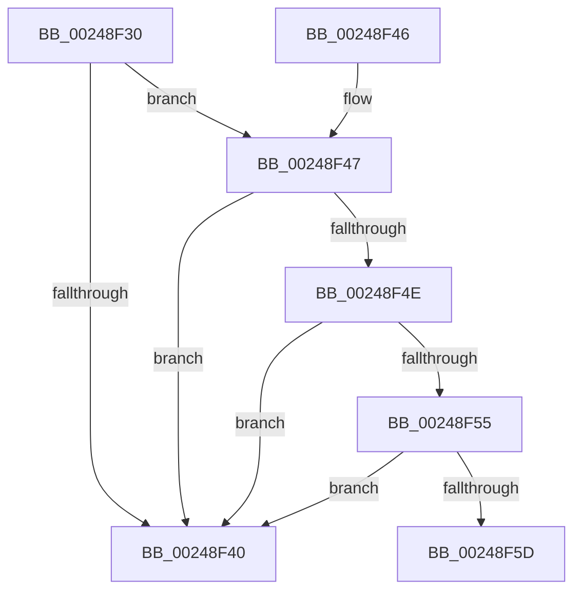

# MiCheckForControlAreaDeletion

- RVA: `0x00248F30`–`0x00248F71` (길이 `65` bytes)
- VA: `0x0000000140248F30`
- 실행 섹션: `.text`
- PDB 이름 있음: `예`; PDB Function 태그: `아니요`
- unwind 정보 RVA: `0x00062664`
- 디코드: `20`개 명령, `65/65` bytes 표시
- 미해석 바이트: `0` (있으면 어셈블리에 `.byte`로 보존)

> 이 문서는 커널 이미지의 기계어와 PDB 기호를 분석해 생성했습니다. 4번과 5번은 함수 원형과 자료형을 바이너리 사용 방식에서 추정한 C 해석이며 원본 소스 복구 결과는 아닙니다.

## 1. Dependencies

- 직접 호출 지점: **0**; 고유 호출 대상: **0**
- 직접 호출자로 확인된 함수: **1**
- RIP 상대 이미지 참조: **1**

### Outgoing calls
- 직접 디코드된 call 명령이 없습니다.

### Direct callers
- [MiDereferenceControlAreaPfnList](../2A/MiDereferenceControlAreaPfnList_function_002A45E8.md) at `0x002A4663`

### Static image references
- `0x00248F64` → RVA `0x00E30088` (`.data`; read)

## 2. Other-region calls and transfers

- 다른 실행 섹션으로 향하는 call: **0**
- 별도 외부 분기/꼬리 이동을 확인하지 못했습니다.

## 3. Assembly (complete function range)

```asm
00248F30  40 53                           push rbx
00248F32  48 83 EC 20                     sub rsp, 0x20
00248F36  48 83 79 20 00                  cmp qword ptr [rcx + 0x20], 0
00248F3B  48 8B D9                        mov rbx, rcx
00248F3E  74 07                           je 0x140248f47
00248F40  48 83 C4 20                     add rsp, 0x20
00248F44  5B                              pop rbx
00248F45  C3                              ret
00248F46  CC                              int3
00248F47  48 83 79 28 00                  cmp qword ptr [rcx + 0x28], 0
00248F4C  75 F2                           jne 0x140248f40
00248F4E  48 83 79 18 00                  cmp qword ptr [rcx + 0x18], 0
00248F53  75 EB                           jne 0x140248f40
00248F55  8B 51 38                        mov edx, dword ptr [rcx + 0x38]
00248F58  F6 C2 01                        test dl, 1
00248F5B  75 E3                           jne 0x140248f40
00248F5D  0F B7 49 3C                     movzx ecx, word ptr [rcx + 0x3c]
00248F61  83 CA 01                        or edx, 1
00248F64  48 8B 05 1D 71 BE 00            mov rax, qword ptr [rip + 0xbe711d]
00248F6B  81 E1 FF 03 00 00               and ecx, 0x3ff
```

## 4. C-style interpretation (structured pseudocode)

```c
__int64 __fastcall MiCheckForControlAreaDeletion(__int64 a1)
{
    __int64 v_rsp;

    v_rsp = (v_rsp) - (32);
    if ((*(unsigned __int64 *)(a1 + 32)) == 0) goto loc_00248F47;
loc_00248F40:
    v_rsp = (v_rsp) + (32);
    return result;
loc_00248F47:
    if ((*(unsigned __int64 *)(a1 + 40)) != 0) goto loc_00248F40;
    if ((*(unsigned __int64 *)(a1 + 24)) != 0) goto loc_00248F40;
    if ((((unsigned __int8)((unsigned int)(*(unsigned int *)(a1 + 56)))) & (1)) != 0) goto loc_00248F40;
    a2 = (unsigned int)(((unsigned int)(*(unsigned int *)(a1 + 56))) | (1));
    a1 = (unsigned int)((*(unsigned __int16 *)(a1 + 60)) & (0x3FFULL));
    return *(unsigned __int64 *)(v_rip + 12480797);
}
```

## 5. (Beta) C Style

```c
int64_t MiCheckForControlAreaDeletion(void *Arg1)
{
    uint8_t *arg1 = (uint8_t *)Arg1;

    int64_t local_rsp;

    local_rsp = (local_rsp) - (32);
    if ((*(uint64_t *)(arg1 + 0x20)) == 0) goto loc_00248F47;
loc_00248F40:
    local_rsp = (local_rsp) + (32);
    return result;
loc_00248F47:
    if ((*(uint64_t *)(arg1 + 0x28)) != 0) goto loc_00248F40;
    if ((*(uint64_t *)(arg1 + 0x18)) != 0) goto loc_00248F40;
    if ((((uint8_t)((uint32_t)(*(uint32_t *)(arg1 + 0x38)))) & (1)) != 0) goto loc_00248F40;
    a2 = (uint32_t)(((uint32_t)(*(uint32_t *)(arg1 + 0x38))) | (1));
    Arg1 = (uint32_t)((*(uint16_t *)(arg1 + 0x3C)) & (0x3FFULL));
    return *(uint64_t *)(v_rip + 0xBE711D);
}
```

### 관측된 메모리 오프셋

구조체 형식이 확인되지 않은 접근은 인자 기준의 오프셋으로만 기록했습니다.

| 기준 인자 | 오프셋 표현 | 폭 (bit) | 접근 |
|---|---:|---:|---|
| `Arg1` | `+ 0x18` | `64` | `R` |
| `Arg1` | `+ 0x20` | `64` | `R` |
| `Arg1` | `+ 0x28` | `64` | `R` |
| `Arg1` | `+ 0x38` | `32` | `R` |
| `Arg1` | `+ 0x3C` | `16` | `R` |

## 6. Execution-region graph

[열기: 2D/3D 그래프와 함수 탐색 컨트롤 패널](../../../control-panel.html?section=text&rva=0x00248F30&view=graph)

- 2D 그래프는 위에서 아래로 흐르고, 3D 그래프는 빈 공간을 드래그해 회전합니다. Shift+드래그는 이동, 휠은 확대·축소, 함수 노드 선택은 대상 보고서 이동입니다.

### Static fallback


