# MiClearMappingAndDereferenceIoSpace

- RVA: `0x00247DF0`–`0x002482B4` (길이 `1,220` bytes)
- VA: `0x0000000140247DF0`
- 실행 섹션: `.text`
- PDB 이름 있음: `예`; PDB Function 태그: `아니요`
- unwind 정보 RVA: `0x00062478`
- 디코드: `285`개 명령, `1,220/1,220` bytes 표시
- 미해석 바이트: `0` (있으면 어셈블리에 `.byte`로 보존)

> 이 문서는 커널 이미지의 기계어와 PDB 기호를 분석해 생성했습니다. 4번과 5번은 함수 원형과 자료형을 바이너리 사용 방식에서 추정한 C 해석이며 원본 소스 복구 결과는 아닙니다.

## 1. Dependencies

- 직접 호출 지점: **13**; 고유 호출 대상: **10**
- 직접 호출자로 확인된 함수: **4**
- RIP 상대 이미지 참조: **4**

### Outgoing calls
- `0x00247E60` → [MI_IS_PHYSICAL_ADDRESS](../23/MI_IS_PHYSICAL_ADDRESS_function_0023B3A0.md) (function, `0x0023B3A0`)
- `0x00247E73` → [MiVaIsUltra](../22/MiVaIsUltra_function_002284F0.md) (function, `0x002284F0`)
- `0x00247E92` → [MiMakeDemandZeroPte](../33/MiMakeDemandZeroPte_function_00337A00.md) (function, `0x00337A00`)
- `0x0024800A` → [MiDereferenceIoPages](../2A/MiDereferenceIoPages_function_002AB1B0.md) (function, `0x002AB1B0`)
- `0x00248024` → [_security_check_cookie](../6A/_security_check_cookie_function_006AC640.md) (function, `0x006AC640`)
- `0x002480EF` → [MiRewritePteWithLockBit](../32/MiRewritePteWithLockBit_function_00322FEC.md) (function, `0x00322FEC`)
- `0x00248130` → [MiZeroAndFlushGoodCitizen](../4D/MiZeroAndFlushGoodCitizen_function_004D0828.md) (function, `0x004D0828`)
- `0x00248171` → [MiLockNestedPageTable](../23/MiLockNestedPageTable_function_0023E890.md) (function, `0x0023E890`)
- `0x002481A9` → [MiZeroAndFlushGoodCitizen](../4D/MiZeroAndFlushGoodCitizen_function_004D0828.md) (function, `0x004D0828`)
- `0x002481DA` → [MiDereferenceIoPages](../2A/MiDereferenceIoPages_function_002AB1B0.md) (function, `0x002AB1B0`)
- `0x00248210` → [MiLockWorkingSetShared](../27/MiLockWorkingSetShared_function_0027CBF0.md) (function, `0x0027CBF0`)
- `0x00248265` → [MiZeroAndFlushGoodCitizen](../4D/MiZeroAndFlushGoodCitizen_function_004D0828.md) (function, `0x004D0828`)
- `0x0024829B` → [MiLockWorkingSetSharedAtDpc](../23/MiLockWorkingSetSharedAtDpc_function_00239574.md) (function, `0x00239574`)

### Direct callers
- [sub_00246F4D](Unknown_function_00246F4D.md) at `0x0024705D`
- [MiFillSystemPtes](../31/MiFillSystemPtes_function_00319850.md) at `0x0031A14B`
- [MiUnmapContiguousMemory](../3F/MiUnmapContiguousMemory_function_003F7908.md) at `0x003F7965`
- [MmMapMdl](../67/MmMapMdl_function_0067CBA0.md) at `0x0067CD5F`

### Static image references
- `0x00247E0F` → RVA `0x00E0A740` (`.data`; read)
- `0x00247E78` → RVA `0x00E38200` (`.data`; read)
- `0x00247F58` → RVA `0x00010880` (`.rdata`; read)
- `0x00247F66` → RVA `0x00E2DCE0` (`.data`; read)

## 2. Other-region calls and transfers

- 다른 실행 섹션으로 향하는 call: **0**
- 별도 외부 분기/꼬리 이동을 확인하지 못했습니다.

## 3. Assembly (complete function range)

```asm
00247DF0  48 89 5C 24 10                  mov qword ptr [rsp + 0x10], rbx
00247DF5  48 89 6C 24 18                  mov qword ptr [rsp + 0x18], rbp
00247DFA  48 89 74 24 20                  mov qword ptr [rsp + 0x20], rsi
00247DFF  57                              push rdi
00247E00  41 54                           push r12
00247E02  41 55                           push r13
00247E04  41 56                           push r14
00247E06  41 57                           push r15
00247E08  48 81 EC 90 01 00 00            sub rsp, 0x190
00247E0F  48 8B 05 2A 29 BC 00            mov rax, qword ptr [rip + 0xbc292a]
00247E16  48 33 C4                        xor rax, rsp
00247E19  48 89 84 24 80 01 00 00         mov qword ptr [rsp + 0x180], rax
00247E21  48 8B F1                        mov rsi, rcx
00247E24  48 BD 00 00 00 00 80 F6 FF FF   movabs rbp, 0xfffff68000000000
00247E2E  48 C1 EE 09                     shr rsi, 9
00247E32  4C 8B F1                        mov r14, rcx
00247E35  49 BD F8 FF FF FF 7F 00 00 00   movabs r13, 0x7ffffffff8
00247E3F  48 8B FA                        mov rdi, rdx
00247E42  49 23 F5                        and rsi, r13
00247E45  48 8B D9                        mov rbx, rcx
00247E48  49 81 E6 00 F0 FF FF            and r14, 0xfffffffffffff000
00247E4F  48 8B C5                        mov rax, rbp
00247E52  41 BF 01 00 00 00               mov r15d, 1
00247E58  48 03 F0                        add rsi, rax
00247E5B  4C 89 7C 24 60                  mov qword ptr [rsp + 0x60], r15
00247E60  E8 3B 35 FF FF                  call 0x14023b3a0
00247E65  44 8B E0                        mov r12d, eax
00247E68  85 C0                           test eax, eax
00247E6A  0F 8F 04 04 00 00               jg 0x140248274
00247E70  48 8B CB                        mov rcx, rbx
00247E73  E8 78 06 FE FF                  call 0x1402284f0
00247E78  48 8D 0D 81 03 BF 00            lea rcx, [rip + 0xbf0381]
00247E7F  45 33 DB                        xor r11d, r11d
00247E82  85 C0                           test eax, eax
00247E84  4C 0F 44 D9                     cmove r11, rcx
00247E88  B9 10 00 00 00                  mov ecx, 0x10
00247E8D  4C 89 5C 24 38                  mov qword ptr [rsp + 0x38], r11
00247E92  E8 69 FB 0E 00                  call 0x140337a00
00247E97  48 8B D8                        mov rbx, rax
00247E9A  4C 89 74 24 58                  mov qword ptr [rsp + 0x58], r14
00247E9F  33 D2                           xor edx, edx
00247EA1  48 8B C7                        mov rax, rdi
00247EA4  49 F7 F7                        div r15
00247EA7  48 8B C7                        mov rax, rdi
00247EAA  45 33 D2                        xor r10d, r10d
00247EAD  48 89 54 24 68                  mov qword ptr [rsp + 0x68], rdx
00247EB2  45 33 C9                        xor r9d, r9d
00247EB5  33 D2                           xor edx, edx
00247EB7  4C 89 54 24 40                  mov qword ptr [rsp + 0x40], r10
00247EBC  49 F7 F7                        div r15
00247EBF  33 ED                           xor ebp, ebp
00247EC1  44 89 4C 24 30                  mov dword ptr [rsp + 0x30], r9d
00247EC6  49 8B D7                        mov rdx, r15
00247EC9  4D 8B C6                        mov r8, r14
00247ECC  48 89 54 24 50                  mov qword ptr [rsp + 0x50], rdx
00247ED1  48 8B FE                        mov rdi, rsi
00247ED4  45 8B EC                        mov r13d, r12d
00247ED7  48 8D 04 C5 00 00 00 00         lea rax, [rax*8]
00247EDF  48 89 44 24 70                  mov qword ptr [rsp + 0x70], rax
00247EE4  48 8D 0C 06                     lea rcx, [rsi + rax]
00247EE8  48 89 4C 24 48                  mov qword ptr [rsp + 0x48], rcx
00247EED  41 83 FC 01                     cmp r12d, 1
00247EF1  0F 8D F7 02 00 00               jge 0x1402481ee
00247EF7  41 B7 11                        mov r15b, 0x11
00247EFA  48 3B F9                        cmp rdi, rcx
00247EFD  0F 83 AE 01 00 00               jae 0x1402480b1
00247F03  4C 8B 74 24 50                  mov r14, qword ptr [rsp + 0x50]
00247F08  48 FF C8                        dec rax
00247F0B  48 C1 E8 03                     shr rax, 3
00247F0F  48 FF C0                        inc rax
00247F12  48 0F AF C2                     imul rax, rdx
00247F16  48 C1 E0 0C                     shl rax, 0xc
00247F1A  4C 03 C0                        add r8, rax
00247F1D  4C 89 44 24 58                  mov qword ptr [rsp + 0x58], r8
00247F22  41 83 FD 01                     cmp r13d, 1
00247F26  0F 8D D7 01 00 00               jge 0x140248103
00247F2C  4C 8B 64 24 40                  mov r12, qword ptr [rsp + 0x40]
00247F31  48 8B 37                        mov rsi, qword ptr [rdi]
00247F34  48 85 F6                        test rsi, rsi
00247F37  0F 84 85 00 00 00               je 0x140247fc2
00247F3D  48 C1 EE 0C                     shr rsi, 0xc
00247F41  48 B8 FF FF FF FF FF 00 00 00   movabs rax, 0xffffffffff
00247F4B  48 23 F0                        and rsi, rax
00247F4E  41 83 FD 01                     cmp r13d, 1
00247F52  0F 8D 8A 01 00 00               jge 0x1402480e2
00247F58  48 8B 05 21 89 DC FF            mov rax, qword ptr [rip - 0x2376df]
00247F5F  8B 54 24 30                     mov edx, dword ptr [rsp + 0x30]
00247F63  48 89 07                        mov qword ptr [rdi], rax
00247F66  48 3B 35 73 5D BE 00            cmp rsi, qword ptr [rip + 0xbe5d73]
00247F6D  77 22                           ja 0x140247f91
00247F6F  48 8D 0C 76                     lea rcx, [rsi + rsi*2]
00247F73  48 B8 28 00 00 00 00 DE FF FF   movabs rax, 0xffffde0000000028
00247F7D  48 03 C9                        add rcx, rcx
00247F80  48 8B C0                        mov rax, rax
00247F83  48 8B 04 C8                     mov rax, qword ptr [rax + rcx*8]
00247F87  48 C1 E8 36                     shr rax, 0x36
00247F8B  0F BA E0 00                     bt eax, 0
00247F8F  72 2C                           jb 0x140247fbd
00247F91  85 ED                           test ebp, ebp
00247F93  0F 85 22 01 00 00               jne 0x1402480bb
00247F99  8B CD                           mov ecx, ebp
00247F9B  4A 8D 04 36                     lea rax, [rsi + r14]
00247F9F  48 03 C9                        add rcx, rcx
00247FA2  FF C5                           inc ebp
00247FA4  48 89 B4 CC 80 00 00 00         mov qword ptr [rsp + rcx*8 + 0x80], rsi
00247FAC  48 89 84 CC 88 00 00 00         mov qword ptr [rsp + rcx*8 + 0x88], rax
00247FB4  83 FD 10                        cmp ebp, 0x10
00247FB7  0F 84 C3 01 00 00               je 0x140248180
00247FBD  48 8B 4C 24 48                  mov rcx, qword ptr [rsp + 0x48]
00247FC2  4C 8B 5C 24 38                  mov r11, qword ptr [rsp + 0x38]
00247FC7  48 83 C7 08                     add rdi, 8
00247FCB  48 3B F9                        cmp rdi, rcx
00247FCE  0F 82 D1 02 00 00               jb 0x1402482a5
00247FD4  4C 8B 5C 24 38                  mov r11, qword ptr [rsp + 0x38]
00247FD9  41 83 FD 01                     cmp r13d, 1
00247FDD  0F 8D 62 02 00 00               jge 0x140248245
00247FE3  4C 8B 44 24 68                  mov r8, qword ptr [rsp + 0x68]
00247FE8  4D 85 C0                        test r8, r8
00247FEB  75 5E                           jne 0x14024804b
00247FED  8B FD                           mov edi, ebp
00247FEF  85 ED                           test ebp, ebp
00247FF1  74 26                           je 0x140248019
00247FF3  48 8D 9C 24 80 00 00 00         lea rbx, [rsp + 0x80]
00247FFB  48 8B 13                        mov rdx, qword ptr [rbx]
00247FFE  B9 01 00 00 00                  mov ecx, 1
00248003  4C 8B 43 08                     mov r8, qword ptr [rbx + 8]
00248007  4C 2B C2                        sub r8, rdx
0024800A  E8 A1 31 06 00                  call 0x1402ab1b0
0024800F  48 8D 5B 10                     lea rbx, [rbx + 0x10]
00248013  48 83 EF 01                     sub rdi, 1
00248017  75 E2                           jne 0x140247ffb
00248019  48 8B 8C 24 80 01 00 00         mov rcx, qword ptr [rsp + 0x180]
00248021  48 33 CC                        xor rcx, rsp
00248024  E8 17 46 46 00                  call 0x1406ac640
00248029  4C 8D 9C 24 90 01 00 00         lea r11, [rsp + 0x190]
00248031  49 8B 5B 38                     mov rbx, qword ptr [r11 + 0x38]
00248035  49 8B 6B 40                     mov rbp, qword ptr [r11 + 0x40]
00248039  49 8B 73 48                     mov rsi, qword ptr [r11 + 0x48]
0024803D  49 8B E3                        mov rsp, r11
00248040  41 5F                           pop r15
00248042  41 5E                           pop r14
00248044  41 5D                           pop r13
00248046  41 5C                           pop r12
00248048  5F                              pop rdi
00248049  C3                              ret
0024804A  CC                              int3
0024804B  48 8B 7C 24 58                  mov rdi, qword ptr [rsp + 0x58]
00248050  48 B8 F8 FF FF FF 7F 00 00 00   movabs rax, 0x7ffffffff8
0024805A  48 C1 EF 09                     shr rdi, 9
0024805E  BA 01 00 00 00                  mov edx, 1
00248063  48 23 F8                        and rdi, rax
00248066  48 89 54 24 50                  mov qword ptr [rsp + 0x50], rdx
0024806B  48 B8 00 00 00 00 80 F6 FF FF   movabs rax, 0xfffff68000000000
00248075  45 33 ED                        xor r13d, r13d
00248078  48 8B C0                        mov rax, rax
0024807B  48 03 F8                        add rdi, rax
0024807E  45 33 D2                        xor r10d, r10d
00248081  4A 8D 04 C5 00 00 00 00         lea rax, [r8*8]
00248089  4C 89 54 24 40                  mov qword ptr [rsp + 0x40], r10
0024808E  45 33 C0                        xor r8d, r8d
00248091  45 33 C9                        xor r9d, r9d
00248094  4C 89 44 24 68                  mov qword ptr [rsp + 0x68], r8
00248099  4C 8B 44 24 58                  mov r8, qword ptr [rsp + 0x58]
0024809E  48 8D 0C 38                     lea rcx, [rax + rdi]
002480A2  48 89 4C 24 48                  mov qword ptr [rsp + 0x48], rcx
002480A7  44 89 4C 24 30                  mov dword ptr [rsp + 0x30], r9d
002480AC  E9 46 FE FF FF                  jmp 0x140247ef7
002480B1  4C 8B 64 24 40                  mov r12, qword ptr [rsp + 0x40]
002480B6  E9 19 FF FF FF                  jmp 0x140247fd4
002480BB  8D 4D FF                        lea ecx, [rbp - 1]
002480BE  48 03 C9                        add rcx, rcx
002480C1  48 8B 84 CC 88 00 00 00         mov rax, qword ptr [rsp + rcx*8 + 0x88]
002480C9  48 3B C6                        cmp rax, rsi
002480CC  0F 85 C7 FE FF FF               jne 0x140247f99
002480D2  49 03 C6                        add rax, r14
002480D5  48 89 84 CC 88 00 00 00         mov qword ptr [rsp + rcx*8 + 0x88], rax
002480DD  E9 DB FE FF FF                  jmp 0x140247fbd
002480E2  48 8B 4C 24 38                  mov rcx, qword ptr [rsp + 0x38]
002480E7  4C 8B CB                        mov r9, rbx
002480EA  4C 8B C7                        mov r8, rdi
002480ED  33 D2                           xor edx, edx
002480EF  E8 F8 AE 0D 00                  call 0x140322fec
002480F4  8B 54 24 30                     mov edx, dword ptr [rsp + 0x30]
002480F8  FF C2                           inc edx
002480FA  89 54 24 30                     mov dword ptr [rsp + 0x30], edx
002480FE  E9 63 FE FF FF                  jmp 0x140247f66
00248103  4D 85 DB                        test r11, r11
00248106  0F 84 20 FE FF FF               je 0x140247f2c
0024810C  4D 85 D2                        test r10, r10
0024810F  74 31                           je 0x140248142
00248111  48 F7 C7 FF 0F 00 00            test rdi, 0xfff
00248118  0F 85 0E FE FF FF               jne 0x140247f2c
0024811E  45 0F B6 C7                     movzx r8d, r15b
00248122  C7 44 24 20 01 00 00 00         mov dword ptr [rsp + 0x20], 1
0024812A  49 8B D2                        mov rdx, r10
0024812D  49 8B CB                        mov rcx, r11
00248130  E8 F3 86 28 00                  call 0x1404d0828
00248135  4C 8B 5C 24 38                  mov r11, qword ptr [rsp + 0x38]
0024813A  C7 44 24 30 00 00 00 00         mov dword ptr [rsp + 0x30], 0
00248142  48 B8 F8 FF FF FF 7F 00 00 00   movabs rax, 0x7ffffffff8
0024814C  4C 8B E7                        mov r12, rdi
0024814F  49 C1 EC 09                     shr r12, 9
00248153  4C 23 E0                        and r12, rax
00248156  48 B8 00 00 00 00 80 F6 FF FF   movabs rax, 0xfffff68000000000
00248160  48 8B C0                        mov rax, rax
00248163  4C 03 E0                        add r12, rax
00248166  49 8B CB                        mov rcx, r11
00248169  49 8B D4                        mov rdx, r12
0024816C  4C 89 64 24 40                  mov qword ptr [rsp + 0x40], r12
00248171  E8 1A 67 FF FF                  call 0x14023e890
00248176  48 8B 4C 24 48                  mov rcx, qword ptr [rsp + 0x48]
0024817B  E9 B1 FD FF FF                  jmp 0x140247f31
00248180  41 83 FD 01                     cmp r13d, 1
00248184  7C 38                           jl 0x1402481be
00248186  48 8B 44 24 38                  mov rax, qword ptr [rsp + 0x38]
0024818B  48 85 C0                        test rax, rax
0024818E  74 2E                           je 0x1402481be
00248190  85 D2                           test edx, edx
00248192  74 2A                           je 0x1402481be
00248194  44 8B CA                        mov r9d, edx
00248197  C7 44 24 20 01 00 00 00         mov dword ptr [rsp + 0x20], 1
0024819F  49 8B D4                        mov rdx, r12
002481A2  45 0F B6 C7                     movzx r8d, r15b
002481A6  48 8B C8                        mov rcx, rax
002481A9  E8 7A 86 28 00                  call 0x1404d0828
002481AE  45 33 E4                        xor r12d, r12d
002481B1  C7 44 24 30 00 00 00 00         mov dword ptr [rsp + 0x30], 0
002481B9  4C 89 64 24 40                  mov qword ptr [rsp + 0x40], r12
002481BE  48 8D B4 24 80 00 00 00         lea rsi, [rsp + 0x80]
002481C6  BD 10 00 00 00                  mov ebp, 0x10
002481CB  48 8B 16                        mov rdx, qword ptr [rsi]
002481CE  B9 01 00 00 00                  mov ecx, 1
002481D3  4C 8B 46 08                     mov r8, qword ptr [rsi + 8]
002481D7  4C 2B C2                        sub r8, rdx
002481DA  E8 D1 2F 06 00                  call 0x1402ab1b0
002481DF  48 8D 76 10                     lea rsi, [rsi + 0x10]
002481E3  48 83 ED 01                     sub rbp, 1
002481E7  75 E2                           jne 0x1402481cb
002481E9  E9 CF FD FF FF                  jmp 0x140247fbd
002481EE  4C 89 74 24 58                  mov qword ptr [rsp + 0x58], r14
002481F3  48 89 54 24 50                  mov qword ptr [rsp + 0x50], rdx
002481F8  4D 85 DB                        test r11, r11
002481FB  0F 84 F6 FC FF FF               je 0x140247ef7
00248201  44 0F 20 C0                     mov rax, cr8
00248205  49 8B CB                        mov rcx, r11
00248208  3C 02                           cmp al, 2
0024820A  0F 84 88 00 00 00               je 0x140248298
00248210  E8 DB 49 03 00                  call 0x14027cbf0
00248215  44 0F B6 F8                     movzx r15d, al
00248219  48 8B 54 24 60                  mov rdx, qword ptr [rsp + 0x60]
0024821E  4D 8B C6                        mov r8, r14
00248221  48 8B 44 24 70                  mov rax, qword ptr [rsp + 0x70]
00248226  4C 8B D5                        mov r10, rbp
00248229  48 8B 4C 24 48                  mov rcx, qword ptr [rsp + 0x48]
0024822E  44 8B CD                        mov r9d, ebp
00248231  4C 8B 5C 24 38                  mov r11, qword ptr [rsp + 0x38]
00248236  48 89 54 24 50                  mov qword ptr [rsp + 0x50], rdx
0024823B  4C 89 74 24 58                  mov qword ptr [rsp + 0x58], r14
00248240  E9 B5 FC FF FF                  jmp 0x140247efa
00248245  4D 85 DB                        test r11, r11
00248248  0F 84 95 FD FF FF               je 0x140247fe3
0024824E  44 8B 4C 24 30                  mov r9d, dword ptr [rsp + 0x30]
00248253  45 0F B6 C7                     movzx r8d, r15b
00248257  49 8B D4                        mov rdx, r12
0024825A  C7 44 24 20 00 00 00 00         mov dword ptr [rsp + 0x20], 0
00248262  49 8B CB                        mov rcx, r11
00248265  E8 BE 85 28 00                  call 0x1404d0828
0024826A  4C 8B 5C 24 38                  mov r11, qword ptr [rsp + 0x38]
0024826F  E9 6F FD FF FF                  jmp 0x140247fe3
00248274  49 8B CC                        mov rcx, r12
00248277  48 C1 EE 09                     shr rsi, 9
0024827B  49 23 F5                        and rsi, r13
0024827E  49 C1 E7 09                     shl r15, 9
00248282  48 8B C5                        mov rax, rbp
00248285  48 03 F0                        add rsi, rax
00248288  48 83 E9 01                     sub rcx, 1
0024828C  75 E9                           jne 0x140248277
0024828E  4C 89 7C 24 60                  mov qword ptr [rsp + 0x60], r15
00248293  E9 D8 FB FF FF                  jmp 0x140247e70
00248298  41 B7 11                        mov r15b, 0x11
0024829B  E8 D4 12 FF FF                  call 0x140239574
002482A0  E9 74 FF FF FF                  jmp 0x140248219
002482A5  4C 8B 54 24 40                  mov r10, qword ptr [rsp + 0x40]
002482AA  44 8B 4C 24 30                  mov r9d, dword ptr [rsp + 0x30]
002482AF  E9 6E FC FF FF                  jmp 0x140247f22
```

## 4. C-style interpretation (structured pseudocode)

```c
__int64 __fastcall MiClearMappingAndDereferenceIoSpace(__int64 a1, __int64 a2, __int64 a3, int a4)
{
    __int64 result;
    __int64 v_r10;
    __int64 v_r11;
    __int64 v_r12;
    __int64 v_r13;
    __int64 v_r14;
    __int64 v_r15;
    __int64 v_rbp;
    __int64 v_rdi;
    __int64 v_rsi;
    __int64 v_rsp;
    unsigned __int64 v_stack_m110;
    unsigned __int64 v_stack_m120;
    unsigned __int64 v_stack_m128;
    unsigned __int64 v_stack_m130;
    unsigned __int64 v_stack_m138;
    unsigned __int64 v_stack_m140;
    unsigned __int64 v_stack_m148;
    unsigned __int64 v_stack_m150;
    unsigned __int64 v_stack_m158;
    unsigned __int64 v_stack_m160;
    unsigned __int64 v_stack_m168;
    unsigned __int64 v_stack_m170;
    unsigned __int64 v_stack_m178;
    unsigned __int64 v_stack_m180;
    unsigned int v_stack_m188;
    unsigned __int64 v_stack_m28;
    unsigned __int64 v_stack_m38;
    unsigned __int64 v_stack_p10;
    unsigned __int64 v_stack_p18;
    unsigned __int64 v_stack_p20;

    v_stack_p10 = v_rbx;
    v_stack_p18 = v_rbp;
    v_stack_p20 = v_rsi;
    v_rsp = (v_rsp) - (400);
    result = (*(unsigned __int64 *)(v_rip + 12331306)) ^ (v_rsp);
    v_stack_m38 = result;
    v_rsi = (a1) >> (9);
    v_rsi = (v_rsi) & (v_r13);
    v_r14 = (a1) & (0xFFFFFFFFFFFFF000ULL);
    v_rsi = (v_rsi) + (v_rbp);
    v_stack_m158 = 1;
    result = MI_IS_PHYSICAL_ADDRESS(a1, a2, a3, a4);
    if (condition_is_greater) goto loc_00248274;
loc_00247E70:
    result = MiVaIsUltra(a1, a2, a3, a4);
    v_r11 = 0;
    if ((unsigned int)(result) == 0) { v_r11 = v_rip + 12518273; }
    v_stack_m180 = v_r11;
    result = MiMakeDemandZeroPte(16, a2, a3, a4);
    v_stack_m160 = v_r14;
    a2 = 0;
    v_r10 = 0;
    v_stack_m150 = 0;
    a4 = 0;
    a2 = 0;
    v_stack_m178 = 0;
    v_rbp = 0;
    v_stack_m188 = 0;
    v_stack_m168 = 1;
    v_stack_m148 = 0 * 8;
    v_stack_m170 = v_rsi + 0 * 8 * 1;
    if (((unsigned int)((unsigned int)((unsigned int)(result)))) >= 1) goto loc_002481EE;
loc_00247EF7:
loc_00247EFA:
    if (v_rsi >= (v_rsi + 0 * 8 * 1)) goto loc_002480B1;
    result = (0 * 8) - 1;
    result = (result) >> (3);
    result = (result) + 1;
    result = (result) * (1);
    result = (result) << (12);
    a3 = (v_r14) + (result);
    v_stack_m160 = a3;
loc_00247F22:
    if (((unsigned int)((unsigned int)((unsigned int)((unsigned int)((unsigned int)(result)))))) >= 1) goto loc_00248103;
loc_00247F2C:
loc_00247F31:
    if (*(unsigned __int64 *)(v_rsi) == 0) goto loc_00247FC2;
    v_rsi = (*(unsigned __int64 *)(v_rsi)) >> (12);
    v_rsi = (v_rsi) & (result);
    if (((unsigned int)((unsigned int)((unsigned int)((unsigned int)((unsigned int)(result)))))) >= 1) goto loc_002480E2;
    *(unsigned __int64 *)(v_rsi) = *(unsigned __int64 *)(v_rip - 2324191);
loc_00247F66:
    if (v_rsi > (*(unsigned __int64 *)(v_rip + 12475763))) goto loc_00247F91;
    a1 = (v_rsi + v_rsi * 2) + (v_rsi + v_rsi * 2);
    result = (*(unsigned __int64 *)(*(unsigned __int64 *)(v_rip - 2324191) + a1 * 8)) >> (54);
    if (condition_is_below) goto loc_00247FBD;
loc_00247F91:
    if (0 != 0) goto loc_002480BB;
loc_00247F99:
    a1 = (0) + (0);
    v_rbp = (unsigned int)((v_rbp) + 1);
    *(unsigned __int64 *)(v_rsp + a1 * 8 + 128) = v_rsi;
    *(unsigned __int64 *)(v_rsp + a1 * 8 + 136) = v_rsi + v_stack_m168 * 1;
    if (((unsigned int)(v_rbp)) == 16) goto loc_00248180;
loc_00247FBD:
loc_00247FC2:
    v_rdi = (v_rsi) + (8);
    if (v_rdi < v_stack_m170) goto loc_002482A5;
loc_00247FD4:
    if (((unsigned int)((unsigned int)((unsigned int)((unsigned int)((unsigned int)(result)))))) >= 1) goto loc_00248245;
loc_00247FE3:
    if (v_stack_m150 != 0) goto loc_0024804B;
    if ((unsigned int)(v_rbp) == 0) goto loc_00248019;
loc_00247FFB:
    a3 = (*(unsigned __int64 *)(v_stack_m138 + 8)) - (*(unsigned __int64 *)(v_stack_m138));
    result = MiDereferenceIoPages(1, *(unsigned __int64 *)(v_stack_m138), a3, a4);
    v_rdi = ((unsigned int)((unsigned int)(v_rbp))) - (1);
    if (condition_is_not_equal) goto loc_00247FFB;
loc_00248019:
    a1 = (v_stack_m38) ^ (v_rsp);
    result = _security_check_cookie(a1, *(unsigned __int64 *)(v_stack_m138), a3, a4);
    return result;
loc_0024804B:
    v_rdi = (v_stack_m138) >> (9);
    v_rdi = (v_rdi) & (result);
    v_stack_m140 = 1;
    v_r13 = 0;
    v_rdi = (v_rdi) + (result);
    v_r10 = 0;
    v_stack_m150 = 0;
    a3 = 0;
    a4 = 0;
    v_stack_m128 = 0;
    v_stack_m148 = a3 * 8 + v_rdi * 1;
    v_stack_m160 = 0;
    goto loc_00247EF7;
loc_002480B1:
    goto loc_00247FD4;
loc_002480BB:
    a1 = (*(unsigned __int64 *)(v_stack_m28 + 64) - 1) + (*(unsigned __int64 *)(v_stack_m28 + 64) - 1);
    if ((*(unsigned __int64 *)(v_stack_m28 + a1 * 8 + 136)) != (*(unsigned __int64 *)(v_stack_m28 + 72))) goto loc_00247F99;
    result = (*(unsigned __int64 *)(v_stack_m28 + a1 * 8 + 136)) + (v_stack_m168);
    *(unsigned __int64 *)(v_stack_m28 + a1 * 8 + 136) = result;
    goto loc_00247FBD;
loc_002480E2:
    a2 = 0;
    result = MiRewritePteWithLockBit(v_stack_m158, a2, v_rdi, *(unsigned __int64 *)(v_stack_m28 + 56));
    a2 = (unsigned int)(((unsigned int)(v_stack_m160)) + 1);
    v_stack_m160 = (unsigned int)(a2);
    goto loc_00247F66;
loc_00248103:
    if (v_stack_m28 == 0) goto loc_00247F2C;
    if (0 == 0) goto loc_00248142;
    if (((v_rdi) & (0xFFFULL)) != 0) goto loc_00247F2C;
    v_stack_m170 = 1;
    result = MiZeroAndFlushGoodCitizen(v_stack_m28, 0, 17, *(unsigned __int64 *)(v_stack_m28 + 56));
    v_stack_m160 = 0;
loc_00248142:
    v_r12 = (v_rdi) >> (9);
    v_r12 = (v_r12) & (result);
    v_r12 = (v_r12) + (result);
    v_stack_m150 = v_r12;
    result = MiLockNestedPageTable(v_stack_m158, v_r12, 17, *(unsigned __int64 *)(v_stack_m28 + 56));
    goto loc_00247F31;
loc_00248180:
    if (0 < 1) goto loc_002481BE;
    if (v_stack_m158 == 0) goto loc_002481BE;
    result = v_stack_m158;
    if ((unsigned int)(v_r12) != 0) {
        a4 = (unsigned int)(v_r12);
        v_stack_m170 = 1;
        a2 = v_r12;
        a3 = 17;
        a1 = v_stack_m158;
        result = MiZeroAndFlushGoodCitizen(a1, a2, a3, a4);
        v_r12 = 0;
        v_stack_m160 = 0;
        v_stack_m150 = 0;
    }
loc_002481CB:
    a3 = (*(unsigned __int64 *)(v_stack_m110 + 8)) - (*(unsigned __int64 *)(v_stack_m110));
    result = MiDereferenceIoPages(1, *(unsigned __int64 *)(v_stack_m110), a3, a4);
    v_rbp = (16) - (1);
    if (condition_is_not_equal) goto loc_002481CB;
    goto loc_00247FBD;
loc_002481EE:
    v_stack_m138 = v_stack_m168;
    v_stack_m140 = *(unsigned __int64 *)(v_stack_m110);
    if (v_stack_m158 == 0) goto loc_00247EF7;
    if (((unsigned __int8)(v_cr8)) == 2) goto loc_00248298;
    result = MiLockWorkingSetShared(v_stack_m158, *(unsigned __int64 *)(v_stack_m110), a3, a4);
loc_00248219:
    v_stack_m140 = v_stack_m130;
    v_stack_m138 = v_stack_m168;
    goto loc_00247EFA;
loc_00248245:
    if (v_stack_m158 == 0) goto loc_00247FE3;
    v_stack_m170 = 0;
    result = MiZeroAndFlushGoodCitizen(v_stack_m158, 0, (unsigned __int8)((unsigned __int8)(result)), (unsigned int)(v_stack_m160));
    goto loc_00247FE3;
loc_00248274:
loc_00248277:
    v_rsi = (v_stack_m110 + 16) >> (9);
    v_rsi = (v_rsi) & (0);
    v_r15 = ((unsigned __int8)(result)) << (9);
    v_rsi = (v_rsi) + (v_rbp);
    a1 = (0) - (1);
    if (condition_is_not_equal) goto loc_00248277;
    v_stack_m130 = v_r15;
    goto loc_00247E70;
loc_00248298:
    result = MiLockWorkingSetSharedAtDpc(a1, 0, (unsigned __int8)((unsigned __int8)(result)), (unsigned int)(v_stack_m160));
    goto loc_00248219;
loc_002482A5:
    goto loc_00247F22;
}
```

## 5. (Beta) C Style

```c
int64_t MiClearMappingAndDereferenceIoSpace(int64_t Arg1, int64_t Arg2, int64_t Arg3, int32_t Arg4)
{
    int64_t result;
    int64_t local_r10;
    int64_t local_r11;
    int64_t local_r12;
    int64_t local_r13;
    int64_t local_r14;
    int64_t local_r15;
    int64_t local_rbp;
    int64_t local_rdi;
    int64_t local_rsi;
    int64_t local_rsp;
    uint64_t v_stack_m110;
    uint64_t v_stack_m120;
    uint64_t v_stack_m128;
    uint64_t v_stack_m130;
    uint64_t v_stack_m138;
    uint64_t v_stack_m140;
    uint64_t v_stack_m148;
    uint64_t v_stack_m150;
    uint64_t v_stack_m158;
    uint64_t v_stack_m160;
    uint64_t v_stack_m168;
    uint64_t v_stack_m170;
    uint64_t v_stack_m178;
    uint64_t v_stack_m180;
    uint32_t v_stack_m188;
    uint64_t v_stack_m28;
    uint64_t v_stack_m38;
    uint64_t v_stack_p10;
    uint64_t v_stack_p18;
    uint64_t v_stack_p20;

    v_stack_p10 = local_rbx;
    v_stack_p18 = local_rbp;
    v_stack_p20 = local_rsi;
    local_rsp = (local_rsp) - (400);
    result = (*(uint64_t *)(v_rip + 0xBC292A)) ^ (local_rsp);
    v_stack_m38 = result;
    local_rsi = (Arg1) >> (9);
    local_rsi = (local_rsi) & (local_r13);
    local_r14 = (Arg1) & (0xFFFFFFFFFFFFF000ULL);
    local_rsi = (local_rsi) + (local_rbp);
    v_stack_m158 = 1;
    result = MI_IS_PHYSICAL_ADDRESS(Arg1, Arg2, Arg3, Arg4);
    if (condition_is_greater) goto loc_00248274;
loc_00247E70:
    result = MiVaIsUltra(Arg1, Arg2, Arg3, Arg4);
    local_r11 = 0;
    if ((uint32_t)(result) == 0) { local_r11 = v_rip + 12518273; }
    v_stack_m180 = local_r11;
    result = MiMakeDemandZeroPte(16, Arg2, Arg3, Arg4);
    v_stack_m160 = local_r14;
    Arg2 = 0;
    local_r10 = 0;
    v_stack_m150 = 0;
    Arg4 = 0;
    Arg2 = 0;
    v_stack_m178 = 0;
    local_rbp = 0;
    v_stack_m188 = 0;
    v_stack_m168 = 1;
    v_stack_m148 = 0 * 8;
    v_stack_m170 = local_rsi + 0 * 8 * 1;
    if (((uint32_t)((uint32_t)((uint32_t)(result)))) >= 1) goto loc_002481EE;
loc_00247EF7:
loc_00247EFA:
    if (local_rsi >= (local_rsi + 0 * 8 * 1)) goto loc_002480B1;
    result = (0 * 8) - 1;
    result = (result) >> (3);
    result = (result) + 1;
    result = (result) * (1);
    result = (result) << (12);
    Arg3 = (local_r14) + (result);
    v_stack_m160 = Arg3;
loc_00247F22:
    if (((uint32_t)((uint32_t)((uint32_t)((uint32_t)((uint32_t)(result)))))) >= 1) goto loc_00248103;
loc_00247F2C:
loc_00247F31:
    if (*(uint64_t *)(local_rsi) == 0) goto loc_00247FC2;
    local_rsi = (*(uint64_t *)(local_rsi)) >> (12);
    local_rsi = (local_rsi) & (result);
    if (((uint32_t)((uint32_t)((uint32_t)((uint32_t)((uint32_t)(result)))))) >= 1) goto loc_002480E2;
    *(uint64_t *)(local_rsi) = *(uint64_t *)(v_rip - 0x2376DF);
loc_00247F66:
    if (local_rsi > (*(uint64_t *)(v_rip + 0xBE5D73))) goto loc_00247F91;
    Arg1 = (local_rsi + local_rsi * 2) + (local_rsi + local_rsi * 2);
    result = (*(uint64_t *)(*(uint64_t *)(v_rip - 0x2376DF) + Arg1 * 8)) >> (54);
    if (condition_is_below) goto loc_00247FBD;
loc_00247F91:
    if (0 != 0) goto loc_002480BB;
loc_00247F99:
    Arg1 = (0) + (0);
    local_rbp = (uint32_t)((local_rbp) + 1);
    *(uint64_t *)(local_rsp + Arg1 * 8 + 0x80) = local_rsi;
    *(uint64_t *)(local_rsp + Arg1 * 8 + 0x88) = local_rsi + v_stack_m168 * 1;
    if (((uint32_t)(local_rbp)) == 16) goto loc_00248180;
loc_00247FBD:
loc_00247FC2:
    local_rdi = (local_rsi) + (8);
    if (local_rdi < v_stack_m170) goto loc_002482A5;
loc_00247FD4:
    if (((uint32_t)((uint32_t)((uint32_t)((uint32_t)((uint32_t)(result)))))) >= 1) goto loc_00248245;
loc_00247FE3:
    if (v_stack_m150 != 0) goto loc_0024804B;
    if ((uint32_t)(local_rbp) == 0) goto loc_00248019;
loc_00247FFB:
    Arg3 = (*(uint64_t *)(v_stack_m138 + 0x8)) - (*(uint64_t *)(v_stack_m138));
    result = MiDereferenceIoPages(1, *(uint64_t *)(v_stack_m138), Arg3, Arg4);
    local_rdi = ((uint32_t)((uint32_t)(local_rbp))) - (1);
    if (condition_is_not_equal) goto loc_00247FFB;
loc_00248019:
    Arg1 = (v_stack_m38) ^ (local_rsp);
    result = _security_check_cookie(Arg1, *(uint64_t *)(v_stack_m138), Arg3, Arg4);
    return result;
loc_0024804B:
    local_rdi = (v_stack_m138) >> (9);
    local_rdi = (local_rdi) & (result);
    v_stack_m140 = 1;
    local_r13 = 0;
    local_rdi = (local_rdi) + (result);
    local_r10 = 0;
    v_stack_m150 = 0;
    Arg3 = 0;
    Arg4 = 0;
    v_stack_m128 = 0;
    v_stack_m148 = Arg3 * 8 + local_rdi * 1;
    v_stack_m160 = 0;
    goto loc_00247EF7;
loc_002480B1:
    goto loc_00247FD4;
loc_002480BB:
    Arg1 = (*(uint64_t *)(v_stack_m28 + 0x40) - 1) + (*(uint64_t *)(v_stack_m28 + 0x40) - 1);
    if ((*(uint64_t *)(v_stack_m28 + Arg1 * 8 + 0x88)) != (*(uint64_t *)(v_stack_m28 + 0x48))) goto loc_00247F99;
    result = (*(uint64_t *)(v_stack_m28 + Arg1 * 8 + 0x88)) + (v_stack_m168);
    *(uint64_t *)(v_stack_m28 + Arg1 * 8 + 0x88) = result;
    goto loc_00247FBD;
loc_002480E2:
    Arg2 = 0;
    result = MiRewritePteWithLockBit(v_stack_m158, Arg2, local_rdi, *(uint64_t *)(v_stack_m28 + 0x38));
    Arg2 = (uint32_t)(((uint32_t)(v_stack_m160)) + 1);
    v_stack_m160 = (uint32_t)(Arg2);
    goto loc_00247F66;
loc_00248103:
    if (v_stack_m28 == 0) goto loc_00247F2C;
    if (0 == 0) goto loc_00248142;
    if (((local_rdi) & (0xFFFULL)) != 0) goto loc_00247F2C;
    v_stack_m170 = 1;
    result = MiZeroAndFlushGoodCitizen(v_stack_m28, 0, 17, *(uint64_t *)(v_stack_m28 + 0x38));
    v_stack_m160 = 0;
loc_00248142:
    local_r12 = (local_rdi) >> (9);
    local_r12 = (local_r12) & (result);
    local_r12 = (local_r12) + (result);
    v_stack_m150 = local_r12;
    result = MiLockNestedPageTable(v_stack_m158, local_r12, 17, *(uint64_t *)(v_stack_m28 + 0x38));
    goto loc_00247F31;
loc_00248180:
    if (0 < 1) goto loc_002481BE;
    if (v_stack_m158 == 0) goto loc_002481BE;
    result = v_stack_m158;
    if ((uint32_t)(local_r12) != 0) {
        Arg4 = (uint32_t)(local_r12);
        v_stack_m170 = 1;
        Arg2 = local_r12;
        Arg3 = 17;
        Arg1 = v_stack_m158;
        result = MiZeroAndFlushGoodCitizen(Arg1, Arg2, Arg3, Arg4);
        local_r12 = 0;
        v_stack_m160 = 0;
        v_stack_m150 = 0;
    }
loc_002481CB:
    Arg3 = (*(uint64_t *)(v_stack_m110 + 0x8)) - (*(uint64_t *)(v_stack_m110));
    result = MiDereferenceIoPages(1, *(uint64_t *)(v_stack_m110), Arg3, Arg4);
    local_rbp = (16) - (1);
    if (condition_is_not_equal) goto loc_002481CB;
    goto loc_00247FBD;
loc_002481EE:
    v_stack_m138 = v_stack_m168;
    v_stack_m140 = *(uint64_t *)(v_stack_m110);
    if (v_stack_m158 == 0) goto loc_00247EF7;
    if (((uint8_t)(v_cr8)) == 2) goto loc_00248298;
    result = MiLockWorkingSetShared(v_stack_m158, *(uint64_t *)(v_stack_m110), Arg3, Arg4);
loc_00248219:
    v_stack_m140 = v_stack_m130;
    v_stack_m138 = v_stack_m168;
    goto loc_00247EFA;
loc_00248245:
    if (v_stack_m158 == 0) goto loc_00247FE3;
    v_stack_m170 = 0;
    result = MiZeroAndFlushGoodCitizen(v_stack_m158, 0, (uint8_t)((uint8_t)(result)), (uint32_t)(v_stack_m160));
    goto loc_00247FE3;
loc_00248274:
loc_00248277:
    local_rsi = (v_stack_m110 + 16) >> (9);
    local_rsi = (local_rsi) & (0);
    local_r15 = ((uint8_t)(result)) << (9);
    local_rsi = (local_rsi) + (local_rbp);
    Arg1 = (0) - (1);
    if (condition_is_not_equal) goto loc_00248277;
    v_stack_m130 = local_r15;
    goto loc_00247E70;
loc_00248298:
    result = MiLockWorkingSetSharedAtDpc(Arg1, 0, (uint8_t)((uint8_t)(result)), (uint32_t)(v_stack_m160));
    goto loc_00248219;
loc_002482A5:
    goto loc_00247F22;
}
```

## 6. Execution-region graph

[열기: 2D/3D 그래프와 함수 탐색 컨트롤 패널](../../../control-panel.html?section=text&rva=0x00247DF0&view=graph)

- 2D 그래프는 위에서 아래로 흐르고, 3D 그래프는 빈 공간을 드래그해 회전합니다. Shift+드래그는 이동, 휠은 확대·축소, 함수 노드 선택은 대상 보고서 이동입니다.

### Static fallback

```mermaid
flowchart TD
  bb_00247DF0[BB_00247DF0]
  bb_00247E70[BB_00247E70]
  bb_00247EF7[BB_00247EF7]
  bb_00247EFA[BB_00247EFA]
  bb_00247F03[BB_00247F03]
  bb_00247F22[BB_00247F22]
  bb_00247F2C[BB_00247F2C]
  bb_00247F31[BB_00247F31]
  bb_00247F3D[BB_00247F3D]
  bb_00247F58[BB_00247F58]
  bb_00247F66[BB_00247F66]
  bb_00247F6F[BB_00247F6F]
  bb_00247F91[BB_00247F91]
  bb_00247F99[BB_00247F99]
  bb_00247FBD[BB_00247FBD]
  bb_00247FC2[BB_00247FC2]
  bb_00247FD4[BB_00247FD4]
  bb_00247FE3[BB_00247FE3]
  bb_00247FED[BB_00247FED]
  bb_00247FF3[BB_00247FF3]
  bb_00247FFB[BB_00247FFB]
  bb_00248019[BB_00248019]
  bb_0024804A[BB_0024804A]
  bb_0024804B[BB_0024804B]
  bb_002480B1[BB_002480B1]
  bb_002480BB[BB_002480BB]
  bb_002480D2[BB_002480D2]
  bb_002480E2[BB_002480E2]
  bb_00248103[BB_00248103]
  bb_0024810C[BB_0024810C]
  bb_00248111[BB_00248111]
  bb_0024811E[BB_0024811E]
  bb_00248142[BB_00248142]
  bb_00248180[BB_00248180]
  bb_00248186[BB_00248186]
  bb_00248190[BB_00248190]
  bb_00248194[BB_00248194]
  bb_002481BE[BB_002481BE]
  bb_002481CB[BB_002481CB]
  bb_002481E9[BB_002481E9]
  bb_002481EE[BB_002481EE]
  bb_00248201[BB_00248201]
  bb_00248210[BB_00248210]
  bb_00248219[BB_00248219]
  bb_00248245[BB_00248245]
  bb_0024824E[BB_0024824E]
  bb_00248274[BB_00248274]
  bb_00248277[BB_00248277]
  bb_0024828E[BB_0024828E]
  bb_00248298[BB_00248298]
  bb_002482A5[BB_002482A5]
  bb_00247DF0 -->|branch| bb_00248274
  bb_00247DF0 -->|fallthrough| bb_00247E70
  bb_00247E70 -->|branch| bb_002481EE
  bb_00247E70 -->|fallthrough| bb_00247EF7
  bb_00247EF7 -->|flow| bb_00247EFA
  bb_00247EFA -->|branch| bb_002480B1
  bb_00247EFA -->|fallthrough| bb_00247F03
  bb_00247F03 -->|flow| bb_00247F22
  bb_00247F22 -->|branch| bb_00248103
  bb_00247F22 -->|fallthrough| bb_00247F2C
  bb_00247F2C -->|flow| bb_00247F31
  bb_00247F31 -->|branch| bb_00247FC2
  bb_00247F31 -->|fallthrough| bb_00247F3D
  bb_00247F3D -->|branch| bb_002480E2
  bb_00247F3D -->|fallthrough| bb_00247F58
  bb_00247F58 -->|flow| bb_00247F66
  bb_00247F66 -->|branch| bb_00247F91
  bb_00247F66 -->|fallthrough| bb_00247F6F
  bb_00247F6F -->|branch| bb_00247FBD
  bb_00247F6F -->|fallthrough| bb_00247F91
  bb_00247F91 -->|branch| bb_002480BB
  bb_00247F91 -->|fallthrough| bb_00247F99
  bb_00247F99 -->|branch| bb_00248180
  bb_00247F99 -->|fallthrough| bb_00247FBD
  bb_00247FBD -->|flow| bb_00247FC2
  bb_00247FC2 -->|branch| bb_002482A5
  bb_00247FC2 -->|fallthrough| bb_00247FD4
  bb_00247FD4 -->|branch| bb_00248245
  bb_00247FD4 -->|fallthrough| bb_00247FE3
  bb_00247FE3 -->|branch| bb_0024804B
  bb_00247FE3 -->|fallthrough| bb_00247FED
  bb_00247FED -->|branch| bb_00248019
  bb_00247FED -->|fallthrough| bb_00247FF3
  bb_00247FF3 -->|flow| bb_00247FFB
  bb_00247FFB -->|branch| bb_00247FFB
  bb_00247FFB -->|fallthrough| bb_00248019
  bb_0024804A -->|flow| bb_0024804B
  bb_0024804B -->|branch| bb_00247EF7
  bb_002480B1 -->|branch| bb_00247FD4
  bb_002480BB -->|branch| bb_00247F99
  bb_002480BB -->|fallthrough| bb_002480D2
  bb_002480D2 -->|branch| bb_00247FBD
  bb_002480E2 -->|branch| bb_00247F66
  bb_00248103 -->|branch| bb_00247F2C
  bb_00248103 -->|fallthrough| bb_0024810C
  bb_0024810C -->|branch| bb_00248142
  bb_0024810C -->|fallthrough| bb_00248111
  bb_00248111 -->|branch| bb_00247F2C
  bb_00248111 -->|fallthrough| bb_0024811E
  bb_0024811E -->|flow| bb_00248142
  bb_00248142 -->|branch| bb_00247F31
  bb_00248180 -->|branch| bb_002481BE
  bb_00248180 -->|fallthrough| bb_00248186
  bb_00248186 -->|branch| bb_002481BE
  bb_00248186 -->|fallthrough| bb_00248190
  bb_00248190 -->|branch| bb_002481BE
  bb_00248190 -->|fallthrough| bb_00248194
  bb_00248194 -->|flow| bb_002481BE
  bb_002481BE -->|flow| bb_002481CB
  bb_002481CB -->|branch| bb_002481CB
  bb_002481CB -->|fallthrough| bb_002481E9
  bb_002481E9 -->|branch| bb_00247FBD
  bb_002481EE -->|branch| bb_00247EF7
  bb_002481EE -->|fallthrough| bb_00248201
  bb_00248201 -->|branch| bb_00248298
  bb_00248201 -->|fallthrough| bb_00248210
  bb_00248210 -->|flow| bb_00248219
  bb_00248219 -->|branch| bb_00247EFA
  bb_00248245 -->|branch| bb_00247FE3
  bb_00248245 -->|fallthrough| bb_0024824E
  bb_0024824E -->|branch| bb_00247FE3
  bb_00248274 -->|flow| bb_00248277
  bb_00248277 -->|branch| bb_00248277
  bb_00248277 -->|fallthrough| bb_0024828E
  bb_0024828E -->|branch| bb_00247E70
  bb_00248298 -->|branch| bb_00248219
  bb_002482A5 -->|branch| bb_00247F22
```


