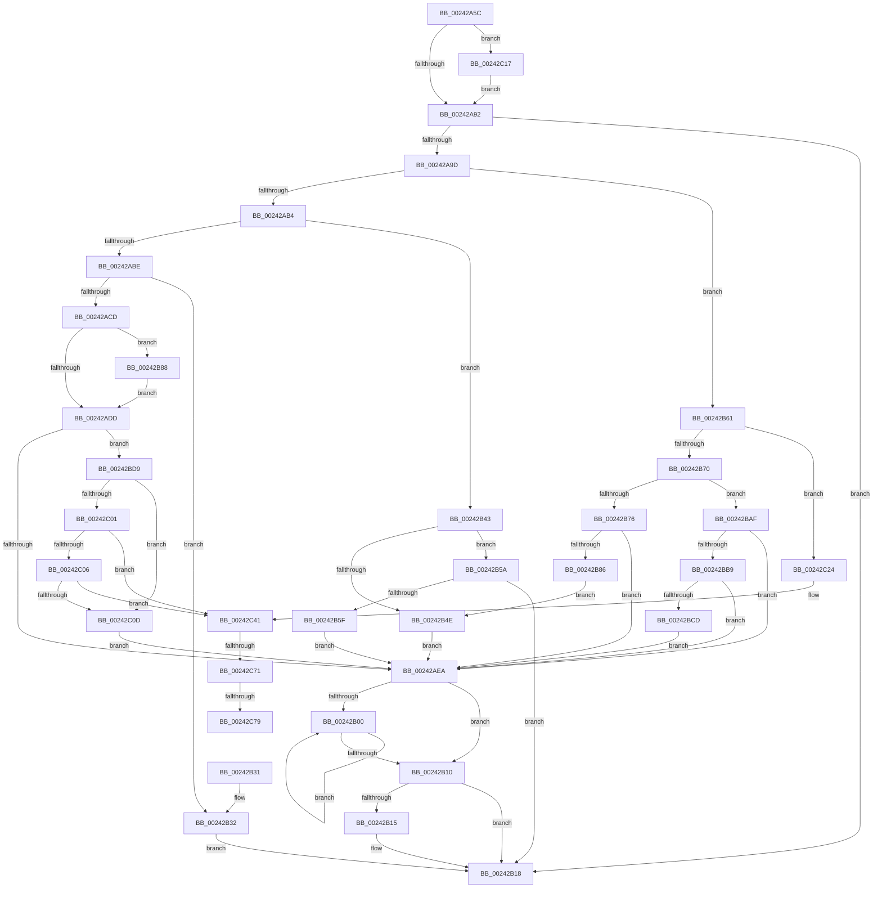

# MiDecommitHandlePageFileFormatPte

- RVA: `0x00242A5C`–`0x00242C87` (길이 `555` bytes)
- VA: `0x0000000140242A5C`
- 실행 섹션: `.text`
- PDB 이름 있음: `예`; PDB Function 태그: `예`
- unwind 정보 RVA: `0x000619C0`
- 디코드: `152`개 명령, `555/555` bytes 표시
- 미해석 바이트: `0` (있으면 어셈블리에 `.byte`로 보존)

> 이 문서는 커널 이미지의 기계어와 PDB 기호를 분석해 생성했습니다. 4번과 5번은 함수 원형과 자료형을 바이너리 사용 방식에서 추정한 C 해석이며 원본 소스 복구 결과는 아닙니다.

## 1. Dependencies

- 직접 호출 지점: **5**; 고유 호출 대상: **4**
- 직접 호출자로 확인된 함수: **2**
- RIP 상대 이미지 참조: **1**

### Outgoing calls
- `0x00242AD0` → [IS_PTE_NOT_DEMAND_ZERO](../22/IS_PTE_NOT_DEMAND_ZERO_function_0022F4D0.md) (function, `0x0022F4D0`)
- `0x00242AF3` → [MiReleasePageFileSpace](../28/MiReleasePageFileSpace_function_00285980.md) (function, `0x00285980`)
- `0x00242B79` → [IS_PTE_NOT_DEMAND_ZERO](../22/IS_PTE_NOT_DEMAND_ZERO_function_0022F4D0.md) (function, `0x0022F4D0`)
- `0x00242BDE` → [MI_READ_PTE_LOCK_FREE](../28/MI_READ_PTE_LOCK_FREE_function_002828A0.md) (function, `0x002828A0`)
- `0x00242C3B` → [KeBugCheckEx](../4F/KeBugCheckEx_function_004FD660.md) (function, `0x004FD660`)

### Direct callers
- [sub_00241E90](Unknown_function_00241E90.md) at `0x00241F3A`
- [MiDeleteVa](../27/MiDeleteVa_function_002789E0.md) at `0x00278E6A`

### Static image references
- `0x00242C49` → RVA `0x00E2DC80` (`.data`; read)

## 2. Other-region calls and transfers

- 다른 실행 섹션으로 향하는 call: **0**
- call이 아닌 외부 분기/꼬리 이동: **3**
  - `0x00242C6B` → [sub_006D7D40](../6D/Unknown_function_006D7D40.md) (`tail-transfer`)
  - `0x00242C73` → [sub_006D7D40](../6D/Unknown_function_006D7D40.md) (`tail-transfer`)
  - `0x00242C82` → [sub_006D7D40](../6D/Unknown_function_006D7D40.md) (`tail-transfer`)

## 3. Assembly (complete function range)

```asm
00242A5C  48 89 5C 24 08                  mov qword ptr [rsp + 8], rbx
00242A61  48 89 6C 24 18                  mov qword ptr [rsp + 0x18], rbp
00242A66  48 89 54 24 10                  mov qword ptr [rsp + 0x10], rdx
00242A6B  56                              push rsi
00242A6C  57                              push rdi
00242A6D  41 55                           push r13
00242A6F  41 56                           push r14
00242A71  41 57                           push r15
00242A73  48 83 EC 30                     sub rsp, 0x30
00242A77  8B A9 C0 00 00 00               mov ebp, dword ptr [rcx + 0xc0]
00242A7D  41 BD 01 00 00 00               mov r13d, 1
00242A83  48 8B DA                        mov rbx, rdx
00242A86  48 8B F1                        mov rsi, rcx
00242A89  41 3B ED                        cmp ebp, r13d
00242A8C  0F 85 85 01 00 00               jne 0x140242c17
00242A92  8B 89 9C 00 00 00               mov ecx, dword ptr [rcx + 0x9c]
00242A98  F6 C1 08                        test cl, 8
00242A9B  75 7B                           jne 0x140242b18
00242A9D  48 8B BE B0 00 00 00            mov rdi, qword ptr [rsi + 0xb0]
00242AA4  45 8B FD                        mov r15d, r13d
00242AA7  4C 8B 76 08                     mov r14, qword ptr [rsi + 8]
00242AAB  F6 C1 20                        test cl, 0x20
00242AAE  0F 85 AD 00 00 00               jne 0x140242b61
00242AB4  83 7E 28 00                     cmp dword ptr [rsi + 0x28], 0
00242AB8  0F 85 85 00 00 00               jne 0x140242b43
00242ABE  48 8B CA                        mov rcx, rdx
00242AC1  48 C1 E9 05                     shr rcx, 5
00242AC5  80 E1 1F                        and cl, 0x1f
00242AC8  80 F9 10                        cmp cl, 0x10
00242ACB  74 65                           je 0x140242b32
00242ACD  48 8B CA                        mov rcx, rdx
00242AD0  E8 FB C9 FE FF                  call 0x14022f4d0
00242AD5  85 C0                           test eax, eax
00242AD7  0F 85 AB 00 00 00               jne 0x140242b88
00242ADD  8A C3                           mov al, bl
00242ADF  D0 E8                           shr al, 1
00242AE1  41 84 C5                        test r13b, al
00242AE4  0F 85 EF 00 00 00               jne 0x140242bd9
00242AEA  45 8B C7                        mov r8d, r15d
00242AED  48 8B D3                        mov rdx, rbx
00242AF0  49 8B CE                        mov rcx, r14
00242AF3  E8 88 2E 04 00                  call 0x140285980
00242AF8  33 C9                           xor ecx, ecx
00242AFA  8B D5                           mov edx, ebp
00242AFC  85 ED                           test ebp, ebp
00242AFE  74 10                           je 0x140242b10
00242B00  48 8B 46 48                     mov rax, qword ptr [rsi + 0x48]
00242B04  48 89 3C C8                     mov qword ptr [rax + rcx*8], rdi
00242B08  49 03 CD                        add rcx, r13
00242B0B  48 3B CA                        cmp rcx, rdx
00242B0E  72 F0                           jb 0x140242b00
00242B10  48 85 FF                        test rdi, rdi
00242B13  75 03                           jne 0x140242b18
00242B15  01 6E 70                        add dword ptr [rsi + 0x70], ebp
00242B18  48 8B 5C 24 60                  mov rbx, qword ptr [rsp + 0x60]
00242B1D  8B C5                           mov eax, ebp
00242B1F  48 8B 6C 24 70                  mov rbp, qword ptr [rsp + 0x70]
00242B24  48 83 C4 30                     add rsp, 0x30
00242B28  41 5F                           pop r15
00242B2A  41 5E                           pop r14
00242B2C  41 5D                           pop r13
00242B2E  5F                              pop rdi
00242B2F  5E                              pop rsi
00242B30  C3                              ret
00242B31  CC                              int3
00242B32  48 8B 56 18                     mov rdx, qword ptr [rsi + 0x18]
00242B36  48 8B 8E 90 00 00 00            mov rcx, qword ptr [rsi + 0x90]
00242B3D  48 01 4A 18                     add qword ptr [rdx + 0x18], rcx
00242B41  EB D5                           jmp 0x140242b18
00242B43  48 8B C2                        mov rax, rdx
00242B46  48 C1 E8 05                     shr rax, 5
00242B4A  A8 1F                           test al, 0x1f
00242B4C  74 0C                           je 0x140242b5a
00242B4E  48 8B 4E 18                     mov rcx, qword ptr [rsi + 0x18]
00242B52  8B C5                           mov eax, ebp
00242B54  48 01 41 18                     add qword ptr [rcx + 0x18], rax
00242B58  EB 90                           jmp 0x140242aea
00242B5A  F6 C1 10                        test cl, 0x10
00242B5D  75 B9                           jne 0x140242b18
00242B5F  EB 89                           jmp 0x140242aea
00242B61  48 8B C2                        mov rax, rdx
00242B64  48 C1 E8 05                     shr rax, 5
00242B68  A8 1F                           test al, 0x1f
00242B6A  0F 84 B4 00 00 00               je 0x140242c24
00242B70  83 7E 28 00                     cmp dword ptr [rsi + 0x28], 0
00242B74  75 39                           jne 0x140242baf
00242B76  48 8B CA                        mov rcx, rdx
00242B79  E8 52 C9 FE FF                  call 0x14022f4d0
00242B7E  85 C0                           test eax, eax
00242B80  0F 84 64 FF FF FF               je 0x140242aea
00242B86  EB C6                           jmp 0x140242b4e
00242B88  65 48 8B 04 25 88 01 00 00      mov rax, qword ptr gs:[0x188]
00242B91  8B D5                           mov edx, ebp
00242B93  48 F7 DA                        neg rdx
00242B96  48 8B 88 B8 00 00 00            mov rcx, qword ptr [rax + 0xb8]
00242B9D  F0 48 01 91 88 02 00 00         lock add qword ptr [rcx + 0x288], rdx
00242BA5  48 8B 5C 24 68                  mov rbx, qword ptr [rsp + 0x68]
00242BAA  E9 2E FF FF FF                  jmp 0x140242add
00242BAF  24 1F                           and al, 0x1f
00242BB1  3C 10                           cmp al, 0x10
00242BB3  0F 84 31 FF FF FF               je 0x140242aea
00242BB9  48 8B 46 18                     mov rax, qword ptr [rsi + 0x18]
00242BBD  8B CD                           mov ecx, ebp
00242BBF  48 01 48 18                     add qword ptr [rax + 0x18], rcx
00242BC3  83 7E 28 03                     cmp dword ptr [rsi + 0x28], 3
00242BC7  0F 84 1D FF FF FF               je 0x140242aea
00242BCD  48 8B 46 18                     mov rax, qword ptr [rsi + 0x18]
00242BD1  48 01 08                        add qword ptr [rax], rcx
00242BD4  E9 11 FF FF FF                  jmp 0x140242aea
00242BD9  48 8D 4C 24 68                  lea rcx, [rsp + 0x68]
00242BDE  E8 BD FC 03 00                  call 0x1402828a0
00242BE3  48 8B C8                        mov rcx, rax
00242BE6  48 C1 E9 0C                     shr rcx, 0xc
00242BEA  83 E1 0F                        and ecx, 0xf
00242BED  49 8B 8C CE 60 48 00 00         mov rcx, qword ptr [r14 + rcx*8 + 0x4860]
00242BF5  0F B7 91 AC 00 00 00            movzx edx, word ptr [rcx + 0xac]
00242BFC  F6 C2 10                        test dl, 0x10
00242BFF  75 0C                           jne 0x140242c0d
00242C01  F6 C2 20                        test dl, 0x20
00242C04  74 3B                           je 0x140242c41
00242C06  D0 E8                           shr al, 1
00242C08  41 84 C5                        test r13b, al
00242C0B  74 34                           je 0x140242c41
00242C0D  48 8B 5C 24 68                  mov rbx, qword ptr [rsp + 0x68]
00242C12  E9 D3 FE FF FF                  jmp 0x140242aea
00242C17  83 79 60 00                     cmp dword ptr [rcx + 0x60], 0
00242C1B  41 0F 45 ED                     cmovne ebp, r13d
00242C1F  E9 6E FE FF FF                  jmp 0x140242a92
00242C24  48 83 64 24 20 00               and qword ptr [rsp + 0x20], 0
00242C2A  4C 8B CA                        mov r9, rdx
00242C2D  4C 8B 46 48                     mov r8, qword ptr [rsi + 0x48]
00242C31  BA 92 17 04 00                  mov edx, 0x41792
00242C36  B9 1A 00 00 00                  mov ecx, 0x1a
00242C3B  E8 20 AA 2B 00                  call 0x1404fd660
00242C40  CC                              int3
00242C41  48 8B 5C 24 68                  mov rbx, qword ptr [rsp + 0x68]
00242C46  45 33 FF                        xor r15d, r15d
00242C49  48 8B 0D 30 B0 BE 00            mov rcx, qword ptr [rip + 0xbeb030]
00242C50  48 8B C3                        mov rax, rbx
00242C53  48 C1 E8 0C                     shr rax, 0xc
00242C57  4C 8B C3                        mov r8, rbx
00242C5A  83 E0 0F                        and eax, 0xf
00242C5D  49 8B 94 C6 60 48 00 00         mov rdx, qword ptr [r14 + rax*8 + 0x4860]
00242C65  48 8B C3                        mov rax, rbx
00242C68  48 85 C9                        test rcx, rcx
00242C6B  0F 84 CF 50 49 00               je 0x1406d7d40
00242C71  A8 10                           test al, 0x10
00242C73  0F 85 C7 50 49 00               jne 0x1406d7d40
00242C79  4C 8B C1                        mov r8, rcx
00242C7C  49 F7 D0                        not r8
00242C7F  4C 23 C0                        and r8, rax
00242C82  E9 B9 50 49 00                  jmp 0x1406d7d40
```

## 4. C-style interpretation (structured pseudocode)

```c
__int64 __fastcall MiDecommitHandlePageFileFormatPte(__int64 a1, __int64 a2)
{
    __int64 result;
    __int64 v_r15;
    __int64 v_rbp;
    __int64 v_rsp;
    unsigned __int64 v_stack_p10;
    unsigned __int64 v_stack_p18;
    unsigned __int64 v_stack_p20;
    unsigned __int64 v_stack_p68;
    unsigned __int64 v_stack_p8;

    v_stack_p8 = v_rbx;
    v_stack_p18 = v_rbp;
    v_stack_p10 = a2;
    v_rsp = (v_rsp) - (48);
    if (((unsigned int)((unsigned int)(*(unsigned int *)(a1 + 192)))) != 1) goto loc_00242C17;
loc_00242A92:
    if ((((unsigned __int8)((unsigned int)(*(unsigned int *)(a1 + 156)))) & (8)) != 0) goto loc_00242B18;
    if ((((unsigned __int8)((unsigned int)(*(unsigned int *)(a1 + 156)))) & (32)) != 0) goto loc_00242B61;
    if ((*(unsigned int *)(a1 + 40)) != 0) goto loc_00242B43;
    a1 = (a2) >> (5);
    a1 = (unsigned __int8)((a1) & (31));
    if (((unsigned __int8)(a1)) == 16) goto loc_00242B32;
    result = IS_PTE_NOT_DEMAND_ZERO(a2, a2, a3, a4);
    if ((unsigned int)(result) != 0) goto loc_00242B88;
loc_00242ADD:
    result = (unsigned __int8)(((unsigned __int8)(a2)) >> (1));
    if (((1) & ((unsigned __int8)(result))) != 0) goto loc_00242BD9;
loc_00242AEA:
    result = MiReleasePageFileSpace(*(unsigned __int64 *)(a1 + 8), a2, 1, a4);
    a1 = 0;
    if ((unsigned int)((unsigned int)(*(unsigned int *)(a1 + 192))) == 0) goto loc_00242B10;
loc_00242B00:
    *(unsigned __int64 *)(*(unsigned __int64 *)(a1 + 72) + a1 * 8) = *(unsigned __int64 *)(a1 + 176);
    a1 = (a1) + (1);
    if (a1 < ((unsigned int)((unsigned int)((unsigned int)(*(unsigned int *)(a1 + 192)))))) goto loc_00242B00;
loc_00242B10:
    if (*(unsigned __int64 *)(a1 + 176) == 0) {
    }
    v_rsp = (v_rsp) + (48);
    return (unsigned int)((unsigned int)((unsigned int)(*(unsigned int *)(a1 + 192))));
loc_00242B32:
    goto loc_00242B18;
loc_00242B43:
    result = (*(unsigned __int64 *)(a1 + 24)) >> (5);
    if ((((unsigned __int8)(result)) & (31)) == 0) goto loc_00242B5A;
loc_00242B4E:
    goto loc_00242AEA;
loc_00242B5A:
    if ((((unsigned __int8)(*(unsigned __int64 *)(a1 + 24))) & (16)) != 0) goto loc_00242B18;
    goto loc_00242AEA;
loc_00242B61:
    result = (*(unsigned __int64 *)(a1 + 24)) >> (5);
    if ((((unsigned __int8)(result)) & (31)) == 0) goto loc_00242C24;
    if ((*(unsigned int *)(a1 + 40)) != 0) goto loc_00242BAF;
    result = IS_PTE_NOT_DEMAND_ZERO(*(unsigned __int64 *)(a1 + 24), *(unsigned __int64 *)(a1 + 24), 1, a4);
    if ((unsigned int)(result) == 0) goto loc_00242AEA;
    goto loc_00242B4E;
loc_00242B88:
    a2 = -((unsigned int)((unsigned int)(v_stack_p18)));
    goto loc_00242ADD;
loc_00242BAF:
    result = (unsigned __int8)((*(unsigned __int64 *)(gs_base + (0 + 392))) & (31));
    if (((unsigned __int8)(result)) == 16) goto loc_00242AEA;
    if ((*(unsigned int *)(a1 + 40)) == 3) goto loc_00242AEA;
    goto loc_00242AEA;
loc_00242BD9:
    result = MI_READ_PTE_LOCK_FREE(v_stack_p68, a2, 1, a4);
    a1 = (result) >> (12);
    a1 = (unsigned int)((a1) & (15));
    if ((((unsigned __int8)(*(unsigned __int16 *)(*(unsigned __int64 *)(*(unsigned __int64 *)(a1 + 8) + a1 * 8 + 18528) + 172))) & (16)) != 0) goto loc_00242C0D;
    if ((((unsigned __int8)(*(unsigned __int16 *)(*(unsigned __int64 *)(*(unsigned __int64 *)(a1 + 8) + a1 * 8 + 18528) + 172))) & (32)) == 0) goto loc_00242C41;
    result = (unsigned __int8)((result) >> (1));
    if (((1) & ((unsigned __int8)(result))) == 0) goto loc_00242C41;
loc_00242C0D:
    goto loc_00242AEA;
loc_00242C17:
    v_rbp = v_stack_p18;
    if ((*(unsigned int *)(*(unsigned __int64 *)(*(unsigned __int64 *)(a1 + 8) + a1 * 8 + 18528) + 96)) != 0) { v_rbp = 1; }
    goto loc_00242A92;
loc_00242C24:
    result = KeBugCheckEx(26, (unsigned int)(0x41792ULL), *(unsigned __int64 *)(a1 + 72), *(unsigned __int16 *)(*(unsigned __int64 *)(*(unsigned __int64 *)(a1 + 8) + a1 * 8 + 18528) + 172));
loc_00242C41:
    v_r15 = 0;
    result = (v_stack_p68) >> (12);
    result = (unsigned int)((result) & (15));
    a3 = ~(*(unsigned __int64 *)(v_rip + 12496944));
    a3 = (a3) & (v_stack_p68);
}
```

## 5. (Beta) C Style

```c
int64_t MiDecommitHandlePageFileFormatPte(void *Arg1, int64_t Arg2)
{
    uint8_t *arg1 = (uint8_t *)Arg1;

    int64_t result;
    int64_t local_r15;
    int64_t local_rbp;
    int64_t local_rsp;
    uint64_t v_stack_p10;
    uint64_t v_stack_p18;
    uint64_t v_stack_p20;
    uint64_t v_stack_p68;
    uint64_t v_stack_p8;

    v_stack_p8 = local_rbx;
    v_stack_p18 = local_rbp;
    v_stack_p10 = Arg2;
    local_rsp = (local_rsp) - (48);
    if (((uint32_t)((uint32_t)(*(uint32_t *)(arg1 + 0xC0)))) != 1) goto loc_00242C17;
loc_00242A92:
    if ((((uint8_t)((uint32_t)(*(uint32_t *)(arg1 + 0x9C)))) & (8)) != 0) goto loc_00242B18;
    if ((((uint8_t)((uint32_t)(*(uint32_t *)(arg1 + 0x9C)))) & (32)) != 0) goto loc_00242B61;
    if ((*(uint32_t *)(arg1 + 0x28)) != 0) goto loc_00242B43;
    Arg1 = (Arg2) >> (5);
    Arg1 = (uint8_t)((Arg1) & (31));
    if (((uint8_t)(Arg1)) == 16) goto loc_00242B32;
    result = IS_PTE_NOT_DEMAND_ZERO(Arg2, Arg2, a3, a4);
    if ((uint32_t)(result) != 0) goto loc_00242B88;
loc_00242ADD:
    result = (uint8_t)(((uint8_t)(Arg2)) >> (1));
    if (((1) & ((uint8_t)(result))) != 0) goto loc_00242BD9;
loc_00242AEA:
    result = MiReleasePageFileSpace(*(uint64_t *)(arg1 + 0x8), Arg2, 1, a4);
    Arg1 = 0;
    if ((uint32_t)((uint32_t)(*(uint32_t *)(arg1 + 0xC0))) == 0) goto loc_00242B10;
loc_00242B00:
    *(uint64_t *)(*(uint64_t *)(arg1 + 0x48) + arg1 * 8) = *(uint64_t *)(arg1 + 0xB0);
    Arg1 = (Arg1) + (1);
    if (Arg1 < ((uint32_t)((uint32_t)((uint32_t)(*(uint32_t *)(arg1 + 0xC0)))))) goto loc_00242B00;
loc_00242B10:
    if (*(uint64_t *)(arg1 + 0xB0) == 0) {
    }
    local_rsp = (local_rsp) + (48);
    return (uint32_t)((uint32_t)((uint32_t)(*(uint32_t *)(arg1 + 0xC0))));
loc_00242B32:
    goto loc_00242B18;
loc_00242B43:
    result = (*(uint64_t *)(arg1 + 0x18)) >> (5);
    if ((((uint8_t)(result)) & (31)) == 0) goto loc_00242B5A;
loc_00242B4E:
    goto loc_00242AEA;
loc_00242B5A:
    if ((((uint8_t)(*(uint64_t *)(arg1 + 0x18))) & (16)) != 0) goto loc_00242B18;
    goto loc_00242AEA;
loc_00242B61:
    result = (*(uint64_t *)(arg1 + 0x18)) >> (5);
    if ((((uint8_t)(result)) & (31)) == 0) goto loc_00242C24;
    if ((*(uint32_t *)(arg1 + 0x28)) != 0) goto loc_00242BAF;
    result = IS_PTE_NOT_DEMAND_ZERO(*(uint64_t *)(arg1 + 0x18), *(uint64_t *)(arg1 + 0x18), 1, a4);
    if ((uint32_t)(result) == 0) goto loc_00242AEA;
    goto loc_00242B4E;
loc_00242B88:
    Arg2 = -((uint32_t)((uint32_t)(v_stack_p18)));
    goto loc_00242ADD;
loc_00242BAF:
    result = (uint8_t)((*(uint64_t *)(gs_base + (0 + 0x188))) & (31));
    if (((uint8_t)(result)) == 16) goto loc_00242AEA;
    if ((*(uint32_t *)(arg1 + 0x28)) == 3) goto loc_00242AEA;
    goto loc_00242AEA;
loc_00242BD9:
    result = MI_READ_PTE_LOCK_FREE(v_stack_p68, Arg2, 1, a4);
    Arg1 = (result) >> (12);
    Arg1 = (uint32_t)((Arg1) & (15));
    if ((((uint8_t)(*(uint16_t *)(*(uint64_t *)(*(uint64_t *)(arg1 + 0x8) + arg1 * 8 + 0x4860) + 0xAC))) & (16)) != 0) goto loc_00242C0D;
    if ((((uint8_t)(*(uint16_t *)(*(uint64_t *)(*(uint64_t *)(arg1 + 0x8) + arg1 * 8 + 0x4860) + 0xAC))) & (32)) == 0) goto loc_00242C41;
    result = (uint8_t)((result) >> (1));
    if (((1) & ((uint8_t)(result))) == 0) goto loc_00242C41;
loc_00242C0D:
    goto loc_00242AEA;
loc_00242C17:
    local_rbp = v_stack_p18;
    if ((*(uint32_t *)(*(uint64_t *)(*(uint64_t *)(arg1 + 0x8) + arg1 * 8 + 0x4860) + 0x60)) != 0) { local_rbp = 1; }
    goto loc_00242A92;
loc_00242C24:
    result = KeBugCheckEx(26, (uint32_t)(0x41792ULL), *(uint64_t *)(arg1 + 0x48), *(uint16_t *)(*(uint64_t *)(*(uint64_t *)(arg1 + 0x8) + arg1 * 8 + 0x4860) + 0xAC));
loc_00242C41:
    local_r15 = 0;
    result = (v_stack_p68) >> (12);
    result = (uint32_t)((result) & (15));
    a3 = ~(*(uint64_t *)(v_rip + 0xBEB030));
    a3 = (a3) & (v_stack_p68);
}
```

### 관측된 메모리 오프셋

구조체 형식이 확인되지 않은 접근은 인자 기준의 오프셋으로만 기록했습니다.

| 기준 인자 | 오프셋 표현 | 폭 (bit) | 접근 |
|---|---:|---:|---|
| `Arg1` | `+ 0x8` | `64` | `R` |
| `Arg1` | `+ 0x18` | `64` | `R` |
| `Arg1` | `+ 0x28` | `32` | `R` |
| `Arg1` | `+ 0x48` | `64` | `R` |
| `Arg1` | `+ 0x60` | `32` | `R` |
| `Arg1` | `+ 0x70` | `32` | `R/W` |
| `Arg1` | `+ 0x90` | `64` | `R` |
| `Arg1` | `+ 0x9C` | `32` | `R` |
| `Arg1` | `+ 0xB0` | `64` | `R` |
| `Arg1` | `+ 0xC0` | `32` | `R` |

## 6. Execution-region graph

[열기: 2D/3D 그래프와 함수 탐색 컨트롤 패널](../../../control-panel.html?section=text&rva=0x00242A5C&view=graph)

- 2D 그래프는 위에서 아래로 흐르고, 3D 그래프는 빈 공간을 드래그해 회전합니다. Shift+드래그는 이동, 휠은 확대·축소, 함수 노드 선택은 대상 보고서 이동입니다.

### Static fallback


