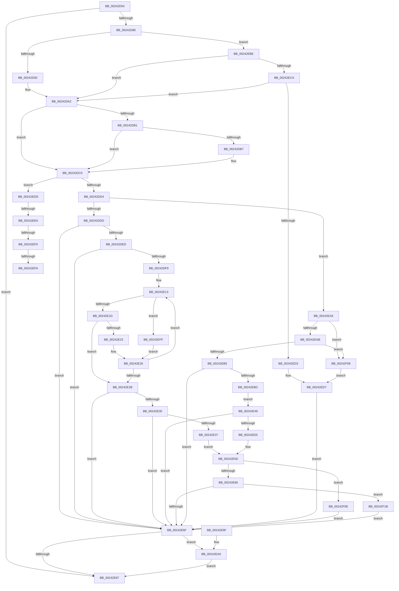

# MiDecommitHandleProtoFormatPte

- RVA: `0x00242D54`–`0x00242F28` (길이 `468` bytes)
- VA: `0x0000000140242D54`
- 실행 섹션: `.text`
- PDB 이름 있음: `예`; PDB Function 태그: `예`
- unwind 정보 RVA: `0x000619F8`
- 디코드: `123`개 명령, `468/468` bytes 표시
- 미해석 바이트: `0` (있으면 어셈블리에 `.byte`로 보존)

> 이 문서는 커널 이미지의 기계어와 PDB 기호를 분석해 생성했습니다. 4번과 5번은 함수 원형과 자료형을 바이너리 사용 방식에서 추정한 C 해석이며 원본 소스 복구 결과는 아닙니다.

## 1. Dependencies

- 직접 호출 지점: **5**; 고유 호출 대상: **5**
- 직접 호출자로 확인된 함수: **2**
- RIP 상대 이미지 참조: **1**

### Outgoing calls
- `0x00242DC7` → [MI_PROTO_FORMAT_COMBINED](../22/MI_PROTO_FORMAT_COMBINED_function_0022F720.md) (function, `0x0022F720`)
- `0x00242DF0` → [MiIsPrototypePteVadLookup](../32/MiIsPrototypePteVadLookup_function_00328B70.md) (function, `0x00328B70`)
- `0x00242E04` → [memset](../6C/memset_function_006C6C40.md) (function, `0x006C6C40`)
- `0x00242E40` → [MiDecrementCloneBlockReference](../22/MiDecrementCloneBlockReference_function_0022B9D0.md) (function, `0x0022B9D0`)
- `0x00242E4C` → [MiImageProtoChargedCommit](../42/MiImageProtoChargedCommit_function_0042F830.md) (function, `0x0042F830`)

### Direct callers
- [sub_00241E90](Unknown_function_00241E90.md) at `0x00242054`
- [MiDeleteVa](../27/MiDeleteVa_function_002789E0.md) at `0x00278C32`

### Static image references
- `0x00242DA2` → RVA `0x00E2DC80` (`.data`; read)

## 2. Other-region calls and transfers

- 다른 실행 섹션으로 향하는 call: **0**
- call이 아닌 외부 분기/꼬리 이동: **4**
  - `0x00242EE0` → [sub_006D7D5E + 0x1B](../6D/Unknown_function_006D7D5E.md) (`tail-transfer`)
  - `0x00242EEA` → [sub_006D7D5E](../6D/Unknown_function_006D7D5E.md) (`tail-transfer`)
  - `0x00242EF4` → [sub_006D7D5E](../6D/Unknown_function_006D7D5E.md) (`tail-transfer`)
  - `0x00242EFA` → [sub_006D7D5E + 0x8](../6D/Unknown_function_006D7D5E.md) (`tail-transfer`)

## 3. Assembly (complete function range)

```asm
00242D54  48 89 5C 24 10                  mov qword ptr [rsp + 0x10], rbx
00242D59  48 89 6C 24 18                  mov qword ptr [rsp + 0x18], rbp
00242D5E  56                              push rsi
00242D5F  57                              push rdi
00242D60  41 56                           push r14
00242D62  48 81 EC 90 00 00 00            sub rsp, 0x90
00242D69  44 8B 91 9C 00 00 00            mov r10d, dword ptr [rcx + 0x9c]
00242D70  4C 8B C2                        mov r8, rdx
00242D73  48 8B D9                        mov rbx, rcx
00242D76  41 F6 C2 08                     test r10b, 8
00242D7A  0F 85 07 01 00 00               jne 0x140242e87
00242D80  44 8B 49 28                     mov r9d, dword ptr [rcx + 0x28]
00242D84  BF 04 00 00 00                  mov edi, 4
00242D89  45 85 C9                        test r9d, r9d
00242D8C  0F 85 2C 01 00 00               jne 0x140242ebe
00242D92  65 48 8B 04 25 88 01 00 00      mov rax, qword ptr gs:[0x188]
00242D9B  48 8B A8 B8 00 00 00            mov rbp, qword ptr [rax + 0xb8]
00242DA2  48 8B 05 D7 AE BE 00            mov rax, qword ptr [rip + 0xbeaed7]
00242DA9  49 8B F0                        mov rsi, r8
00242DAC  48 85 C0                        test rax, rax
00242DAF  74 0F                           je 0x140242dc0
00242DB1  41 F6 C0 10                     test r8b, 0x10
00242DB5  75 09                           jne 0x140242dc0
00242DB7  48 8B F0                        mov rsi, rax
00242DBA  48 F7 D6                        not rsi
00242DBD  49 23 F0                        and rsi, r8
00242DC0  49 8B C8                        mov rcx, r8
00242DC3  48 C1 FE 10                     sar rsi, 0x10
00242DC7  E8 54 C9 FE FF                  call 0x14022f720
00242DCC  84 C0                           test al, al
00242DCE  0F 85 09 01 00 00               jne 0x140242edd
00242DD4  48 85 ED                        test rbp, rbp
00242DD7  0F 84 C8 00 00 00               je 0x140242ea5
00242DDD  48 8B BD 80 02 00 00            mov rdi, qword ptr [rbp + 0x280]
00242DE4  48 85 FF                        test rdi, rdi
00242DE7  0F 84 82 00 00 00               je 0x140242e6f
00242DED  49 8B C8                        mov rcx, r8
00242DF0  E8 7B 5D 0E 00                  call 0x140328b70
00242DF5  85 C0                           test eax, eax
00242DF7  75 76                           jne 0x140242e6f
00242DF9  33 D2                           xor edx, edx
00242DFB  44 8D 40 70                     lea r8d, [rax + 0x70]
00242DFF  48 8D 4C 24 20                  lea rcx, [rsp + 0x20]
00242E04  E8 37 3E 48 00                  call 0x1406c6c40
00242E09  48 89 74 24 38                  mov qword ptr [rsp + 0x38], rsi
00242E0E  48 89 74 24 40                  mov qword ptr [rsp + 0x40], rsi
00242E13  48 3B 77 20                     cmp rsi, qword ptr [rdi + 0x20]
00242E17  0F 87 E2 00 00 00               ja 0x140242eff
00242E1D  48 3B 77 18                     cmp rsi, qword ptr [rdi + 0x18]
00242E21  73 08                           jae 0x140242e2b
00242E23  48 8B 3F                        mov rdi, qword ptr [rdi]
00242E26  48 85 FF                        test rdi, rdi
00242E29  75 E8                           jne 0x140242e13
00242E2B  48 85 FF                        test rdi, rdi
00242E2E  74 3F                           je 0x140242e6f
00242E30  48 83 7F 30 00                  cmp qword ptr [rdi + 0x30], 0
00242E35  74 38                           je 0x140242e6f
00242E37  4C 8B C5                        mov r8, rbp
00242E3A  48 8B D6                        mov rdx, rsi
00242E3D  48 8B CF                        mov rcx, rdi
00242E40  E8 8B 8B FE FF                  call 0x14022b9d0
00242E45  8B F8                           mov edi, eax
00242E47  EB 14                           jmp 0x140242e5d
00242E49  48 8B D6                        mov rdx, rsi
00242E4C  E8 DF C9 1E 00                  call 0x14042f830
00242E51  85 C0                           test eax, eax
00242E53  74 1A                           je 0x140242e6f
00242E55  48 8B 43 18                     mov rax, qword ptr [rbx + 0x18]
00242E59  48 FF 40 18                     inc qword ptr [rax + 0x18]
00242E5D  83 FF 03                        cmp edi, 3
00242E60  0F 84 A8 00 00 00               je 0x140242f0e
00242E66  83 FF 05                        cmp edi, 5
00242E69  0F 84 AC 00 00 00               je 0x140242f1b
00242E6F  48 8B 4B 48                     mov rcx, qword ptr [rbx + 0x48]
00242E73  48 8B 83 B0 00 00 00            mov rax, qword ptr [rbx + 0xb0]
00242E7A  48 89 01                        mov qword ptr [rcx], rax
00242E7D  48 83 BB B0 00 00 00 00         cmp qword ptr [rbx + 0xb0], 0
00242E85  74 19                           je 0x140242ea0
00242E87  4C 8D 9C 24 90 00 00 00         lea r11, [rsp + 0x90]
00242E8F  49 8B 5B 28                     mov rbx, qword ptr [r11 + 0x28]
00242E93  49 8B 6B 30                     mov rbp, qword ptr [r11 + 0x30]
00242E97  49 8B E3                        mov rsp, r11
00242E9A  41 5E                           pop r14
00242E9C  5F                              pop rdi
00242E9D  5E                              pop rsi
00242E9E  C3                              ret
00242E9F  CC                              int3
00242EA0  FF 43 70                        inc dword ptr [rbx + 0x70]
00242EA3  EB E2                           jmp 0x140242e87
00242EA5  41 F6 C2 02                     test r10b, 2
00242EA9  75 5D                           jne 0x140242f08
00242EAB  48 8B 4B 30                     mov rcx, qword ptr [rbx + 0x30]
00242EAF  41 83 F9 03                     cmp r9d, 3
00242EB3  74 53                           je 0x140242f08
00242EB5  8B 41 38                        mov eax, dword ptr [rcx + 0x38]
00242EB8  A8 20                           test al, 0x20
00242EBA  74 B3                           je 0x140242e6f
00242EBC  EB 8B                           jmp 0x140242e49
00242EBE  33 ED                           xor ebp, ebp
00242EC0  41 83 F9 02                     cmp r9d, 2
00242EC4  0F 85 D8 FE FF FF               jne 0x140242da2
00242ECA  45 84 C1                        test r9b, r8b
00242ECD  0F 84 CF FE FF FF               je 0x140242da2
00242ED3  48 8B 41 18                     mov rax, qword ptr [rcx + 0x18]
00242ED7  48 FF 40 18                     inc qword ptr [rax + 0x18]
00242EDB  EB 92                           jmp 0x140242e6f
00242EDD  48 85 ED                        test rbp, rbp
00242EE0  0F 85 93 4E 49 00               jne 0x1406d7d79
00242EE6  41 83 F9 03                     cmp r9d, 3
00242EEA  0F 84 6E 4E 49 00               je 0x1406d7d5e
00242EF0  41 F6 C2 20                     test r10b, 0x20
00242EF4  0F 84 64 4E 49 00               je 0x1406d7d5e
00242EFA  E9 67 4E 49 00                  jmp 0x1406d7d66
00242EFF  48 8B 7F 08                     mov rdi, qword ptr [rdi + 8]
00242F03  E9 1E FF FF FF                  jmp 0x140242e26
00242F08  48 8B 43 18                     mov rax, qword ptr [rbx + 0x18]
00242F0C  EB C9                           jmp 0x140242ed7
00242F0E  48 8B 43 18                     mov rax, qword ptr [rbx + 0x18]
00242F12  48 FF 40 08                     inc qword ptr [rax + 8]
00242F16  E9 54 FF FF FF                  jmp 0x140242e6f
00242F1B  48 8B 43 18                     mov rax, qword ptr [rbx + 0x18]
00242F1F  48 FF 40 10                     inc qword ptr [rax + 0x10]
00242F23  E9 47 FF FF FF                  jmp 0x140242e6f
```

## 4. C-style interpretation (structured pseudocode)

```c
__int64 __fastcall MiDecommitHandleProtoFormatPte(__int64 a1, __int64 a2)
{
    __int64 result;
    __int64 v_rbp;
    __int64 v_rsi;
    __int64 v_rsp;
    unsigned __int64 v_stack_m18;
    unsigned __int64 v_stack_m68;
    unsigned __int64 v_stack_m70;
    unsigned __int64 v_stack_m88;
    unsigned __int64 v_stack_p10;
    unsigned __int64 v_stack_p18;

    v_stack_p10 = v_rbx;
    v_stack_p18 = v_rbp;
    v_rsp = (v_rsp) - (144);
    if ((((unsigned __int8)((unsigned int)(*(unsigned int *)(a1 + 156)))) & (8)) != 0) goto loc_00242E87;
    if ((unsigned int)((unsigned int)(*(unsigned int *)(a1 + 40))) != 0) goto loc_00242EBE;
loc_00242DA2:
    if (*(unsigned __int64 *)(v_rip + 12496599) == 0) goto loc_00242DC0;
    v_rsi = a2;
    if ((((unsigned __int8)(a2)) & (16)) == 0) {
        v_rsi = *(unsigned __int64 *)(v_rip + 12496599);
        v_rsi = ~(v_rsi);
        v_rsi = (v_rsi) & (a2);
    }
    v_rsi = (v_rsi) >> (16);
    result = MI_PROTO_FORMAT_COMBINED(a2, a2, a2, (unsigned int)(*(unsigned int *)(a1 + 40)));
    if ((unsigned __int8)(result) != 0) goto loc_00242EDD;
    if (*(unsigned __int64 *)(*(unsigned __int64 *)(gs_base + (0 + 392)) + 184) == 0) goto loc_00242EA5;
    if (*(unsigned __int64 *)(*(unsigned __int64 *)(*(unsigned __int64 *)(gs_base + (0 + 392)) + 184) + 640) == 0) goto loc_00242E6F;
    result = MiIsPrototypePteVadLookup(a2, a2, a2, (unsigned int)(*(unsigned int *)(a1 + 40)));
    if ((unsigned int)(result) != 0) goto loc_00242E6F;
    a2 = 0;
    result = memset(v_stack_m88, a2, result + 112, (unsigned int)(*(unsigned int *)(a1 + 40)));
    v_stack_m70 = v_rsi;
    v_stack_m68 = v_rsi;
loc_00242E13:
    if (v_rsi > (*(unsigned __int64 *)(*(unsigned __int64 *)(*(unsigned __int64 *)(*(unsigned __int64 *)(gs_base + (0 + 392)) + 184) + 640) + 32))) goto loc_00242EFF;
    if (v_rsi >= (*(unsigned __int64 *)(*(unsigned __int64 *)(*(unsigned __int64 *)(*(unsigned __int64 *)(gs_base + (0 + 392)) + 184) + 640) + 24))) goto loc_00242E2B;
loc_00242E26:
    if (*(unsigned __int64 *)(*(unsigned __int64 *)(*(unsigned __int64 *)(*(unsigned __int64 *)(gs_base + (0 + 392)) + 184) + 640)) != 0) goto loc_00242E13;
loc_00242E2B:
    if (*(unsigned __int64 *)(*(unsigned __int64 *)(*(unsigned __int64 *)(*(unsigned __int64 *)(gs_base + (0 + 392)) + 184) + 640)) == 0) goto loc_00242E6F;
    if ((*(unsigned __int64 *)(*(unsigned __int64 *)(*(unsigned __int64 *)(*(unsigned __int64 *)(*(unsigned __int64 *)(gs_base + (0 + 392)) + 184) + 640)) + 48)) == 0) goto loc_00242E6F;
    result = MiDecrementCloneBlockReference(*(unsigned __int64 *)(*(unsigned __int64 *)(*(unsigned __int64 *)(*(unsigned __int64 *)(gs_base + (0 + 392)) + 184) + 640)), v_rsi, *(unsigned __int64 *)(*(unsigned __int64 *)(gs_base + (0 + 392)) + 184), (unsigned int)(*(unsigned int *)(a1 + 40)));
    goto loc_00242E5D;
loc_00242E49:
    result = MiImageProtoChargedCommit(*(unsigned __int64 *)(*(unsigned __int64 *)(*(unsigned __int64 *)(*(unsigned __int64 *)(gs_base + (0 + 392)) + 184) + 640)), v_rsi, *(unsigned __int64 *)(*(unsigned __int64 *)(gs_base + (0 + 392)) + 184), (unsigned int)(*(unsigned int *)(a1 + 40)));
    if ((unsigned int)(result) == 0) goto loc_00242E6F;
loc_00242E5D:
    if (((unsigned int)((unsigned int)((unsigned int)(result)))) == 3) goto loc_00242F0E;
    if (((unsigned int)((unsigned int)((unsigned int)(result)))) == 5) goto loc_00242F1B;
loc_00242E6F:
    *(unsigned __int64 *)(*(unsigned __int64 *)(a1 + 72)) = *(unsigned __int64 *)(a1 + 176);
    if ((*(unsigned __int64 *)(a1 + 176)) == 0) goto loc_00242EA0;
loc_00242E87:
    return *(unsigned __int64 *)(a1 + 176);
loc_00242EA0:
    goto loc_00242E87;
loc_00242EA5:
    if ((((unsigned __int8)((unsigned int)(*(unsigned int *)(a1 + 156)))) & (2)) != 0) goto loc_00242F08;
    if (((unsigned int)((unsigned int)(*(unsigned int *)(a1 + 40)))) == 3) goto loc_00242F08;
    if ((((unsigned __int8)((unsigned int)(*(unsigned int *)(*(unsigned __int64 *)(*(unsigned __int64 *)(v_stack_m18 + 40) + 48) + 56)))) & (32)) == 0) goto loc_00242E6F;
    goto loc_00242E49;
loc_00242EBE:
    v_rbp = 0;
    if (((unsigned int)((unsigned int)(*(unsigned int *)(a1 + 40)))) != 2) goto loc_00242DA2;
    if ((((unsigned __int8)((unsigned int)(*(unsigned int *)(a1 + 40)))) & ((unsigned __int8)(*(unsigned __int64 *)(*(unsigned __int64 *)(gs_base + (0 + 392)) + 184)))) == 0) goto loc_00242DA2;
loc_00242ED7:
    goto loc_00242E6F;
loc_00242EDD:
loc_00242EFF:
    goto loc_00242E26;
loc_00242F08:
    goto loc_00242ED7;
loc_00242F0E:
    goto loc_00242E6F;
loc_00242F1B:
    goto loc_00242E6F;
}
```

## 5. (Beta) C Style

```c
int64_t MiDecommitHandleProtoFormatPte(void *Arg1, int64_t Arg2)
{
    uint8_t *arg1 = (uint8_t *)Arg1;

    int64_t result;
    int64_t local_rbp;
    int64_t local_rsi;
    int64_t local_rsp;
    uint64_t v_stack_m18;
    uint64_t v_stack_m68;
    uint64_t v_stack_m70;
    uint64_t v_stack_m88;
    uint64_t v_stack_p10;
    uint64_t v_stack_p18;

    v_stack_p10 = local_rbx;
    v_stack_p18 = local_rbp;
    local_rsp = (local_rsp) - (144);
    if ((((uint8_t)((uint32_t)(*(uint32_t *)(arg1 + 0x9C)))) & (8)) != 0) goto loc_00242E87;
    if ((uint32_t)((uint32_t)(*(uint32_t *)(arg1 + 0x28))) != 0) goto loc_00242EBE;
loc_00242DA2:
    if (*(uint64_t *)(v_rip + 0xBEAED7) == 0) goto loc_00242DC0;
    local_rsi = Arg2;
    if ((((uint8_t)(Arg2)) & (16)) == 0) {
        local_rsi = *(uint64_t *)(v_rip + 0xBEAED7);
        local_rsi = ~(local_rsi);
        local_rsi = (local_rsi) & (Arg2);
    }
    local_rsi = (local_rsi) >> (16);
    result = MI_PROTO_FORMAT_COMBINED(Arg2, Arg2, Arg2, (uint32_t)(*(uint32_t *)(arg1 + 0x28)));
    if ((uint8_t)(result) != 0) goto loc_00242EDD;
    if (*(uint64_t *)(*(uint64_t *)(gs_base + (0 + 0x188)) + 0xB8) == 0) goto loc_00242EA5;
    if (*(uint64_t *)(*(uint64_t *)(*(uint64_t *)(gs_base + (0 + 0x188)) + 0xB8) + 0x280) == 0) goto loc_00242E6F;
    result = MiIsPrototypePteVadLookup(Arg2, Arg2, Arg2, (uint32_t)(*(uint32_t *)(arg1 + 0x28)));
    if ((uint32_t)(result) != 0) goto loc_00242E6F;
    Arg2 = 0;
    result = memset(v_stack_m88, Arg2, result + 112, (uint32_t)(*(uint32_t *)(arg1 + 0x28)));
    v_stack_m70 = local_rsi;
    v_stack_m68 = local_rsi;
loc_00242E13:
    if (local_rsi > (*(uint64_t *)(*(uint64_t *)(*(uint64_t *)(*(uint64_t *)(gs_base + (0 + 0x188)) + 0xB8) + 0x280) + 0x20))) goto loc_00242EFF;
    if (local_rsi >= (*(uint64_t *)(*(uint64_t *)(*(uint64_t *)(*(uint64_t *)(gs_base + (0 + 0x188)) + 0xB8) + 0x280) + 0x18))) goto loc_00242E2B;
loc_00242E26:
    if (*(uint64_t *)(*(uint64_t *)(*(uint64_t *)(*(uint64_t *)(gs_base + (0 + 0x188)) + 0xB8) + 0x280)) != 0) goto loc_00242E13;
loc_00242E2B:
    if (*(uint64_t *)(*(uint64_t *)(*(uint64_t *)(*(uint64_t *)(gs_base + (0 + 0x188)) + 0xB8) + 0x280)) == 0) goto loc_00242E6F;
    if ((*(uint64_t *)(*(uint64_t *)(*(uint64_t *)(*(uint64_t *)(*(uint64_t *)(gs_base + (0 + 0x188)) + 0xB8) + 0x280)) + 0x30)) == 0) goto loc_00242E6F;
    result = MiDecrementCloneBlockReference(*(uint64_t *)(*(uint64_t *)(*(uint64_t *)(*(uint64_t *)(gs_base + (0 + 0x188)) + 0xB8) + 0x280)), local_rsi, *(uint64_t *)(*(uint64_t *)(gs_base + (0 + 0x188)) + 0xB8), (uint32_t)(*(uint32_t *)(arg1 + 0x28)));
    goto loc_00242E5D;
loc_00242E49:
    result = MiImageProtoChargedCommit(*(uint64_t *)(*(uint64_t *)(*(uint64_t *)(*(uint64_t *)(gs_base + (0 + 0x188)) + 0xB8) + 0x280)), local_rsi, *(uint64_t *)(*(uint64_t *)(gs_base + (0 + 0x188)) + 0xB8), (uint32_t)(*(uint32_t *)(arg1 + 0x28)));
    if ((uint32_t)(result) == 0) goto loc_00242E6F;
loc_00242E5D:
    if (((uint32_t)((uint32_t)((uint32_t)(result)))) == 3) goto loc_00242F0E;
    if (((uint32_t)((uint32_t)((uint32_t)(result)))) == 5) goto loc_00242F1B;
loc_00242E6F:
    *(uint64_t *)(*(uint64_t *)(arg1 + 0x48)) = *(uint64_t *)(arg1 + 0xB0);
    if ((*(uint64_t *)(arg1 + 0xB0)) == 0) goto loc_00242EA0;
loc_00242E87:
    return *(uint64_t *)(arg1 + 0xB0);
loc_00242EA0:
    goto loc_00242E87;
loc_00242EA5:
    if ((((uint8_t)((uint32_t)(*(uint32_t *)(arg1 + 0x9C)))) & (2)) != 0) goto loc_00242F08;
    if (((uint32_t)((uint32_t)(*(uint32_t *)(arg1 + 0x28)))) == 3) goto loc_00242F08;
    if ((((uint8_t)((uint32_t)(*(uint32_t *)(*(uint64_t *)(*(uint64_t *)(v_stack_m18 + 0x28) + 0x30) + 0x38)))) & (32)) == 0) goto loc_00242E6F;
    goto loc_00242E49;
loc_00242EBE:
    local_rbp = 0;
    if (((uint32_t)((uint32_t)(*(uint32_t *)(arg1 + 0x28)))) != 2) goto loc_00242DA2;
    if ((((uint8_t)((uint32_t)(*(uint32_t *)(arg1 + 0x28)))) & ((uint8_t)(*(uint64_t *)(*(uint64_t *)(gs_base + (0 + 0x188)) + 0xB8)))) == 0) goto loc_00242DA2;
loc_00242ED7:
    goto loc_00242E6F;
loc_00242EDD:
loc_00242EFF:
    goto loc_00242E26;
loc_00242F08:
    goto loc_00242ED7;
loc_00242F0E:
    goto loc_00242E6F;
loc_00242F1B:
    goto loc_00242E6F;
}
```

### 관측된 메모리 오프셋

구조체 형식이 확인되지 않은 접근은 인자 기준의 오프셋으로만 기록했습니다.

| 기준 인자 | 오프셋 표현 | 폭 (bit) | 접근 |
|---|---:|---:|---|
| `Arg1` | `+ 0x18` | `64` | `R` |
| `Arg1` | `+ 0x28` | `32` | `R` |
| `Arg1` | `+ 0x30` | `64` | `R` |
| `Arg1` | `+ 0x48` | `64` | `R` |
| `Arg1` | `+ 0x70` | `32` | `R/W` |
| `Arg1` | `+ 0x9C` | `32` | `R` |
| `Arg1` | `+ 0xB0` | `64` | `R` |

## 6. Execution-region graph

[열기: 2D/3D 그래프와 함수 탐색 컨트롤 패널](../../../control-panel.html?section=text&rva=0x00242D54&view=graph)

- 2D 그래프는 위에서 아래로 흐르고, 3D 그래프는 빈 공간을 드래그해 회전합니다. Shift+드래그는 이동, 휠은 확대·축소, 함수 노드 선택은 대상 보고서 이동입니다.

### Static fallback


