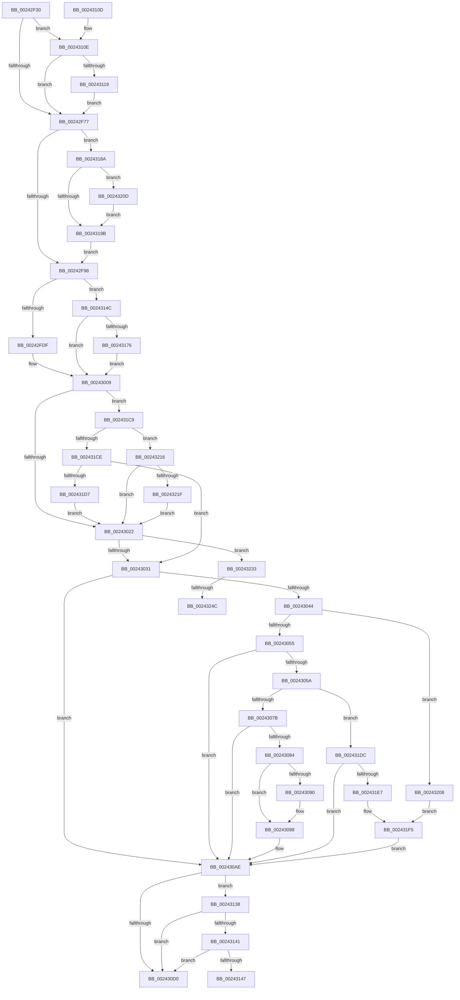

# MiDecommitInitializePacket

- RVA: `0x00242F30`–`0x0024325B` (길이 `811` bytes)
- VA: `0x0000000140242F30`
- 실행 섹션: `.text`
- PDB 이름 있음: `예`; PDB Function 태그: `예`
- unwind 정보 RVA: `0x00061A24`
- 디코드: `186`개 명령, `811/811` bytes 표시
- 미해석 바이트: `0` (있으면 어셈블리에 `.byte`로 보존)

> 이 문서는 커널 이미지의 기계어와 PDB 기호를 분석해 생성했습니다. 4번과 5번은 함수 원형과 자료형을 바이너리 사용 방식에서 추정한 C 해석이며 원본 소스 복구 결과는 아닙니다.

## 1. Dependencies

- 직접 호출 지점: **8**; 고유 호출 대상: **6**
- 직접 호출자로 확인된 함수: **4**
- RIP 상대 이미지 참조: **3**

### Outgoing calls
- `0x00242FE2` → [MiVaToFlushVm](../31/MiVaToFlushVm_function_0031AD84.md) (function, `0x0031AD84`)
- `0x002430A3` → [MiVadPureReserve](../2C/MiVadPureReserve_function_002C34C0.md) (function, `0x002C34C0`)
- `0x002430DF` → [MiDecommitComputeCheckPte](../41/MiDecommitComputeCheckPte_function_00417330.md) (function, `0x00417330`)
- `0x002430F0` → [_security_check_cookie](../6A/_security_check_cookie_function_006AC640.md) (function, `0x006AC640`)
- `0x00243129` → [MiIsStoreProcess](../2B/MiIsStoreProcess_function_002B62E0.md) (function, `0x002B62E0`)
- `0x00243179` → [MiMakeDemandZeroPte](../33/MiMakeDemandZeroPte_function_00337A00.md) (function, `0x00337A00`)
- `0x002431F0` → [MiMakeDemandZeroPte](../33/MiMakeDemandZeroPte_function_00337A00.md) (function, `0x00337A00`)
- `0x00243222` → [MiMakeDemandZeroPte](../33/MiMakeDemandZeroPte_function_00337A00.md) (function, `0x00337A00`)

### Direct callers
- [MiDecommitPages](MiDecommitPages_function_00241BD0.md) at `0x00241C42`
- [MiDeleteEmptyPageTables](../2A/MiDeleteEmptyPageTables_function_002A5220.md) at `0x002A53F9`
- [MiDeletePagablePteRange](../2A/MiDeletePagablePteRange_function_002A96B4.md) at `0x002A97B0`
- [MiStoreDiscardPoisonedPage](../69/MiStoreDiscardPoisonedPage_function_00692858.md) at `0x00692AD4`

### Static image references
- `0x00242F44` → RVA `0x00E0A740` (`.data`; read)
- `0x00242FF0` → RVA `0x00E30088` (`.data`; read)
- `0x00243022` → RVA `0x00FC6B04` (`ALMOSTRO`; read)

## 2. Other-region calls and transfers

- 다른 실행 섹션으로 향하는 call: **0**
- call이 아닌 외부 분기/꼬리 이동: **3**
  - `0x00243147` → [sub_006D7DB2 + 0x4D](../6D/Unknown_function_006D7DB2.md) (`tail-transfer`)
  - `0x00243246` → [sub_006D7DB2](../6D/Unknown_function_006D7DB2.md) (`tail-transfer`)
  - `0x00243256` → [sub_006D7DB2 + 0xA](../6D/Unknown_function_006D7DB2.md) (`tail-transfer`)

## 3. Assembly (complete function range)

```asm
00242F30  48 89 5C 24 18                  mov qword ptr [rsp + 0x18], rbx
00242F35  55                              push rbp
00242F36  56                              push rsi
00242F37  57                              push rdi
00242F38  41 54                           push r12
00242F3A  41 55                           push r13
00242F3C  41 56                           push r14
00242F3E  41 57                           push r15
00242F40  48 83 EC 70                     sub rsp, 0x70
00242F44  48 8B 05 F5 77 BC 00            mov rax, qword ptr [rip + 0xbc77f5]
00242F4B  48 33 C4                        xor rax, rsp
00242F4E  48 89 44 24 68                  mov qword ptr [rsp + 0x68], rax
00242F53  48 8B AC 24 D0 00 00 00         mov rbp, qword ptr [rsp + 0xd0]
00242F5B  4D 8B E8                        mov r13, r8
00242F5E  44 8B BC 24 E0 00 00 00         mov r15d, dword ptr [rsp + 0xe0]
00242F66  48 8B D9                        mov rbx, rcx
00242F69  48 89 54 24 38                  mov qword ptr [rsp + 0x38], rdx
00242F6E  48 85 ED                        test rbp, rbp
00242F71  0F 85 97 01 00 00               jne 0x14024310e
00242F77  48 8B BC 24 D8 00 00 00         mov rdi, qword ptr [rsp + 0xd8]
00242F7F  41 BA 01 00 00 00               mov r10d, 1
00242F85  49 B8 00 00 00 00 80 F6 FF FF   movabs r8, 0xfffff68000000000
00242F8F  48 85 FF                        test rdi, rdi
00242F92  0F 85 F2 01 00 00               jne 0x14024318a
00242F98  48 8B 84 24 F0 00 00 00         mov rax, qword ptr [rsp + 0xf0]
00242FA0  48 8B F2                        mov rsi, rdx
00242FA3  48 89 43 18                     mov qword ptr [rbx + 0x18], rax
00242FA7  48 C1 E6 19                     shl rsi, 0x19
00242FAB  4C 89 4B 30                     mov qword ptr [rbx + 0x30], r9
00242FAF  49 8B C0                        mov rax, r8
00242FB2  48 C1 E0 19                     shl rax, 0x19
00242FB6  45 8B F7                        mov r14d, r15d
00242FB9  48 2B F0                        sub rsi, rax
00242FBC  41 83 E6 20                     and r14d, 0x20
00242FC0  49 8D 45 FF                     lea rax, [r13 - 1]
00242FC4  48 C1 FE 10                     sar rsi, 0x10
00242FC8  48 8D 04 C2                     lea rax, [rdx + rax*8]
00242FCC  41 BC 10 00 00 00               mov r12d, 0x10
00242FD2  48 89 43 50                     mov qword ptr [rbx + 0x50], rax
00242FD6  48 85 ED                        test rbp, rbp
00242FD9  0F 85 6D 01 00 00               jne 0x14024314c
00242FDF  48 8B CE                        mov rcx, rsi
00242FE2  E8 9D 7D 0D 00                  call 0x14031ad84
00242FE7  48 89 43 20                     mov qword ptr [rbx + 0x20], rax
00242FEB  45 8D 54 24 F1                  lea r10d, [r12 - 0xf]
00242FF0  48 8B 0D 91 D0 BE 00            mov rcx, qword ptr [rip + 0xbed091]
00242FF7  4C 8B C0                        mov r8, rax
00242FFA  0F B7 90 AE 00 00 00            movzx edx, word ptr [rax + 0xae]
00243001  48 8B 14 D1                     mov rdx, qword ptr [rcx + rdx*8]
00243005  48 89 53 08                     mov qword ptr [rbx + 8], rdx
00243009  41 8B 80 B8 00 00 00            mov eax, dword ptr [r8 + 0xb8]
00243010  0F B6 D0                        movzx edx, al
00243013  83 E2 0F                        and edx, 0xf
00243016  89 53 28                        mov dword ptr [rbx + 0x28], edx
00243019  83 FA 02                        cmp edx, 2
0024301C  0F 85 A7 01 00 00               jne 0x1402431c9
00243022  8B 05 DC 3A D8 00               mov eax, dword ptr [rip + 0xd83adc]
00243028  41 84 C2                        test r10b, al
0024302B  0F 85 02 02 00 00               jne 0x140243233
00243031  48 8B 83 A8 00 00 00            mov rax, qword ptr [rbx + 0xa8]
00243038  48 89 83 B0 00 00 00            mov qword ptr [rbx + 0xb0], rax
0024303F  48 85 ED                        test rbp, rbp
00243042  74 6A                           je 0x1402430ae
00243044  48 8B 84 24 E8 00 00 00         mov rax, qword ptr [rsp + 0xe8]
0024304C  48 85 C0                        test rax, rax
0024304F  0F 85 B3 01 00 00               jne 0x140243208
00243055  48 85 FF                        test rdi, rdi
00243058  74 54                           je 0x1402430ae
0024305A  8B 4F 34                        mov ecx, dword ptr [rdi + 0x34]
0024305D  48 B8 FE FF FF FF 07 00 00 00   movabs rax, 0x7fffffffe
00243067  0F B6 57 22                     movzx edx, byte ptr [rdi + 0x22]
0024306B  48 C1 E2 20                     shl rdx, 0x20
0024306F  48 0B D1                        or rdx, rcx
00243072  48 3B D0                        cmp rdx, rax
00243075  0F 84 61 01 00 00               je 0x1402431dc
0024307B  8B 47 30                        mov eax, dword ptr [rdi + 0x30]
0024307E  0F BA E0 19                     bt eax, 0x19
00243082  72 2A                           jb 0x1402430ae
00243084  25 00 00 20 0C                  and eax, 0xc200000
00243089  3D 00 00 20 08                  cmp eax, 0x8200000
0024308E  74 08                           je 0x140243098
00243090  48 83 A3 B0 00 00 00 00         and qword ptr [rbx + 0xb0], 0
00243098  48 83 A3 B8 00 00 00 00         and qword ptr [rbx + 0xb8], 0
002430A0  48 8B CF                        mov rcx, rdi
002430A3  E8 18 04 08 00                  call 0x1402c34c0
002430A8  89 83 98 00 00 00               mov dword ptr [rbx + 0x98], eax
002430AE  C7 83 CC 00 00 00 03 00 00 00   mov dword ptr [rbx + 0xcc], 3
002430B8  BA 01 00 00 00                  mov edx, 1
002430BD  48 89 93 90 00 00 00            mov qword ptr [rbx + 0x90], rdx
002430C4  48 89 93 C0 00 00 00            mov qword ptr [rbx + 0xc0], rdx
002430CB  48 85 FF                        test rdi, rdi
002430CE  75 68                           jne 0x140243138
002430D0  48 8B 54 24 38                  mov rdx, qword ptr [rsp + 0x38]
002430D5  48 8B CB                        mov rcx, rbx
002430D8  44 89 BB 9C 00 00 00            mov dword ptr [rbx + 0x9c], r15d
002430DF  E8 4C 42 1D 00                  call 0x140417330
002430E4  C6 43 2C 11                     mov byte ptr [rbx + 0x2c], 0x11
002430E8  48 8B 4C 24 68                  mov rcx, qword ptr [rsp + 0x68]
002430ED  48 33 CC                        xor rcx, rsp
002430F0  E8 4B 95 46 00                  call 0x1406ac640
002430F5  48 8B 9C 24 C0 00 00 00         mov rbx, qword ptr [rsp + 0xc0]
002430FD  48 83 C4 70                     add rsp, 0x70
00243101  41 5F                           pop r15
00243103  41 5E                           pop r14
00243105  41 5D                           pop r13
00243107  41 5C                           pop r12
00243109  5F                              pop rdi
0024310A  5E                              pop rsi
0024310B  5D                              pop rbp
0024310C  C3                              ret
0024310D  CC                              int3
0024310E  41 0F BA E7 05                  bt r15d, 5
00243113  0F 82 5E FE FF FF               jb 0x140242f77
00243119  65 48 8B 0C 25 88 01 00 00      mov rcx, qword ptr gs:[0x188]
00243122  48 8B 89 B8 00 00 00            mov rcx, qword ptr [rcx + 0xb8]
00243129  E8 B2 31 07 00                  call 0x1402b62e0
0024312E  48 8B 54 24 38                  mov rdx, qword ptr [rsp + 0x38]
00243133  E9 3F FE FF FF                  jmp 0x140242f77
00243138  8B 47 30                        mov eax, dword ptr [rdi + 0x30]
0024313B  0F BA E0 15                     bt eax, 0x15
0024313F  73 8F                           jae 0x1402430d0
00243141  0F BA E0 17                     bt eax, 0x17
00243145  73 89                           jae 0x1402430d0
00243147  E9 B3 4C 49 00                  jmp 0x1406d7dff
0024314C  4C 8D 85 00 04 00 00            lea r8, [rbp + 0x400]
00243153  4C 89 43 20                     mov qword ptr [rbx + 0x20], r8
00243157  0F B7 8D AE 04 00 00            movzx ecx, word ptr [rbp + 0x4ae]
0024315E  48 8B 05 23 CF BE 00            mov rax, qword ptr [rip + 0xbecf23]
00243165  48 8B 0C C8                     mov rcx, qword ptr [rax + rcx*8]
00243169  48 89 4B 08                     mov qword ptr [rbx + 8], rcx
0024316D  45 85 F6                        test r14d, r14d
00243170  0F 85 93 FE FF FF               jne 0x140243009
00243176  41 8B CC                        mov ecx, r12d
00243179  E8 82 48 0F 00                  call 0x140337a00
0024317E  48 89 83 A8 00 00 00            mov qword ptr [rbx + 0xa8], rax
00243185  E9 7F FE FF FF                  jmp 0x140243009
0024318A  B9 00 00 20 04                  mov ecx, 0x4200000
0024318F  48 89 3B                        mov qword ptr [rbx], rdi
00243192  8B 47 30                        mov eax, dword ptr [rdi + 0x30]
00243195  23 C1                           and eax, ecx
00243197  3B C1                           cmp eax, ecx
00243199  74 72                           je 0x14024320d
0024319B  8B 47 1C                        mov eax, dword ptr [rdi + 0x1c]
0024319E  0F B6 4F 21                     movzx ecx, byte ptr [rdi + 0x21]
002431A2  48 C1 E1 20                     shl rcx, 0x20
002431A6  48 0B C8                        or rcx, rax
002431A9  48 B8 FF FF FF FF 0F 00 00 00   movabs rax, 0xfffffffff
002431B3  48 23 C8                        and rcx, rax
002431B6  49 8B C0                        mov rax, r8
002431B9  48 8D 0C C8                     lea rcx, [rax + rcx*8]
002431BD  48 89 8B B8 00 00 00            mov qword ptr [rbx + 0xb8], rcx
002431C4  E9 CF FD FF FF                  jmp 0x140242f98
002431C9  83 FA 03                        cmp edx, 3
002431CC  74 48                           je 0x140243216
002431CE  83 FA 04                        cmp edx, 4
002431D1  0F 85 5A FE FF FF               jne 0x140243031
002431D7  E9 46 FE FF FF                  jmp 0x140243022
002431DC  41 0F BA E7 05                  bt r15d, 5
002431E1  0F 82 C7 FE FF FF               jb 0x1402430ae
002431E7  8B 4F 30                        mov ecx, dword ptr [rdi + 0x30]
002431EA  C1 E9 07                        shr ecx, 7
002431ED  83 E1 1F                        and ecx, 0x1f
002431F0  E8 0B 48 0F 00                  call 0x140337a00
002431F5  48 89 83 A8 00 00 00            mov qword ptr [rbx + 0xa8], rax
002431FC  48 89 83 B0 00 00 00            mov qword ptr [rbx + 0xb0], rax
00243203  E9 A6 FE FF FF                  jmp 0x1402430ae
00243208  48 8B 00                        mov rax, qword ptr [rax]
0024320B  EB E8                           jmp 0x1402431f5
0024320D  44 89 93 88 00 00 00            mov dword ptr [rbx + 0x88], r10d
00243214  EB 85                           jmp 0x14024319b
00243216  45 85 F6                        test r14d, r14d
00243219  0F 85 03 FE FF FF               jne 0x140243022
0024321F  41 8B CC                        mov ecx, r12d
00243222  E8 D9 47 0F 00                  call 0x140337a00
00243227  48 89 83 A8 00 00 00            mov qword ptr [rbx + 0xa8], rax
0024322E  E9 EF FD FF FF                  jmp 0x140243022
00243233  41 8B C5                        mov eax, r13d
00243236  48 89 44 24 50                  mov qword ptr [rsp + 0x50], rax
0024323B  8D 42 FD                        lea eax, [rdx - 3]
0024323E  48 89 74 24 48                  mov qword ptr [rsp + 0x48], rsi
00243243  41 3B C2                        cmp eax, r10d
00243246  0F 86 66 4B 49 00               jbe 0x1406d7db2
0024324C  33 C0                           xor eax, eax
0024324E  48 83 E0 F4                     and rax, 0xfffffffffffffff4
00243252  48 83 C8 04                     or rax, 4
00243256  E9 61 4B 49 00                  jmp 0x1406d7dbc
```

## 4. C-style interpretation (structured pseudocode)

```c
__int64 __fastcall MiDecommitInitializePacket(__int64 a1, __int64 a2, __int64 a3, __int64 a4, __int64 a5, __int64 a6, unsigned int a7, __int64 a8, __int64 a9)
{
    __int64 result;
    __int64 v_r14;
    __int64 v_rsi;
    __int64 v_rsp;
    unsigned __int64 v_stack_m40;
    unsigned __int64 v_stack_m70;
    unsigned __int64 v_stack_p18;
    unsigned __int64 v_stack_p38;
    unsigned __int64 v_stack_p48;
    unsigned __int64 v_stack_p50;

    v_stack_p18 = v_rbx;
    v_rsp = (v_rsp) - (112);
    result = (*(unsigned __int64 *)(v_rip + 12351477)) ^ (v_rsp);
    v_stack_m40 = result;
    v_stack_m70 = a2;
    if (a5 != 0) goto loc_0024310E;
loc_00242F77:
    if (a6 != 0) goto loc_0024318A;
loc_00242F98:
    *(unsigned __int64 *)(a1 + 24) = a9;
    v_rsi = (a2) << (25);
    *(unsigned __int64 *)(a1 + 48) = a4;
    result = (a3) << (25);
    v_rsi = (v_rsi) - (result);
    v_r14 = (unsigned int)(((unsigned int)((unsigned int)((unsigned int)(a7)))) & (32));
    v_rsi = (v_rsi) >> (16);
    *(unsigned __int64 *)(a1 + 80) = a2 + a3 - 1 * 8;
    if (a5 != 0) goto loc_0024314C;
    result = MiVaToFlushVm(v_rsi, a2, a3, a4);
    *(unsigned __int64 *)(a1 + 32) = result;
    *(unsigned __int64 *)(a1 + 8) = *(unsigned __int64 *)(*(unsigned __int64 *)(v_rip + 12505233) + *(unsigned __int16 *)(result + 174) * 8);
loc_00243009:
    a2 = (unsigned int)(((unsigned __int8)((unsigned int)(*(unsigned int *)(result + 184)))) & (15));
    *(unsigned int *)(a1 + 40) = (unsigned int)(a2);
    if (((unsigned int)(a2)) != 2) goto loc_002431C9;
loc_00243022:
    if ((((unsigned __int8)(16 - 15)) & ((unsigned __int8)((unsigned int)(*(unsigned int *)(v_rip + 14170844))))) != 0) goto loc_00243233;
loc_00243031:
    *(unsigned __int64 *)(a1 + 176) = *(unsigned __int64 *)(a1 + 168);
    if (a5 == 0) goto loc_002430AE;
    if (a8 != 0) goto loc_00243208;
    if (a6 == 0) goto loc_002430AE;
    a2 = (*(unsigned __int8 *)(a6 + 34)) << (32);
    a2 = (a2) | ((unsigned int)(*(unsigned int *)(a6 + 52)));
    if (a2 == a8) goto loc_002431DC;
    if (a2 < a8) goto loc_002430AE;
    result = (unsigned int)(((unsigned int)(*(unsigned int *)(a6 + 48))) & (0xC200000ULL));
    if (((unsigned int)(result)) != 0x8200000ULL) {
    }
    result = MiVadPureReserve(a6, a2, result, a4);
    *(unsigned int *)(a1 + 152) = (unsigned int)(result);
loc_002430AE:
    *(unsigned int *)(a1 + 204) = 3;
    *(unsigned __int64 *)(a1 + 144) = 1;
    *(unsigned __int64 *)(a1 + 192) = 1;
    if (a6 != 0) goto loc_00243138;
loc_002430D0:
    *(unsigned int *)(a1 + 156) = (unsigned int)((unsigned int)(a7));
    result = MiDecommitComputeCheckPte(a1, v_stack_m70, result, a4);
    *(unsigned __int8 *)(a1 + 44) = 17;
    a1 = (v_stack_m40) ^ (v_rsp);
    result = _security_check_cookie(a1, v_stack_m70, result, a4);
    v_rsp = (v_rsp) + (112);
    return result;
loc_0024310E:
    if (condition_is_below) goto loc_00242F77;
    result = MiIsStoreProcess(*(unsigned __int64 *)(*(unsigned __int64 *)(gs_base + (0 + 392)) + 184), v_stack_m70, result, a4);
    goto loc_00242F77;
loc_00243138:
    if (condition_is_above_or_equal) goto loc_002430D0;
    if (condition_is_above_or_equal) goto loc_002430D0;
loc_0024314C:
    *(unsigned __int64 *)(v_stack_p18 + 32) = a5 + 1024;
    *(unsigned __int64 *)(v_stack_p18 + 8) = *(unsigned __int64 *)(*(unsigned __int64 *)(v_rip + 12504867) + *(unsigned __int16 *)(a5 + 1198) * 8);
    if ((unsigned int)(v_r14) != 0) goto loc_00243009;
    result = MiMakeDemandZeroPte(16, v_stack_p38, a5 + 1024, a4);
    *(unsigned __int64 *)(v_stack_p18 + 168) = result;
    goto loc_00243009;
loc_0024318A:
    *(unsigned __int64 *)(v_stack_p18) = a6;
    result = (unsigned int)(((unsigned int)(*(unsigned int *)(a6 + 48))) & ((unsigned int)((unsigned int)(0x4200000ULL))));
    if (((unsigned int)(result)) == ((unsigned int)((unsigned int)(0x4200000ULL)))) goto loc_0024320D;
loc_0024319B:
    a1 = (*(unsigned __int8 *)(a6 + 33)) << (32);
    a1 = (a1) | ((unsigned int)(*(unsigned int *)(a6 + 28)));
    a1 = (a1) & ((unsigned int)(*(unsigned int *)(a6 + 28)));
    *(unsigned __int64 *)(v_stack_p18 + 184) = a5 + 1024 + a1 * 8;
    goto loc_00242F98;
loc_002431C9:
    if (((unsigned int)(v_stack_p38)) == 3) goto loc_00243216;
    if (((unsigned int)(v_stack_p38)) != 4) goto loc_00243031;
    goto loc_00243022;
loc_002431DC:
    if (((unsigned int)(v_stack_p38)) < 4) goto loc_002430AE;
    a1 = (unsigned int)(((unsigned int)(*(unsigned int *)(a6 + 48))) >> (7));
    a1 = (unsigned int)((a1) & (31));
    result = MiMakeDemandZeroPte(a1, v_stack_p38, a5 + 1024, a4);
loc_002431F5:
    *(unsigned __int64 *)(v_stack_p18 + 168) = result;
    *(unsigned __int64 *)(v_stack_p18 + 176) = result;
    goto loc_002430AE;
loc_00243208:
    goto loc_002431F5;
loc_0024320D:
    *(unsigned int *)(v_stack_p18 + 136) = (unsigned int)(16 - 15);
    goto loc_0024319B;
loc_00243216:
    if ((unsigned int)(v_r14) != 0) goto loc_00243022;
    result = MiMakeDemandZeroPte(16, v_stack_p38, a5 + 1024, a4);
    *(unsigned __int64 *)(v_stack_p18 + 168) = result;
    goto loc_00243022;
loc_00243233:
    v_stack_p50 = (unsigned int)((unsigned int)(a3));
    v_stack_p48 = v_rsi;
    result = 0;
    result = (result) & (-12);
    result = (result) | (4);
}
```

## 5. (Beta) C Style

```c
int64_t MiDecommitInitializePacket(void *Arg1, int64_t Arg2, void *Arg3, int64_t Arg4, int64_t Arg5, int64_t Arg6, uint32_t Arg7, int64_t Arg8, int64_t Arg9)
{
    uint8_t *arg1 = (uint8_t *)Arg1;
    uint8_t *arg3 = (uint8_t *)Arg3;

    int64_t result;
    int64_t local_r14;
    int64_t local_rsi;
    int64_t local_rsp;
    uint64_t v_stack_m40;
    uint64_t v_stack_m70;
    uint64_t v_stack_p18;
    uint64_t v_stack_p38;
    uint64_t v_stack_p48;
    uint64_t v_stack_p50;

    v_stack_p18 = local_rbx;
    local_rsp = (local_rsp) - (112);
    result = (*(uint64_t *)(v_rip + 0xBC77F5)) ^ (local_rsp);
    v_stack_m40 = result;
    v_stack_m70 = Arg2;
    if (Arg5 != 0) goto loc_0024310E;
loc_00242F77:
    if (Arg6 != 0) goto loc_0024318A;
loc_00242F98:
    *(uint64_t *)(arg1 + 0x18) = Arg9;
    local_rsi = (Arg2) << (25);
    *(uint64_t *)(arg1 + 0x30) = Arg4;
    result = (Arg3) << (25);
    local_rsi = (local_rsi) - (result);
    local_r14 = (uint32_t)(((uint32_t)((uint32_t)((uint32_t)(Arg7)))) & (32));
    local_rsi = (local_rsi) >> (16);
    *(uint64_t *)(arg1 + 0x50) = Arg2 + Arg3 - 1 * 8;
    if (Arg5 != 0) goto loc_0024314C;
    result = MiVaToFlushVm(local_rsi, Arg2, Arg3, Arg4);
    *(uint64_t *)(arg1 + 0x20) = result;
    *(uint64_t *)(arg1 + 0x8) = *(uint64_t *)(*(uint64_t *)(v_rip + 0xBED091) + *(uint16_t *)(result + 0xAE) * 8);
loc_00243009:
    Arg2 = (uint32_t)(((uint8_t)((uint32_t)(*(uint32_t *)(result + 0xB8)))) & (15));
    *(uint32_t *)(arg1 + 0x28) = (uint32_t)(Arg2);
    if (((uint32_t)(Arg2)) != 2) goto loc_002431C9;
loc_00243022:
    if ((((uint8_t)(16 - 15)) & ((uint8_t)((uint32_t)(*(uint32_t *)(v_rip + 0xD83ADC))))) != 0) goto loc_00243233;
loc_00243031:
    *(uint64_t *)(arg1 + 0xB0) = *(uint64_t *)(arg1 + 0xA8);
    if (Arg5 == 0) goto loc_002430AE;
    if (Arg8 != 0) goto loc_00243208;
    if (Arg6 == 0) goto loc_002430AE;
    Arg2 = (*(uint8_t *)(Arg6 + 0x22)) << (32);
    Arg2 = (Arg2) | ((uint32_t)(*(uint32_t *)(Arg6 + 0x34)));
    if (Arg2 == Arg8) goto loc_002431DC;
    if (Arg2 < Arg8) goto loc_002430AE;
    result = (uint32_t)(((uint32_t)(*(uint32_t *)(Arg6 + 0x30))) & (0xC200000ULL));
    if (((uint32_t)(result)) != 0x8200000ULL) {
    }
    result = MiVadPureReserve(Arg6, Arg2, result, Arg4);
    *(uint32_t *)(arg1 + 0x98) = (uint32_t)(result);
loc_002430AE:
    *(uint32_t *)(arg1 + 0xCC) = 3;
    *(uint64_t *)(arg1 + 0x90) = 1;
    *(uint64_t *)(arg1 + 0xC0) = 1;
    if (Arg6 != 0) goto loc_00243138;
loc_002430D0:
    *(uint32_t *)(arg1 + 0x9C) = (uint32_t)((uint32_t)(Arg7));
    result = MiDecommitComputeCheckPte(Arg1, v_stack_m70, result, Arg4);
    *(uint8_t *)(arg1 + 0x2C) = 17;
    Arg1 = (v_stack_m40) ^ (local_rsp);
    result = _security_check_cookie(Arg1, v_stack_m70, result, Arg4);
    local_rsp = (local_rsp) + (112);
    return result;
loc_0024310E:
    if (condition_is_below) goto loc_00242F77;
    result = MiIsStoreProcess(*(uint64_t *)(*(uint64_t *)(gs_base + (0 + 0x188)) + 0xB8), v_stack_m70, result, Arg4);
    goto loc_00242F77;
loc_00243138:
    if (condition_is_above_or_equal) goto loc_002430D0;
    if (condition_is_above_or_equal) goto loc_002430D0;
loc_0024314C:
    *(uint64_t *)(v_stack_p18 + 0x20) = Arg5 + 1024;
    *(uint64_t *)(v_stack_p18 + 0x8) = *(uint64_t *)(*(uint64_t *)(v_rip + 0xBECF23) + *(uint16_t *)(Arg5 + 0x4AE) * 8);
    if ((uint32_t)(local_r14) != 0) goto loc_00243009;
    result = MiMakeDemandZeroPte(16, v_stack_p38, Arg5 + 1024, Arg4);
    *(uint64_t *)(v_stack_p18 + 0xA8) = result;
    goto loc_00243009;
loc_0024318A:
    *(uint64_t *)(v_stack_p18) = Arg6;
    result = (uint32_t)(((uint32_t)(*(uint32_t *)(Arg6 + 0x30))) & ((uint32_t)((uint32_t)(0x4200000ULL))));
    if (((uint32_t)(result)) == ((uint32_t)((uint32_t)(0x4200000ULL)))) goto loc_0024320D;
loc_0024319B:
    Arg1 = (*(uint8_t *)(Arg6 + 0x21)) << (32);
    Arg1 = (Arg1) | ((uint32_t)(*(uint32_t *)(Arg6 + 0x1C)));
    Arg1 = (Arg1) & ((uint32_t)(*(uint32_t *)(Arg6 + 0x1C)));
    *(uint64_t *)(v_stack_p18 + 0xB8) = Arg5 + 1024 + Arg1 * 8;
    goto loc_00242F98;
loc_002431C9:
    if (((uint32_t)(v_stack_p38)) == 3) goto loc_00243216;
    if (((uint32_t)(v_stack_p38)) != 4) goto loc_00243031;
    goto loc_00243022;
loc_002431DC:
    if (((uint32_t)(v_stack_p38)) < 4) goto loc_002430AE;
    Arg1 = (uint32_t)(((uint32_t)(*(uint32_t *)(Arg6 + 0x30))) >> (7));
    Arg1 = (uint32_t)((Arg1) & (31));
    result = MiMakeDemandZeroPte(Arg1, v_stack_p38, Arg5 + 1024, Arg4);
loc_002431F5:
    *(uint64_t *)(v_stack_p18 + 0xA8) = result;
    *(uint64_t *)(v_stack_p18 + 0xB0) = result;
    goto loc_002430AE;
loc_00243208:
    goto loc_002431F5;
loc_0024320D:
    *(uint32_t *)(v_stack_p18 + 0x88) = (uint32_t)(16 - 15);
    goto loc_0024319B;
loc_00243216:
    if ((uint32_t)(local_r14) != 0) goto loc_00243022;
    result = MiMakeDemandZeroPte(16, v_stack_p38, Arg5 + 1024, Arg4);
    *(uint64_t *)(v_stack_p18 + 0xA8) = result;
    goto loc_00243022;
loc_00243233:
    v_stack_p50 = (uint32_t)((uint32_t)(Arg3));
    v_stack_p48 = local_rsi;
    result = 0;
    result = (result) & (-12);
    result = (result) | (4);
}
```

### 관측된 메모리 오프셋

구조체 형식이 확인되지 않은 접근은 인자 기준의 오프셋으로만 기록했습니다.

| 기준 인자 | 오프셋 표현 | 폭 (bit) | 접근 |
|---|---:|---:|---|
| `Arg1` | `+ 0x0` | `64` | `W` |
| `Arg1` | `+ 0x8` | `64` | `W` |
| `Arg1` | `+ 0x18` | `64` | `W` |
| `Arg1` | `+ 0x20` | `64` | `W` |
| `Arg1` | `+ 0x28` | `32` | `W` |
| `Arg1` | `+ 0x2C` | `8` | `W` |
| `Arg1` | `+ 0x30` | `64` | `W` |
| `Arg1` | `+ 0x50` | `64` | `W` |
| `Arg1` | `+ 0x88` | `32` | `W` |
| `Arg1` | `+ 0x90` | `64` | `W` |
| `Arg1` | `+ 0x98` | `32` | `W` |
| `Arg1` | `+ 0x9C` | `32` | `W` |
| `Arg1` | `+ 0xA8` | `64` | `R` |
| `Arg1` | `+ 0xA8` | `64` | `W` |
| `Arg1` | `+ 0xB0` | `64` | `R/W` |
| `Arg1` | `+ 0xB0` | `64` | `W` |
| `Arg1` | `+ 0xB8` | `64` | `R/W` |
| `Arg1` | `+ 0xB8` | `64` | `W` |
| `Arg1` | `+ 0xC0` | `64` | `W` |
| `Arg1` | `+ 0xCC` | `32` | `W` |
| `Arg3` | `- 0x1` | `64` | `R` |

## 6. Execution-region graph

[열기: 2D/3D 그래프와 함수 탐색 컨트롤 패널](../../../control-panel.html?section=text&rva=0x00242F30&view=graph)

- 2D 그래프는 위에서 아래로 흐르고, 3D 그래프는 빈 공간을 드래그해 회전합니다. Shift+드래그는 이동, 휠은 확대·축소, 함수 노드 선택은 대상 보고서 이동입니다.

### Static fallback


