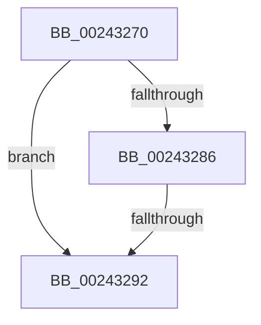

# MiDecommitLockNewPageTable

- RVA: `0x00243270`–`0x0024329D` (길이 `45` bytes)
- VA: `0x0000000140243270`
- 실행 섹션: `.text`
- PDB 이름 있음: `예`; PDB Function 태그: `아니요`
- unwind 정보 RVA: `0x00061A58`
- 디코드: `12`개 명령, `45/45` bytes 표시
- 미해석 바이트: `0` (있으면 어셈블리에 `.byte`로 보존)

> 이 문서는 커널 이미지의 기계어와 PDB 기호를 분석해 생성했습니다. 4번과 5번은 함수 원형과 자료형을 바이너리 사용 방식에서 추정한 C 해석이며 원본 소스 복구 결과는 아닙니다.

## 1. Dependencies

- 직접 호출 지점: **1**; 고유 호출 대상: **1**
- 직접 호출자로 확인된 함수: **1**
- RIP 상대 이미지 참조: **0**

### Outgoing calls
- `0x00243292` → [MiLockWorkingSetShared](../27/MiLockWorkingSetShared_function_0027CBF0.md) (function, `0x0027CBF0`)

### Direct callers
- [sub_00241E90](Unknown_function_00241E90.md) at `0x002420FE`

### Static image references
- 디코드된 RIP-relative 메모리 참조가 없습니다.

## 2. Other-region calls and transfers

- 다른 실행 섹션으로 향하는 call: **0**
- call이 아닌 외부 분기/꼬리 이동: **1**
  - `0x0024328C` → [sub_00243617](Unknown_function_00243617.md) (`tail-transfer`)

## 3. Assembly (complete function range)

```asm
00243270  40 53                           push rbx
00243272  48 81 EC 10 01 00 00            sub rsp, 0x110
00243279  83 79 28 06                     cmp dword ptr [rcx + 0x28], 6
0024327D  48 8B D9                        mov rbx, rcx
00243280  48 8B 49 20                     mov rcx, qword ptr [rcx + 0x20]
00243284  75 0C                           jne 0x140243292
00243286  44 0F 20 C0                     mov rax, cr8
0024328A  3C 02                           cmp al, 2
0024328C  0F 84 85 03 00 00               je 0x140243617
00243292  E8 59 99 03 00                  call 0x14027cbf0
00243297  88 43 2C                        mov byte ptr [rbx + 0x2c], al
0024329A  8B 4B 28                        mov ecx, dword ptr [rbx + 0x28]
```

## 4. C-style interpretation (structured pseudocode)

```c
__int64 __fastcall MiDecommitLockNewPageTable(__int64 a1)
{
    __int64 result;
    __int64 v_rsp;

    v_rsp = (v_rsp) - (272);
    if ((*(unsigned int *)(a1 + 40)) != 6) goto loc_00243292;
loc_00243292:
    result = MiLockWorkingSetShared(*(unsigned __int64 *)(a1 + 32), a2, a3, a4);
    *(unsigned __int8 *)(a1 + 44) = (unsigned __int8)(result);
    return result;
}
```

## 5. (Beta) C Style

```c
int64_t MiDecommitLockNewPageTable(void *Arg1)
{
    uint8_t *arg1 = (uint8_t *)Arg1;

    int64_t result;
    int64_t local_rsp;

    local_rsp = (local_rsp) - (272);
    if ((*(uint32_t *)(arg1 + 0x28)) != 6) goto loc_00243292;
loc_00243292:
    result = MiLockWorkingSetShared(*(uint64_t *)(arg1 + 0x20), a2, a3, a4);
    *(uint8_t *)(arg1 + 0x2C) = (uint8_t)(result);
    return result;
}
```

### 관측된 메모리 오프셋

구조체 형식이 확인되지 않은 접근은 인자 기준의 오프셋으로만 기록했습니다.

| 기준 인자 | 오프셋 표현 | 폭 (bit) | 접근 |
|---|---:|---:|---|
| `Arg1` | `+ 0x20` | `64` | `R` |
| `Arg1` | `+ 0x28` | `32` | `R` |
| `Arg1` | `+ 0x2C` | `8` | `W` |

## 6. Execution-region graph

[열기: 2D/3D 그래프와 함수 탐색 컨트롤 패널](../../../control-panel.html?section=text&rva=0x00243270&view=graph)

- 2D 그래프는 위에서 아래로 흐르고, 3D 그래프는 빈 공간을 드래그해 회전합니다. Shift+드래그는 이동, 휠은 확대·축소, 함수 노드 선택은 대상 보고서 이동입니다.

### Static fallback


