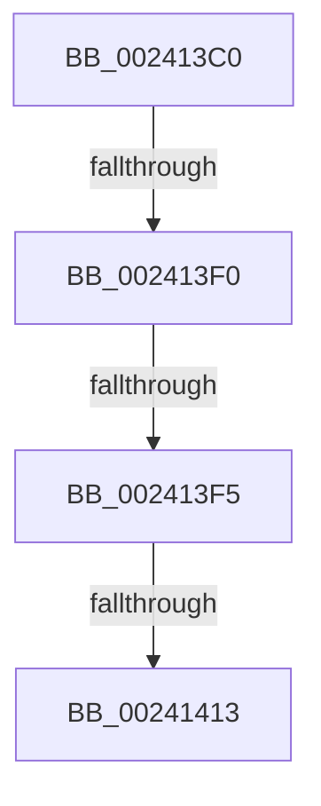

# MiEmptyPte

- RVA: `0x002413C0`–`0x00241415` (길이 `85` bytes)
- VA: `0x00000001402413C0`
- 실행 섹션: `.text`
- PDB 이름 있음: `예`; PDB Function 태그: `아니요`
- unwind 정보 RVA: `0x000617EC`
- 디코드: `24`개 명령, `85/85` bytes 표시
- 미해석 바이트: `0` (있으면 어셈블리에 `.byte`로 보존)

> 이 문서는 커널 이미지의 기계어와 PDB 기호를 분석해 생성했습니다. 4번과 5번은 함수 원형과 자료형을 바이너리 사용 방식에서 추정한 C 해석이며 원본 소스 복구 결과는 아닙니다.

## 1. Dependencies

- 직접 호출 지점: **0**; 고유 호출 대상: **0**
- 직접 호출자로 확인된 함수: **0**
- RIP 상대 이미지 참조: **0**

### Outgoing calls
- 직접 디코드된 call 명령이 없습니다.

### Direct callers
- 이 함수 시작 RVA로 연결되는 직접 call은 확인되지 않았습니다. 간접 호출은 완전히 역산할 수 없습니다.

### Static image references
- 디코드된 RIP-relative 메모리 참조가 없습니다.

## 2. Other-region calls and transfers

- 다른 실행 섹션으로 향하는 call: **0**
- call이 아닌 외부 분기/꼬리 이동: **4**
  - `0x002413EE` → [sub_0024145E + 0xC](Unknown_function_0024145E.md) (`tail-transfer`)
  - `0x002413F3` → [sub_0024145E](Unknown_function_0024145E.md) (`tail-transfer`)
  - `0x00241411` → [sub_0024145E](Unknown_function_0024145E.md) (`tail-transfer`)
  - `0x00241413` → [sub_0024145E + 0x14](Unknown_function_0024145E.md) (`tail-transfer`)

## 3. Assembly (complete function range)

```asm
002413C0  40 56                           push rsi
002413C2  57                              push rdi
002413C3  41 56                           push r14
002413C5  48 83 EC 30                     sub rsp, 0x30
002413C9  48 8B B1 B8 00 00 00            mov rsi, qword ptr [rcx + 0xb8]
002413D0  4C 8B F2                        mov r14, rdx
002413D3  48 8B F9                        mov rdi, rcx
002413D6  49 B9 00 00 00 00 00 DE FF FF   movabs r9, 0xffffde0000000000
002413E0  49 BA FF FF FF FF FF 00 00 00   movabs r10, 0xffffffffff
002413EA  8B 06                           mov eax, dword ptr [rsi]
002413EC  A8 02                           test al, 2
002413EE  74 7A                           je 0x14024146a
002413F0  45 85 C0                        test r8d, r8d
002413F3  75 69                           jne 0x14024145e
002413F5  48 8B 02                        mov rax, qword ptr [rdx]
002413F8  48 C1 E8 0C                     shr rax, 0xc
002413FC  49 23 C2                        and rax, r10
002413FF  48 8D 0C 40                     lea rcx, [rax + rax*2]
00241403  48 03 C9                        add rcx, rcx
00241406  49 8B C1                        mov rax, r9
00241409  48 8B 44 C8 28                  mov rax, qword ptr [rax + rcx*8 + 0x28]
0024140E  48 85 C0                        test rax, rax
00241411  78 4B                           js 0x14024145e
00241413  EB 5D                           jmp 0x140241472
```

## 4. C-style interpretation (structured pseudocode)

```c
__int64 __fastcall MiEmptyPte(__int64 a1, __int64 a2, int a3)
{
    __int64 result;
    __int64 v_rsp;

    v_rsp = (v_rsp) - (48);
    result = (*(unsigned __int64 *)(a2)) >> (12);
    result = (result) & (v_r10);
    a1 = (result + result * 2) + (result + result * 2);
}
```

## 5. (Beta) C Style

```c
int64_t MiEmptyPte(void *Arg1, void *Arg2, int32_t Arg3)
{
    uint8_t *arg1 = (uint8_t *)Arg1;
    uint8_t *arg2 = (uint8_t *)Arg2;

    int64_t result;
    int64_t local_rsp;

    local_rsp = (local_rsp) - (48);
    result = (*(uint64_t *)(arg2)) >> (12);
    result = (result) & (local_r10);
    Arg1 = (result + result * 2) + (result + result * 2);
}
```

### 관측된 메모리 오프셋

구조체 형식이 확인되지 않은 접근은 인자 기준의 오프셋으로만 기록했습니다.

| 기준 인자 | 오프셋 표현 | 폭 (bit) | 접근 |
|---|---:|---:|---|
| `Arg1` | `+ 0xB8` | `64` | `R` |
| `Arg2` | `+ 0x0` | `64` | `R` |

## 6. Execution-region graph

[열기: 2D/3D 그래프와 함수 탐색 컨트롤 패널](../../../control-panel.html?section=text&rva=0x002413C0&view=graph)

- 2D 그래프는 위에서 아래로 흐르고, 3D 그래프는 빈 공간을 드래그해 회전합니다. Shift+드래그는 이동, 휠은 확대·축소, 함수 노드 선택은 대상 보고서 이동입니다.

### Static fallback


