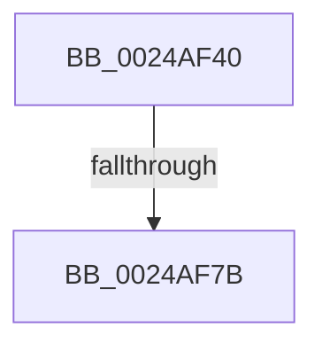

# MiEnqueuePageList

- RVA: `0x0024AF40`–`0x0024AF7F` (길이 `63` bytes)
- VA: `0x000000014024AF40`
- 실행 섹션: `.text`
- PDB 이름 있음: `예`; PDB Function 태그: `아니요`
- unwind 정보 RVA: `0x00062BA4`
- 디코드: `16`개 명령, `63/63` bytes 표시
- 미해석 바이트: `0` (있으면 어셈블리에 `.byte`로 보존)

> 이 문서는 커널 이미지의 기계어와 PDB 기호를 분석해 생성했습니다. 4번과 5번은 함수 원형과 자료형을 바이너리 사용 방식에서 추정한 C 해석이며 원본 소스 복구 결과는 아닙니다.

## 1. Dependencies

- 직접 호출 지점: **0**; 고유 호출 대상: **0**
- 직접 호출자로 확인된 함수: **1**
- RIP 상대 이미지 참조: **0**

### Outgoing calls
- 직접 디코드된 call 명령이 없습니다.

### Direct callers
- [MiAddPageToInsertList](MiAddPageToInsertList_function_0024A950.md) at `0x0024A9F1`

### Static image references
- 디코드된 RIP-relative 메모리 참조가 없습니다.

## 2. Other-region calls and transfers

- 다른 실행 섹션으로 향하는 call: **0**
- call이 아닌 외부 분기/꼬리 이동: **1**
  - `0x0024AF75` → [sub_0024B2CF](Unknown_function_0024B2CF.md) (`tail-transfer`)

## 3. Assembly (complete function range)

```asm
0024AF40  40 53                           push rbx
0024AF42  56                              push rsi
0024AF43  57                              push rdi
0024AF44  41 55                           push r13
0024AF46  41 57                           push r15
0024AF48  48 81 EC F0 00 00 00            sub rsp, 0xf0
0024AF4F  4C 8D 3C 52                     lea r15, [rdx + rdx*2]
0024AF53  49 BD 00 00 00 00 00 DE FF FF   movabs r13, 0xffffde0000000000
0024AF5D  49 C1 E7 04                     shl r15, 4
0024AF61  48 8B F2                        mov rsi, rdx
0024AF64  48 8B D9                        mov rbx, rcx
0024AF67  49 8B C5                        mov rax, r13
0024AF6A  F7 41 60 FD FF FF FF            test dword ptr [rcx + 0x60], 0xfffffffd
0024AF71  49 8D 3C 07                     lea rdi, [r15 + rax]
0024AF75  0F 84 54 03 00 00               je 0x14024b2cf
0024AF7B  48 83 3B 00                     cmp qword ptr [rbx], 0
```

## 4. C-style interpretation (structured pseudocode)

```c
__int64 __fastcall MiEnqueuePageList(__int64 a1, __int64 a2)
{
    __int64 v_r15;
    __int64 v_rsp;

    v_rsp = (v_rsp) - (240);
    v_r15 = (a2 + a2 * 2) << (4);
    return v_r13;
}
```

## 5. (Beta) C Style

```c
int64_t MiEnqueuePageList(void *Arg1, void *Arg2)
{
    uint8_t *arg1 = (uint8_t *)Arg1;
    uint8_t *arg2 = (uint8_t *)Arg2;

    int64_t local_r15;
    int64_t local_rsp;

    local_rsp = (local_rsp) - (240);
    local_r15 = (Arg2 + Arg2 * 2) << (4);
    return local_r13;
}
```

### 관측된 메모리 오프셋

구조체 형식이 확인되지 않은 접근은 인자 기준의 오프셋으로만 기록했습니다.

| 기준 인자 | 오프셋 표현 | 폭 (bit) | 접근 |
|---|---:|---:|---|
| `Arg1` | `+ 0x0` | `64` | `R` |
| `Arg1` | `+ 0x60` | `32` | `R` |
| `Arg2` | `+ 0x0 + rdx*2` | `64` | `R` |

## 6. Execution-region graph

[열기: 2D/3D 그래프와 함수 탐색 컨트롤 패널](../../../control-panel.html?section=text&rva=0x0024AF40&view=graph)

- 2D 그래프는 위에서 아래로 흐르고, 3D 그래프는 빈 공간을 드래그해 회전합니다. Shift+드래그는 이동, 휠은 확대·축소, 함수 노드 선택은 대상 보고서 이동입니다.

### Static fallback


