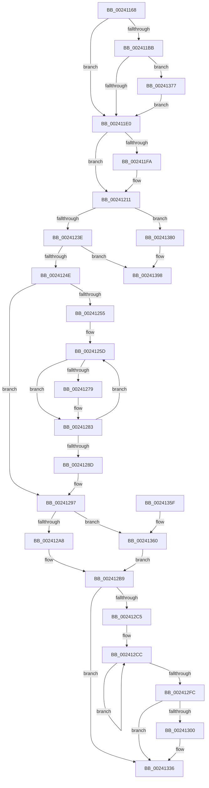

# MiFreeWsleList

- RVA: `0x00241168`–`0x002413B3` (길이 `587` bytes)
- VA: `0x0000000140241168`
- 실행 섹션: `.text`
- PDB 이름 있음: `예`; PDB Function 태그: `아니요`
- unwind 정보 RVA: `0x000617D0`
- 디코드: `146`개 명령, `587/587` bytes 표시
- 미해석 바이트: `0` (있으면 어셈블리에 `.byte`로 보존)

> 이 문서는 커널 이미지의 기계어와 PDB 기호를 분석해 생성했습니다. 4번과 5번은 함수 원형과 자료형을 바이너리 사용 방식에서 추정한 C 해석이며 원본 소스 복구 결과는 아닙니다.

## 1. Dependencies

- 직접 호출 지점: **7**; 고유 호출 대상: **5**
- 직접 호출자로 확인된 함수: **17**
- RIP 상대 이미지 참조: **0**

### Outgoing calls
- `0x0024120B` → [KeBugCheckEx](../4F/KeBugCheckEx_function_004FD660.md) (function, `0x004FD660`)
- `0x00241270` → [MiWsleFlush](../23/MiWsleFlush_function_0023FB30.md) (function, `0x0023FB30`)
- `0x002412B4` → [MiFlushTbList](../31/MiFlushTbList_function_00311FC0.md) (function, `0x00311FC0`)
- `0x002412E3` → [MiWsleFree](../28/MiWsleFree_function_00284600.md) (function, `0x00284600`)
- `0x00241331` → [MiRemoveWsleList](../29/MiRemoveWsleList_function_00292160.md) (function, `0x00292160`)
- `0x00241392` → [KeBugCheckEx](../4F/KeBugCheckEx_function_004FD660.md) (function, `0x004FD660`)
- `0x002413AD` → [KeBugCheckEx](../4F/KeBugCheckEx_function_004FD660.md) (function, `0x004FD660`)

### Direct callers
- [MiAgeTrimListsTail](../23/MiAgeTrimListsTail_function_00239E90.md) at `0x00239F17`
- [MiEmptyWorkingSetHelper](MiEmptyWorkingSetHelper_function_00240C00.md) at `0x00240F9A`
- [sub_00241415](Unknown_function_00241415.md) at `0x00241440`
- [sub_002901B8](../29/Unknown_function_002901B8.md) at `0x002904CE`
- [sub_002C3A7C](../2C/Unknown_function_002C3A7C.md) at `0x002C4218`
- [sub_002C3A7C](../2C/Unknown_function_002C3A7C.md) at `0x002C451B`
- [MiTrimSharedPageFromViews](../2E/MiTrimSharedPageFromViews_function_002E16F8.md) at `0x002E1A50`
- [MiTrimSharedPageFromViews](../2E/MiTrimSharedPageFromViews_function_002E16F8.md) at `0x002E2049`
- [MiTrimSharedPageFromViews](../2E/MiTrimSharedPageFromViews_function_002E16F8.md) at `0x002E2125`
- [MiSharePages](../31/MiSharePages_function_00315110.md) at `0x003158EC`
- [MiTrimWorkingSetBuildup](../3E/MiTrimWorkingSetBuildup_function_003E03FC.md) at `0x003E0473`
- [MiUpdateOldWorkingSetPagesTail](../42/MiUpdateOldWorkingSetPagesTail_function_00428C00.md) at `0x00428C60`
- [sub_00428D7A](../42/Unknown_function_00428D7A.md) at `0x00428D96`
- [MiDeprioritizeVirtualAddresses](../42/MiDeprioritizeVirtualAddresses_function_0042AD1C.md) at `0x0042AFEE`
- [MiDeprioritizeVirtualAddresses](../42/MiDeprioritizeVirtualAddresses_function_0042AD1C.md) at `0x0042B02C`
- [MiEmptyWorkingSetTail](../46/MiEmptyWorkingSetTail_function_0046CC90.md) at `0x0046CCC0`
- [MiConvertAndFlushWsleVas](../49/MiConvertAndFlushWsleVas_function_00492CB4.md) at `0x00492E47`
- [MiMakeVaRangeNoAccess](../4A/MiMakeVaRangeNoAccess_function_004A3CE0.md) at `0x004A3DC0`
- [MiMakeVaRangeNoAccess](../4A/MiMakeVaRangeNoAccess_function_004A3CE0.md) at `0x004A3E9E`
- [NtUnlockVirtualMemory](../4E/NtUnlockVirtualMemory_function_004EE890.md) at `0x004EEA2D`
- [NtUnlockVirtualMemory](../4E/NtUnlockVirtualMemory_function_004EE890.md) at `0x004EEB3D`
- [NtUnlockVirtualMemory](../4E/NtUnlockVirtualMemory_function_004EE890.md) at `0x004EECD6`
- [NtUnlockVirtualMemory](../4E/NtUnlockVirtualMemory_function_004EE890.md) at `0x004EED22`
- [sub_006D9212](../6D/Unknown_function_006D9212.md) at `0x006D944B`
- [sub_006DB77C](../6D/Unknown_function_006DB77C.md) at `0x006DB865`

### Static image references
- 디코드된 RIP-relative 메모리 참조가 없습니다.

## 2. Other-region calls and transfers

- 다른 실행 섹션으로 향하는 call: **0**
- 별도 외부 분기/꼬리 이동을 확인하지 못했습니다.

## 3. Assembly (complete function range)

```asm
00241168  48 89 5C 24 18                  mov qword ptr [rsp + 0x18], rbx
0024116D  48 89 4C 24 08                  mov qword ptr [rsp + 8], rcx
00241172  55                              push rbp
00241173  56                              push rsi
00241174  57                              push rdi
00241175  41 54                           push r12
00241177  41 55                           push r13
00241179  41 56                           push r14
0024117B  41 57                           push r15
0024117D  48 83 EC 30                     sub rsp, 0x30
00241181  44 8B 7A 1C                     mov r15d, dword ptr [rdx + 0x1c]
00241185  4C 8D 72 28                     lea r14, [rdx + 0x28]
00241189  49 8B 3E                        mov rdi, qword ptr [r14]
0024118C  45 8B E8                        mov r13d, r8d
0024118F  48 C1 EF 12                     shr rdi, 0x12
00241193  48 8B F2                        mov rsi, rdx
00241196  81 E7 F8 FF FF 3F               and edi, 0x3ffffff8
0024119C  4C 8B E1                        mov r12, rcx
0024119F  48 B8 00 00 00 40 FB F6 FF FF   movabs rax, 0xfffff6fb40000000
002411A9  48 03 F8                        add rdi, rax
002411AC  8B 81 B8 00 00 00               mov eax, dword ptr [rcx + 0xb8]
002411B2  48 89 7C 24 78                  mov qword ptr [rsp + 0x78], rdi
002411B7  A8 0F                           test al, 0xf
002411B9  75 25                           jne 0x1402411e0
002411BB  65 48 8B 04 25 88 01 00 00      mov rax, qword ptr gs:[0x188]
002411C4  48 8B 88 B8 00 00 00            mov rcx, qword ptr [rax + 0xb8]
002411CB  48 8B 81 10 04 00 00            mov rax, qword ptr [rcx + 0x410]
002411D2  48 83 B8 28 04 00 00 00         cmp qword ptr [rax + 0x428], 0
002411DA  0F 85 97 01 00 00               jne 0x140241377
002411E0  65 4C 8B 04 25 20 00 00 00      mov r8, qword ptr gs:[0x20]
002411E9  49 8B 90 38 88 00 00            mov rdx, qword ptr [r8 + 0x8838]
002411F0  8B 82 5C 01 00 00               mov eax, dword ptr [rdx + 0x15c]
002411F6  85 C0                           test eax, eax
002411F8  75 17                           jne 0x140241211
002411FA  48 83 64 24 20 00               and qword ptr [rsp + 0x20], 0
00241200  8D 48 1A                        lea ecx, [rax + 0x1a]
00241203  45 33 C9                        xor r9d, r9d
00241206  BA 41 04 00 00                  mov edx, 0x441
0024120B  E8 50 C4 2B 00                  call 0x1404fd660
00241210  CC                              int3
00241211  8D 48 FF                        lea ecx, [rax - 1]
00241214  65 48 8B 04 25 88 01 00 00      mov rax, qword ptr gs:[0x188]
0024121D  48 69 D9 78 50 00 00            imul rbx, rcx, 0x5078
00241224  48 81 C3 80 01 00 00            add rbx, 0x180
0024122B  48 03 DA                        add rbx, rdx
0024122E  4C 8B 8B 70 50 00 00            mov r9, qword ptr [rbx + 0x5070]
00241235  4C 3B C8                        cmp r9, rax
00241238  0F 85 42 01 00 00               jne 0x140241380
0024123E  48 8D 83 28 10 00 00            lea rax, [rbx + 0x1028]
00241245  48 3B F0                        cmp rsi, rax
00241248  0F 85 4A 01 00 00               jne 0x140241398
0024124E  33 ED                           xor ebp, ebp
00241250  4D 85 FF                        test r15, r15
00241253  74 42                           je 0x140241297
00241255  48 8B 7C 24 70                  mov rdi, qword ptr [rsp + 0x70]
0024125A  4D 8B E7                        mov r12, r15
0024125D  49 8B 16                        mov rdx, qword ptr [r14]
00241260  4C 8B CB                        mov r9, rbx
00241263  48 81 E2 00 F0 FF FF            and rdx, 0xfffffffffffff000
0024126A  45 8B C5                        mov r8d, r13d
0024126D  48 8B CF                        mov rcx, rdi
00241270  E8 BB E8 FF FF                  call 0x14023fb30
00241275  85 C0                           test eax, eax
00241277  74 0A                           je 0x140241283
00241279  49 8B 06                        mov rax, qword ptr [r14]
0024127C  48 89 44 EE 28                  mov qword ptr [rsi + rbp*8 + 0x28], rax
00241281  FF C5                           inc ebp
00241283  49 83 C6 08                     add r14, 8
00241287  49 83 EC 01                     sub r12, 1
0024128B  75 D0                           jne 0x14024125d
0024128D  48 8B 7C 24 78                  mov rdi, qword ptr [rsp + 0x78]
00241292  4C 8B 64 24 70                  mov r12, qword ptr [rsp + 0x70]
00241297  8B 83 68 40 00 00               mov eax, dword ptr [rbx + 0x4068]
0024129D  4C 2B F8                        sub r15, rax
002412A0  85 ED                           test ebp, ebp
002412A2  0F 84 B8 00 00 00               je 0x140241360
002412A8  8B C5                           mov eax, ebp
002412AA  48 8B CE                        mov rcx, rsi
002412AD  48 89 46 20                     mov qword ptr [rsi + 0x20], rax
002412B1  89 6E 1C                        mov dword ptr [rsi + 0x1c], ebp
002412B4  E8 07 0D 0D 00                  call 0x140311fc0
002412B9  8B 83 68 40 00 00               mov eax, dword ptr [rbx + 0x4068]
002412BF  33 ED                           xor ebp, ebp
002412C1  85 C0                           test eax, eax
002412C3  74 71                           je 0x140241336
002412C5  48 8D B3 70 40 00 00            lea rsi, [rbx + 0x4070]
002412CC  48 8B 16                        mov rdx, qword ptr [rsi]
002412CF  45 8B C5                        mov r8d, r13d
002412D2  4C 8B 8E F0 EF FF FF            mov r9, qword ptr [rsi - 0x1010]
002412D9  48 81 E2 00 F0 FF FF            and rdx, 0xfffffffffffff000
002412E0  49 8B CC                        mov rcx, r12
002412E3  E8 18 33 04 00                  call 0x140284600
002412E8  89 06                           mov dword ptr [rsi], eax
002412EA  48 FF C5                        inc rbp
002412ED  8B 83 68 40 00 00               mov eax, dword ptr [rbx + 0x4068]
002412F3  48 8D 76 08                     lea rsi, [rsi + 8]
002412F7  48 3B E8                        cmp rbp, rax
002412FA  72 D0                           jb 0x1402412cc
002412FC  85 C0                           test eax, eax
002412FE  74 36                           je 0x140241336
00241300  48 B9 00 00 00 00 80 F6 FF FF   movabs rcx, 0xfffff68000000000
0024130A  48 C1 E7 19                     shl rdi, 0x19
0024130E  48 8B D3                        mov rdx, rbx
00241311  48 C1 E1 19                     shl rcx, 0x19
00241315  48 2B F9                        sub rdi, rcx
00241318  48 C1 FF 10                     sar rdi, 0x10
0024131C  48 C1 E7 19                     shl rdi, 0x19
00241320  48 2B F9                        sub rdi, rcx
00241323  49 8B CC                        mov rcx, r12
00241326  48 C1 FF 10                     sar rdi, 0x10
0024132A  48 89 BB 60 40 00 00            mov qword ptr [rbx + 0x4060], rdi
00241331  E8 2A 0E 05 00                  call 0x140292160
00241336  83 A3 58 30 00 00 00            and dword ptr [rbx + 0x3058], 0
0024133D  49 8B C7                        mov rax, r15
00241340  83 A3 68 40 00 00 00            and dword ptr [rbx + 0x4068], 0
00241347  48 8B 9C 24 80 00 00 00         mov rbx, qword ptr [rsp + 0x80]
0024134F  48 83 C4 30                     add rsp, 0x30
00241353  41 5F                           pop r15
00241355  41 5E                           pop r14
00241357  41 5D                           pop r13
00241359  41 5C                           pop r12
0024135B  5F                              pop rdi
0024135C  5E                              pop rsi
0024135D  5D                              pop rbp
0024135E  C3                              ret
0024135F  CC                              int3
00241360  66 83 66 19 00                  and word ptr [rsi + 0x19], 0
00241365  83 66 1C 00                     and dword ptr [rsi + 0x1c], 0
00241369  48 83 66 20 00                  and qword ptr [rsi + 0x20], 0
0024136E  83 66 10 DB                     and dword ptr [rsi + 0x10], 0xffffffdb
00241372  E9 42 FF FF FF                  jmp 0x1402412b9
00241377  41 83 CD 02                     or r13d, 2
0024137B  E9 60 FE FF FF                  jmp 0x1402411e0
00241380  4C 8B C3                        mov r8, rbx
00241383  48 89 44 24 20                  mov qword ptr [rsp + 0x20], rax
00241388  BA 42 04 00 00                  mov edx, 0x442
0024138D  B9 1A 00 00 00                  mov ecx, 0x1a
00241392  E8 C9 C2 2B 00                  call 0x1404fd660
00241397  CC                              int3
00241398  4C 8B CE                        mov r9, rsi
0024139B  48 89 44 24 20                  mov qword ptr [rsp + 0x20], rax
002413A0  4C 8B C3                        mov r8, rbx
002413A3  BA 42 04 00 00                  mov edx, 0x442
002413A8  B9 1A 00 00 00                  mov ecx, 0x1a
002413AD  E8 AE C2 2B 00                  call 0x1404fd660
002413B2  CC                              int3
```

## 4. C-style interpretation (structured pseudocode)

```c
__int64 __fastcall MiFreeWsleList(__int64 a1, __int64 a2, int a3, int a4)
{
    __int64 result;
    __int64 v_r12;
    __int64 v_r13;
    __int64 v_r14;
    __int64 v_r15;
    __int64 v_rbp;
    __int64 v_rbx;
    __int64 v_rdi;
    __int64 v_rsp;
    unsigned __int64 v_stack_m48;
    unsigned __int64 v_stack_p10;
    unsigned __int64 v_stack_p18;
    unsigned __int64 v_stack_p20;
    unsigned __int64 v_stack_p8;

    v_stack_p18 = v_rbx;
    v_stack_p8 = a1;
    v_rsp = (v_rsp) - (48);
    v_rdi = (*(unsigned __int64 *)(a2 + 40)) >> (18);
    v_rdi = (unsigned int)((v_rdi) & (0x3FFFFFF8ULL));
    v_rdi = (v_rdi) + (result);
    v_stack_p10 = v_rdi;
    if ((((unsigned __int8)((unsigned int)(*(unsigned int *)(a1 + 184)))) & (15)) != 0) goto loc_002411E0;
    if ((*(unsigned __int64 *)(*(unsigned __int64 *)(*(unsigned __int64 *)(*(unsigned __int64 *)(gs_base + (0 + 392)) + 184) + 1040) + 1064)) != 0) goto loc_00241377;
loc_002411E0:
    result = (unsigned int)(*(unsigned int *)(*(unsigned __int64 *)(*(unsigned __int64 *)(gs_base + (0 + 32)) + 34872) + 348));
    if ((unsigned int)((unsigned int)(*(unsigned int *)(*(unsigned __int64 *)(*(unsigned __int64 *)(gs_base + (0 + 32)) + 34872) + 348))) == 0) {
        a1 = (unsigned int)(*(unsigned int *)(*(unsigned __int64 *)(*(unsigned __int64 *)(gs_base + (0 + 32)) + 34872) + 348)) + 26;
        a4 = 0;
        a2 = 0x441ULL;
        result = KeBugCheckEx(a1, a2, *(unsigned __int64 *)(gs_base + (0 + 32)), a4);
    }
    v_rbx = (v_rbx) * (result - 1);
    v_rbx = (v_rbx) + (384);
    v_rbx = (v_rbx) + (a2);
    if ((*(unsigned __int64 *)(v_rbx + 20592)) != (*(unsigned __int64 *)(gs_base + (0 + 392)))) goto loc_00241380;
    if (a2 != (v_rbx + 4136)) goto loc_00241398;
    v_rbp = 0;
    if ((unsigned int)(*(unsigned int *)(a2 + 28)) == 0) goto loc_00241297;
loc_0024125D:
    a2 = (*(unsigned __int64 *)(a2 + 40)) & (0xFFFFFFFFFFFFF000ULL);
    result = MiWsleFlush(v_stack_p8, a2, (unsigned int)((unsigned int)((unsigned int)(a3))), v_rbx);
    if ((unsigned int)(result) != 0) {
        result = *(unsigned __int64 *)(a2 + 40);
        *(unsigned __int64 *)(a2 + v_rbp * 8 + 40) = result;
        v_rbp = (unsigned int)((v_rbp) + 1);
    }
    v_r14 = (a2 + 40) + (8);
    v_r12 = ((unsigned int)(*(unsigned int *)(a2 + 28))) - (1);
    if (condition_is_not_equal) goto loc_0024125D;
loc_00241297:
    v_r15 = ((unsigned int)(*(unsigned int *)(a2 + 28))) - ((unsigned int)(*(unsigned int *)(v_rbx + 16488)));
    if ((unsigned int)(v_rbp) == 0) goto loc_00241360;
    *(unsigned __int64 *)(a2 + 32) = (unsigned int)((unsigned int)(v_rbp));
    *(unsigned int *)(a2 + 28) = (unsigned int)(v_rbp);
    result = MiFlushTbList(a2, a2, (unsigned int)((unsigned int)((unsigned int)(a3))), v_rbx);
loc_002412B9:
    v_rbp = 0;
    if ((unsigned int)((unsigned int)(*(unsigned int *)(v_rbx + 16488))) == 0) goto loc_00241336;
loc_002412CC:
    a2 = (*(unsigned __int64 *)(v_rbx + 16496)) & (0xFFFFFFFFFFFFF000ULL);
    result = MiWsleFree(v_stack_p8, a2, (unsigned int)((unsigned int)((unsigned int)(a3))), *(unsigned __int64 *)(v_rbx + 16496 - 4112));
    *(unsigned int *)(v_rbx + 16496) = (unsigned int)(result);
    v_rbp = (v_rbp) + 1;
    if (v_rbp < ((unsigned int)(*(unsigned int *)(v_rbx + 16488)))) goto loc_002412CC;
    result = (unsigned int)(*(unsigned int *)(v_rbx + 16488));
    v_rdi = v_stack_p10;
    if ((unsigned int)((unsigned int)(*(unsigned int *)(v_rbx + 16488))) != 0) {
        v_rdi = (v_stack_p10) << (25);
        a2 = v_rbx;
        a1 = (v_stack_p8) << (25);
        v_rdi = (v_rdi) - (a1);
        v_rdi = (v_rdi) >> (16);
        v_rdi = (v_rdi) << (25);
        v_rdi = (v_rdi) - (a1);
        a1 = v_stack_p8;
        v_rdi = (v_rdi) >> (16);
        *(unsigned __int64 *)(v_rbx + 16480) = v_rdi;
        result = MiRemoveWsleList(a1, a2, (unsigned int)((unsigned int)((unsigned int)(a3))), *(unsigned __int64 *)(v_rbx + 16496 - 4112));
    }
    v_rsp = (v_rsp) + (48);
    return v_r15;
loc_00241360:
    goto loc_002412B9;
loc_00241377:
    v_r13 = (unsigned int)(((unsigned int)(a3)) | (2));
    goto loc_002411E0;
loc_00241380:
    v_stack_p20 = v_r15;
    result = KeBugCheckEx(26, (unsigned int)(0x442ULL), v_stack_p18, *(unsigned __int64 *)(v_rbx + 16496 - 4112));
loc_00241398:
    v_stack_p20 = result;
    result = KeBugCheckEx(26, (unsigned int)(0x442ULL), v_stack_p18, v_rbx + 16496 + 8);
    return result;
}
```

## 5. (Beta) C Style

```c
int64_t MiFreeWsleList(void *Arg1, void *Arg2, int32_t Arg3, int32_t Arg4)
{
    uint8_t *arg1 = (uint8_t *)Arg1;
    uint8_t *arg2 = (uint8_t *)Arg2;

    int64_t result;
    int64_t local_r12;
    int64_t local_r13;
    int64_t local_r14;
    int64_t local_r15;
    int64_t local_rbp;
    int64_t local_rbx;
    int64_t local_rdi;
    int64_t local_rsp;
    uint64_t v_stack_m48;
    uint64_t v_stack_p10;
    uint64_t v_stack_p18;
    uint64_t v_stack_p20;
    uint64_t v_stack_p8;

    v_stack_p18 = local_rbx;
    v_stack_p8 = Arg1;
    local_rsp = (local_rsp) - (48);
    local_rdi = (*(uint64_t *)(arg2 + 0x28)) >> (18);
    local_rdi = (uint32_t)((local_rdi) & (0x3FFFFFF8ULL));
    local_rdi = (local_rdi) + (result);
    v_stack_p10 = local_rdi;
    if ((((uint8_t)((uint32_t)(*(uint32_t *)(arg1 + 0xB8)))) & (15)) != 0) goto loc_002411E0;
    if ((*(uint64_t *)(*(uint64_t *)(*(uint64_t *)(*(uint64_t *)(gs_base + (0 + 0x188)) + 0xB8) + 0x410) + 0x428)) != 0) goto loc_00241377;
loc_002411E0:
    result = (uint32_t)(*(uint32_t *)(*(uint64_t *)(*(uint64_t *)(gs_base + (0 + 0x20)) + 0x8838) + 0x15C));
    if ((uint32_t)((uint32_t)(*(uint32_t *)(*(uint64_t *)(*(uint64_t *)(gs_base + (0 + 0x20)) + 0x8838) + 0x15C))) == 0) {
        Arg1 = (uint32_t)(*(uint32_t *)(*(uint64_t *)(*(uint64_t *)(gs_base + (0 + 0x20)) + 0x8838) + 0x15C)) + 26;
        Arg4 = 0;
        Arg2 = 0x441ULL;
        result = KeBugCheckEx(Arg1, Arg2, *(uint64_t *)(gs_base + (0 + 0x20)), Arg4);
    }
    local_rbx = (local_rbx) * (result - 1);
    local_rbx = (local_rbx) + (384);
    local_rbx = (local_rbx) + (Arg2);
    if ((*(uint64_t *)(local_rbx + 0x5070)) != (*(uint64_t *)(gs_base + (0 + 0x188)))) goto loc_00241380;
    if (Arg2 != (local_rbx + 4136)) goto loc_00241398;
    local_rbp = 0;
    if ((uint32_t)(*(uint32_t *)(arg2 + 0x1C)) == 0) goto loc_00241297;
loc_0024125D:
    Arg2 = (*(uint64_t *)(arg2 + 0x28)) & (0xFFFFFFFFFFFFF000ULL);
    result = MiWsleFlush(v_stack_p8, Arg2, (uint32_t)((uint32_t)((uint32_t)(Arg3))), local_rbx);
    if ((uint32_t)(result) != 0) {
        result = *(uint64_t *)(arg2 + 0x28);
        *(uint64_t *)(arg2 + local_rbp * 8 + 0x28) = result;
        local_rbp = (uint32_t)((local_rbp) + 1);
    }
    local_r14 = (Arg2 + 40) + (8);
    local_r12 = ((uint32_t)(*(uint32_t *)(arg2 + 0x1C))) - (1);
    if (condition_is_not_equal) goto loc_0024125D;
loc_00241297:
    local_r15 = ((uint32_t)(*(uint32_t *)(arg2 + 0x1C))) - ((uint32_t)(*(uint32_t *)(local_rbx + 0x4068)));
    if ((uint32_t)(local_rbp) == 0) goto loc_00241360;
    *(uint64_t *)(arg2 + 0x20) = (uint32_t)((uint32_t)(local_rbp));
    *(uint32_t *)(arg2 + 0x1C) = (uint32_t)(local_rbp);
    result = MiFlushTbList(Arg2, Arg2, (uint32_t)((uint32_t)((uint32_t)(Arg3))), local_rbx);
loc_002412B9:
    local_rbp = 0;
    if ((uint32_t)((uint32_t)(*(uint32_t *)(local_rbx + 0x4068))) == 0) goto loc_00241336;
loc_002412CC:
    Arg2 = (*(uint64_t *)(local_rbx + 0x4070)) & (0xFFFFFFFFFFFFF000ULL);
    result = MiWsleFree(v_stack_p8, Arg2, (uint32_t)((uint32_t)((uint32_t)(Arg3))), *(uint64_t *)(local_rbx + 0x4070 - 0x1010));
    *(uint32_t *)(local_rbx + 0x4070) = (uint32_t)(result);
    local_rbp = (local_rbp) + 1;
    if (local_rbp < ((uint32_t)(*(uint32_t *)(local_rbx + 0x4068)))) goto loc_002412CC;
    result = (uint32_t)(*(uint32_t *)(local_rbx + 0x4068));
    local_rdi = v_stack_p10;
    if ((uint32_t)((uint32_t)(*(uint32_t *)(local_rbx + 0x4068))) != 0) {
        local_rdi = (v_stack_p10) << (25);
        Arg2 = local_rbx;
        Arg1 = (v_stack_p8) << (25);
        local_rdi = (local_rdi) - (Arg1);
        local_rdi = (local_rdi) >> (16);
        local_rdi = (local_rdi) << (25);
        local_rdi = (local_rdi) - (Arg1);
        Arg1 = v_stack_p8;
        local_rdi = (local_rdi) >> (16);
        *(uint64_t *)(local_rbx + 0x4060) = local_rdi;
        result = MiRemoveWsleList(Arg1, Arg2, (uint32_t)((uint32_t)((uint32_t)(Arg3))), *(uint64_t *)(local_rbx + 0x4070 - 0x1010));
    }
    local_rsp = (local_rsp) + (48);
    return local_r15;
loc_00241360:
    goto loc_002412B9;
loc_00241377:
    local_r13 = (uint32_t)(((uint32_t)(Arg3)) | (2));
    goto loc_002411E0;
loc_00241380:
    v_stack_p20 = local_r15;
    result = KeBugCheckEx(26, (uint32_t)(0x442ULL), v_stack_p18, *(uint64_t *)(local_rbx + 0x4070 - 0x1010));
loc_00241398:
    v_stack_p20 = result;
    result = KeBugCheckEx(26, (uint32_t)(0x442ULL), v_stack_p18, local_rbx + 16496 + 8);
    return result;
}
```

### 관측된 메모리 오프셋

구조체 형식이 확인되지 않은 접근은 인자 기준의 오프셋으로만 기록했습니다.

| 기준 인자 | 오프셋 표현 | 폭 (bit) | 접근 |
|---|---:|---:|---|
| `Arg1` | `+ 0xB8` | `32` | `R` |
| `Arg2` | `+ 0x0` | `64` | `R` |
| `Arg2` | `+ 0x1C` | `32` | `R` |
| `Arg2` | `+ 0x28` | `64` | `R` |

## 6. Execution-region graph

[열기: 2D/3D 그래프와 함수 탐색 컨트롤 패널](../../../control-panel.html?section=text&rva=0x00241168&view=graph)

- 2D 그래프는 위에서 아래로 흐르고, 3D 그래프는 빈 공간을 드래그해 회전합니다. Shift+드래그는 이동, 휠은 확대·축소, 함수 노드 선택은 대상 보고서 이동입니다.

### Static fallback


