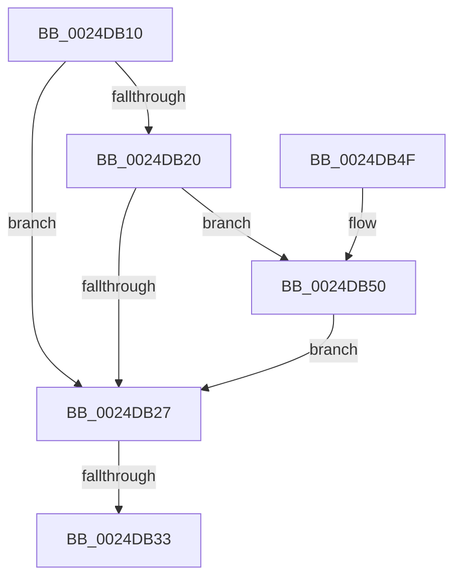

# MiGetControlAreaPtes

- RVA: `0x0024DB10`–`0x0024DB56` (길이 `70` bytes)
- VA: `0x000000014024DB10`
- 실행 섹션: `.text`
- PDB 이름 있음: `예`; PDB Function 태그: `아니요`
- unwind 정보 RVA: `0x00062F18`
- 디코드: `23`개 명령, `70/70` bytes 표시
- 미해석 바이트: `0` (있으면 어셈블리에 `.byte`로 보존)

> 이 문서는 커널 이미지의 기계어와 PDB 기호를 분석해 생성했습니다. 4번과 5번은 함수 원형과 자료형을 바이너리 사용 방식에서 추정한 C 해석이며 원본 소스 복구 결과는 아닙니다.

## 1. Dependencies

- 직접 호출 지점: **0**; 고유 호출 대상: **0**
- 직접 호출자로 확인된 함수: **3**
- RIP 상대 이미지 참조: **0**

### Outgoing calls
- 직접 디코드된 call 명령이 없습니다.

### Direct callers
- [MiOffsetToProtos](MiOffsetToProtos_function_0024D880.md) at `0x0024D89F`
- [sub_00884EE1](../../page/88/Unknown_function_00884EE1.md) at `0x00884F23`
- [MiPfPrepareSequentialReadList](../../page/93/MiPfPrepareSequentialReadList_function_0093D8E8.md) at `0x0093DB3B`

### Static image references
- 디코드된 RIP-relative 메모리 참조가 없습니다.

## 2. Other-region calls and transfers

- 다른 실행 섹션으로 향하는 call: **0**
- call이 아닌 외부 분기/꼬리 이동: **1**
  - `0x0024DB2D` → [sub_0024DC8D + 0x1](Unknown_function_0024DC8D.md) (`tail-transfer`)

## 3. Assembly (complete function range)

```asm
0024DB10  40 53                           push rbx
0024DB12  48 83 EC 20                     sub rsp, 0x20
0024DB16  8B 41 38                        mov eax, dword ptr [rcx + 0x38]
0024DB19  48 8B D9                        mov rbx, rcx
0024DB1C  A8 20                           test al, 0x20
0024DB1E  75 07                           jne 0x14024db27
0024DB20  48 83 79 40 00                  cmp qword ptr [rcx + 0x40], 0
0024DB25  75 29                           jne 0x14024db50
0024DB27  44 0F 20 C0                     mov rax, cr8
0024DB2B  3C 02                           cmp al, 2
0024DB2D  0F 83 5B 01 00 00               jae 0x14024dc8e
0024DB33  48 8B 09                        mov rcx, qword ptr [rcx]
0024DB36  0F B7 41 0C                     movzx eax, word ptr [rcx + 0xc]
0024DB3A  8B 49 08                        mov ecx, dword ptr [rcx + 8]
0024DB3D  25 FF 03 00 00                  and eax, 0x3ff
0024DB42  48 C1 E0 20                     shl rax, 0x20
0024DB46  48 0B C1                        or rax, rcx
0024DB49  48 83 C4 20                     add rsp, 0x20
0024DB4D  5B                              pop rbx
0024DB4E  C3                              ret
0024DB4F  CC                              int3
0024DB50  0F BA E0 0A                     bt eax, 0xa
0024DB54  72 D1                           jb 0x14024db27
```

## 4. C-style interpretation (structured pseudocode)

```c
__int64 __fastcall MiGetControlAreaPtes(__int64 a1)
{
    __int64 result;
    __int64 v_rsp;

    v_rsp = (v_rsp) - (32);
    if ((((unsigned __int8)((unsigned int)(*(unsigned int *)(a1 + 56)))) & (32)) != 0) goto loc_0024DB27;
    if ((*(unsigned __int64 *)(a1 + 64)) != 0) goto loc_0024DB50;
loc_0024DB27:
    result = (unsigned int)((*(unsigned __int16 *)(*(unsigned __int64 *)(a1) + 12)) & (0x3FFULL));
    result = (result) << (32);
    result = (result) | ((unsigned int)(*(unsigned int *)(*(unsigned __int64 *)(a1) + 8)));
    v_rsp = (v_rsp) + (32);
    return result;
loc_0024DB50:
    if (condition_is_below) goto loc_0024DB27;
}
```

## 5. (Beta) C Style

```c
int64_t MiGetControlAreaPtes(void *Arg1)
{
    uint8_t *arg1 = (uint8_t *)Arg1;

    int64_t result;
    int64_t local_rsp;

    local_rsp = (local_rsp) - (32);
    if ((((uint8_t)((uint32_t)(*(uint32_t *)(arg1 + 0x38)))) & (32)) != 0) goto loc_0024DB27;
    if ((*(uint64_t *)(arg1 + 0x40)) != 0) goto loc_0024DB50;
loc_0024DB27:
    result = (uint32_t)((*(uint16_t *)(*(uint64_t *)(arg1) + 0xC)) & (0x3FFULL));
    result = (result) << (32);
    result = (result) | ((uint32_t)(*(uint32_t *)(*(uint64_t *)(arg1) + 0x8)));
    local_rsp = (local_rsp) + (32);
    return result;
loc_0024DB50:
    if (condition_is_below) goto loc_0024DB27;
}
```

### 관측된 메모리 오프셋

구조체 형식이 확인되지 않은 접근은 인자 기준의 오프셋으로만 기록했습니다.

| 기준 인자 | 오프셋 표현 | 폭 (bit) | 접근 |
|---|---:|---:|---|
| `Arg1` | `+ 0x0` | `64` | `R` |
| `Arg1` | `+ 0x38` | `32` | `R` |
| `Arg1` | `+ 0x40` | `64` | `R` |

## 6. Execution-region graph

[열기: 2D/3D 그래프와 함수 탐색 컨트롤 패널](../../../control-panel.html?section=text&rva=0x0024DB10&view=graph)

- 2D 그래프는 위에서 아래로 흐르고, 3D 그래프는 빈 공간을 드래그해 회전합니다. Shift+드래그는 이동, 휠은 확대·축소, 함수 노드 선택은 대상 보고서 이동입니다.

### Static fallback


