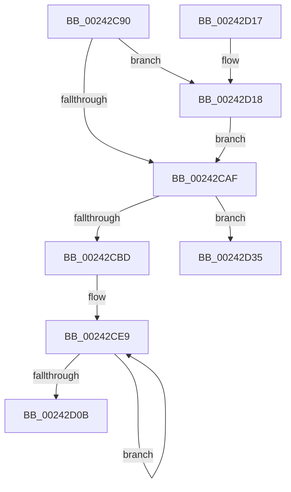

# MiGetProcessorFlushList

- RVA: `0x00242C90`–`0x00242D4E` (길이 `190` bytes)
- VA: `0x0000000140242C90`
- 실행 섹션: `.text`
- PDB 이름 있음: `예`; PDB Function 태그: `아니요`
- unwind 정보 RVA: `0x000619EC`
- 디코드: `39`개 명령, `190/190` bytes 표시
- 미해석 바이트: `0` (있으면 어셈블리에 `.byte`로 보존)

> 이 문서는 커널 이미지의 기계어와 PDB 기호를 분석해 생성했습니다. 4번과 5번은 함수 원형과 자료형을 바이너리 사용 방식에서 추정한 C 해석이며 원본 소스 복구 결과는 아닙니다.

## 1. Dependencies

- 직접 호출 지점: **1**; 고유 호출 대상: **1**
- 직접 호출자로 확인된 함수: **61**
- RIP 상대 이미지 참조: **3**

### Outgoing calls
- `0x00242D48` → [KeBugCheckEx](../4F/KeBugCheckEx_function_004FD660.md) (function, `0x004FD660`)

### Direct callers
- [MiBuildForkPte](../22/MiBuildForkPte_function_0022E32C.md) at `0x0022EBF7`
- [MmSetAddressRangeModifiedEx](../23/MmSetAddressRangeModifiedEx_function_00236F20.md) at `0x0023710D`
- [sub_00241476](Unknown_function_00241476.md) at `0x002414A4`
- [sub_00241ACC](Unknown_function_00241ACC.md) at `0x00241ACC`
- [sub_00241E90](Unknown_function_00241E90.md) at `0x00241FB3`
- [MiWalkVaRange](MiWalkVaRange_function_00243BF0.md) at `0x00244302`
- [MmProtectPool](../26/MmProtectPool_function_002697AC.md) at `0x00269C44`
- [MmProtectPool](../26/MmProtectPool_function_002697AC.md) at `0x00269F61`
- [MiDeleteVa](../27/MiDeleteVa_function_002789E0.md) at `0x00278C4B`
- [MiDeleteVa](../27/MiDeleteVa_function_002789E0.md) at `0x00278D21`
- [MiAcquirePrcbAgeTrimLists](../29/MiAcquirePrcbAgeTrimLists_function_002918B0.md) at `0x002918C0`
- [sub_00293C9B](../29/Unknown_function_00293C9B.md) at `0x00293CE6`
- [MiSetReadOnlyOnSectionView](../29/MiSetReadOnlyOnSectionView_function_00294538.md) at `0x002946F7`
- [NtGetWriteWatch](../2A/NtGetWriteWatch_function_002A7CE0.md) at `0x002A84F1`
- [MiMoveDirtyBitsToPfns](../2A/MiMoveDirtyBitsToPfns_function_002A8624.md) at `0x002A8776`
- [MiReplaceRotateWithDemandZeroNoCopy](../2A/MiReplaceRotateWithDemandZeroNoCopy_function_002AAB04.md) at `0x002AAC04`
- [sub_002C1B88](../2C/Unknown_function_002C1B88.md) at `0x002C1CAF`
- [sub_002C1D11](../2C/Unknown_function_002C1D11.md) at `0x002C1D3E`
- [sub_002C1E57](../2C/Unknown_function_002C1E57.md) at `0x002C1E8D`
- [sub_002C3A7C](../2C/Unknown_function_002C3A7C.md) at `0x002C3CDF`
- [sub_002C3A7C](../2C/Unknown_function_002C3A7C.md) at `0x002C4116`
- [MiProtectPrivateMemory](../2C/MiProtectPrivateMemory_function_002C45B0.md) at `0x002C480A`
- [MiTrimSharedPageFromViews](../2E/MiTrimSharedPageFromViews_function_002E16F8.md) at `0x002E1B5C`
- [MiTrimSharedPageFromViews](../2E/MiTrimSharedPageFromViews_function_002E16F8.md) at `0x002E1C7C`
- [MiTrimSharedPageFromViews](../2E/MiTrimSharedPageFromViews_function_002E16F8.md) at `0x002E1FE0`
- [MiFlushTbAsNeeded](../31/MiFlushTbAsNeeded_function_00313730.md) at `0x00313790`
- [MiSharePages](../31/MiSharePages_function_00315110.md) at `0x00315826`
- [MiSharePages](../31/MiSharePages_function_00315110.md) at `0x00315BEA`
- [MiSharePages](../31/MiSharePages_function_00315110.md) at `0x00315C8F`
- [MiFillSystemPtes](../31/MiFillSystemPtes_function_00319850.md) at `0x0031A174`
- [MiCleanupLazyStampedPageTable](../32/MiCleanupLazyStampedPageTable_function_0032A43C.md) at `0x0032A5A8`
- [MiDecommitHardwareEnclavePages](../36/MiDecommitHardwareEnclavePages_function_003688D4.md) at `0x00368BE1`
- [MiLockCode](../36/MiLockCode_function_0036F91C.md) at `0x0036FF52`
- [MiFlushValidPteFromTb](../37/MiFlushValidPteFromTb_function_00376878.md) at `0x003768AC`
- [MiSetSystemCodeProtection](../38/MiSetSystemCodeProtection_function_00384420.md) at `0x00384735`
- [MiUnmapMdlCommon](../3E/MiUnmapMdlCommon_function_003E7DF0.md) at `0x003E7F44`
- [MiUnmapContiguousMemory](../3F/MiUnmapContiguousMemory_function_003F7908.md) at `0x003F7A5A`
- [MiConsumeSystemCacheTbFlushNeededView](../41/MiConsumeSystemCacheTbFlushNeededView_function_004193B4.md) at `0x0041943D`
- [MiDeprioritizeVirtualAddresses](../42/MiDeprioritizeVirtualAddresses_function_0042AD1C.md) at `0x0042B041`
- [sub_0044565B](../44/Unknown_function_0044565B.md) at `0x00445764`
- [MiInitializeSystemPageTable](../45/MiInitializeSystemPageTable_function_00451C88.md) at `0x00451F73`
- [MiClearPteAccessedBitRange](../45/MiClearPteAccessedBitRange_function_004520B8.md) at `0x0045216F`
- [MiRevokeExecutePte](../46/MiRevokeExecutePte_function_00460BA0.md) at `0x00460C77`
- [MiDeleteSystemPageTable](../49/MiDeleteSystemPageTable_function_004916B0.md) at `0x004916EF`
- [MiConvertAndFlushWsleVas](../49/MiConvertAndFlushWsleVas_function_00492CB4.md) at `0x00492DE3`
- [MiSetPagingOfDriver](../4A/MiSetPagingOfDriver_function_004A76C4.md) at `0x004A7929`
- [MiUnmapKernelScp](../4A/MiUnmapKernelScp_function_004A82E8.md) at `0x004A8412`
- [MiAdjustSecureDriverStateForIatCapture](../4B/MiAdjustSecureDriverStateForIatCapture_function_004BE864.md) at `0x004BE93A`
- [MiProtectAweRegion](../4C/MiProtectAweRegion_function_004CE62C.md) at `0x004CEBDE`
- [MiProtectEnclavePages](../4D/MiProtectEnclavePages_function_004D5528.md) at `0x004D599C`
- [NtUnlockVirtualMemory](../4E/NtUnlockVirtualMemory_function_004EE890.md) at `0x004EEC83`
- [MiDecommitAddTbFlushEntries](../4F/MiDecommitAddTbFlushEntries_function_004FB798.md) at `0x004FB7CF`
- [MiPageBootRegistry](../66/MiPageBootRegistry_function_0066E82C.md) at `0x0066EA1D`
- [MiSetPageProtection](../67/MiSetPageProtection_function_00674BDC.md) at `0x00674C74`
- [MiClearDriverTablePtes](../68/MiClearDriverTablePtes_function_00683024.md) at `0x00683188`
- [MiFlushEnclaveTb](../68/MiFlushEnclaveTb_function_00686E10.md) at `0x00686E4B`
- [MiBuildPhysicalPageFreeChain](../68/MiBuildPhysicalPageFreeChain_function_00687C80.md) at `0x00687DC8`
- [MiGetAweFlushList](../68/MiGetAweFlushList_function_00688D34.md) at `0x00688D43`
- [MiClearSystemAccessBits](../68/MiClearSystemAccessBits_function_0068A2A0.md) at `0x0068A350`
- [MiDemoteValidLargePageOneLevel](../68/MiDemoteValidLargePageOneLevel_function_0068A3F4.md) at `0x0068A7E4`
- [MiScrubLargeMappedPage](../69/MiScrubLargeMappedPage_function_00693E2C.md) at `0x00694093`
- [sub_006D9212](../6D/Unknown_function_006D9212.md) at `0x006D93FE`
- [sub_006DAFCA](../6D/Unknown_function_006DAFCA.md) at `0x006DB0DA`
- [sub_006DB77C](../6D/Unknown_function_006DB77C.md) at `0x006DB803`
- [sub_006E362E](../6E/Unknown_function_006E362E.md) at `0x006E3651`
- [MiProtectLargeKernelHalRange](../../page/7F/MiProtectLargeKernelHalRange_function_007F8D20.md) at `0x007F8E29`
- [MiMarkBootKernelStack](../../init/C6/MiMarkBootKernelStack_function_00C68244.md) at `0x00C6838C`
- [MiFreeBootDriverPages](../../init/C7/MiFreeBootDriverPages_function_00C7695C.md) at `0x00C769D1`

### Static image references
- `0x00242D18` → RVA `0x01011694` (`INITDATA`; write)
- `0x00242D1F` → RVA `0x0100F4C0` (`INITDATA`; read)
- `0x00242D26` → RVA `0x0100F620` (`INITDATA`; write)

## 2. Other-region calls and transfers

- 다른 실행 섹션으로 향하는 call: **0**
- 별도 외부 분기/꼬리 이동을 확인하지 못했습니다.

## 3. Assembly (complete function range)

```asm
00242C90  48 83 EC 38                     sub rsp, 0x38
00242C94  65 4C 8B 04 25 20 00 00 00      mov r8, qword ptr gs:[0x20]
00242C9D  41 B9 00 02 00 00               mov r9d, 0x200
00242CA3  49 8B 88 38 88 00 00            mov rcx, qword ptr [r8 + 0x8838]
00242CAA  48 85 C9                        test rcx, rcx
00242CAD  74 69                           je 0x140242d18
00242CAF  8B 81 5C 01 00 00               mov eax, dword ptr [rcx + 0x15c]
00242CB5  3B 81 60 01 00 00               cmp eax, dword ptr [rcx + 0x160]
00242CBB  74 78                           je 0x140242d35
00242CBD  48 69 D0 78 50 00 00            imul rdx, rax, 0x5078
00242CC4  65 48 8B 04 25 88 01 00 00      mov rax, qword ptr gs:[0x188]
00242CCD  48 03 D1                        add rdx, rcx
00242CD0  48 89 82 F0 51 00 00            mov qword ptr [rdx + 0x51f0], rax
00242CD7  B8 02 00 00 00                  mov eax, 2
00242CDC  FF 81 5C 01 00 00               inc dword ptr [rcx + 0x15c]
00242CE2  48 8D 8A 80 01 00 00            lea rcx, [rdx + 0x180]
00242CE9  0F 57 C0                        xorps xmm0, xmm0
00242CEC  45 33 C0                        xor r8d, r8d
00242CEF  0F 11 01                        movups xmmword ptr [rcx], xmm0
00242CF2  0F 11 41 10                     movups xmmword ptr [rcx + 0x10], xmm0
00242CF6  4C 89 41 20                     mov qword ptr [rcx + 0x20], r8
00242CFA  44 89 49 0C                     mov dword ptr [rcx + 0xc], r9d
00242CFE  48 8D 89 28 10 00 00            lea rcx, [rcx + 0x1028]
00242D05  48 83 E8 01                     sub rax, 1
00242D09  75 DE                           jne 0x140242ce9
00242D0B  48 8D 82 80 01 00 00            lea rax, [rdx + 0x180]
00242D12  48 83 C4 38                     add rsp, 0x38
00242D16  C3                              ret
00242D17  CC                              int3
00242D18  44 89 0D 75 E9 DC 00            mov dword ptr [rip + 0xdce975], r9d
00242D1F  48 8D 0D 9A C7 DC 00            lea rcx, [rip + 0xdcc79a]
00242D26  C7 05 F0 C8 DC 00 01 00 00 00   mov dword ptr [rip + 0xdcc8f0], 1
00242D30  E9 7A FF FF FF                  jmp 0x140242caf
00242D35  48 83 64 24 20 00               and qword ptr [rsp + 0x20], 0
00242D3B  4C 8B C8                        mov r9, rax
00242D3E  BA 40 04 00 00                  mov edx, 0x440
00242D43  B9 1A 00 00 00                  mov ecx, 0x1a
00242D48  E8 13 A9 2B 00                  call 0x1404fd660
00242D4D  CC                              int3
```

## 4. C-style interpretation (structured pseudocode)

```c
__int64 __fastcall MiGetProcessorFlushList(void)
{
    __int64 result;
    __int64 v_rsp;
    unsigned __int64 v_stack_p20;

    v_rsp = (v_rsp) - (56);
    if (*(unsigned __int64 *)(*(unsigned __int64 *)(gs_base + (0 + 32)) + 34872) == 0) goto loc_00242D18;
loc_00242CAF:
    if (((unsigned int)((unsigned int)(*(unsigned int *)(*(unsigned __int64 *)(*(unsigned __int64 *)(gs_base + (0 + 32)) + 34872) + 348)))) == (*(unsigned int *)(*(unsigned __int64 *)(*(unsigned __int64 *)(gs_base + (0 + 32)) + 34872) + 352))) goto loc_00242D35;
    a2 = (a2) * ((unsigned int)(*(unsigned int *)(*(unsigned __int64 *)(*(unsigned __int64 *)(gs_base + (0 + 32)) + 34872) + 348)));
    a2 = (a2) + (*(unsigned __int64 *)(*(unsigned __int64 *)(gs_base + (0 + 32)) + 34872));
    *(unsigned __int64 *)(a2 + 20976) = *(unsigned __int64 *)(gs_base + (0 + 392));
loc_00242CE9:
    a3 = 0;
    *(unsigned __int64 *)(a2 + 384) = v_xmm0;
    *(unsigned __int64 *)(a2 + 384 + 16) = v_xmm0;
    *(unsigned __int64 *)(a2 + 384 + 32) = 0;
    *(unsigned int *)(a2 + 384 + 12) = 512;
    result = (2) - (1);
    if (condition_is_not_equal) goto loc_00242CE9;
    v_rsp = (v_rsp) + (56);
    return a2 + 384;
loc_00242D18:
    *(unsigned int *)(v_rip + 14477685) = 512;
    *(unsigned int *)(v_rip + 14469360) = 1;
    goto loc_00242CAF;
loc_00242D35:
    result = KeBugCheckEx(26, (unsigned int)(0x440ULL), a3, a2 + 384);
    return result;
}
```

## 5. (Beta) C Style

```c
void MiGetProcessorFlushList(void)
{
    int64_t result;
    int64_t local_rsp;
    uint64_t v_stack_p20;

    local_rsp = (local_rsp) - (56);
    if (*(uint64_t *)(*(uint64_t *)(gs_base + (0 + 0x20)) + 0x8838) == 0) goto loc_00242D18;
loc_00242CAF:
    if (((uint32_t)((uint32_t)(*(uint32_t *)(*(uint64_t *)(*(uint64_t *)(gs_base + (0 + 0x20)) + 0x8838) + 0x15C)))) == (*(uint32_t *)(*(uint64_t *)(*(uint64_t *)(gs_base + (0 + 0x20)) + 0x8838) + 0x160))) goto loc_00242D35;
    a2 = (a2) * ((uint32_t)(*(uint32_t *)(*(uint64_t *)(*(uint64_t *)(gs_base + (0 + 0x20)) + 0x8838) + 0x15C)));
    a2 = (a2) + (*(uint64_t *)(*(uint64_t *)(gs_base + (0 + 0x20)) + 0x8838));
    *(uint64_t *)(a2 + 0x51F0) = *(uint64_t *)(gs_base + (0 + 0x188));
loc_00242CE9:
    a3 = 0;
    *(uint64_t *)(a2 + 0x180) = v_xmm0;
    *(uint64_t *)(a2 + 0x180 + 0x10) = v_xmm0;
    *(uint64_t *)(a2 + 0x180 + 0x20) = 0;
    *(uint32_t *)(a2 + 0x180 + 0xC) = 512;
    result = (2) - (1);
    if (condition_is_not_equal) goto loc_00242CE9;
    local_rsp = (local_rsp) + (56);
    return a2 + 384;
loc_00242D18:
    *(uint32_t *)(v_rip + 0xDCE975) = 512;
    *(uint32_t *)(v_rip + 0xDCC8F0) = 1;
    goto loc_00242CAF;
loc_00242D35:
    result = KeBugCheckEx(26, (uint32_t)(0x440ULL), a3, a2 + 384);
    return result;
}
```

## 6. Execution-region graph

[열기: 2D/3D 그래프와 함수 탐색 컨트롤 패널](../../../control-panel.html?section=text&rva=0x00242C90&view=graph)

- 2D 그래프는 위에서 아래로 흐르고, 3D 그래프는 빈 공간을 드래그해 회전합니다. Shift+드래그는 이동, 휠은 확대·축소, 함수 노드 선택은 대상 보고서 이동입니다.

### Static fallback


