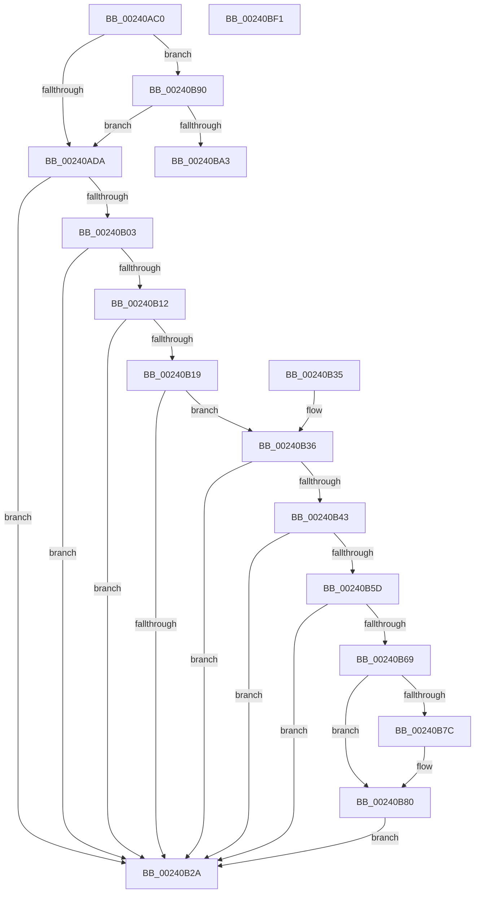

# MiGetVaAge

- RVA: `0x00240AC0`–`0x00240BF2` (길이 `306` bytes)
- VA: `0x0000000140240AC0`
- 실행 섹션: `.text`
- PDB 이름 있음: `예`; PDB Function 태그: `아니요`
- unwind 정보 RVA: `0x000617A0`
- 디코드: `72`개 명령, `306/306` bytes 표시
- 미해석 바이트: `0` (있으면 어셈블리에 `.byte`로 보존)

> 이 문서는 커널 이미지의 기계어와 PDB 기호를 분석해 생성했습니다. 4번과 5번은 함수 원형과 자료형을 바이너리 사용 방식에서 추정한 C 해석이며 원본 소스 복구 결과는 아닙니다.

## 1. Dependencies

- 직접 호출 지점: **1**; 고유 호출 대상: **1**
- 직접 호출자로 확인된 함수: **10**
- RIP 상대 이미지 참조: **1**

### Outgoing calls
- `0x00240BBB` → [MI_READ_PTE_LOCK_FREE](../28/MI_READ_PTE_LOCK_FREE_function_002828A0.md) (function, `0x002828A0`)

### Direct callers
- [MiResetAccessBitPteWorker](../22/MiResetAccessBitPteWorker_function_0022A6B8.md) at `0x0022A6E3`
- [MiEmptyWorkingSetHelper](MiEmptyWorkingSetHelper_function_00240C00.md) at `0x00240D32`
- [sub_00241476](Unknown_function_00241476.md) at `0x00241634`
- [MiActOnPte](MiActOnPte_function_00244C90.md) at `0x0024512D`
- [MiClearPteAccessed](../29/MiClearPteAccessed_function_00290630.md) at `0x00290784`
- [MI_WSLE_LOG_ACCESS](../29/MI_WSLE_LOG_ACCESS_function_00294400.md) at `0x00294447`
- [MiProcessWsInSwapFault](../36/MiProcessWsInSwapFault_function_00361EFC.md) at `0x00361F77`
- [sub_0040D91B](../40/Unknown_function_0040D91B.md) at `0x0040DA61`
- [MiSimpleAgePte](../4A/MiSimpleAgePte_function_004ACD40.md) at `0x004ACDEA`
- [MiUpdateOldPte](../4E/MiUpdateOldPte_function_004EDD20.md) at `0x004EDDD4`

### Static image references
- `0x00240B36` → RVA `0x00FC6A88` (`ALMOSTRO`; read)

## 2. Other-region calls and transfers

- 다른 실행 섹션으로 향하는 call: **0**
- 별도 외부 분기/꼬리 이동을 확인하지 못했습니다.

## 3. Assembly (complete function range)

```asm
00240AC0  48 83 EC 28                     sub rsp, 0x28
00240AC4  48 B9 00 00 00 00 80 F6 FF FF   movabs rcx, 0xfffff68000000000
00240ACE  48 8B C1                        mov rax, rcx
00240AD1  48 3B D0                        cmp rdx, rax
00240AD4  0F 83 B6 00 00 00               jae 0x140240b90
00240ADA  48 C1 EA 09                     shr rdx, 9
00240ADE  48 B8 F8 FF FF FF 7F 00 00 00   movabs rax, 0x7ffffffff8
00240AE8  48 23 D0                        and rdx, rax
00240AEB  48 8B C1                        mov rax, rcx
00240AEE  48 03 D0                        add rdx, rax
00240AF1  48 8B 02                        mov rax, qword ptr [rdx]
00240AF4  48 B9 00 D0 BE 7D FB F6 FF FF   movabs rcx, 0xfffff6fb7dbed000
00240AFE  48 3B D1                        cmp rdx, rcx
00240B01  72 27                           jb 0x140240b2a
00240B03  48 B9 F8 D7 BE 7D FB F6 FF FF   movabs rcx, 0xfffff6fb7dbed7f8
00240B0D  48 3B D1                        cmp rdx, rcx
00240B10  77 18                           ja 0x140240b2a
00240B12  48 8B C8                        mov rcx, rax
00240B15  A8 01                           test al, 1
00240B17  74 11                           je 0x140240b2a
00240B19  A8 42                           test al, 0x42
00240B1B  41 0F 95 C1                     setne r9b
00240B1F  A8 20                           test al, 0x20
00240B21  41 0F 95 C0                     setne r8b
00240B25  45 84 C8                        test r8b, r9b
00240B28  74 0C                           je 0x140240b36
00240B2A  48 C1 E8 38                     shr rax, 0x38
00240B2E  24 0F                           and al, 0xf
00240B30  48 83 C4 28                     add rsp, 0x28
00240B34  C3                              ret
00240B35  CC                              int3
00240B36  48 F7 05 47 5F D8 00 00 00 60 00  test qword ptr [rip + 0xd85f47], 0x600000
00240B41  74 E7                           je 0x140240b2a
00240B43  65 4C 8B 04 25 88 01 00 00      mov r8, qword ptr gs:[0x188]
00240B4C  4D 8B 88 B8 00 00 00            mov r9, qword ptr [r8 + 0xb8]
00240B53  41 80 B9 60 01 00 00 01         cmp byte ptr [r9 + 0x160], 1
00240B5B  74 CD                           je 0x140240b2a
00240B5D  4D 8B 81 08 05 00 00            mov r8, qword ptr [r9 + 0x508]
00240B64  4D 85 C0                        test r8, r8
00240B67  74 C1                           je 0x140240b2a
00240B69  48 C1 EA 03                     shr rdx, 3
00240B6D  81 E2 FF 01 00 00               and edx, 0x1ff
00240B73  49 8B 14 D0                     mov rdx, qword ptr [r8 + rdx*8]
00240B77  F6 C2 20                        test dl, 0x20
00240B7A  74 04                           je 0x140240b80
00240B7C  48 83 C9 20                     or rcx, 0x20
00240B80  48 8B C1                        mov rax, rcx
00240B83  48 83 C8 42                     or rax, 0x42
00240B87  F6 C2 42                        test dl, 0x42
00240B8A  48 0F 44 C1                     cmove rax, rcx
00240B8E  EB 9A                           jmp 0x140240b2a
00240B90  48 B8 FF FF FF FF FF F6 FF FF   movabs rax, 0xfffff6ffffffffff
00240B9A  48 3B D0                        cmp rdx, rax
00240B9D  0F 87 37 FF FF FF               ja 0x140240ada
00240BA3  48 C1 EA 09                     shr rdx, 9
00240BA7  48 B8 F8 FF FF FF 7F 00 00 00   movabs rax, 0x7ffffffff8
00240BB1  48 23 D0                        and rdx, rax
00240BB4  48 8B C1                        mov rax, rcx
00240BB7  48 8D 0C 10                     lea rcx, [rax + rdx]
00240BBB  E8 E0 1C 04 00                  call 0x1402828a0
00240BC0  48 C1 E8 0C                     shr rax, 0xc
00240BC4  48 B9 FF FF FF FF FF 00 00 00   movabs rcx, 0xffffffffff
00240BCE  48 23 C1                        and rax, rcx
00240BD1  48 8D 04 40                     lea rax, [rax + rax*2]
00240BD5  48 03 C0                        add rax, rax
00240BD8  48 B9 00 00 00 00 00 DE FF FF   movabs rcx, 0xffffde0000000000
00240BE2  48 8B 04 C1                     mov rax, qword ptr [rcx + rax*8]
00240BE6  48 C1 E8 2A                     shr rax, 0x2a
00240BEA  24 07                           and al, 7
00240BEC  48 83 C4 28                     add rsp, 0x28
00240BF0  C3                              ret
00240BF1  CC                              int3
```

## 4. C-style interpretation (structured pseudocode)

```c
__int64 __fastcall MiGetVaAge(__int64 a1, __int64 a2)
{
    __int64 result;
    __int64 v_rsp;

    v_rsp = (v_rsp) - (40);
    if (a2 >= a1) goto loc_00240B90;
loc_00240ADA:
    a2 = (a2) >> (9);
    a2 = (a2) & (a1);
    a2 = (a2) + (a1);
    if (a2 < a1) goto loc_00240B2A;
    if (a2 > a1) goto loc_00240B2A;
    if ((((unsigned __int8)(*(unsigned __int64 *)(a2))) & (1)) == 0) goto loc_00240B2A;
    a4 = ((((unsigned __int8)(*(unsigned __int64 *)(a2))) & (66)) != 0) ? 1 : 0;
    a3 = ((((unsigned __int8)(*(unsigned __int64 *)(a2))) & (32)) != 0) ? 1 : 0;
    if ((((unsigned __int8)(a3)) & ((unsigned __int8)(a4))) == 0) goto loc_00240B36;
loc_00240B2A:
    result = (*(unsigned __int64 *)(a2)) >> (56);
    result = (unsigned __int8)((result) & (15));
    v_rsp = (v_rsp) + (40);
    return result;
loc_00240B36:
    if (((*(unsigned __int64 *)(v_rip + 14180167)) & (0x600000ULL)) == 0) goto loc_00240B2A;
    if ((*(unsigned __int8 *)(*(unsigned __int64 *)(*(unsigned __int64 *)(gs_base + (0 + 392)) + 184) + 352)) == 1) goto loc_00240B2A;
    if (*(unsigned __int64 *)(*(unsigned __int64 *)(*(unsigned __int64 *)(gs_base + (0 + 392)) + 184) + 1288) == 0) goto loc_00240B2A;
    a2 = (a2) >> (3);
    a2 = (unsigned int)((a2) & (511));
    if ((((unsigned __int8)(*(unsigned __int64 *)(*(unsigned __int64 *)(*(unsigned __int64 *)(*(unsigned __int64 *)(gs_base + (0 + 392)) + 184) + 1288) + a2 * 8))) & (32)) != 0) {
        a1 = (*(unsigned __int64 *)(a2)) | (32);
    }
    result = (a1) | (66);
    if ((((unsigned __int8)(*(unsigned __int64 *)(*(unsigned __int64 *)(*(unsigned __int64 *)(*(unsigned __int64 *)(gs_base + (0 + 392)) + 184) + 1288) + a2 * 8))) & (66)) == 0) { result = a1; }
    goto loc_00240B2A;
loc_00240B90:
    if ((*(unsigned __int64 *)(*(unsigned __int64 *)(*(unsigned __int64 *)(*(unsigned __int64 *)(gs_base + (0 + 392)) + 184) + 1288) + a2 * 8)) > result) goto loc_00240ADA;
    a2 = (*(unsigned __int64 *)(*(unsigned __int64 *)(*(unsigned __int64 *)(*(unsigned __int64 *)(gs_base + (0 + 392)) + 184) + 1288) + a2 * 8)) >> (9);
    a2 = (a2) & (result);
    result = MI_READ_PTE_LOCK_FREE(a1 + a2 * 1, a2, *(unsigned __int64 *)(*(unsigned __int64 *)(*(unsigned __int64 *)(gs_base + (0 + 392)) + 184) + 1288), *(unsigned __int64 *)(*(unsigned __int64 *)(gs_base + (0 + 392)) + 184));
    result = (result) >> (12);
    result = (result) & (a1 + a2 * 1);
    result = (result + result * 2) + (result + result * 2);
    result = (*(unsigned __int64 *)(a1 + a2 * 1 + result * 8)) >> (42);
    result = (unsigned __int8)((result) & (7));
    v_rsp = (v_rsp) + (40);
    return result;
}
```

## 5. (Beta) C Style

```c
int64_t MiGetVaAge(int64_t Arg1, int64_t Arg2)
{
    int64_t result;
    int64_t local_rsp;

    local_rsp = (local_rsp) - (40);
    if (Arg2 >= Arg1) goto loc_00240B90;
loc_00240ADA:
    Arg2 = (Arg2) >> (9);
    Arg2 = (Arg2) & (Arg1);
    Arg2 = (Arg2) + (Arg1);
    if (Arg2 < Arg1) goto loc_00240B2A;
    if (Arg2 > Arg1) goto loc_00240B2A;
    if ((((uint8_t)(*(uint64_t *)(Arg2))) & (1)) == 0) goto loc_00240B2A;
    a4 = ((((uint8_t)(*(uint64_t *)(Arg2))) & (66)) != 0) ? 1 : 0;
    a3 = ((((uint8_t)(*(uint64_t *)(Arg2))) & (32)) != 0) ? 1 : 0;
    if ((((uint8_t)(a3)) & ((uint8_t)(a4))) == 0) goto loc_00240B36;
loc_00240B2A:
    result = (*(uint64_t *)(Arg2)) >> (56);
    result = (uint8_t)((result) & (15));
    local_rsp = (local_rsp) + (40);
    return result;
loc_00240B36:
    if (((*(uint64_t *)(v_rip + 0xD85F47)) & (0x600000ULL)) == 0) goto loc_00240B2A;
    if ((*(uint8_t *)(*(uint64_t *)(*(uint64_t *)(gs_base + (0 + 0x188)) + 0xB8) + 0x160)) == 1) goto loc_00240B2A;
    if (*(uint64_t *)(*(uint64_t *)(*(uint64_t *)(gs_base + (0 + 0x188)) + 0xB8) + 0x508) == 0) goto loc_00240B2A;
    Arg2 = (Arg2) >> (3);
    Arg2 = (uint32_t)((Arg2) & (511));
    if ((((uint8_t)(*(uint64_t *)(*(uint64_t *)(*(uint64_t *)(*(uint64_t *)(gs_base + (0 + 0x188)) + 0xB8) + 0x508) + Arg2 * 8))) & (32)) != 0) {
        Arg1 = (*(uint64_t *)(Arg2)) | (32);
    }
    result = (Arg1) | (66);
    if ((((uint8_t)(*(uint64_t *)(*(uint64_t *)(*(uint64_t *)(*(uint64_t *)(gs_base + (0 + 0x188)) + 0xB8) + 0x508) + Arg2 * 8))) & (66)) == 0) { result = Arg1; }
    goto loc_00240B2A;
loc_00240B90:
    if ((*(uint64_t *)(*(uint64_t *)(*(uint64_t *)(*(uint64_t *)(gs_base + (0 + 0x188)) + 0xB8) + 0x508) + Arg2 * 8)) > result) goto loc_00240ADA;
    Arg2 = (*(uint64_t *)(*(uint64_t *)(*(uint64_t *)(*(uint64_t *)(gs_base + (0 + 0x188)) + 0xB8) + 0x508) + Arg2 * 8)) >> (9);
    Arg2 = (Arg2) & (result);
    result = MI_READ_PTE_LOCK_FREE(Arg1 + Arg2 * 1, Arg2, *(uint64_t *)(*(uint64_t *)(*(uint64_t *)(gs_base + (0 + 0x188)) + 0xB8) + 0x508), *(uint64_t *)(*(uint64_t *)(gs_base + (0 + 0x188)) + 0xB8));
    result = (result) >> (12);
    result = (result) & (Arg1 + Arg2 * 1);
    result = (result + result * 2) + (result + result * 2);
    result = (*(uint64_t *)(Arg1 + Arg2 * 1 + result * 8)) >> (42);
    result = (uint8_t)((result) & (7));
    local_rsp = (local_rsp) + (40);
    return result;
}
```

## 6. Execution-region graph

[열기: 2D/3D 그래프와 함수 탐색 컨트롤 패널](../../../control-panel.html?section=text&rva=0x00240AC0&view=graph)

- 2D 그래프는 위에서 아래로 흐르고, 3D 그래프는 빈 공간을 드래그해 회전합니다. Shift+드래그는 이동, 휠은 확대·축소, 함수 노드 선택은 대상 보고서 이동입니다.

### Static fallback


