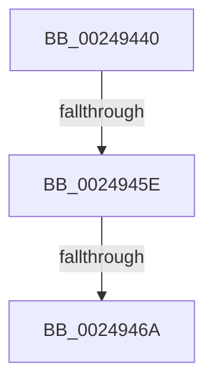

# MiIncrementSubsectionViewCount

- RVA: `0x00249440`–`0x00249475` (길이 `53` bytes)
- VA: `0x0000000140249440`
- 실행 섹션: `.text`
- PDB 이름 있음: `예`; PDB Function 태그: `아니요`
- unwind 정보 RVA: `0x000627F0`
- 디코드: `14`개 명령, `53/53` bytes 표시
- 미해석 바이트: `0` (있으면 어셈블리에 `.byte`로 보존)

> 이 문서는 커널 이미지의 기계어와 PDB 기호를 분석해 생성했습니다. 4번과 5번은 함수 원형과 자료형을 바이너리 사용 방식에서 추정한 C 해석이며 원본 소스 복구 결과는 아닙니다.

## 1. Dependencies

- 직접 호출 지점: **0**; 고유 호출 대상: **0**
- 직접 호출자로 확인된 함수: **8**
- RIP 상대 이미지 참조: **0**

### Outgoing calls
- 직접 디코드된 call 명령이 없습니다.

### Direct callers
- [MiCreatePrototypePtes](../29/MiCreatePrototypePtes_function_002950FC.md) at `0x0029526D`
- [sub_002BBD98](../2B/Unknown_function_002BBD98.md) at `0x002BBDAE`
- [MmPurgeSection](../38/MmPurgeSection_function_0038B450.md) at `0x0038B5B0`
- [MiFlushSection](../40/MiFlushSection_function_004036B0.md) at `0x004038DA`
- [MiPrepareSegmentForDeletion](../46/MiPrepareSegmentForDeletion_function_004630A8.md) at `0x00463134`
- [MiRetainSubsection](../47/MiRetainSubsection_function_00479864.md) at `0x004798A2`
- [MiSetSubsectionBase](../49/MiSetSubsectionBase_function_0049CE98.md) at `0x0049CEE3`
- [MiExtendSection](../../page/98/MiExtendSection_function_00982FDC.md) at `0x009833C8`

### Static image references
- 디코드된 RIP-relative 메모리 참조가 없습니다.

## 2. Other-region calls and transfers

- 다른 실행 섹션으로 향하는 call: **0**
- call이 아닌 외부 분기/꼬리 이동: **3**
  - `0x00249458` → [sub_00249543 + 0x22](Unknown_function_00249543.md) (`tail-transfer`)
  - `0x00249464` → [sub_00249543 + 0x18](Unknown_function_00249543.md) (`tail-transfer`)
  - `0x0024946F` → [sub_00249543 + 0x18](Unknown_function_00249543.md) (`tail-transfer`)

## 3. Assembly (complete function range)

```asm
00249440  40 56                           push rsi
00249442  57                              push rdi
00249443  48 83 EC 38                     sub rsp, 0x38
00249447  4C 8B 01                        mov r8, qword ptr [rcx]
0024944A  44 8B CA                        mov r9d, edx
0024944D  48 8B F9                        mov rdi, rcx
00249450  BE 02 00 00 00                  mov esi, 2
00249455  F6 C2 08                        test dl, 8
00249458  0F 85 07 01 00 00               jne 0x140249565
0024945E  41 8B 40 38                     mov eax, dword ptr [r8 + 0x38]
00249462  A8 20                           test al, 0x20
00249464  0F 85 F1 00 00 00               jne 0x14024955b
0024946A  49 83 78 40 00                  cmp qword ptr [r8 + 0x40], 0
0024946F  0F 84 E6 00 00 00               je 0x14024955b
```

## 4. C-style interpretation (structured pseudocode)

```c
__int64 __fastcall MiIncrementSubsectionViewCount(__int64 a1, int a2)
{
    __int64 v_rsp;

    v_rsp = (v_rsp) - (56);
}
```

## 5. (Beta) C Style

```c
int64_t MiIncrementSubsectionViewCount(void *Arg1, int32_t Arg2)
{
    uint8_t *arg1 = (uint8_t *)Arg1;

    int64_t local_rsp;

    local_rsp = (local_rsp) - (56);
}
```

### 관측된 메모리 오프셋

구조체 형식이 확인되지 않은 접근은 인자 기준의 오프셋으로만 기록했습니다.

| 기준 인자 | 오프셋 표현 | 폭 (bit) | 접근 |
|---|---:|---:|---|
| `Arg1` | `+ 0x0` | `64` | `R` |

## 6. Execution-region graph

[열기: 2D/3D 그래프와 함수 탐색 컨트롤 패널](../../../control-panel.html?section=text&rva=0x00249440&view=graph)

- 2D 그래프는 위에서 아래로 흐르고, 3D 그래프는 빈 공간을 드래그해 회전합니다. Shift+드래그는 이동, 휠은 확대·축소, 함수 노드 선택은 대상 보고서 이동입니다.

### Static fallback


