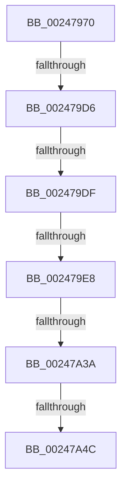

# MiInsertCachedPte

- RVA: `0x00247970`–`0x00247A59` (길이 `233` bytes)
- VA: `0x0000000140247970`
- 실행 섹션: `.text`
- PDB 이름 있음: `예`; PDB Function 태그: `아니요`
- unwind 정보 RVA: `0x000623D0`
- 디코드: `56`개 명령, `233/233` bytes 표시
- 미해석 바이트: `0` (있으면 어셈블리에 `.byte`로 보존)

> 이 문서는 커널 이미지의 기계어와 PDB 기호를 분석해 생성했습니다. 4번과 5번은 함수 원형과 자료형을 바이너리 사용 방식에서 추정한 C 해석이며 원본 소스 복구 결과는 아닙니다.

## 1. Dependencies

- 직접 호출 지점: **0**; 고유 호출 대상: **0**
- 직접 호출자로 확인된 함수: **2**
- RIP 상대 이미지 참조: **3**

### Outgoing calls
- 직접 디코드된 call 명령이 없습니다.

### Direct callers
- [MiReleasePtes](MiReleasePtes_function_00247240.md) at `0x002473C1`
- [MiUnmapContiguousMemory](../3F/MiUnmapContiguousMemory_function_003F7908.md) at `0x003F7A3F`

### Static image references
- `0x00247A0F` → RVA `0x00FC5000` (`ALMOSTRO`; read)
- `0x00247A29` → RVA `0x00FCF080` (`CACHEALI`; read)
- `0x00247A4C` → RVA `0x00E2DC80` (`.data`; read)

## 2. Other-region calls and transfers

- 다른 실행 섹션으로 향하는 call: **0**
- call이 아닌 외부 분기/꼬리 이동: **5**
  - `0x002479D0` → [sub_00247B71](Unknown_function_00247B71.md) (`tail-transfer`)
  - `0x002479D9` → [sub_00247BC3 + 0x61](Unknown_function_00247BC3.md) (`tail-transfer`)
  - `0x002479E2` → [sub_00247BC3](Unknown_function_00247BC3.md) (`tail-transfer`)
  - `0x00247A34` → [sub_00247D90](Unknown_function_00247D90.md) (`tail-transfer`)
  - `0x00247A46` → [sub_00247BC3 + 0x3A](Unknown_function_00247BC3.md) (`tail-transfer`)

## 3. Assembly (complete function range)

```asm
00247970  48 89 4C 24 08                  mov qword ptr [rsp + 8], rcx
00247975  53                              push rbx
00247976  55                              push rbp
00247977  56                              push rsi
00247978  57                              push rdi
00247979  41 54                           push r12
0024797B  41 55                           push r13
0024797D  41 56                           push r14
0024797F  48 83 EC 50                     sub rsp, 0x50
00247983  4C 8B 69 20                     mov r13, qword ptr [rcx + 0x20]
00247987  45 33 DB                        xor r11d, r11d
0024798A  41 81 F8 00 02 00 00            cmp r8d, 0x200
00247991  41 8B D8                        mov ebx, r8d
00247994  41 8B EB                        mov ebp, r11d
00247997  4C 89 5C 24 20                  mov qword ptr [rsp + 0x20], r11
0024799C  48 8B C2                        mov rax, rdx
0024799F  48 89 5C 24 38                  mov qword ptr [rsp + 0x38], rbx
002479A4  40 0F 93 C5                     setae bpl
002479A8  49 B9 00 00 00 00 80 F6 FF FF   movabs r9, 0xfffff68000000000
002479B2  48 C1 E0 19                     shl rax, 0x19
002479B6  48 8B F2                        mov rsi, rdx
002479B9  4C 8B D1                        mov r10, rcx
002479BC  49 8B D1                        mov rdx, r9
002479BF  48 C1 E2 19                     shl rdx, 0x19
002479C3  48 2B C2                        sub rax, rdx
002479C6  48 C1 F8 10                     sar rax, 0x10
002479CA  49 8B C9                        mov rcx, r9
002479CD  48 3B C1                        cmp rax, rcx
002479D0  0F 83 9B 01 00 00               jae 0x140247b71
002479D6  49 3B F5                        cmp rsi, r13
002479D9  0F 84 45 02 00 00               je 0x140247c24
002479DF  83 FB 01                        cmp ebx, 1
002479E2  0F 85 DB 01 00 00               jne 0x140247bc3
002479E8  48 C7 84 24 A8 00 00 00 02 00 00 00  mov qword ptr [rsp + 0xa8], 2
002479F4  65 48 8B 04 25 20 00 00 00      mov rax, qword ptr gs:[0x20]
002479FD  48 8B 88 C0 00 00 00            mov rcx, qword ptr [rax + 0xc0]
00247A04  49 8B 42 50                     mov rax, qword ptr [r10 + 0x50]
00247A08  0F B7 91 8A 00 00 00            movzx edx, word ptr [rcx + 0x8a]
00247A0F  0F B7 0D EA D5 D7 00            movzx ecx, word ptr [rip + 0xd7d5ea]
00247A16  0F AF CD                        imul ecx, ebp
00247A19  48 03 CA                        add rcx, rdx
00247A1C  48 8D 0C C9                     lea rcx, [rcx + rcx*8]
00247A20  4C 8D 34 C8                     lea r14, [rax + rcx*8]
00247A24  F0 44 09 1C 24                  lock or dword ptr [rsp], r11d
00247A29  8B 05 51 76 D8 00               mov eax, dword ptr [rip + 0xd87651]
00247A2F  0F B7 F8                        movzx edi, ax
00247A32  85 FF                           test edi, edi
00247A34  0F 84 56 03 00 00               je 0x140247d90
00247A3A  8B C7                           mov eax, edi
00247A3C  83 E0 07                        and eax, 7
00247A3F  4D 8D 24 C6                     lea r12, [r14 + rax*8]
00247A43  83 FD 02                        cmp ebp, 2
00247A46  0F 84 B1 01 00 00               je 0x140247bfd
00247A4C  48 8B 15 2D 62 BE 00            mov rdx, qword ptr [rip + 0xbe622d]
00247A53  8B C7                           mov eax, edi
00247A55  48 C1 E0 19                     shl rax, 0x19
```

## 4. C-style interpretation (structured pseudocode)

```c
__int64 __fastcall MiInsertCachedPte(__int64 a1, __int64 a2, int a3)
{
    __int64 result;
    __int64 v_r11;
    __int64 v_rbp;
    __int64 v_rsp;
    unsigned __int64 v_stack_m50;
    unsigned __int64 v_stack_m68;
    unsigned int v_stack_m88;
    unsigned __int64 v_stack_p20;
    unsigned __int64 v_stack_p8;

    v_stack_p8 = a1;
    v_rsp = (v_rsp) - (80);
    v_r11 = 0;
    v_stack_m68 = 0;
    v_stack_m50 = (unsigned int)(a3);
    v_rbp = (a3 >= 512) ? 1 : 0;
    result = (a2) << (25);
    a2 = (a4) << (25);
    result = (result) - (a2);
    result = (result) >> (16);
    v_stack_p20 = 2;
    a1 = (unsigned int)((*(unsigned __int16 *)(v_rip + 14145002)) * ((unsigned int)(v_rbp)));
    a1 = (a1) + (*(unsigned __int16 *)(*(unsigned __int64 *)(*(unsigned __int64 *)(gs_base + (0 + 32)) + 192) + 138));
    result = (unsigned int)(((unsigned int)((unsigned int)((unsigned __int16)((unsigned int)(*(unsigned int *)(v_rip + 14186065)))))) & (7));
    result = ((unsigned int)((unsigned int)((unsigned __int16)((unsigned int)(*(unsigned int *)(v_rip + 14186065)))))) << (25);
    return result;
}
```

## 5. (Beta) C Style

```c
int64_t MiInsertCachedPte(void *Arg1, int64_t Arg2, int32_t Arg3)
{
    uint8_t *arg1 = (uint8_t *)Arg1;

    int64_t result;
    int64_t local_r11;
    int64_t local_rbp;
    int64_t local_rsp;
    uint64_t v_stack_m50;
    uint64_t v_stack_m68;
    uint32_t v_stack_m88;
    uint64_t v_stack_p20;
    uint64_t v_stack_p8;

    v_stack_p8 = Arg1;
    local_rsp = (local_rsp) - (80);
    local_r11 = 0;
    v_stack_m68 = 0;
    v_stack_m50 = (uint32_t)(Arg3);
    local_rbp = (Arg3 >= 512) ? 1 : 0;
    result = (Arg2) << (25);
    Arg2 = (a4) << (25);
    result = (result) - (Arg2);
    result = (result) >> (16);
    v_stack_p20 = 2;
    Arg1 = (uint32_t)((*(uint16_t *)(v_rip + 0xD7D5EA)) * ((uint32_t)(local_rbp)));
    Arg1 = (Arg1) + (*(uint16_t *)(*(uint64_t *)(*(uint64_t *)(gs_base + (0 + 0x20)) + 0xC0) + 0x8A));
    result = (uint32_t)(((uint32_t)((uint32_t)((uint16_t)((uint32_t)(*(uint32_t *)(v_rip + 0xD87651)))))) & (7));
    result = ((uint32_t)((uint32_t)((uint16_t)((uint32_t)(*(uint32_t *)(v_rip + 0xD87651)))))) << (25);
    return result;
}
```

### 관측된 메모리 오프셋

구조체 형식이 확인되지 않은 접근은 인자 기준의 오프셋으로만 기록했습니다.

| 기준 인자 | 오프셋 표현 | 폭 (bit) | 접근 |
|---|---:|---:|---|
| `Arg1` | `+ 0x20` | `64` | `R` |
| `Arg1` | `+ 0x50` | `64` | `R` |

## 6. Execution-region graph

[열기: 2D/3D 그래프와 함수 탐색 컨트롤 패널](../../../control-panel.html?section=text&rva=0x00247970&view=graph)

- 2D 그래프는 위에서 아래로 흐르고, 3D 그래프는 빈 공간을 드래그해 회전합니다. Shift+드래그는 이동, 휠은 확대·축소, 함수 노드 선택은 대상 보고서 이동입니다.

### Static fallback


