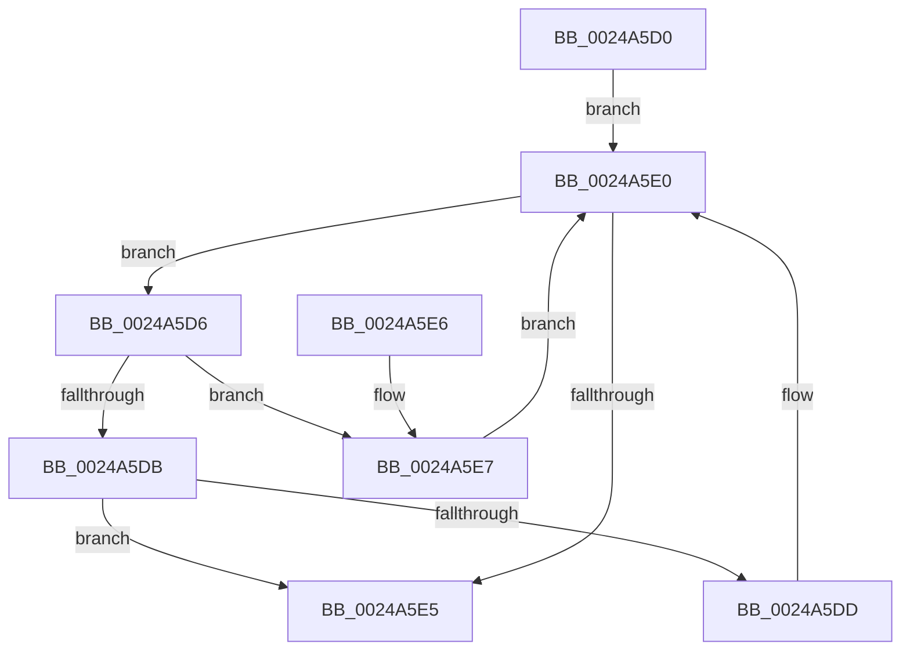

# MiLocateSessionProtosInSubsection

- RVA: `0x0024A5D0`–`0x0024A5ED` (길이 `29` bytes)
- VA: `0x000000014024A5D0`
- 실행 섹션: `.text`
- PDB 이름 있음: `예`; PDB Function 태그: `아니요`
- unwind 정보 RVA: `0x000DB714`
- 디코드: `12`개 명령, `29/29` bytes 표시
- 미해석 바이트: `0` (있으면 어셈블리에 `.byte`로 보존)

> 이 문서는 커널 이미지의 기계어와 PDB 기호를 분석해 생성했습니다. 4번과 5번은 함수 원형과 자료형을 바이너리 사용 방식에서 추정한 C 해석이며 원본 소스 복구 결과는 아닙니다.

## 1. Dependencies

- 직접 호출 지점: **0**; 고유 호출 대상: **0**
- 직접 호출자로 확인된 함수: **4**
- RIP 상대 이미지 참조: **0**

### Outgoing calls
- 직접 디코드된 call 명령이 없습니다.

### Direct callers
- [sub_0024A15A](Unknown_function_0024A15A.md) at `0x0024A1B6`
- [MiGetSharedProtosAtDpc](../42/MiGetSharedProtosAtDpc_function_0042F924.md) at `0x0042F949`
- [MiDereferenceSubsectionProtos](../../page/A2/MiDereferenceSubsectionProtos_function_00A2EEE4.md) at `0x00A2EF13`
- [MiCreatePerSessionProtos](../../page/A6/MiCreatePerSessionProtos_function_00A666D8.md) at `0x00A667C6`

### Static image references
- 디코드된 RIP-relative 메모리 참조가 없습니다.

## 2. Other-region calls and transfers

- 다른 실행 섹션으로 향하는 call: **0**
- 별도 외부 분기/꼬리 이동을 확인하지 못했습니다.

## 3. Assembly (complete function range)

```asm
0024A5D0  48 8B 41 18                     mov rax, qword ptr [rcx + 0x18]
0024A5D4  EB 0A                           jmp 0x14024a5e0
0024A5D6  3B 50 40                        cmp edx, dword ptr [rax + 0x40]
0024A5D9  77 0C                           ja 0x14024a5e7
0024A5DB  73 08                           jae 0x14024a5e5
0024A5DD  48 8B 00                        mov rax, qword ptr [rax]
0024A5E0  48 85 C0                        test rax, rax
0024A5E3  75 F1                           jne 0x14024a5d6
0024A5E5  C3                              ret
0024A5E6  CC                              int3
0024A5E7  48 8B 40 08                     mov rax, qword ptr [rax + 8]
0024A5EB  EB F3                           jmp 0x14024a5e0
```

## 4. C-style interpretation (structured pseudocode)

```c
__int64 __fastcall MiLocateSessionProtosInSubsection(__int64 a1, int a2)
{
    goto loc_0024A5E0;
loc_0024A5D6:
    if (a2 > (*(unsigned int *)(*(unsigned __int64 *)(a1 + 24) + 64))) goto loc_0024A5E7;
    if (a2 >= (*(unsigned int *)(*(unsigned __int64 *)(a1 + 24) + 64))) goto loc_0024A5E5;
loc_0024A5E0:
    if (*(unsigned __int64 *)(*(unsigned __int64 *)(a1 + 24)) != 0) goto loc_0024A5D6;
loc_0024A5E5:
    return *(unsigned __int64 *)(*(unsigned __int64 *)(a1 + 24));
loc_0024A5E7:
    goto loc_0024A5E0;
}
```

## 5. (Beta) C Style

```c
int64_t MiLocateSessionProtosInSubsection(void *Arg1, int32_t Arg2)
{
    uint8_t *arg1 = (uint8_t *)Arg1;

    goto loc_0024A5E0;
loc_0024A5D6:
    if (Arg2 > (*(uint32_t *)(*(uint64_t *)(arg1 + 0x18) + 0x40))) goto loc_0024A5E7;
    if (Arg2 >= (*(uint32_t *)(*(uint64_t *)(arg1 + 0x18) + 0x40))) goto loc_0024A5E5;
loc_0024A5E0:
    if (*(uint64_t *)(*(uint64_t *)(arg1 + 0x18)) != 0) goto loc_0024A5D6;
loc_0024A5E5:
    return *(uint64_t *)(*(uint64_t *)(arg1 + 0x18));
loc_0024A5E7:
    goto loc_0024A5E0;
}
```

### 관측된 메모리 오프셋

구조체 형식이 확인되지 않은 접근은 인자 기준의 오프셋으로만 기록했습니다.

| 기준 인자 | 오프셋 표현 | 폭 (bit) | 접근 |
|---|---:|---:|---|
| `Arg1` | `+ 0x18` | `64` | `R` |

## 6. Execution-region graph

[열기: 2D/3D 그래프와 함수 탐색 컨트롤 패널](../../../control-panel.html?section=text&rva=0x0024A5D0&view=graph)

- 2D 그래프는 위에서 아래로 흐르고, 3D 그래프는 빈 공간을 드래그해 회전합니다. Shift+드래그는 이동, 휠은 확대·축소, 함수 노드 선택은 대상 보고서 이동입니다.

### Static fallback


