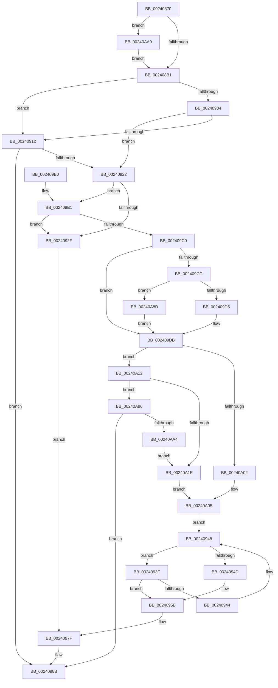

# MiLogPageAccess

- RVA: `0x00240870`–`0x00240AB5` (길이 `581` bytes)
- VA: `0x0000000140240870`
- 실행 섹션: `.text`
- PDB 이름 있음: `예`; PDB Function 태그: `아니요`
- unwind 정보 RVA: `0x00061780`
- 디코드: `151`개 명령, `581/581` bytes 표시
- 미해석 바이트: `0` (있으면 어셈블리에 `.byte`로 보존)

> 이 문서는 커널 이미지의 기계어와 PDB 기호를 분석해 생성했습니다. 4번과 5번은 함수 원형과 자료형을 바이너리 사용 방식에서 추정한 C 해석이며 원본 소스 복구 결과는 아닙니다.

## 1. Dependencies

- 직접 호출 지점: **7**; 고유 호출 대상: **7**
- 직접 호출자로 확인된 함수: **7**
- RIP 상대 이미지 참조: **2**

### Outgoing calls
- `0x002408C9` → [MI_READ_PTE_LOCK_FREE](../28/MI_READ_PTE_LOCK_FREE_function_002828A0.md) (function, `0x002828A0`)
- `0x002408F7` → [MiLockWorkingSetCoreExclusive](../2C/MiLockWorkingSetCoreExclusive_function_002C0CFC.md) (function, `0x002C0CFC`)
- `0x00240915` → [MiAllocateAccessLog](../36/MiAllocateAccessLog_function_0036B04C.md) (function, `0x0036B04C`)
- `0x0024098E` → [MiUnlockWorkingSetCoreExclusive](../2C/MiUnlockWorkingSetCoreExclusive_function_002C0DC4.md) (function, `0x002C0DC4`)
- `0x00240A2C` → [MiReferenceControlAreaFileWithTag](../34/MiReferenceControlAreaFileWithTag_function_00348390.md) (function, `0x00348390`)
- `0x00240A42` → [ObFastDereferenceObjectDeferDelete](../23/ObFastDereferenceObjectDeferDelete_function_002378C0.md) (function, `0x002378C0`)
- `0x00240A51` → [MiStartingOffset](../34/MiStartingOffset_function_003482E0.md) (function, `0x003482E0`)

### Direct callers
- [MiResetAccessBitPteWorker](../22/MiResetAccessBitPteWorker_function_0022A6B8.md) at `0x0022A7BF`
- [MiEmptyWorkingSetHelper](MiEmptyWorkingSetHelper_function_00240C00.md) at `0x00240D74`
- [sub_00241476](Unknown_function_00241476.md) at `0x00241677`
- [MiClearPteAccessed](../29/MiClearPteAccessed_function_00290630.md) at `0x00290936`
- [MI_WSLE_LOG_ACCESS](../29/MI_WSLE_LOG_ACCESS_function_00294400.md) at `0x00294484`
- [MiCopyOnWrite](../36/MiCopyOnWrite_function_00362A0C.md) at `0x003632B3`
- [MiIssueHardFault](../38/MiIssueHardFault_function_00380074.md) at `0x00380613`

### Static image references
- `0x00240890` → RVA `0x00E38868` (`.data`; read)
- `0x002409C0` → RVA `0x00E2DC80` (`.data`; read)

## 2. Other-region calls and transfers

- 다른 실행 섹션으로 향하는 call: **0**
- 별도 외부 분기/꼬리 이동을 확인하지 못했습니다.

## 3. Assembly (complete function range)

```asm
00240870  48 8B C4                        mov rax, rsp
00240873  48 89 58 10                     mov qword ptr [rax + 0x10], rbx
00240877  48 89 68 18                     mov qword ptr [rax + 0x18], rbp
0024087B  48 89 70 20                     mov qword ptr [rax + 0x20], rsi
0024087F  57                              push rdi
00240880  41 54                           push r12
00240882  41 55                           push r13
00240884  41 56                           push r14
00240886  41 57                           push r15
00240888  48 83 EC 20                     sub rsp, 0x20
0024088C  83 60 08 00                     and dword ptr [rax + 8], 0
00240890  48 8D 3D D1 7F BF 00            lea rdi, [rip + 0xbf7fd1]
00240897  C7 40 0C 03 00 00 00            mov dword ptr [rax + 0xc], 3
0024089E  48 8B E9                        mov rbp, rcx
002408A1  8B 81 B8 00 00 00               mov eax, dword ptr [rcx + 0xb8]
002408A7  24 0F                           and al, 0xf
002408A9  3C 01                           cmp al, 1
002408AB  0F 85 F8 01 00 00               jne 0x140240aa9
002408B1  4C 8B FA                        mov r15, rdx
002408B4  48 8B F2                        mov rsi, rdx
002408B7  48 83 E6 FE                     and rsi, 0xfffffffffffffffe
002408BB  41 83 E7 01                     and r15d, 1
002408BF  4D 85 FF                        test r15, r15
002408C2  48 0F 44 F2                     cmove rsi, rdx
002408C6  48 8B CE                        mov rcx, rsi
002408C9  E8 D2 1F 04 00                  call 0x1402828a0
002408CE  48 C1 E8 0C                     shr rax, 0xc
002408D2  48 B9 FF FF FF FF FF 00 00 00   movabs rcx, 0xffffffffff
002408DC  48 23 C1                        and rax, rcx
002408DF  4C 8D 34 40                     lea r14, [rax + rax*2]
002408E3  49 C1 E6 04                     shl r14, 4
002408E7  48 B8 00 00 00 00 00 DE FF FF   movabs rax, 0xffffde0000000000
002408F1  48 8B CD                        mov rcx, rbp
002408F4  4C 03 F0                        add r14, rax
002408F7  E8 00 04 08 00                  call 0x1402c0cfc
002408FC  48 8B 3F                        mov rdi, qword ptr [rdi]
002408FF  48 85 FF                        test rdi, rdi
00240902  74 0E                           je 0x140240912
00240904  48 8B 47 20                     mov rax, qword ptr [rdi + 0x20]
00240908  48 83 C0 08                     add rax, 8
0024090C  48 3B 47 28                     cmp rax, qword ptr [rdi + 0x28]
00240910  76 10                           jbe 0x140240922
00240912  48 8B CD                        mov rcx, rbp
00240915  E8 32 A7 12 00                  call 0x14036b04c
0024091A  48 8B F8                        mov rdi, rax
0024091D  48 85 C0                        test rax, rax
00240920  74 69                           je 0x14024098b
00240922  49 8B 4E 28                     mov rcx, qword ptr [r14 + 0x28]
00240926  48 85 C9                        test rcx, rcx
00240929  0F 88 82 00 00 00               js 0x1402409b1
0024092F  41 8B CF                        mov ecx, r15d
00240932  48 C1 E1 09                     shl rcx, 9
00240936  48 C1 E6 10                     shl rsi, 0x10
0024093A  48 0B CE                        or rcx, rsi
0024093D  EB 40                           jmp 0x14024097f
0024093F  48 39 32                        cmp qword ptr [rdx], rsi
00240942  74 17                           je 0x14024095b
00240944  48 83 C2 08                     add rdx, 8
00240948  49 3B D4                        cmp rdx, r12
0024094B  76 F2                           jbe 0x14024093f
0024094D  48 8B D1                        mov rdx, rcx
00240950  48 83 C1 F8                     add rcx, -8
00240954  48 89 4F 28                     mov qword ptr [rdi + 0x28], rcx
00240958  48 89 32                        mov qword ptr [rdx], rsi
0024095B  48 8B 4F 30                     mov rcx, qword ptr [rdi + 0x30]
0024095F  48 25 00 FC FF FF               and rax, 0xfffffffffffffc00
00240965  48 2B CA                        sub rcx, rdx
00240968  41 8B D7                        mov edx, r15d
0024096B  48 C1 F9 03                     sar rcx, 3
0024096F  81 E1 FF 01 00 00               and ecx, 0x1ff
00240975  48 C1 E2 09                     shl rdx, 9
00240979  48 0B CA                        or rcx, rdx
0024097C  48 0B C8                        or rcx, rax
0024097F  48 8B 47 20                     mov rax, qword ptr [rdi + 0x20]
00240983  48 89 08                        mov qword ptr [rax], rcx
00240986  48 83 47 20 08                  add qword ptr [rdi + 0x20], 8
0024098B  48 8B CD                        mov rcx, rbp
0024098E  E8 31 04 08 00                  call 0x1402c0dc4
00240993  48 8B 5C 24 58                  mov rbx, qword ptr [rsp + 0x58]
00240998  48 8B 6C 24 60                  mov rbp, qword ptr [rsp + 0x60]
0024099D  48 8B 74 24 68                  mov rsi, qword ptr [rsp + 0x68]
002409A2  48 83 C4 20                     add rsp, 0x20
002409A6  41 5F                           pop r15
002409A8  41 5E                           pop r14
002409AA  41 5D                           pop r13
002409AC  41 5C                           pop r12
002409AE  5F                              pop rdi
002409AF  C3                              ret
002409B0  CC                              int3
002409B1  49 8B 5E 10                     mov rbx, qword ptr [r14 + 0x10]
002409B5  48 0F BA E3 0A                  bt rbx, 0xa
002409BA  0F 83 6F FF FF FF               jae 0x14024092f
002409C0  48 8B 05 B9 D2 BE 00            mov rax, qword ptr [rip + 0xbed2b9]
002409C7  48 85 C0                        test rax, rax
002409CA  74 0F                           je 0x1402409db
002409CC  F6 C3 10                        test bl, 0x10
002409CF  0F 85 B8 00 00 00               jne 0x140240a8d
002409D5  48 F7 D0                        not rax
002409D8  48 23 D8                        and rbx, rax
002409DB  4D 8B 76 08                     mov r14, qword ptr [r14 + 8]
002409DF  48 B8 00 00 00 00 00 00 00 80   movabs rax, 0x8000000000000000
002409E9  4C 8B 67 30                     mov r12, qword ptr [rdi + 0x30]
002409ED  4C 0B F0                        or r14, rax
002409F0  49 8B C6                        mov rax, r14
002409F3  48 C1 FB 10                     sar rbx, 0x10
002409F7  48 C1 E0 10                     shl rax, 0x10
002409FB  48 83 7F 38 01                  cmp qword ptr [rdi + 0x38], 1
00240A00  76 10                           jbe 0x140240a12
00240A02  48 8B F3                        mov rsi, rbx
00240A05  48 8B 4F 28                     mov rcx, qword ptr [rdi + 0x28]
00240A09  48 8D 51 08                     lea rdx, [rcx + 8]
00240A0D  E9 36 FF FF FF                  jmp 0x140240948
00240A12  8B 43 20                        mov eax, dword ptr [rbx + 0x20]
00240A15  4C 8B 2B                        mov r13, qword ptr [rbx]
00240A18  0F BA E0 11                     bt eax, 0x11
00240A1C  72 78                           jb 0x140240a96
00240A1E  BA 4D 6D 53 63                  mov edx, 0x63536d4d
00240A23  41 B8 01 00 00 00               mov r8d, 1
00240A29  49 8B CD                        mov rcx, r13
00240A2C  E8 5F 79 10 00                  call 0x140348390
00240A31  49 8D 4D 40                     lea rcx, [r13 + 0x40]
00240A35  41 B8 4D 6D 53 63               mov r8d, 0x63536d4d
00240A3B  48 8B D0                        mov rdx, rax
00240A3E  48 8B 70 18                     mov rsi, qword ptr [rax + 0x18]
00240A42  E8 79 6E FF FF                  call 0x1402378c0
00240A47  41 83 C8 FF                     or r8d, 0xffffffff
00240A4B  49 8B D6                        mov rdx, r14
00240A4E  48 8B CB                        mov rcx, rbx
00240A51  E8 8A 78 10 00                  call 0x1403482e0
00240A56  41 8B 55 38                     mov edx, dword ptr [r13 + 0x38]
00240A5A  8B CA                           mov ecx, edx
00240A5C  48 C1 E9 05                     shr rcx, 5
00240A60  83 E2 20                        and edx, 0x20
00240A63  83 E1 01                        and ecx, 1
00240A66  C1 E2 05                        shl edx, 5
00240A69  8B 4C 8C 50                     mov ecx, dword ptr [rsp + rcx*4 + 0x50]
00240A6D  48 D3 E0                        shl rax, cl
00240A70  48 89 44 24 50                  mov qword ptr [rsp + 0x50], rax
00240A75  0F BA F0 0A                     btr eax, 0xa
00240A79  0B D0                           or edx, eax
00240A7B  89 54 24 50                     mov dword ptr [rsp + 0x50], edx
00240A7F  49 83 EC 08                     sub r12, 8
00240A83  48 8B 44 24 50                  mov rax, qword ptr [rsp + 0x50]
00240A88  E9 78 FF FF FF                  jmp 0x140240a05
00240A8D  48 83 E3 EF                     and rbx, 0xffffffffffffffef
00240A91  E9 45 FF FF FF                  jmp 0x1402409db
00240A96  41 F7 45 38 00 00 00 08         test dword ptr [r13 + 0x38], 0x8000000
00240A9E  0F 85 E7 FE FF FF               jne 0x14024098b
00240AA4  E9 75 FF FF FF                  jmp 0x140240a1e
00240AA9  48 8D B9 E8 00 00 00            lea rdi, [rcx + 0xe8]
00240AB0  E9 FC FD FF FF                  jmp 0x1402408b1
```

## 4. C-style interpretation (structured pseudocode)

```c
__int64 __fastcall MiLogPageAccess(__int64 a1, __int64 a2)
{
    __int64 result;
    __int64 v_r12;
    __int64 v_r14;
    __int64 v_r15;
    __int64 v_rbx;
    __int64 v_rsi;
    __int64 v_rsp;
    unsigned __int64 v_stack_p10;
    unsigned __int64 v_stack_p18;
    unsigned __int64 v_stack_p20;
    unsigned __int64 v_stack_p50;

    *(unsigned __int64 *)(v_rsp + 16) = v_rbx;
    *(unsigned __int64 *)(v_rsp + 24) = v_rbp;
    *(unsigned __int64 *)(v_rsp + 32) = v_rsi;
    v_rsp = (v_rsp) - (32);
    *(unsigned int *)(v_rsp + 12) = 3;
    result = (unsigned __int8)(((unsigned int)(*(unsigned int *)(a1 + 184))) & (15));
    if (((unsigned __int8)(result)) != 1) goto loc_00240AA9;
loc_002408B1:
    v_rsi = (a2) & (-2);
    v_r15 = (unsigned int)((a2) & (1));
    if (v_r15 == 0) { v_rsi = a2; }
    result = MI_READ_PTE_LOCK_FREE(v_rsi, a2, a3, a4);
    result = (result) >> (12);
    result = (result) & (v_rsi);
    v_r14 = (result + result * 2) << (4);
    v_r14 = (v_r14) + (result);
    result = MiLockWorkingSetCoreExclusive(a1, a2, a3, a4);
    if (*(unsigned __int64 *)(v_rip + 12550097) == 0) goto loc_00240912;
    result = (*(unsigned __int64 *)(*(unsigned __int64 *)(v_rip + 12550097) + 32)) + (8);
    if (result <= (*(unsigned __int64 *)(*(unsigned __int64 *)(v_rip + 12550097) + 40))) goto loc_00240922;
loc_00240912:
    result = MiAllocateAccessLog(a1, a2, a3, a4);
    if (result == 0) goto loc_0024098B;
loc_00240922:
    if (sign_flag) goto loc_002409B1;
loc_0024092F:
    a1 = ((unsigned int)((unsigned int)(v_r15))) << (9);
    v_rsi = (v_rsi) << (16);
    a1 = (a1) | (v_rsi);
    goto loc_0024097F;
loc_0024093F:
    if ((*(unsigned __int64 *)(a2)) == v_rsi) goto loc_0024095B;
    a2 = (a2) + (8);
loc_00240948:
    if (a2 <= v_r12) goto loc_0024093F;
    a1 = (a1) + (-8);
    *(unsigned __int64 *)(result + 40) = a1;
    *(unsigned __int64 *)(a1) = v_rsi;
loc_0024095B:
    result = (result) & (0xFFFFFFFFFFFFFC00ULL);
    a1 = (*(unsigned __int64 *)(result + 48)) - (a1);
    a1 = (a1) >> (3);
    a1 = (unsigned int)((a1) & (511));
    a2 = ((unsigned int)((unsigned int)(v_r15))) << (9);
    a1 = (a1) | (a2);
    a1 = (a1) | (result);
loc_0024097F:
    *(unsigned __int64 *)(*(unsigned __int64 *)(result + 32)) = a1;
loc_0024098B:
    result = MiUnlockWorkingSetCoreExclusive(a1, a2, a3, a4);
    v_rsp = (v_rsp) + (32);
    return result;
loc_002409B1:
    if (condition_is_above_or_equal) goto loc_0024092F;
    if (*(unsigned __int64 *)(v_rip + 12505785) == 0) goto loc_002409DB;
    if ((((unsigned __int8)(*(unsigned __int64 *)(v_r14 + 16))) & (16)) != 0) goto loc_00240A8D;
    result = ~(*(unsigned __int64 *)(v_rip + 12505785));
    v_rbx = (*(unsigned __int64 *)(v_r14 + 16)) & (result);
loc_002409DB:
    v_r14 = (*(unsigned __int64 *)(v_r14 + 8)) | (result);
    v_rbx = (v_rbx) >> (16);
    result = (v_r14) << (16);
    if ((*(unsigned __int64 *)(result + 56)) <= 1) goto loc_00240A12;
loc_00240A05:
    goto loc_00240948;
loc_00240A12:
    if ((*(unsigned __int64 *)(result + 56)) < 1) goto loc_00240A96;
loc_00240A1E:
    result = MiReferenceControlAreaFileWithTag(*(unsigned __int64 *)(v_rbx), (unsigned int)(0x63536D4DULL), 1, a4);
    result = ObFastDereferenceObjectDeferDelete(*(unsigned __int64 *)(v_rbx) + 64, result, (unsigned int)(0x63536D4DULL), a4);
    a3 = (unsigned int)(((unsigned int)(0x63536D4DULL)) | (0xFFFFFFFFULL));
    result = MiStartingOffset(v_rbx, v_r14, a3, a4);
    a1 = ((unsigned int)((unsigned int)((unsigned int)(*(unsigned int *)(*(unsigned __int64 *)(v_rbx) + 56))))) >> (5);
    a2 = (unsigned int)(((unsigned int)(*(unsigned int *)(*(unsigned __int64 *)(v_rbx) + 56))) & (32));
    a1 = (unsigned int)((a1) & (1));
    a2 = (unsigned int)((a2) << (5));
    result = (result) << ((unsigned __int8)((unsigned int)(*(unsigned int *)(v_rsp + a1 * 4 + 80))));
    v_stack_p50 = result;
    a2 = (unsigned int)((a2) | ((unsigned int)(result)));
    v_stack_p50 = (unsigned int)(a2);
    v_r12 = (*(unsigned __int64 *)(result + 48)) - (8);
    goto loc_00240A05;
loc_00240A8D:
    v_rbx = (v_rbx) & (-17);
    goto loc_002409DB;
loc_00240A96:
    if (((*(unsigned int *)(*(unsigned __int64 *)(v_rbx) + 56)) & (0x8000000ULL)) != 0) goto loc_0024098B;
    goto loc_00240A1E;
loc_00240AA9:
    goto loc_002408B1;
}
```

## 5. (Beta) C Style

```c
int64_t MiLogPageAccess(void *Arg1, int64_t Arg2)
{
    uint8_t *arg1 = (uint8_t *)Arg1;

    int64_t result;
    int64_t local_r12;
    int64_t local_r14;
    int64_t local_r15;
    int64_t local_rbx;
    int64_t local_rsi;
    int64_t local_rsp;
    uint64_t v_stack_p10;
    uint64_t v_stack_p18;
    uint64_t v_stack_p20;
    uint64_t v_stack_p50;

    *(uint64_t *)(local_rsp + 0x10) = local_rbx;
    *(uint64_t *)(local_rsp + 0x18) = local_rbp;
    *(uint64_t *)(local_rsp + 0x20) = local_rsi;
    local_rsp = (local_rsp) - (32);
    *(uint32_t *)(local_rsp + 0xC) = 3;
    result = (uint8_t)(((uint32_t)(*(uint32_t *)(arg1 + 0xB8))) & (15));
    if (((uint8_t)(result)) != 1) goto loc_00240AA9;
loc_002408B1:
    local_rsi = (Arg2) & (-2);
    local_r15 = (uint32_t)((Arg2) & (1));
    if (local_r15 == 0) { local_rsi = Arg2; }
    result = MI_READ_PTE_LOCK_FREE(local_rsi, Arg2, a3, a4);
    result = (result) >> (12);
    result = (result) & (local_rsi);
    local_r14 = (result + result * 2) << (4);
    local_r14 = (local_r14) + (result);
    result = MiLockWorkingSetCoreExclusive(Arg1, Arg2, a3, a4);
    if (*(uint64_t *)(v_rip + 0xBF7FD1) == 0) goto loc_00240912;
    result = (*(uint64_t *)(*(uint64_t *)(v_rip + 0xBF7FD1) + 0x20)) + (8);
    if (result <= (*(uint64_t *)(*(uint64_t *)(v_rip + 0xBF7FD1) + 0x28))) goto loc_00240922;
loc_00240912:
    result = MiAllocateAccessLog(Arg1, Arg2, a3, a4);
    if (result == 0) goto loc_0024098B;
loc_00240922:
    if (sign_flag) goto loc_002409B1;
loc_0024092F:
    Arg1 = ((uint32_t)((uint32_t)(local_r15))) << (9);
    local_rsi = (local_rsi) << (16);
    Arg1 = (Arg1) | (local_rsi);
    goto loc_0024097F;
loc_0024093F:
    if ((*(uint64_t *)(Arg2)) == local_rsi) goto loc_0024095B;
    Arg2 = (Arg2) + (8);
loc_00240948:
    if (Arg2 <= local_r12) goto loc_0024093F;
    Arg1 = (Arg1) + (-8);
    *(void **)(result + 0x28) = Arg1;
    *(uint64_t *)(arg1) = local_rsi;
loc_0024095B:
    result = (result) & (0xFFFFFFFFFFFFFC00ULL);
    Arg1 = (*(uint64_t *)(result + 0x30)) - (Arg1);
    Arg1 = (Arg1) >> (3);
    Arg1 = (uint32_t)((Arg1) & (511));
    Arg2 = ((uint32_t)((uint32_t)(local_r15))) << (9);
    Arg1 = (Arg1) | (Arg2);
    Arg1 = (Arg1) | (result);
loc_0024097F:
    *(void **)(*(uint64_t *)(result + 0x20)) = Arg1;
loc_0024098B:
    result = MiUnlockWorkingSetCoreExclusive(Arg1, Arg2, a3, a4);
    local_rsp = (local_rsp) + (32);
    return result;
loc_002409B1:
    if (condition_is_above_or_equal) goto loc_0024092F;
    if (*(uint64_t *)(v_rip + 0xBED2B9) == 0) goto loc_002409DB;
    if ((((uint8_t)(*(uint64_t *)(local_r14 + 0x10))) & (16)) != 0) goto loc_00240A8D;
    result = ~(*(uint64_t *)(v_rip + 0xBED2B9));
    local_rbx = (*(uint64_t *)(local_r14 + 0x10)) & (result);
loc_002409DB:
    local_r14 = (*(uint64_t *)(local_r14 + 0x8)) | (result);
    local_rbx = (local_rbx) >> (16);
    result = (local_r14) << (16);
    if ((*(uint64_t *)(result + 0x38)) <= 1) goto loc_00240A12;
loc_00240A05:
    goto loc_00240948;
loc_00240A12:
    if ((*(uint64_t *)(result + 0x38)) < 1) goto loc_00240A96;
loc_00240A1E:
    result = MiReferenceControlAreaFileWithTag(*(uint64_t *)(local_rbx), (uint32_t)(0x63536D4DULL), 1, a4);
    result = ObFastDereferenceObjectDeferDelete(*(uint64_t *)(local_rbx) + 64, result, (uint32_t)(0x63536D4DULL), a4);
    a3 = (uint32_t)(((uint32_t)(0x63536D4DULL)) | (0xFFFFFFFFULL));
    result = MiStartingOffset(local_rbx, local_r14, a3, a4);
    Arg1 = ((uint32_t)((uint32_t)((uint32_t)(*(uint32_t *)(*(uint64_t *)(local_rbx) + 0x38))))) >> (5);
    Arg2 = (uint32_t)(((uint32_t)(*(uint32_t *)(*(uint64_t *)(local_rbx) + 0x38))) & (32));
    Arg1 = (uint32_t)((Arg1) & (1));
    Arg2 = (uint32_t)((Arg2) << (5));
    result = (result) << ((uint8_t)((uint32_t)(*(uint32_t *)(local_rsp + arg1 * 4 + 0x50))));
    v_stack_p50 = result;
    Arg2 = (uint32_t)((Arg2) | ((uint32_t)(result)));
    v_stack_p50 = (uint32_t)(Arg2);
    local_r12 = (*(uint64_t *)(result + 0x30)) - (8);
    goto loc_00240A05;
loc_00240A8D:
    local_rbx = (local_rbx) & (-17);
    goto loc_002409DB;
loc_00240A96:
    if (((*(uint32_t *)(*(uint64_t *)(local_rbx) + 0x38)) & (0x8000000ULL)) != 0) goto loc_0024098B;
    goto loc_00240A1E;
loc_00240AA9:
    goto loc_002408B1;
}
```

### 관측된 메모리 오프셋

구조체 형식이 확인되지 않은 접근은 인자 기준의 오프셋으로만 기록했습니다.

| 기준 인자 | 오프셋 표현 | 폭 (bit) | 접근 |
|---|---:|---:|---|
| `Arg1` | `+ 0xB8` | `32` | `R` |
| `Arg1` | `+ 0xE8` | `64` | `R` |

## 6. Execution-region graph

[열기: 2D/3D 그래프와 함수 탐색 컨트롤 패널](../../../control-panel.html?section=text&rva=0x00240870&view=graph)

- 2D 그래프는 위에서 아래로 흐르고, 3D 그래프는 빈 공간을 드래그해 회전합니다. Shift+드래그는 이동, 휠은 확대·축소, 함수 노드 선택은 대상 보고서 이동입니다.

### Static fallback


