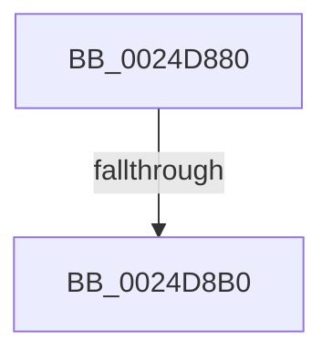

# MiOffsetToProtos

- RVA: `0x0024D880`–`0x0024D8B5` (길이 `53` bytes)
- VA: `0x000000014024D880`
- 실행 섹션: `.text`
- PDB 이름 있음: `예`; PDB Function 태그: `아니요`
- unwind 정보 RVA: `0x00062E44`
- 디코드: `15`개 명령, `53/53` bytes 표시
- 미해석 바이트: `0` (있으면 어셈블리에 `.byte`로 보존)

> 이 문서는 커널 이미지의 기계어와 PDB 기호를 분석해 생성했습니다. 4번과 5번은 함수 원형과 자료형을 바이너리 사용 방식에서 추정한 C 해석이며 원본 소스 복구 결과는 아닙니다.

## 1. Dependencies

- 직접 호출 지점: **1**; 고유 호출 대상: **1**
- 직접 호출자로 확인된 함수: **14**
- RIP 상대 이미지 참조: **0**

### Outgoing calls
- `0x0024D89F` → [MiGetControlAreaPtes](MiGetControlAreaPtes_function_0024DB10.md) (function, `0x0024DB10`)

### Direct callers
- [MmMapViewInSystemCache](../27/MmMapViewInSystemCache_function_00273094.md) at `0x002730FC`
- [MiRemoveMappedPtes](../29/MiRemoveMappedPtes_function_00296A50.md) at `0x00296ADD`
- [MiCompleteProtoPteFault](../34/MiCompleteProtoPteFault_function_00345710.md) at `0x003465BB`
- [MiAddMappedPtes](../34/MiAddMappedPtes_function_00349030.md) at `0x0034908D`
- [MiSetSystemCodeProtection](../38/MiSetSystemCodeProtection_function_00384420.md) at `0x00384827`
- [MiInsertInSystemSpace](../3B/MiInsertInSystemSpace_function_003B2F5C.md) at `0x003B3005`
- [MiReferenceDataSubsections](../3B/MiReferenceDataSubsections_function_003B3768.md) at `0x003B37A6`
- [MiSystemImageHasPrivateFixups](../45/MiSystemImageHasPrivateFixups_function_004507E0.md) at `0x004508DA`
- [MiDereferenceDataSubsections](../69/MiDereferenceDataSubsections_function_00692530.md) at `0x00692560`
- [MiPfPrepareReadList](../../page/93/MiPfPrepareReadList_function_0093CD5C.md) at `0x0093CE9A`
- [MiPfPrepareSequentialReadList](../../page/93/MiPfPrepareSequentialReadList_function_0093D8E8.md) at `0x0093DBFA`
- [MiLogRelocationRva](../../page/94/MiLogRelocationRva_function_009420DC.md) at `0x00942105`
- [MiRelocateImage](../../page/98/MiRelocateImage_function_00988E14.md) at `0x00989403`
- [MiScanRelocationPage](../../page/98/MiScanRelocationPage_function_00989670.md) at `0x009897E0`

### Static image references
- 디코드된 RIP-relative 메모리 참조가 없습니다.

## 2. Other-region calls and transfers

- 다른 실행 섹션으로 향하는 call: **0**
- call이 아닌 외부 분기/꼬리 이동: **1**
  - `0x0024D8AA` → [sub_0024DAC5](Unknown_function_0024DAC5.md) (`tail-transfer`)

## 3. Assembly (complete function range)

```asm
0024D880  40 56                           push rsi
0024D882  57                              push rdi
0024D883  41 56                           push r14
0024D885  48 81 EC C0 00 00 00            sub rsp, 0xc0
0024D88C  48 8B C2                        mov rax, rdx
0024D88F  4D 8B F0                        mov r14, r8
0024D892  48 C1 E8 0C                     shr rax, 0xc
0024D896  48 8B F2                        mov rsi, rdx
0024D899  49 89 00                        mov qword ptr [r8], rax
0024D89C  48 8B F9                        mov rdi, rcx
0024D89F  E8 6C 02 00 00                  call 0x14024db10
0024D8A4  49 8B 0E                        mov rcx, qword ptr [r14]
0024D8A7  48 3B C8                        cmp rcx, rax
0024D8AA  0F 83 15 02 00 00               jae 0x14024dac5
0024D8B0  48 83 7F 40 00                  cmp qword ptr [rdi + 0x40], 0
```

## 4. C-style interpretation (structured pseudocode)

```c
__int64 __fastcall MiOffsetToProtos(__int64 a1, __int64 a2, __int64 a3)
{
    __int64 result;
    __int64 v_rsp;

    v_rsp = (v_rsp) - (192);
    result = (a2) >> (12);
    *(unsigned __int64 *)(a3) = result;
    result = MiGetControlAreaPtes(a1, a2, a3, a4);
    return result;
}
```

## 5. (Beta) C Style

```c
int64_t MiOffsetToProtos(void *Arg1, int64_t Arg2, void *Arg3)
{
    uint8_t *arg1 = (uint8_t *)Arg1;
    uint8_t *arg3 = (uint8_t *)Arg3;

    int64_t result;
    int64_t local_rsp;

    local_rsp = (local_rsp) - (192);
    result = (Arg2) >> (12);
    *(uint64_t *)(arg3) = result;
    result = MiGetControlAreaPtes(Arg1, Arg2, Arg3, a4);
    return result;
}
```

### 관측된 메모리 오프셋

구조체 형식이 확인되지 않은 접근은 인자 기준의 오프셋으로만 기록했습니다.

| 기준 인자 | 오프셋 표현 | 폭 (bit) | 접근 |
|---|---:|---:|---|
| `Arg1` | `+ 0x40` | `64` | `R` |
| `Arg3` | `+ 0x0` | `64` | `R` |
| `Arg3` | `+ 0x0` | `64` | `W` |

## 6. Execution-region graph

[열기: 2D/3D 그래프와 함수 탐색 컨트롤 패널](../../../control-panel.html?section=text&rva=0x0024D880&view=graph)

- 2D 그래프는 위에서 아래로 흐르고, 3D 그래프는 빈 공간을 드래그해 회전합니다. Shift+드래그는 이동, 휠은 확대·축소, 함수 노드 선택은 대상 보고서 이동입니다.

### Static fallback


