# MiProbeUnlockPage

- RVA: `0x00243860`–`0x00243BE1` (길이 `897` bytes)
- VA: `0x0000000140243860`
- 실행 섹션: `.text`
- PDB 이름 있음: `예`; PDB Function 태그: `예`
- unwind 정보 RVA: `0x00061C94`
- 디코드: `220`개 명령, `897/897` bytes 표시
- 미해석 바이트: `0` (있으면 어셈블리에 `.byte`로 보존)

> 이 문서는 커널 이미지의 기계어와 PDB 기호를 분석해 생성했습니다. 4번과 5번은 함수 원형과 자료형을 바이너리 사용 방식에서 추정한 C 해석이며 원본 소스 복구 결과는 아닙니다.

## 1. Dependencies

- 직접 호출 지점: **10**; 고유 호출 대상: **10**
- 직접 호출자로 확인된 함수: **2**
- RIP 상대 이미지 참조: **5**

### Outgoing calls
- `0x002439C8` → [MiRemoveLockedPageChargeAndDecRef](MiRemoveLockedPageChargeAndDecRef_function_002459D0.md) (function, `0x002459D0`)
- `0x00243ABB` → [MiUnlockPageTableCharges](../40/MiUnlockPageTableCharges_function_00408140.md) (function, `0x00408140`)
- `0x00243B11` → [MiClearPageFileReservation](../32/MiClearPageFileReservation_function_0032B68C.md) (function, `0x0032B68C`)
- `0x00243B2E` → [KiCheckVpBackingLongSpinWaitHypercall](../30/KiCheckVpBackingLongSpinWaitHypercall_function_0030F490.md) (function, `0x0030F490`)
- `0x00243B3D` → [HvlNotifyLongSpinWait](../30/HvlNotifyLongSpinWait_function_0030F460.md) (function, `0x0030F460`)
- `0x00243B54` → [MiCanPfnOriginalPteBeLost](../37/MiCanPfnOriginalPteBeLost_function_00373D3C.md) (function, `0x00373D3C`)
- `0x00243B9B` → [MiReleasePageFileInfo](../28/MiReleasePageFileInfo_function_00283FD0.md) (function, `0x00283FD0`)
- `0x00243BB4` → [MiFinishLargePageFree](../37/MiFinishLargePageFree_function_00377B94.md) (function, `0x00377B94`)
- `0x00243BC6` → [MiDereferenceControlAreaProbe](../36/MiDereferenceControlAreaProbe_function_003691C0.md) (function, `0x003691C0`)
- `0x00243BD7` → [ExReleaseRundownProtectionCacheAware](../34/ExReleaseRundownProtectionCacheAware_function_00342DF0.md) (function, `0x00342DF0`)

### Direct callers
- [MmUnlockPages](../29/MmUnlockPages_function_0029EEE0.md) at `0x0029EFF7`
- [MiUnlockPhysicalPageByVa](../67/MiUnlockPhysicalPageByVa_function_00673EB0.md) at `0x00674087`

### Static image references
- `0x00243921` → RVA `0x00E30088` (`.data`; read)
- `0x00243A04` → RVA `0x00E38D00` (`.data`; read)
- `0x00243A72` → RVA `0x00FC52AC` (`ALMOSTRO`; reference)
- `0x00243ADE` → RVA `0x00E2DC80` (`.data`; read)
- `0x00243B20` → RVA `0x00FC6AB8` (`ALMOSTRO`; read)

## 2. Other-region calls and transfers

- 다른 실행 섹션으로 향하는 call: **0**
- call이 아닌 외부 분기/꼬리 이동: **1**
  - `0x00243A9E` → [sub_006D7E56](../6D/Unknown_function_006D7E56.md) (`tail-transfer`)

## 3. Assembly (complete function range)

```asm
00243860  48 89 5C 24 18                  mov qword ptr [rsp + 0x18], rbx
00243865  55                              push rbp
00243866  56                              push rsi
00243867  57                              push rdi
00243868  41 54                           push r12
0024386A  41 55                           push r13
0024386C  41 56                           push r14
0024386E  41 57                           push r15
00243870  48 83 EC 30                     sub rsp, 0x30
00243874  44 8B FA                        mov r15d, edx
00243877  49 8B F1                        mov rsi, r9
0024387A  49 8B D8                        mov rbx, r8
0024387D  48 8B F9                        mov rdi, rcx
00243880  48 BA FF FF FF FF FF 00 00 00   movabs rdx, 0xffffffffff
0024388A  41 0F BA E7 08                  bt r15d, 8
0024388F  73 73                           jae 0x140243904
00243891  48 8B 41 28                     mov rax, qword ptr [rcx + 0x28]
00243895  48 0F BA E0 28                  bt rax, 0x28
0024389A  72 68                           jb 0x140243904
0024389C  48 8B 41 28                     mov rax, qword ptr [rcx + 0x28]
002438A0  48 C1 E8 3C                     shr rax, 0x3c
002438A4  24 07                           and al, 7
002438A6  3C 01                           cmp al, 1
002438A8  74 5A                           je 0x140243904
002438AA  48 8B 41 28                     mov rax, qword ptr [rcx + 0x28]
002438AE  48 B9 FE FF FF FF 3F 00 00 00   movabs rcx, 0x3ffffffffe
002438B8  48 23 C2                        and rax, rdx
002438BB  48 3B C1                        cmp rax, rcx
002438BE  74 44                           je 0x140243904
002438C0  48 8B 47 28                     mov rax, qword ptr [rdi + 0x28]
002438C4  48 8B 47 28                     mov rax, qword ptr [rdi + 0x28]
002438C8  49 8B 08                        mov rcx, qword ptr [r8]
002438CB  48 23 C2                        and rax, rdx
002438CE  48 3B C8                        cmp rcx, rax
002438D1  74 31                           je 0x140243904
002438D3  48 B8 FF FF FF FF 3F 00 00 00   movabs rax, 0x3fffffffff
002438DD  48 3B C8                        cmp rcx, rax
002438E0  0F 85 BD 01 00 00               jne 0x140243aa3
002438E6  48 8B 47 28                     mov rax, qword ptr [rdi + 0x28]
002438EA  48 85 C0                        test rax, rax
002438ED  0F 88 54 02 00 00               js 0x140243b47
002438F3  B8 02 00 00 00                  mov eax, 2
002438F8  89 06                           mov dword ptr [rsi], eax
002438FA  48 8B 47 28                     mov rax, qword ptr [rdi + 0x28]
002438FE  48 23 C2                        and rax, rdx
00243901  48 89 03                        mov qword ptr [rbx], rax
00243904  33 F6                           xor esi, esi
00243906  44 8B EE                        mov r13d, esi
00243909  44 8B E6                        mov r12d, esi
0024390C  8B DE                           mov ebx, esi
0024390E  8B EE                           mov ebp, esi
00243910  F0 48 0F BA 6F 18 3F            lock bts qword ptr [rdi + 0x18], 0x3f
00243917  0F 82 53 01 00 00               jb 0x140243a70
0024391D  48 8B 47 28                     mov rax, qword ptr [rdi + 0x28]
00243921  48 8B 0D 60 C7 BE 00            mov rcx, qword ptr [rip + 0xbec760]
00243928  48 C1 E8 2B                     shr rax, 0x2b
0024392C  25 FF 03 00 00                  and eax, 0x3ff
00243931  4C 8B 34 C1                     mov r14, qword ptr [rcx + rax*8]
00243935  8B 47 20                        mov eax, dword ptr [rdi + 0x20]
00243938  C1 E8 10                        shr eax, 0x10
0024393B  A8 20                           test al, 0x20
0024393D  0F 85 F6 00 00 00               jne 0x140243a39
00243943  45 84 FF                        test r15b, r15b
00243946  0F 89 E1 00 00 00               jns 0x140243a2d
0024394C  4D 85 E4                        test r12, r12
0024394F  75 54                           jne 0x1402439a5
00243951  8B 47 10                        mov eax, dword ptr [rdi + 0x10]
00243954  48 0F BA E0 0A                  bt rax, 0xa
00243959  72 1F                           jb 0x14024397a
0024395B  F6 47 22 08                     test byte ptr [rdi + 0x22], 8
0024395F  75 19                           jne 0x14024397a
00243961  48 8B 47 10                     mov rax, qword ptr [rdi + 0x10]
00243965  48 89 44 24 70                  mov qword ptr [rsp + 0x70], rax
0024396A  C0 E8 02                        shr al, 2
0024396D  A8 01                           test al, 1
0024396F  0F 85 8B 01 00 00               jne 0x140243b00
00243975  48 89 5C 24 70                  mov qword ptr [rsp + 0x70], rbx
0024397A  44 8B 5F 20                     mov r11d, dword ptr [rdi + 0x20]
0024397E  44 89 5C 24 78                  mov dword ptr [rsp + 0x78], r11d
00243983  41 C1 EB 10                     shr r11d, 0x10
00243987  41 0F B6 EB                     movzx ebp, r11b
0024398B  41 F6 C3 08                     test r11b, 8
0024398F  0F 85 BC 01 00 00               jne 0x140243b51
00243995  40 80 CD 10                     or bpl, 0x10
00243999  40 88 6C 24 7A                  mov byte ptr [rsp + 0x7a], bpl
0024399E  8B 44 24 78                     mov eax, dword ptr [rsp + 0x78]
002439A2  89 47 20                        mov dword ptr [rdi + 0x20], eax
002439A5  48 8B 47 28                     mov rax, qword ptr [rdi + 0x28]
002439A9  49 BF 00 00 00 00 00 01 00 00   movabs r15, 0x10000000000
002439B3  49 85 C7                        test r15, rax
002439B6  75 0D                           jne 0x1402439c5
002439B8  48 8B 47 28                     mov rax, qword ptr [rdi + 0x28]
002439BC  48 85 C0                        test rax, rax
002439BF  0F 88 0A 01 00 00               js 0x140243acf
002439C5  48 8B CF                        mov rcx, rdi
002439C8  E8 03 20 00 00                  call 0x1402459d0
002439CD  48 8B 47 28                     mov rax, qword ptr [rdi + 0x28]
002439D1  48 BD FF FF FF FF FF FF FF 7F   movabs rbp, 0x7fffffffffffffff
002439DB  49 85 C7                        test r15, rax
002439DE  0F 85 AB 00 00 00               jne 0x140243a8f
002439E4  F0 48 21 6F 18                  lock and qword ptr [rdi + 0x18], rbp
002439E9  48 85 DB                        test rbx, rbx
002439EC  0F 85 9D 01 00 00               jne 0x140243b8f
002439F2  48 85 F6                        test rsi, rsi
002439F5  0F 85 AA 01 00 00               jne 0x140243ba5
002439FB  4D 85 ED                        test r13, r13
002439FE  0F 85 BA 01 00 00               jne 0x140243bbe
00243A04  48 8D 05 F5 52 BF 00            lea rax, [rip + 0xbf52f5]
00243A0B  4C 3B F0                        cmp r14, rax
00243A0E  0F 85 BC 01 00 00               jne 0x140243bd0
00243A14  48 8B 9C 24 80 00 00 00         mov rbx, qword ptr [rsp + 0x80]
00243A1C  48 83 C4 30                     add rsp, 0x30
00243A20  41 5F                           pop r15
00243A22  41 5E                           pop r14
00243A24  41 5D                           pop r13
00243A26  41 5C                           pop r12
00243A28  5F                              pop rdi
00243A29  5E                              pop rsi
00243A2A  5D                              pop rbp
00243A2B  C3                              ret
00243A2C  CC                              int3
00243A2D  49 BF 00 00 00 00 00 01 00 00   movabs r15, 0x10000000000
00243A37  EB 8C                           jmp 0x1402439c5
00243A39  A8 08                           test al, 8
00243A3B  0F 85 02 FF FF FF               jne 0x140243943
00243A41  48 8B 47 18                     mov rax, qword ptr [rdi + 0x18]
00243A45  48 B9 FF FF FF FF FF FF FF 3F   movabs rcx, 0x3fffffffffffffff
00243A4F  48 85 C1                        test rcx, rax
00243A52  0F 85 EB FE FF FF               jne 0x140243943
00243A58  4C 8B 27                        mov r12, qword ptr [rdi]
00243A5B  49 83 C4 E0                     add r12, -0x20
00243A5F  F0 49 FF 8C 24 08 01 00 00      lock dec qword ptr [r12 + 0x108]
00243A68  E9 D6 FE FF FF                  jmp 0x140243943
00243A6D  0F 1F 00                        nop dword ptr [rax]
00243A70  FF C5                           inc ebp
00243A72  85 2D 34 18 D8 00               test dword ptr [rip + 0xd81834], ebp
00243A78  0F 84 A2 00 00 00               je 0x140243b20
00243A7E  F3 90                           pause
00243A80  48 8B 47 18                     mov rax, qword ptr [rdi + 0x18]
00243A84  48 85 C0                        test rax, rax
00243A87  0F 89 83 FE FF FF               jns 0x140243910
00243A8D  EB E1                           jmp 0x140243a70
00243A8F  48 8B 47 18                     mov rax, qword ptr [rdi + 0x18]
00243A93  48 0F BA E0 3E                  bt rax, 0x3e
00243A98  0F 83 46 FF FF FF               jae 0x1402439e4
00243A9E  E9 B3 43 49 00                  jmp 0x1406d7e56
00243AA3  48 8D 0C 49                     lea rcx, [rcx + rcx*2]
00243AA7  48 C1 E1 04                     shl rcx, 4
00243AAB  48 B8 00 00 00 00 00 DE FF FF   movabs rax, 0xffffde0000000000
00243AB5  41 8B 11                        mov edx, dword ptr [r9]
00243AB8  48 03 C8                        add rcx, rax
00243ABB  E8 80 46 1C 00                  call 0x140408140
00243AC0  48 BA FF FF FF FF FF 00 00 00   movabs rdx, 0xffffffffff
00243ACA  E9 17 FE FF FF                  jmp 0x1402438e6
00243ACF  48 8B 47 10                     mov rax, qword ptr [rdi + 0x10]
00243AD3  48 0F BA E0 0A                  bt rax, 0xa
00243AD8  0F 83 E7 FE FF FF               jae 0x1402439c5
00243ADE  48 8B 0D 9B A1 BE 00            mov rcx, qword ptr [rip + 0xbea19b]
00243AE5  48 85 C9                        test rcx, rcx
00243AE8  74 0A                           je 0x140243af4
00243AEA  A8 10                           test al, 0x10
00243AEC  75 06                           jne 0x140243af4
00243AEE  48 F7 D1                        not rcx
00243AF1  48 23 C1                        and rax, rcx
00243AF4  48 C1 F8 10                     sar rax, 0x10
00243AF8  4C 8B 28                        mov r13, qword ptr [rax]
00243AFB  E9 C5 FE FF FF                  jmp 0x1402439c5
00243B00  48 8B 47 10                     mov rax, qword ptr [rdi + 0x10]
00243B04  48 8D 4C 24 70                  lea rcx, [rsp + 0x70]
00243B09  48 83 E0 FB                     and rax, 0xfffffffffffffffb
00243B0D  48 89 47 10                     mov qword ptr [rdi + 0x10], rax
00243B11  E8 76 7B 0E 00                  call 0x14032b68c
00243B16  48 8B 5C 24 70                  mov rbx, qword ptr [rsp + 0x70]
00243B1B  E9 5A FE FF FF                  jmp 0x14024397a
00243B20  8B 05 92 2F D8 00               mov eax, dword ptr [rip + 0xd82f92]
00243B26  A8 40                           test al, 0x40
00243B28  0F 84 50 FF FF FF               je 0x140243a7e
00243B2E  E8 5D B9 0C 00                  call 0x14030f490
00243B33  84 C0                           test al, al
00243B35  0F 84 43 FF FF FF               je 0x140243a7e
00243B3B  8B CD                           mov ecx, ebp
00243B3D  E8 1E B9 0C 00                  call 0x14030f460
00243B42  E9 39 FF FF FF                  jmp 0x140243a80
00243B47  B8 01 00 00 00                  mov eax, 1
00243B4C  E9 A7 FD FF FF                  jmp 0x1402438f8
00243B51  48 8B CF                        mov rcx, rdi
00243B54  E8 E3 01 13 00                  call 0x140373d3c
00243B59  85 C0                           test eax, eax
00243B5B  0F 84 34 FE FF FF               je 0x140243995
00243B61  48 8B 47 10                     mov rax, qword ptr [rdi + 0x10]
00243B65  0F B6 4F 22                     movzx ecx, byte ptr [rdi + 0x22]
00243B69  C0 E9 04                        shr cl, 4
00243B6C  A8 04                           test al, 4
00243B6E  F6 D1                           not cl
00243B70  0F 95 C0                        setne al
00243B73  22 C8                           and cl, al
00243B75  F6 C1 01                        test cl, 1
00243B78  0F 84 17 FE FF FF               je 0x140243995
00243B7E  48 8B 47 10                     mov rax, qword ptr [rdi + 0x10]
00243B82  48 83 E0 FB                     and rax, 0xfffffffffffffffb
00243B86  48 89 47 10                     mov qword ptr [rdi + 0x10], rax
00243B8A  E9 06 FE FF FF                  jmp 0x140243995
00243B8F  41 B8 01 00 00 00               mov r8d, 1
00243B95  48 8B D3                        mov rdx, rbx
00243B98  49 8B CE                        mov rcx, r14
00243B9B  E8 30 04 04 00                  call 0x140283fd0
00243BA0  E9 4D FE FF FF                  jmp 0x1402439f2
00243BA5  BA 01 00 00 00                  mov edx, 1
00243BAA  48 8B CE                        mov rcx, rsi
00243BAD  44 8B C2                        mov r8d, edx
00243BB0  44 8D 4A 0F                     lea r9d, [rdx + 0xf]
00243BB4  E8 DB 3F 13 00                  call 0x140377b94
00243BB9  E9 3D FE FF FF                  jmp 0x1402439fb
00243BBE  BA 01 00 00 00                  mov edx, 1
00243BC3  49 8B CD                        mov rcx, r13
00243BC6  E8 F5 55 12 00                  call 0x1403691c0
00243BCB  E9 34 FE FF FF                  jmp 0x140243a04
00243BD0  49 8B 8E F0 0A 00 00            mov rcx, qword ptr [r14 + 0xaf0]
00243BD7  E8 14 F2 0F 00                  call 0x140342df0
00243BDC  E9 33 FE FF FF                  jmp 0x140243a14
```

## 4. C-style interpretation (structured pseudocode)

```c
__int64 __fastcall MiProbeUnlockPage(__int64 a1, int a2, __int64 a3, __int64 a4)
{
    __int64 result;
    __int64 v_r11;
    __int64 v_r12;
    __int64 v_rbp;
    __int64 v_rsi;
    __int64 v_rsp;
    unsigned int v_stack_p10;
    unsigned __int8 v_stack_p12;
    unsigned __int64 v_stack_p18;
    unsigned __int64 v_stack_p70;
    unsigned __int64 v_stack_p8;

    v_stack_p18 = v_rbx;
    v_rsp = (v_rsp) - (48);
    if (condition_is_above_or_equal) goto loc_00243904;
    if (condition_is_below) goto loc_00243904;
    result = (*(unsigned __int64 *)(a1 + 40)) >> (60);
    result = (unsigned __int8)((result) & (7));
    if (((unsigned __int8)(result)) == 1) goto loc_00243904;
    result = (*(unsigned __int64 *)(a1 + 40)) & (a2);
    if (result == a1) goto loc_00243904;
    result = (*(unsigned __int64 *)(a1 + 40)) & (a2);
    if ((*(unsigned __int64 *)(a3)) == result) goto loc_00243904;
    if ((*(unsigned __int64 *)(a3)) != result) goto loc_00243AA3;
loc_002438E6:
    if (sign_flag) goto loc_00243B47;
loc_002438F8:
    *(unsigned int *)(a4) = 2;
    result = (*(unsigned __int64 *)(a1 + 40)) & (a2);
    *(unsigned __int64 *)(a3) = result;
loc_00243904:
    v_rsi = 0;
loc_00243910:
    if (condition_is_below) goto loc_00243A70;
    result = (*(unsigned __int64 *)(a1 + 40)) >> (43);
    result = (unsigned int)((result) & (0x3FFULL));
    result = (unsigned int)(((unsigned int)(*(unsigned int *)(a1 + 32))) >> (16));
    if ((((unsigned __int8)(result)) & (32)) != 0) goto loc_00243A39;
loc_00243943:
    if (!sign_flag) goto loc_00243A2D;
    if (0 != 0) goto loc_002439A5;
    if (condition_is_below) goto loc_0024397A;
    if (((*(unsigned __int8 *)(a1 + 34)) & (8)) != 0) goto loc_0024397A;
    v_stack_p8 = *(unsigned __int64 *)(a1 + 16);
    result = (unsigned __int8)((*(unsigned __int64 *)(a1 + 16)) >> (2));
    if ((((unsigned __int8)(result)) & (1)) != 0) goto loc_00243B00;
    v_stack_p8 = 0;
loc_0024397A:
    v_stack_p10 = (unsigned int)((unsigned int)(*(unsigned int *)(a1 + 32)));
    v_r11 = (unsigned int)(((unsigned int)(*(unsigned int *)(a1 + 32))) >> (16));
    if ((((unsigned __int8)(v_r11)) & (8)) != 0) goto loc_00243B51;
loc_00243995:
    v_rbp = (unsigned __int8)(((unsigned __int8)(v_r11)) | (16));
    v_stack_p12 = (unsigned __int8)(v_rbp);
    *(unsigned int *)(a1 + 32) = (unsigned int)((unsigned int)(v_stack_p10));
loc_002439A5:
    if ((((unsigned int)(a2)) & (*(unsigned __int64 *)(a1 + 40))) != 0) goto loc_002439C5;
    if (sign_flag) goto loc_00243ACF;
loc_002439C5:
    result = MiRemoveLockedPageChargeAndDecRef(a1, a2, a3, a4);
    if ((((unsigned int)(a2)) & (*(unsigned __int64 *)(a1 + 40))) != 0) goto loc_00243A8F;
loc_002439E4:
    if (0 != 0) goto loc_00243B8F;
loc_002439F2:
    if (0 != 0) goto loc_00243BA5;
loc_002439FB:
    if (0 != 0) goto loc_00243BBE;
loc_00243A04:
    if ((*(unsigned __int64 *)(*(unsigned __int64 *)(v_rip + 12502880) + result * 8)) != (v_rip + 12538613)) goto loc_00243BD0;
loc_00243A14:
    v_rsp = (v_rsp) + (48);
    return v_rip + 12538613;
loc_00243A2D:
    goto loc_002439C5;
loc_00243A39:
    if ((((unsigned __int8)(v_rip + 12538613)) & (8)) != 0) goto loc_00243943;
    if (((a1) & (*(unsigned __int64 *)(a1 + 24))) != 0) goto loc_00243943;
    v_r12 = (*(unsigned __int64 *)(a1)) + (-32);
    goto loc_00243943;
loc_00243A70:
    v_rbp = (unsigned int)((v_rbp) + 1);
    if (((*(unsigned int *)(v_rip + 14161972)) & ((unsigned int)(v_rbp))) == 0) goto loc_00243B20;
loc_00243A7E:
loc_00243A80:
    if (!sign_flag) goto loc_00243910;
    goto loc_00243A70;
loc_00243A8F:
    if (condition_is_above_or_equal) goto loc_002439E4;
loc_00243AA3:
    a1 = (a1 + a1 * 2) << (4);
    a1 = (a1) + (*(unsigned __int64 *)(a1 + 24));
    result = MiUnlockPageTableCharges(a1, (unsigned int)(*(unsigned int *)(a4)), a3, a4);
    goto loc_002438E6;
loc_00243ACF:
    if (condition_is_above_or_equal) goto loc_002439C5;
    if (*(unsigned __int64 *)(v_rip + 12493211) == 0) goto loc_00243AF4;
    result = *(unsigned __int64 *)(a1 + 16);
    if ((((unsigned __int8)(*(unsigned __int64 *)(a1 + 16))) & (16)) == 0) {
        a1 = ~(*(unsigned __int64 *)(v_rip + 12493211));
        result = (*(unsigned __int64 *)(a1 + 16)) & (a1);
    }
    result = (result) >> (16);
    goto loc_002439C5;
loc_00243B00:
    result = (*(unsigned __int64 *)(a1 + 16)) & (-5);
    *(unsigned __int64 *)(a1 + 16) = result;
    result = MiClearPageFileReservation(v_stack_p70, (unsigned int)(*(unsigned int *)(a4)), a3, a4);
    goto loc_0024397A;
loc_00243B20:
    if ((((unsigned __int8)((unsigned int)(*(unsigned int *)(v_rip + 14167954)))) & (64)) == 0) goto loc_00243A7E;
    result = KiCheckVpBackingLongSpinWaitHypercall(v_stack_p70, (unsigned int)(*(unsigned int *)(a4)), a3, a4);
    if ((unsigned __int8)(result) == 0) goto loc_00243A7E;
    result = HvlNotifyLongSpinWait((unsigned int)((unsigned int)(v_rbp)), (unsigned int)(*(unsigned int *)(a4)), a3, a4);
    goto loc_00243A80;
loc_00243B47:
    goto loc_002438F8;
loc_00243B51:
    result = MiCanPfnOriginalPteBeLost(a1, (unsigned int)(*(unsigned int *)(a4)), a3, a4);
    if ((unsigned int)(result) == 0) goto loc_00243995;
    a1 = (unsigned __int8)((*(unsigned __int8 *)(a1 + 34)) >> (4));
    a1 = (unsigned __int8)(~(a1));
    result = ((((unsigned __int8)(*(unsigned __int64 *)(a1 + 16))) & (4)) != 0) ? 1 : 0;
    a1 = (unsigned __int8)((a1) & ((unsigned __int8)(result)));
    if ((((unsigned __int8)(a1)) & (1)) == 0) goto loc_00243995;
    result = (*(unsigned __int64 *)(a1 + 16)) & (-5);
    *(unsigned __int64 *)(a1 + 16) = result;
    goto loc_00243995;
loc_00243B8F:
    result = MiReleasePageFileInfo(*(unsigned __int64 *)(*(unsigned __int64 *)(v_rip + 12502880) + result * 8), v_stack_p70, 1, a4);
    goto loc_002439F2;
loc_00243BA5:
    result = MiFinishLargePageFree(0, 1, 1, 1 + 15);
    goto loc_002439FB;
loc_00243BBE:
    result = MiDereferenceControlAreaProbe(*(unsigned __int64 *)(result), 1, 1, 1 + 15);
    goto loc_00243A04;
loc_00243BD0:
    result = ExReleaseRundownProtectionCacheAware(*(unsigned __int64 *)(*(unsigned __int64 *)(*(unsigned __int64 *)(v_rip + 12502880) + result * 8) + 2800), 1, 1, 1 + 15);
    goto loc_00243A14;
}
```

## 5. (Beta) C Style

```c
int64_t MiProbeUnlockPage(void *Arg1, int32_t Arg2, void *Arg3, void *Arg4)
{
    uint8_t *arg1 = (uint8_t *)Arg1;
    uint8_t *arg3 = (uint8_t *)Arg3;
    uint8_t *arg4 = (uint8_t *)Arg4;

    int64_t result;
    int64_t local_r11;
    int64_t local_r12;
    int64_t local_rbp;
    int64_t local_rsi;
    int64_t local_rsp;
    uint32_t v_stack_p10;
    uint8_t v_stack_p12;
    uint64_t v_stack_p18;
    uint64_t v_stack_p70;
    uint64_t v_stack_p8;

    v_stack_p18 = local_rbx;
    local_rsp = (local_rsp) - (48);
    if (condition_is_above_or_equal) goto loc_00243904;
    if (condition_is_below) goto loc_00243904;
    result = (*(uint64_t *)(arg1 + 0x28)) >> (60);
    result = (uint8_t)((result) & (7));
    if (((uint8_t)(result)) == 1) goto loc_00243904;
    result = (*(uint64_t *)(arg1 + 0x28)) & (Arg2);
    if (result == Arg1) goto loc_00243904;
    result = (*(uint64_t *)(arg1 + 0x28)) & (Arg2);
    if ((*(uint64_t *)(arg3)) == result) goto loc_00243904;
    if ((*(uint64_t *)(arg3)) != result) goto loc_00243AA3;
loc_002438E6:
    if (sign_flag) goto loc_00243B47;
loc_002438F8:
    *(uint32_t *)(arg4) = 2;
    result = (*(uint64_t *)(arg1 + 0x28)) & (Arg2);
    *(uint64_t *)(arg3) = result;
loc_00243904:
    local_rsi = 0;
loc_00243910:
    if (condition_is_below) goto loc_00243A70;
    result = (*(uint64_t *)(arg1 + 0x28)) >> (43);
    result = (uint32_t)((result) & (0x3FFULL));
    result = (uint32_t)(((uint32_t)(*(uint32_t *)(arg1 + 0x20))) >> (16));
    if ((((uint8_t)(result)) & (32)) != 0) goto loc_00243A39;
loc_00243943:
    if (!sign_flag) goto loc_00243A2D;
    if (0 != 0) goto loc_002439A5;
    if (condition_is_below) goto loc_0024397A;
    if (((*(uint8_t *)(arg1 + 0x22)) & (8)) != 0) goto loc_0024397A;
    v_stack_p8 = *(uint64_t *)(arg1 + 0x10);
    result = (uint8_t)((*(uint64_t *)(arg1 + 0x10)) >> (2));
    if ((((uint8_t)(result)) & (1)) != 0) goto loc_00243B00;
    v_stack_p8 = 0;
loc_0024397A:
    v_stack_p10 = (uint32_t)((uint32_t)(*(uint32_t *)(arg1 + 0x20)));
    local_r11 = (uint32_t)(((uint32_t)(*(uint32_t *)(arg1 + 0x20))) >> (16));
    if ((((uint8_t)(local_r11)) & (8)) != 0) goto loc_00243B51;
loc_00243995:
    local_rbp = (uint8_t)(((uint8_t)(local_r11)) | (16));
    v_stack_p12 = (uint8_t)(local_rbp);
    *(uint32_t *)(arg1 + 0x20) = (uint32_t)((uint32_t)(v_stack_p10));
loc_002439A5:
    if ((((uint32_t)(Arg2)) & (*(uint64_t *)(arg1 + 0x28))) != 0) goto loc_002439C5;
    if (sign_flag) goto loc_00243ACF;
loc_002439C5:
    result = MiRemoveLockedPageChargeAndDecRef(Arg1, Arg2, Arg3, Arg4);
    if ((((uint32_t)(Arg2)) & (*(uint64_t *)(arg1 + 0x28))) != 0) goto loc_00243A8F;
loc_002439E4:
    if (0 != 0) goto loc_00243B8F;
loc_002439F2:
    if (0 != 0) goto loc_00243BA5;
loc_002439FB:
    if (0 != 0) goto loc_00243BBE;
loc_00243A04:
    if ((*(uint64_t *)(*(uint64_t *)(v_rip + 0xBEC760) + result * 8)) != (v_rip + 12538613)) goto loc_00243BD0;
loc_00243A14:
    local_rsp = (local_rsp) + (48);
    return v_rip + 12538613;
loc_00243A2D:
    goto loc_002439C5;
loc_00243A39:
    if ((((uint8_t)(v_rip + 12538613)) & (8)) != 0) goto loc_00243943;
    if (((Arg1) & (*(uint64_t *)(arg1 + 0x18))) != 0) goto loc_00243943;
    local_r12 = (*(uint64_t *)(arg1)) + (-32);
    goto loc_00243943;
loc_00243A70:
    local_rbp = (uint32_t)((local_rbp) + 1);
    if (((*(uint32_t *)(v_rip + 0xD81834)) & ((uint32_t)(local_rbp))) == 0) goto loc_00243B20;
loc_00243A7E:
loc_00243A80:
    if (!sign_flag) goto loc_00243910;
    goto loc_00243A70;
loc_00243A8F:
    if (condition_is_above_or_equal) goto loc_002439E4;
loc_00243AA3:
    Arg1 = (Arg1 + Arg1 * 2) << (4);
    Arg1 = (Arg1) + (*(uint64_t *)(arg1 + 0x18));
    result = MiUnlockPageTableCharges(Arg1, (uint32_t)(*(uint32_t *)(arg4)), Arg3, Arg4);
    goto loc_002438E6;
loc_00243ACF:
    if (condition_is_above_or_equal) goto loc_002439C5;
    if (*(uint64_t *)(v_rip + 0xBEA19B) == 0) goto loc_00243AF4;
    result = *(uint64_t *)(arg1 + 0x10);
    if ((((uint8_t)(*(uint64_t *)(arg1 + 0x10))) & (16)) == 0) {
        Arg1 = ~(*(uint64_t *)(v_rip + 0xBEA19B));
        result = (*(uint64_t *)(arg1 + 0x10)) & (Arg1);
    }
    result = (result) >> (16);
    goto loc_002439C5;
loc_00243B00:
    result = (*(uint64_t *)(arg1 + 0x10)) & (-5);
    *(uint64_t *)(arg1 + 0x10) = result;
    result = MiClearPageFileReservation(v_stack_p70, (uint32_t)(*(uint32_t *)(arg4)), Arg3, Arg4);
    goto loc_0024397A;
loc_00243B20:
    if ((((uint8_t)((uint32_t)(*(uint32_t *)(v_rip + 0xD82F92)))) & (64)) == 0) goto loc_00243A7E;
    result = KiCheckVpBackingLongSpinWaitHypercall(v_stack_p70, (uint32_t)(*(uint32_t *)(arg4)), Arg3, Arg4);
    if ((uint8_t)(result) == 0) goto loc_00243A7E;
    result = HvlNotifyLongSpinWait((uint32_t)((uint32_t)(local_rbp)), (uint32_t)(*(uint32_t *)(arg4)), Arg3, Arg4);
    goto loc_00243A80;
loc_00243B47:
    goto loc_002438F8;
loc_00243B51:
    result = MiCanPfnOriginalPteBeLost(Arg1, (uint32_t)(*(uint32_t *)(arg4)), Arg3, Arg4);
    if ((uint32_t)(result) == 0) goto loc_00243995;
    Arg1 = (uint8_t)((*(uint8_t *)(arg1 + 0x22)) >> (4));
    Arg1 = (uint8_t)(~(Arg1));
    result = ((((uint8_t)(*(uint64_t *)(arg1 + 0x10))) & (4)) != 0) ? 1 : 0;
    Arg1 = (uint8_t)((Arg1) & ((uint8_t)(result)));
    if ((((uint8_t)(Arg1)) & (1)) == 0) goto loc_00243995;
    result = (*(uint64_t *)(arg1 + 0x10)) & (-5);
    *(uint64_t *)(arg1 + 0x10) = result;
    goto loc_00243995;
loc_00243B8F:
    result = MiReleasePageFileInfo(*(uint64_t *)(*(uint64_t *)(v_rip + 0xBEC760) + result * 8), v_stack_p70, 1, Arg4);
    goto loc_002439F2;
loc_00243BA5:
    result = MiFinishLargePageFree(0, 1, 1, 1 + 15);
    goto loc_002439FB;
loc_00243BBE:
    result = MiDereferenceControlAreaProbe(*(uint64_t *)(result), 1, 1, 1 + 15);
    goto loc_00243A04;
loc_00243BD0:
    result = ExReleaseRundownProtectionCacheAware(*(uint64_t *)(*(uint64_t *)(*(uint64_t *)(v_rip + 0xBEC760) + result * 8) + 0xAF0), 1, 1, 1 + 15);
    goto loc_00243A14;
}
```

### 관측된 메모리 오프셋

구조체 형식이 확인되지 않은 접근은 인자 기준의 오프셋으로만 기록했습니다.

| 기준 인자 | 오프셋 표현 | 폭 (bit) | 접근 |
|---|---:|---:|---|
| `Arg1` | `+ 0x0` | `64` | `R` |
| `Arg1` | `+ 0x10` | `32` | `R` |
| `Arg1` | `+ 0x10` | `64` | `R` |
| `Arg1` | `+ 0x10` | `64` | `W` |
| `Arg1` | `+ 0x18` | `64` | `R` |
| `Arg1` | `+ 0x18` | `64` | `R/W` |
| `Arg1` | `+ 0x20` | `32` | `R` |
| `Arg1` | `+ 0x20` | `32` | `W` |
| `Arg1` | `+ 0x22` | `8` | `R` |
| `Arg1` | `+ 0x28` | `64` | `R` |
| `Arg3` | `+ 0x0` | `64` | `R` |
| `Arg3` | `+ 0x0` | `64` | `W` |
| `Arg4` | `+ 0x0` | `32` | `R` |
| `Arg4` | `+ 0x0` | `32` | `W` |

## 6. Execution-region graph

[열기: 2D/3D 그래프와 함수 탐색 컨트롤 패널](../../../control-panel.html?section=text&rva=0x00243860&view=graph)

- 2D 그래프는 위에서 아래로 흐르고, 3D 그래프는 빈 공간을 드래그해 회전합니다. Shift+드래그는 이동, 휠은 확대·축소, 함수 노드 선택은 대상 보고서 이동입니다.

### Static fallback

```mermaid
flowchart TD
  bb_00243860[BB_00243860]
  bb_00243891[BB_00243891]
  bb_0024389C[BB_0024389C]
  bb_002438AA[BB_002438AA]
  bb_002438C0[BB_002438C0]
  bb_002438D3[BB_002438D3]
  bb_002438E6[BB_002438E6]
  bb_002438F3[BB_002438F3]
  bb_002438F8[BB_002438F8]
  bb_00243904[BB_00243904]
  bb_00243910[BB_00243910]
  bb_0024391D[BB_0024391D]
  bb_00243943[BB_00243943]
  bb_0024394C[BB_0024394C]
  bb_00243951[BB_00243951]
  bb_0024395B[BB_0024395B]
  bb_00243961[BB_00243961]
  bb_00243975[BB_00243975]
  bb_0024397A[BB_0024397A]
  bb_00243995[BB_00243995]
  bb_002439A5[BB_002439A5]
  bb_002439B8[BB_002439B8]
  bb_002439C5[BB_002439C5]
  bb_002439E4[BB_002439E4]
  bb_002439F2[BB_002439F2]
  bb_002439FB[BB_002439FB]
  bb_00243A04[BB_00243A04]
  bb_00243A14[BB_00243A14]
  bb_00243A2C[BB_00243A2C]
  bb_00243A2D[BB_00243A2D]
  bb_00243A39[BB_00243A39]
  bb_00243A41[BB_00243A41]
  bb_00243A58[BB_00243A58]
  bb_00243A6D[BB_00243A6D]
  bb_00243A70[BB_00243A70]
  bb_00243A7E[BB_00243A7E]
  bb_00243A80[BB_00243A80]
  bb_00243A8D[BB_00243A8D]
  bb_00243A8F[BB_00243A8F]
  bb_00243A9E[BB_00243A9E]
  bb_00243AA3[BB_00243AA3]
  bb_00243ACF[BB_00243ACF]
  bb_00243ADE[BB_00243ADE]
  bb_00243AEA[BB_00243AEA]
  bb_00243AEE[BB_00243AEE]
  bb_00243AF4[BB_00243AF4]
  bb_00243B00[BB_00243B00]
  bb_00243B20[BB_00243B20]
  bb_00243B2E[BB_00243B2E]
  bb_00243B3B[BB_00243B3B]
  bb_00243B47[BB_00243B47]
  bb_00243B51[BB_00243B51]
  bb_00243B61[BB_00243B61]
  bb_00243B7E[BB_00243B7E]
  bb_00243B8F[BB_00243B8F]
  bb_00243BA5[BB_00243BA5]
  bb_00243BBE[BB_00243BBE]
  bb_00243BD0[BB_00243BD0]
  bb_00243860 -->|branch| bb_00243904
  bb_00243860 -->|fallthrough| bb_00243891
  bb_00243891 -->|branch| bb_00243904
  bb_00243891 -->|fallthrough| bb_0024389C
  bb_0024389C -->|branch| bb_00243904
  bb_0024389C -->|fallthrough| bb_002438AA
  bb_002438AA -->|branch| bb_00243904
  bb_002438AA -->|fallthrough| bb_002438C0
  bb_002438C0 -->|branch| bb_00243904
  bb_002438C0 -->|fallthrough| bb_002438D3
  bb_002438D3 -->|branch| bb_00243AA3
  bb_002438D3 -->|fallthrough| bb_002438E6
  bb_002438E6 -->|branch| bb_00243B47
  bb_002438E6 -->|fallthrough| bb_002438F3
  bb_002438F3 -->|flow| bb_002438F8
  bb_002438F8 -->|flow| bb_00243904
  bb_00243904 -->|flow| bb_00243910
  bb_00243910 -->|branch| bb_00243A70
  bb_00243910 -->|fallthrough| bb_0024391D
  bb_0024391D -->|branch| bb_00243A39
  bb_0024391D -->|fallthrough| bb_00243943
  bb_00243943 -->|branch| bb_00243A2D
  bb_00243943 -->|fallthrough| bb_0024394C
  bb_0024394C -->|branch| bb_002439A5
  bb_0024394C -->|fallthrough| bb_00243951
  bb_00243951 -->|branch| bb_0024397A
  bb_00243951 -->|fallthrough| bb_0024395B
  bb_0024395B -->|branch| bb_0024397A
  bb_0024395B -->|fallthrough| bb_00243961
  bb_00243961 -->|branch| bb_00243B00
  bb_00243961 -->|fallthrough| bb_00243975
  bb_00243975 -->|flow| bb_0024397A
  bb_0024397A -->|branch| bb_00243B51
  bb_0024397A -->|fallthrough| bb_00243995
  bb_00243995 -->|flow| bb_002439A5
  bb_002439A5 -->|branch| bb_002439C5
  bb_002439A5 -->|fallthrough| bb_002439B8
  bb_002439B8 -->|branch| bb_00243ACF
  bb_002439B8 -->|fallthrough| bb_002439C5
  bb_002439C5 -->|branch| bb_00243A8F
  bb_002439C5 -->|fallthrough| bb_002439E4
  bb_002439E4 -->|branch| bb_00243B8F
  bb_002439E4 -->|fallthrough| bb_002439F2
  bb_002439F2 -->|branch| bb_00243BA5
  bb_002439F2 -->|fallthrough| bb_002439FB
  bb_002439FB -->|branch| bb_00243BBE
  bb_002439FB -->|fallthrough| bb_00243A04
  bb_00243A04 -->|branch| bb_00243BD0
  bb_00243A04 -->|fallthrough| bb_00243A14
  bb_00243A2C -->|flow| bb_00243A2D
  bb_00243A2D -->|branch| bb_002439C5
  bb_00243A39 -->|branch| bb_00243943
  bb_00243A39 -->|fallthrough| bb_00243A41
  bb_00243A41 -->|branch| bb_00243943
  bb_00243A41 -->|fallthrough| bb_00243A58
  bb_00243A58 -->|branch| bb_00243943
  bb_00243A6D -->|flow| bb_00243A70
  bb_00243A70 -->|branch| bb_00243B20
  bb_00243A70 -->|fallthrough| bb_00243A7E
  bb_00243A7E -->|flow| bb_00243A80
  bb_00243A80 -->|branch| bb_00243910
  bb_00243A80 -->|fallthrough| bb_00243A8D
  bb_00243A8D -->|branch| bb_00243A70
  bb_00243A8F -->|branch| bb_002439E4
  bb_00243A8F -->|fallthrough| bb_00243A9E
  bb_00243AA3 -->|branch| bb_002438E6
  bb_00243ACF -->|branch| bb_002439C5
  bb_00243ACF -->|fallthrough| bb_00243ADE
  bb_00243ADE -->|branch| bb_00243AF4
  bb_00243ADE -->|fallthrough| bb_00243AEA
  bb_00243AEA -->|branch| bb_00243AF4
  bb_00243AEA -->|fallthrough| bb_00243AEE
  bb_00243AEE -->|flow| bb_00243AF4
  bb_00243AF4 -->|branch| bb_002439C5
  bb_00243B00 -->|branch| bb_0024397A
  bb_00243B20 -->|branch| bb_00243A7E
  bb_00243B20 -->|fallthrough| bb_00243B2E
  bb_00243B2E -->|branch| bb_00243A7E
  bb_00243B2E -->|fallthrough| bb_00243B3B
  bb_00243B3B -->|branch| bb_00243A80
  bb_00243B47 -->|branch| bb_002438F8
  bb_00243B51 -->|branch| bb_00243995
  bb_00243B51 -->|fallthrough| bb_00243B61
  bb_00243B61 -->|branch| bb_00243995
  bb_00243B61 -->|fallthrough| bb_00243B7E
  bb_00243B7E -->|branch| bb_00243995
  bb_00243B8F -->|branch| bb_002439F2
  bb_00243BA5 -->|branch| bb_002439FB
  bb_00243BBE -->|branch| bb_00243A04
  bb_00243BD0 -->|branch| bb_00243A14
```


