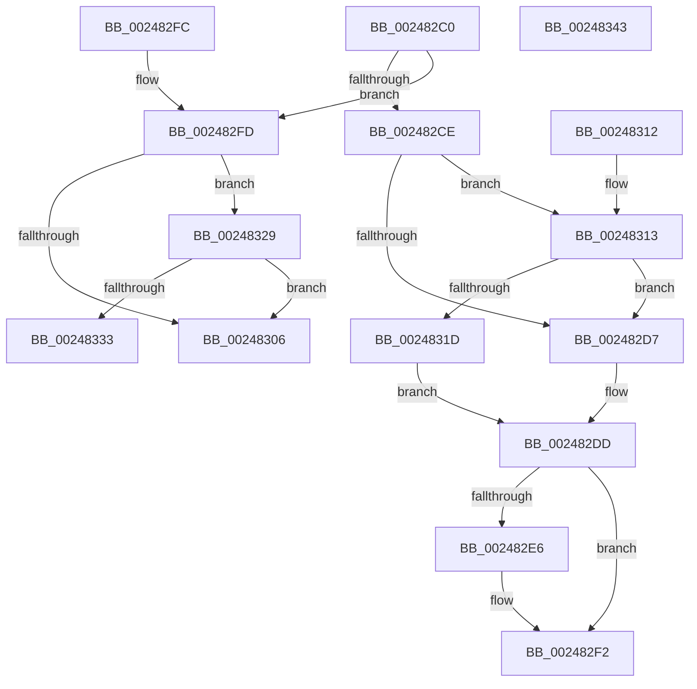

# MiReleaseSpinLockExclusive

- RVA: `0x002482C0`–`0x00248344` (길이 `132` bytes)
- VA: `0x00000001402482C0`
- 실행 섹션: `.text`
- PDB 이름 있음: `예`; PDB Function 태그: `아니요`
- unwind 정보 RVA: `0x000624A4`
- 디코드: `40`개 명령, `132/132` bytes 표시
- 미해석 바이트: `0` (있으면 어셈블리에 `.byte`로 보존)

> 이 문서는 커널 이미지의 기계어와 PDB 기호를 분석해 생성했습니다. 4번과 5번은 함수 원형과 자료형을 바이너리 사용 방식에서 추정한 C 해석이며 원본 소스 복구 결과는 아닙니다.

## 1. Dependencies

- 직접 호출 지점: **3**; 고유 호출 대상: **2**
- 직접 호출자로 확인된 함수: **314**
- RIP 상대 이미지 참조: **3**

### Outgoing calls
- `0x002482ED` → [KiLowerIrqlProcessIrqlFlags](../4F/KiLowerIrqlProcessIrqlFlags_function_004F5698.md) (function, `0x004F5698`)
- `0x00248322` → [ExpReleaseSpinLockExclusiveFromDpcLevelInstrumented](../2C/ExpReleaseSpinLockExclusiveFromDpcLevelInstrumented_function_002C0F44.md) (function, `0x002C0F44`)
- `0x00248338` → [ExpReleaseSpinLockExclusiveFromDpcLevelInstrumented](../2C/ExpReleaseSpinLockExclusiveFromDpcLevelInstrumented_function_002C0F44.md) (function, `0x002C0F44`)

### Direct callers
- [sub_00238C83](../23/Unknown_function_00238C83.md) at `0x00238C8E`
- [sub_00238CD1](../23/Unknown_function_00238CD1.md) at `0x00238D09`
- [sub_00245F1D](Unknown_function_00245F1D.md) at `0x00245F53`
- [sub_00245F85](Unknown_function_00245F85.md) at `0x00245FEC`
- [sub_002467B9](Unknown_function_002467B9.md) at `0x002467EB`
- [sub_00246856](Unknown_function_00246856.md) at `0x002468AF`
- [sub_00246C9F](Unknown_function_00246C9F.md) at `0x00246CDA`
- [sub_00246D01](Unknown_function_00246D01.md) at `0x00246D66`
- [sub_00246F4D](Unknown_function_00246F4D.md) at `0x002470F5`
- [sub_002484B4](Unknown_function_002484B4.md) at `0x002485A5`
- [sub_002484B4](Unknown_function_002484B4.md) at `0x0024861F`
- [sub_002490EA](Unknown_function_002490EA.md) at `0x00249143`
- [sub_00249850](Unknown_function_00249850.md) at `0x0024987D`
- [sub_00249850](Unknown_function_00249850.md) at `0x00249B26`
- [MiAddPageToInsertList](MiAddPageToInsertList_function_0024A950.md) at `0x0024AD98`
- [MiInsertVad](../26/MiInsertVad_function_00265540.md) at `0x0026569B`
- [MiInsertSubsectionNode](../26/MiInsertSubsectionNode_function_00265C7C.md) at `0x00265D4C`
- [sub_00285DC9](../28/Unknown_function_00285DC9.md) at `0x00285DF9`
- [MiCheckControlArea](../28/MiCheckControlArea_function_002861B0.md) at `0x002862B7`
- [MiReturnCrossPartitionCharges](../28/MiReturnCrossPartitionCharges_function_002867D0.md) at `0x00286850`
- [MiChargeCommit](../28/MiChargeCommit_function_00286EB0.md) at `0x002874C4`
- [MiCheckZeroFreeRebalance](../28/MiCheckZeroFreeRebalance_function_0028B1FC.md) at `0x0028B2EB`
- [MiReleaseSystemCacheView](../29/MiReleaseSystemCacheView_function_00294CE0.md) at `0x00294D7B`
- [MiCreatePrototypePtes](../29/MiCreatePrototypePtes_function_002950FC.md) at `0x002952C7`
- [MiCreatePrototypePtes](../29/MiCreatePrototypePtes_function_002950FC.md) at `0x00295353`
- [MiCreatePrototypePtes](../29/MiCreatePrototypePtes_function_002950FC.md) at `0x00295486`
- [MiCreatePrototypePtes](../29/MiCreatePrototypePtes_function_002950FC.md) at `0x002954F4`
- [MiCreatePrototypePtes](../29/MiCreatePrototypePtes_function_002950FC.md) at `0x0029553D`
- [MiDeleteCachedSubsection](../29/MiDeleteCachedSubsection_function_00297888.md) at `0x002978EA`
- [MiDeleteCachedSubsection](../29/MiDeleteCachedSubsection_function_00297888.md) at `0x002979A8`
- [MiDeleteCachedSubsection](../29/MiDeleteCachedSubsection_function_00297888.md) at `0x00297A24`
- [MiDeleteCachedSubsection](../29/MiDeleteCachedSubsection_function_00297888.md) at `0x00297AF9`
- [MiEntireSubsectionIsPurged](../29/MiEntireSubsectionIsPurged_function_00297C04.md) at `0x00297CC9`
- [MiWaitForFreePage](../2A/MiWaitForFreePage_function_002A3324.md) at `0x002A341D`
- [MiWaitForFreePage](../2A/MiWaitForFreePage_function_002A3324.md) at `0x002A34DF`
- [MiOutlawInswaps](../2A/MiOutlawInswaps_function_002A48B8.md) at `0x002A491C`
- [MmQueryProcessWorkingSetSwapPages](../2A/MmQueryProcessWorkingSetSwapPages_function_002A49BC.md) at `0x002A4A36`
- [MmOutSwapWorkingSet](../2A/MmOutSwapWorkingSet_function_002A6BC8.md) at `0x002A6D9C`
- [MmOutSwapWorkingSet](../2A/MmOutSwapWorkingSet_function_002A6BC8.md) at `0x002A6F24`
- [MmFlushImageSection](../2A/MmFlushImageSection_function_002AB930.md) at `0x002AB9A8`
- [MmFlushImageSection](../2A/MmFlushImageSection_function_002AB930.md) at `0x002AB9DB`
- [MmFlushImageSection](../2A/MmFlushImageSection_function_002AB930.md) at `0x002AB9F2`
- [MiSectionCreated](../2A/MiSectionCreated_function_002ABA18.md) at `0x002ABADE`
- [MmCanFileBeTruncated](../2A/MmCanFileBeTruncated_function_002ACC50.md) at `0x002ACCA4`
- [MiCanFileBeTruncatedInternal](../2A/MiCanFileBeTruncatedInternal_function_002ACCB4.md) at `0x002ACDE6`
- [MiCanFileBeTruncatedInternal](../2A/MiCanFileBeTruncatedInternal_function_002ACCB4.md) at `0x002ACE01`
- [MiCanFileBeTruncatedInternal](../2A/MiCanFileBeTruncatedInternal_function_002ACCB4.md) at `0x002ACE1E`
- [MiCanFileBeTruncatedInternal](../2A/MiCanFileBeTruncatedInternal_function_002ACCB4.md) at `0x002ACE39`
- [MiCanFileBeTruncatedInternal](../2A/MiCanFileBeTruncatedInternal_function_002ACCB4.md) at `0x002ACE70`
- [MiForceSectionClosed](../2A/MiForceSectionClosed_function_002ACFD4.md) at `0x002AD037`
- [MiAttemptSectionDelete](../2A/MiAttemptSectionDelete_function_002AD044.md) at `0x002AD086`
- [MiAttemptSectionDelete](../2A/MiAttemptSectionDelete_function_002AD044.md) at `0x002AD110`
- [MiStoreWriteModifiedPages](../2B/MiStoreWriteModifiedPages_function_002B46C4.md) at `0x002B4B7A`
- [MiStoreWriteModifiedPages](../2B/MiStoreWriteModifiedPages_function_002B46C4.md) at `0x002B5143`
- [MiReferencePfBackedSection](../2B/MiReferencePfBackedSection_function_002B9B70.md) at `0x002B9CA5`
- [MmDoesFileHaveUserWritableReferences](../2B/MmDoesFileHaveUserWritableReferences_function_002BB690.md) at `0x002BB795`
- [MiComputeFlushRange](../2B/MiComputeFlushRange_function_002BB8D0.md) at `0x002BB9B5`
- [MiComputeFlushRange](../2B/MiComputeFlushRange_function_002BB8D0.md) at `0x002BB9C8`
- [sub_002BBBB5](../2B/Unknown_function_002BBBB5.md) at `0x002BBBFF`
- [sub_002BBC08](../2B/Unknown_function_002BBC08.md) at `0x002BBC10`
- [sub_002BBC22](../2B/Unknown_function_002BBC22.md) at `0x002BBC36`
- [MiReferenceControlArea](../2B/MiReferenceControlArea_function_002BC198.md) at `0x002BC380`
- [MiReferenceControlArea](../2B/MiReferenceControlArea_function_002BC198.md) at `0x002BC45B`
- [MiReferenceControlArea](../2B/MiReferenceControlArea_function_002BC198.md) at `0x002BC4CF`
- [MiReferenceControlArea](../2B/MiReferenceControlArea_function_002BC198.md) at `0x002BC4EB`
- [MiLockSectionControlArea](../2B/MiLockSectionControlArea_function_002BC930.md) at `0x002BCB11`
- [MiReferenceExistingControlArea](../2B/MiReferenceExistingControlArea_function_002BDE64.md) at `0x002BDF70`
- [MiReferenceExistingControlArea](../2B/MiReferenceExistingControlArea_function_002BDE64.md) at `0x002BDFE0`
- [MiUnlinkWorkingSet](../2C/MiUnlinkWorkingSet_function_002C8B50.md) at `0x002C8BE0`
- [MiUnlinkWorkingSet](../2C/MiUnlinkWorkingSet_function_002C8B50.md) at `0x002C8C04`
- [MiLockControlAreaSectionExtend](../2C/MiLockControlAreaSectionExtend_function_002C9D60.md) at `0x002C9E00`
- [MiLockControlAreaSectionExtend](../2C/MiLockControlAreaSectionExtend_function_002C9D60.md) at `0x002C9E6C`
- [MiDeleteAcceleratorDescriptor](../2C/MiDeleteAcceleratorDescriptor_function_002CA560.md) at `0x002CA5DC`
- [MiReassessZeroThreads](../2C/MiReassessZeroThreads_function_002CB0C0.md) at `0x002CB2AA`
- [MiReplenishUltraPageTables](../2C/MiReplenishUltraPageTables_function_002CB4EC.md) at `0x002CB5AB`
- [MiReplenishUltraPageTables](../2C/MiReplenishUltraPageTables_function_002CB4EC.md) at `0x002CB642`
- [MiDereferenceAnyActiveHugeContext](../2C/MiDereferenceAnyActiveHugeContext_function_002CB928.md) at `0x002CB99C`
- [MiBackgroundZeroNodePages](../2C/MiBackgroundZeroNodePages_function_002CB9B0.md) at `0x002CBA1E`
- [MiBackgroundZeroNodePages](../2C/MiBackgroundZeroNodePages_function_002CB9B0.md) at `0x002CBA60`
- [MiBackgroundZeroNodePages](../2C/MiBackgroundZeroNodePages_function_002CB9B0.md) at `0x002CBAAD`
- [sub_002CBDF6](../2C/Unknown_function_002CBDF6.md) at `0x002CBE77`
- [sub_002CC67B](../2C/Unknown_function_002CC67B.md) at `0x002CC709`
- [MiWorkingSetManager](../2D/MiWorkingSetManager_function_002DA7E0.md) at `0x002DAA2A`
- [MiScheduleZeroPageThreads](../2D/MiScheduleZeroPageThreads_function_002DB1DC.md) at `0x002DB382`
- [MiScheduleZeroPageThreads](../2D/MiScheduleZeroPageThreads_function_002DB1DC.md) at `0x002DB465`
- [MiPruneProcessLargePageCaches](../2D/MiPruneProcessLargePageCaches_function_002DBD60.md) at `0x002DBDD2`
- [MiAdjustModifiedPageLoad](../2D/MiAdjustModifiedPageLoad_function_002DC07C.md) at `0x002DC27E`
- [MiFreeDeferredAcceleratorPool](../2D/MiFreeDeferredAcceleratorPool_function_002DC464.md) at `0x002DC4A8`
- [MiReclaimUnusedUltraMdlMaps](../2D/MiReclaimUnusedUltraMdlMaps_function_002DC4C0.md) at `0x002DC59B`
- [MiManageUltraSpacePageTable](../2D/MiManageUltraSpacePageTable_function_002DCAF0.md) at `0x002DCD80`
- [sub_002E10F7](../2E/Unknown_function_002E10F7.md) at `0x002E1177`
- [sub_002E10F7](../2E/Unknown_function_002E10F7.md) at `0x002E11A3`
- [MiTrimSharedPageFromViews](../2E/MiTrimSharedPageFromViews_function_002E16F8.md) at `0x002E1839`
- [MiSharePages](../31/MiSharePages_function_00315110.md) at `0x00315226`
- [MiAllocateCombineBlock](../31/MiAllocateCombineBlock_function_00317294.md) at `0x003172F0`
- [sub_0031A6F6](../31/Unknown_function_0031A6F6.md) at `0x0031AAB4`
- [MiGetBackgroundHugePageToZero](../31/MiGetBackgroundHugePageToZero_function_0031DD8C.md) at `0x0031DE96`
- [MiGetBackgroundHugePageToZero](../31/MiGetBackgroundHugePageToZero_function_0031DD8C.md) at `0x0031DEE5`
- [MiGetBackgroundHugePageToZero](../31/MiGetBackgroundHugePageToZero_function_0031DD8C.md) at `0x0031DEF7`
- [MiGetBackgroundHugePageToZero](../31/MiGetBackgroundHugePageToZero_function_0031DD8C.md) at `0x0031DF24`
- [MiSetZeroPageThreadPriority](../31/MiSetZeroPageThreadPriority_function_0031E620.md) at `0x0031E6A8`
- [MiBackgroundZeroLocalPages](../31/MiBackgroundZeroLocalPages_function_0031EF30.md) at `0x0031F6F2`
- [MiBackgroundZeroLocalPages](../31/MiBackgroundZeroLocalPages_function_0031EF30.md) at `0x0031F7FC`
- [sub_0031F9CC](../31/Unknown_function_0031F9CC.md) at `0x0031F9E4`
- [sub_0031F9CC](../31/Unknown_function_0031F9CC.md) at `0x0031FA3E`
- [sub_0031FC44](../31/Unknown_function_0031FC44.md) at `0x0031FCD7`
- [MiReleaseNonPagedResources](../32/MiReleaseNonPagedResources_function_0032299C.md) at `0x00322BAC`
- [MiReleaseNonPagedResources](../32/MiReleaseNonPagedResources_function_0032299C.md) at `0x00322C19`
- [MiGetUltraMapping](../32/MiGetUltraMapping_function_00323270.md) at `0x003236DA`
- [MiAddViewsForSection](../32/MiAddViewsForSection_function_00324990.md) at `0x0032500B`
- [MiAddViewsForSection](../32/MiAddViewsForSection_function_00324990.md) at `0x00325037`
- [MiReferenceActiveSubsection](../32/MiReferenceActiveSubsection_function_00325060.md) at `0x0032534E`
- [MiReferenceActiveSubsection](../32/MiReferenceActiveSubsection_function_00325060.md) at `0x0032568F`
- [MiReferenceActiveSubsection](../32/MiReferenceActiveSubsection_function_00325060.md) at `0x003256C0`
- [MiReferenceActiveSubsection](../32/MiReferenceActiveSubsection_function_00325060.md) at `0x003256FF`
- [MiGetCrossPartitionCharges](../32/MiGetCrossPartitionCharges_function_00325BFC.md) at `0x00325CB5`
- [MiDeleteSegmentPages](../32/MiDeleteSegmentPages_function_003261D4.md) at `0x0032630E`
- [MiDeleteSubsectionPages](../32/MiDeleteSubsectionPages_function_00326340.md) at `0x00326405`
- [MiDeleteSubsectionPages](../32/MiDeleteSubsectionPages_function_00326340.md) at `0x00326448`
- [MiReturnPhysicalPoolPages](../32/MiReturnPhysicalPoolPages_function_00328568.md) at `0x0032884C`
- [sub_003354FB](../33/Unknown_function_003354FB.md) at `0x00335C3D`
- [sub_0033EABD](../33/Unknown_function_0033EABD.md) at `0x0033EDA8`
- [MiStoreUpdateMemoryConditions](../34/MiStoreUpdateMemoryConditions_function_0034CF3C.md) at `0x0034D07E`
- [MiProcessWorkingSets](../34/MiProcessWorkingSets_function_0034E710.md) at `0x0034E8BE`
- [MiProcessWorkingSets](../34/MiProcessWorkingSets_function_0034E710.md) at `0x0034E9E0`
- [MiProcessWorkingSets](../34/MiProcessWorkingSets_function_0034E710.md) at `0x0034EAE0`
- [MiProcessWorkingSets](../34/MiProcessWorkingSets_function_0034E710.md) at `0x0034EC3D`
- [MiCheckSystemTrimEndCriteria](../34/MiCheckSystemTrimEndCriteria_function_0034EDC8.md) at `0x0034EE6E`
- [MiAllowWorkingSetExpansion](../35/MiAllowWorkingSetExpansion_function_00350490.md) at `0x003504BE`
- [MiQueueControlAreaDelete](../36/MiQueueControlAreaDelete_function_00369018.md) at `0x00369065`
- [MiPrepareToFlushSubsection](../36/MiPrepareToFlushSubsection_function_00369094.md) at `0x003690F5`
- [MiPrepareToFlushSubsection](../36/MiPrepareToFlushSubsection_function_00369094.md) at `0x00369132`
- [MiPrepareToFlushSubsection](../36/MiPrepareToFlushSubsection_function_00369094.md) at `0x00369193`
- [MiDeleteControlArea](../36/MiDeleteControlArea_function_003691F4.md) at `0x00369390`
- [MiFreeCombineBlock](../37/MiFreeCombineBlock_function_00372000.md) at `0x003720B8`
- [MiFreeCombineBlock](../37/MiFreeCombineBlock_function_00372000.md) at `0x003720DB`
- [MiGatherPagefilePages](../37/MiGatherPagefilePages_function_00372B08.md) at `0x00372FB9`
- [MiGatherPagefilePages](../37/MiGatherPagefilePages_function_00372B08.md) at `0x003731D1`
- [MiGatherPagefilePages](../37/MiGatherPagefilePages_function_00372B08.md) at `0x00373212`
- [MiUpdateLargePageBitMap](../37/MiUpdateLargePageBitMap_function_0037619C.md) at `0x003762A9`
- [MiInsertSlabEntry](../37/MiInsertSlabEntry_function_00378AF4.md) at `0x00378C47`
- [MiFlowThroughRemoveNode](../38/MiFlowThroughRemoveNode_function_00381BB0.md) at `0x00381C12`
- [MiWritePageFileHash](../38/MiWritePageFileHash_function_00381DC8.md) at `0x0038206E`
- [MmPurgeSection](../38/MmPurgeSection_function_0038B450.md) at `0x0038B51F`
- [MmPurgeSection](../38/MmPurgeSection_function_0038B450.md) at `0x0038B5C5`
- [MmGetControlAreaPartition](../38/MmGetControlAreaPartition_function_0038B80C.md) at `0x0038B857`
- [MiStoreEvictThread](../3A/MiStoreEvictThread_function_003A42D0.md) at `0x003A4453`
- [MiStoreEvictThread](../3A/MiStoreEvictThread_function_003A42D0.md) at `0x003A451D`
- [MiUpControlAreaRefs](../3B/MiUpControlAreaRefs_function_003B2BF0.md) at `0x003B2E9E`
- [MiMarkSystemVaAllocated](../3B/MiMarkSystemVaAllocated_function_003B3878.md) at `0x003B3A5C`
- [MiExpandPtes](../3B/MiExpandPtes_function_003B4B78.md) at `0x003B4D83`
- [MiObtainDynamicVa](../3B/MiObtainDynamicVa_function_003B501C.md) at `0x003B50D6`
- [MiObtainDynamicVa](../3B/MiObtainDynamicVa_function_003B501C.md) at `0x003B5316`
- [MiRebalanceZeroFreeLists](../3B/MiRebalanceZeroFreeLists_function_003BB9B0.md) at `0x003BBA2E`
- [MiReplenishSlabAllocatorByIdentity](../3B/MiReplenishSlabAllocatorByIdentity_function_003BD8A8.md) at `0x003BDADC`
- [MmUpdateSectionIoAttribution](../3C/MmUpdateSectionIoAttribution_function_003C9FA4.md) at `0x003CA00D`
- [MmStoreEvictComplete](../3E/MmStoreEvictComplete_function_003E1840.md) at `0x003E18AC`
- [MiFindFreePageFileSpace](../3E/MiFindFreePageFileSpace_function_003E2CAC.md) at `0x003E310A`
- [MiFindFreePageFileSpace](../3E/MiFindFreePageFileSpace_function_003E2CAC.md) at `0x003E312E`
- [MiUnmapMdlCommon](../3E/MiUnmapMdlCommon_function_003E7DF0.md) at `0x003E826C`
- [MiFlushSection](../40/MiFlushSection_function_004036B0.md) at `0x004038E6`
- [MiFlushSection](../40/MiFlushSection_function_004036B0.md) at `0x00403E35`
- [MiFlushSection](../40/MiFlushSection_function_004036B0.md) at `0x004040AC`
- [MiBuildReservationCluster](../40/MiBuildReservationCluster_function_004071A0.md) at `0x0040770C`
- [MiReleaseWriteInProgressCharges](../40/MiReleaseWriteInProgressCharges_function_00407B4C.md) at `0x00407CE7`
- [MiRefPageFileSpaceBitmaps](../40/MiRefPageFileSpaceBitmaps_function_00407DC4.md) at `0x00407E16`
- [sub_004084EC](../40/Unknown_function_004084EC.md) at `0x0040851C`
- [MiComputeAgeDistribution](../40/MiComputeAgeDistribution_function_0040A360.md) at `0x0040A468`
- [MiUpdateCommitCounts](../43/MiUpdateCommitCounts_function_0043D9CC.md) at `0x0043DAE2`
- [MiUnlockControlAreaSectionExtend](../44/MiUnlockControlAreaSectionExtend_function_0044BDC4.md) at `0x0044BE0E`
- [MmUpdateMdlTracker](../45/MmUpdateMdlTracker_function_00456468.md) at `0x004564F5`
- [MmChangeSectionBackingFile](../45/MmChangeSectionBackingFile_function_0045808C.md) at `0x0045814F`
- [MmGetImageFileSignatureInformation](../45/MmGetImageFileSignatureInformation_function_004582B0.md) at `0x00458300`
- [MmGetImageFileSignatureInformation](../45/MmGetImageFileSignatureInformation_function_004582B0.md) at `0x0045833A`
- [MiUpdateLastSubsectionSize](../45/MiUpdateLastSubsectionSize_function_0045876C.md) at `0x00458810`
- [MiUpdateLastSubsectionSize](../45/MiUpdateLastSubsectionSize_function_0045876C.md) at `0x004588A2`
- [MmInSwapWorkingSet](../45/MmInSwapWorkingSet_function_0045B6C4.md) at `0x0045B788`
- [MmInSwapWorkingSet](../45/MmInSwapWorkingSet_function_0045B6C4.md) at `0x0045B80D`
- [MiCleanSection](../46/MiCleanSection_function_00462E1C.md) at `0x00462EBB`
- [MiCleanSection](../46/MiCleanSection_function_00462E1C.md) at `0x00462F8E`
- [MiDestroySection](../46/MiDestroySection_function_00462FDC.md) at `0x00463010`
- [MiPrepareSegmentForDeletion](../46/MiPrepareSegmentForDeletion_function_004630A8.md) at `0x0046310B`
- [MiDrainControlAreaWrites](../46/MiDrainControlAreaWrites_function_0046317C.md) at `0x004631E9`
- [MiDereferenceSegmentThread](../46/MiDereferenceSegmentThread_function_00464890.md) at `0x00464A16`
- [MiSetDeleteOnCloseTimer](../46/MiSetDeleteOnCloseTimer_function_00464A24.md) at `0x00464A61`
- [MiIssueSegmentDereferenceWork](../46/MiIssueSegmentDereferenceWork_function_00464AB0.md) at `0x00464C28`
- [MiIssueSegmentDereferenceWork](../46/MiIssueSegmentDereferenceWork_function_00464AB0.md) at `0x00464CBA`
- [MiMarkPendingCommitRequests](../46/MiMarkPendingCommitRequests_function_00464FA8.md) at `0x00464FED`
- [MiDeleteFinalPageTables](../46/MiDeleteFinalPageTables_function_004659AC.md) at `0x00465B07`
- [MiCreateNewProcessTopLevelMappings](../46/MiCreateNewProcessTopLevelMappings_function_0046C4A0.md) at `0x0046C527`
- [MiRefillPurgedExtents](../47/MiRefillPurgedExtents_function_00479988.md) at `0x004799C4`
- [MiImageUnused](../47/MiImageUnused_function_0047AD6C.md) at `0x0047ADFD`
- [MiDerefPageFileSpaceBitmaps](../47/MiDerefPageFileSpaceBitmaps_function_0047B478.md) at `0x0047B4BB`
- [MiComputeCommitThresholds](../47/MiComputeCommitThresholds_function_0047C904.md) at `0x0047C9E2`
- [MiSyncCommitSignals](../47/MiSyncCommitSignals_function_0047CA00.md) at `0x0047CA73`
- [MiPageFileNoFreeSpace](../47/MiPageFileNoFreeSpace_function_0047E45C.md) at `0x0047E4C4`
- [MiStoreCheckCompleteWriteBatch](../47/MiStoreCheckCompleteWriteBatch_function_0047EC80.md) at `0x0047ED0C`
- [MiSendParkedCoreUpdateToAllChildPartitions](../47/MiSendParkedCoreUpdateToAllChildPartitions_function_0047FAC0.md) at `0x0047FBA1`
- [MiSendParkedCoreUpdateToAllChildPartitions](../47/MiSendParkedCoreUpdateToAllChildPartitions_function_0047FAC0.md) at `0x0047FBC7`
- [MiAppendSubsectionChain](../48/MiAppendSubsectionChain_function_00480228.md) at `0x004802EA`
- [MiAppendSubsectionChain](../48/MiAppendSubsectionChain_function_00480228.md) at `0x0048035D`
- [MiHandlePageFileSizeChanges](../48/MiHandlePageFileSizeChanges_function_004811D0.md) at `0x00481296`
- [MiHandlePageFileSizeChanges](../48/MiHandlePageFileSizeChanges_function_004811D0.md) at `0x004812E3`
- [MiHandlePageFileSizeChanges](../48/MiHandlePageFileSizeChanges_function_004811D0.md) at `0x00481318`
- [MiAttemptPageFileReduction](../48/MiAttemptPageFileReduction_function_004813E4.md) at `0x0048147C`
- [MiAttemptPageFileReductionApc](../48/MiAttemptPageFileReductionApc_function_004815A0.md) at `0x004816F1`
- [MiContractPagingFiles](../48/MiContractPagingFiles_function_0048177C.md) at `0x0048183D`
- [MiQueuePageFileExtension](../48/MiQueuePageFileExtension_function_0048187C.md) at `0x004818E7`
- [MiWakeCommitRequest](../48/MiWakeCommitRequest_function_00481C58.md) at `0x00481CC2`
- [MiCopyHeaderIfResident](../48/MiCopyHeaderIfResident_function_00482184.md) at `0x004822E4`
- [MiInsertNewCombineBlocks](../48/MiInsertNewCombineBlocks_function_00485858.md) at `0x004858E9`
- [MmOnlySystemCacheViewsPresent](../48/MmOnlySystemCacheViewsPresent_function_0048E4DC.md) at `0x0048E50D`
- [MiFlushDataSection](../48/MiFlushDataSection_function_0048ED88.md) at `0x0048EDE9`
- [MiMapPageFileHash](../49/MiMapPageFileHash_function_004921E0.md) at `0x0049234F`
- [MiMapPageFileHash](../49/MiMapPageFileHash_function_004921E0.md) at `0x004923CF`
- [MiMapPageFileHash](../49/MiMapPageFileHash_function_004921E0.md) at `0x004925C2`
- [MiMapPageFileHash](../49/MiMapPageFileHash_function_004921E0.md) at `0x0049262B`
- [MiFreeCombinePool](../49/MiFreeCombinePool_function_00492F60.md) at `0x00492F8A`
- [MiReleaseImageSection](../49/MiReleaseImageSection_function_00493044.md) at `0x0049307B`
- [MiDeleteEmptyControlAreas](../49/MiDeleteEmptyControlAreas_function_0049334C.md) at `0x004933C8`
- [MiDeleteEmptyControlAreas](../49/MiDeleteEmptyControlAreas_function_0049334C.md) at `0x004933DE`
- [MiDeleteEmptyControlAreas](../49/MiDeleteEmptyControlAreas_function_0049334C.md) at `0x00493421`
- [MiFreeMdlTracker](../49/MiFreeMdlTracker_function_00494838.md) at `0x004948A9`
- [MmSetMemoryPriorityProcess](../49/MmSetMemoryPriorityProcess_function_00494EF4.md) at `0x00494F20`
- [MmIsFileSectionActive](../49/MmIsFileSectionActive_function_004958C0.md) at `0x00495954`
- [MmIsFileSectionActive](../49/MmIsFileSectionActive_function_004958C0.md) at `0x00495971`
- [MiFlushAcquire](../49/MiFlushAcquire_function_00495B70.md) at `0x00495BCD`
- [MiAddMdlTracker](../49/MiAddMdlTracker_function_0049A240.md) at `0x0049A3E3`
- [MiInsertNewProcess](../49/MiInsertNewProcess_function_0049BB40.md) at `0x0049BB90`
- [MiSetSubsectionBase](../49/MiSetSubsectionBase_function_0049CE98.md) at `0x0049CF15`
- [MiWaitForAvailablePages](../4A/MiWaitForAvailablePages_function_004A1DCC.md) at `0x004A1E5E`
- [MiWaitForAvailablePages](../4A/MiWaitForAvailablePages_function_004A1DCC.md) at `0x004A1EAC`
- [MiReplenishSlabAllocatorWorker](../4A/MiReplenishSlabAllocatorWorker_function_004A7A90.md) at `0x004A7B03`
- [MiGetCachedPoolPages](../4A/MiGetCachedPoolPages_function_004A9324.md) at `0x004A9396`
- [MiInsertMappingNode](../4A/MiInsertMappingNode_function_004A9560.md) at `0x004A95BF`
- [MiZeroSectionObjectPointer](../4A/MiZeroSectionObjectPointer_function_004A9B90.md) at `0x004A9C03`
- [MiAsyncSlabReplenish](../4A/MiAsyncSlabReplenish_function_004AA54C.md) at `0x004AA615`
- [MiRemoveMappingNode](../4A/MiRemoveMappingNode_function_004AC85C.md) at `0x004AC8BD`
- [MiUpdatePerSessionProto](../4A/MiUpdatePerSessionProto_function_004AD938.md) at `0x004AD982`
- [MiConsumeOverCommit](../4B/MiConsumeOverCommit_function_004B3E0C.md) at `0x004B3E6B`
- [MiFreeHardwareDescriptor](../4B/MiFreeHardwareDescriptor_function_004B6078.md) at `0x004B60F9`
- [MmStoreFlushOutstandingEvictions](../4B/MmStoreFlushOutstandingEvictions_function_004B769C.md) at `0x004B76E9`
- [MiSetControlAreaSystemVa](../4B/MiSetControlAreaSystemVa_function_004B7984.md) at `0x004B79C8`
- [MiAllocateHardwareDescriptor](../4B/MiAllocateHardwareDescriptor_function_004B8738.md) at `0x004B878B`
- [MiFreePrivateFixupEntryForSystemImage](../4B/MiFreePrivateFixupEntryForSystemImage_function_004B8F54.md) at `0x004B8FC3`
- [MiAddPrivateFixupEntryForSystemImage](../4B/MiAddPrivateFixupEntryForSystemImage_function_004BAA18.md) at `0x004BAB20`
- [MiStrongCodeImage](../4B/MiStrongCodeImage_function_004BE728.md) at `0x004BE75E`
- [MiLateInitializeSystemCache](../4C/MiLateInitializeSystemCache_function_004C8104.md) at `0x004C819A`
- [MiMapMdlWithLargePages](../4D/MiMapMdlWithLargePages_function_004D10B8.md) at `0x004D1543`
- [MiQueueExtentPfnDeletion](../4D/MiQueueExtentPfnDeletion_function_004D1C80.md) at `0x004D1CEB`
- [MiDecrementLargeSubsections](../4D/MiDecrementLargeSubsections_function_004D2BE0.md) at `0x004D2C2F`
- [MiDecrementLargeSubsections](../4D/MiDecrementLargeSubsections_function_004D2BE0.md) at `0x004D2D08`
- [MiIncrementLargeSubsections](../4D/MiIncrementLargeSubsections_function_004D3410.md) at `0x004D34B4`
- [MiIncrementLargeSubsections](../4D/MiIncrementLargeSubsections_function_004D3410.md) at `0x004D34D9`
- [MiIncrementLargeSubsections](../4D/MiIncrementLargeSubsections_function_004D3410.md) at `0x004D354D`
- [MiFinishPageFileExtension](../4D/MiFinishPageFileExtension_function_004D5EB4.md) at `0x004D5F68`
- [MiReturnCrossPartitionControlAreaCharges](../4D/MiReturnCrossPartitionControlAreaCharges_function_004D6184.md) at `0x004D61C9`
- [MiRemovePteTracker](../4D/MiRemovePteTracker_function_004D8200.md) at `0x004D83B8`
- [MiSubsectionProtosCreated](../4D/MiSubsectionProtosCreated_function_004D9570.md) at `0x004D9639`
- [MiSetDeleteOnClose](../4D/MiSetDeleteOnClose_function_004DD8E8.md) at `0x004DD953`
- [MiPulseCommitSignal](../4D/MiPulseCommitSignal_function_004DEFF4.md) at `0x004DF078`
- [MiDeleteEmptySubsections](../4E/MiDeleteEmptySubsections_function_004ED818.md) at `0x004ED8BE`
- [MiDeleteEmptySubsections](../4E/MiDeleteEmptySubsections_function_004ED818.md) at `0x004ED946`
- [MiMakeSystemRangeAvailable](../4E/MiMakeSystemRangeAvailable_function_004EE174.md) at `0x004EE382`
- [MiQueueWorkingSetRequest](../4F/MiQueueWorkingSetRequest_function_004F7168.md) at `0x004F71D3`
- [MiReplicatePteChange](../4F/MiReplicatePteChange_function_004F8A24.md) at `0x004F8AD4`
- [MiFreeUltraMapping](../4F/MiFreeUltraMapping_function_004FAFD4.md) at `0x004FB022`
- [MiCreateKernelStackNode](../4F/MiCreateKernelStackNode_function_004FB0B8.md) at `0x004FB16F`
- [MmReleaseCommitForMemResetPages](../66/MmReleaseCommitForMemResetPages_function_0066FDCC.md) at `0x0066FE85`
- [MiZeroPageFile](../67/MiZeroPageFile_function_00671180.md) at `0x0067128E`
- [MiZeroPageFile](../67/MiZeroPageFile_function_00671180.md) at `0x0067130C`
- [MiComputeNodeMemory](../67/MiComputeNodeMemory_function_00671AA4.md) at `0x00671D4E`
- [MiFreedUnusedPfnPagesDpc](../67/MiFreedUnusedPfnPagesDpc_function_00672378.md) at `0x0067265A`
- [MiPerformMemoryChange](../67/MiPerformMemoryChange_function_006733A8.md) at `0x00673516`
- [MmUpdateMdlTrackerForMdlSwitch](../67/MmUpdateMdlTrackerForMdlSwitch_function_00674298.md) at `0x0067445F`
- [MiAddPartitionHugeRange](../67/MiAddPartitionHugeRange_function_006750D8.md) at `0x006751A4`
- [MiAddPartitionHugeRange](../67/MiAddPartitionHugeRange_function_006750D8.md) at `0x0067534A`
- [MiHotRemoveHugeRange](../67/MiHotRemoveHugeRange_function_00675DD0.md) at `0x00675FF5`
- [MiInitializeHugePfnDatabase](../67/MiInitializeHugePfnDatabase_function_00676410.md) at `0x00676479`
- [MiInitializeHugePfnDatabase](../67/MiInitializeHugePfnDatabase_function_00676410.md) at `0x006764C2`
- [MiDeleteCachedEntries](../67/MiDeleteCachedEntries_function_00677A28.md) at `0x00677CB9`
- [MiDeleteDeleteOnCloseSubsections](../67/MiDeleteDeleteOnCloseSubsections_function_00677D20.md) at `0x00677D7A`
- [MiDeleteDeleteOnCloseSubsections](../67/MiDeleteDeleteOnCloseSubsections_function_00677D20.md) at `0x00677DB2`
- [MiMakeUnusedSegmentDeleteOnClose](../67/MiMakeUnusedSegmentDeleteOnClose_function_00678078.md) at `0x0067814E`
- [MiMakeUnusedSegmentDeleteOnClose](../67/MiMakeUnusedSegmentDeleteOnClose_function_00678078.md) at `0x006781AE`
- [MiNotifyUserOfLostData](../67/MiNotifyUserOfLostData_function_00678280.md) at `0x006782C4`
- [MiProcessDeleteOnClose](../67/MiProcessDeleteOnClose_function_006783D8.md) at `0x0067846E`
- [MiProcessDeleteOnClose](../67/MiProcessDeleteOnClose_function_006783D8.md) at `0x006784D3`
- [MiReferenceMappedControlArea](../67/MiReferenceMappedControlArea_function_00678F50.md) at `0x00678F74`
- [MiBadPageSignaler](../67/MiBadPageSignaler_function_006794C0.md) at `0x006794E0`
- [MiCheckLostBadPageNode](../67/MiCheckLostBadPageNode_function_00679550.md) at `0x00679627`
- [MiDeletePendingBadPageNodesAwaitingDeleteList](../67/MiDeletePendingBadPageNodesAwaitingDeleteList_function_00679660.md) at `0x006796A6`
- [MiDeletePendingBadPageNodesAwaitingDeleteList](../67/MiDeletePendingBadPageNodesAwaitingDeleteList_function_00679660.md) at `0x006796DD`
- [MiEnumeratePartitionBadPages](../67/MiEnumeratePartitionBadPages_function_00679700.md) at `0x006797A0`
- [MiEnumeratePartitionBadPages](../67/MiEnumeratePartitionBadPages_function_00679700.md) at `0x0067983E`
- [MiEnumeratePartitionBadPages](../67/MiEnumeratePartitionBadPages_function_00679700.md) at `0x00679871`
- [MiDeleteKernelStackNode](../67/MiDeleteKernelStackNode_function_0067B1B0.md) at `0x0067B1E3`
- [MiDeleteStaleCacheMaps](../67/MiDeleteStaleCacheMaps_function_0067B780.md) at `0x0067BBE8`
- [MiDeleteStaleCacheMaps](../67/MiDeleteStaleCacheMaps_function_0067B780.md) at `0x0067BC07`
- [MiDeleteUnmappedSystemCacheViews](../67/MiDeleteUnmappedSystemCacheViews_function_0067C9A0.md) at `0x0067CA31`
- [MiInitializeNonPagedPoolThresholds](../67/MiInitializeNonPagedPoolThresholds_function_0067CA64.md) at `0x0067CAB5`
- [MiSignalNonPagedPoolWatchers](../67/MiSignalNonPagedPoolWatchers_function_0067CAC8.md) at `0x0067CB74`
- [MiReleaseFaultPte](../67/MiReleaseFaultPte_function_0067E5B4.md) at `0x0067E638`
- [MiReserveFaultPte](../67/MiReserveFaultPte_function_0067E64C.md) at `0x0067E69A`
- [MiEmptyTargetedWorkingSet](../67/MiEmptyTargetedWorkingSet_function_0067E6F8.md) at `0x0067E777`
- [MiEmptyTargetedWorkingSet](../67/MiEmptyTargetedWorkingSet_function_0067E6F8.md) at `0x0067E7D1`
- [MiInitializeWorkingSetManagerParameters](../67/MiInitializeWorkingSetManagerParameters_function_0067E7F8.md) at `0x0067E900`
- [MiSubsectionNeedsExtents](../67/MiSubsectionNeedsExtents_function_0067EFF8.md) at `0x0067F01C`
- [MiUpdateActiveSubsection](../67/MiUpdateActiveSubsection_function_0067F034.md) at `0x0067F0B0`
- [MiUpdateActiveSubsection](../67/MiUpdateActiveSubsection_function_0067F034.md) at `0x0067F12E`
- [MiUpdateActiveSubsection](../67/MiUpdateActiveSubsection_function_0067F034.md) at `0x0067F180`
- [MiChangePagingFileMaximum](../67/MiChangePagingFileMaximum_function_0067FEFC.md) at `0x00680164`
- [MiCheckAndUpdatePagingFileMinimum](../68/MiCheckAndUpdatePagingFileMinimum_function_006802D4.md) at `0x0068030C`
- [MiCheckPageFileMapping](../68/MiCheckPageFileMapping_function_0068032C.md) at `0x00680373`
- [MiUpdatePageFileList](../68/MiUpdatePageFileList_function_006803AC.md) at `0x0068046E`
- [MiUpdatePagingFileMinimum](../68/MiUpdatePagingFileMinimum_function_00680498.md) at `0x006804C8`
- [MiChangingSubsectionProtos](../68/MiChangingSubsectionProtos_function_0068057C.md) at `0x006806E5`
- [MiChangingSubsectionProtos](../68/MiChangingSubsectionProtos_function_0068057C.md) at `0x0068072F`
- [MiChangingSubsectionProtos](../68/MiChangingSubsectionProtos_function_0068057C.md) at `0x00680741`
- [MiChangingSubsectionProtos](../68/MiChangingSubsectionProtos_function_0068057C.md) at `0x00680769`
- [MiDeleteExtentPfns](../68/MiDeleteExtentPfns_function_006808B0.md) at `0x00680931`
- [MiDeleteExtentPfns](../68/MiDeleteExtentPfns_function_006808B0.md) at `0x00680961`
- [MiEnableImageDirectMap](../68/MiEnableImageDirectMap_function_00680A78.md) at `0x00680B0A`
- [MiGetDanglingExtent](../68/MiGetDanglingExtent_function_006812C4.md) at `0x00681327`
- [MiMergeCopyExtents](../68/MiMergeCopyExtents_function_00681844.md) at `0x006819B7`
- [MiPurgeBadFileOnlyPages](../68/MiPurgeBadFileOnlyPages_function_00681ADC.md) at `0x00681B64`
- [MiPurgeBadFileOnlyPages](../68/MiPurgeBadFileOnlyPages_function_00681ADC.md) at `0x00681C24`
- [MiPurgeBadFileOnlyPages](../68/MiPurgeBadFileOnlyPages_function_00681ADC.md) at `0x00681CCA`
- [MiUnlinkSubsectionWaitBlock](../68/MiUnlinkSubsectionWaitBlock_function_00681EDC.md) at `0x00681F62`
- [MiWaitForExtentDeletions](../68/MiWaitForExtentDeletions_function_00681F80.md) at `0x00681FF8`
- [MiCompactDebuggerPatchTable](../68/MiCompactDebuggerPatchTable_function_006844C0.md) at `0x00684716`
- [MiMarkPxeAsShadowed](../68/MiMarkPxeAsShadowed_function_00686360.md) at `0x006863AB`
- [MmManageFaultRange](../68/MmManageFaultRange_function_00686AD4.md) at `0x00686C61`
- [MiPrepareEnclaveMetadataPage](../68/MiPrepareEnclaveMetadataPage_function_00686EAC.md) at `0x00687045`
- [MiRemoveUserPhysicalPagesView](../68/MiRemoveUserPhysicalPagesView_function_00689658.md) at `0x0068971E`
- [MiEmptyAccessLogs](../68/MiEmptyAccessLogs_function_00689FF0.md) at `0x0068A052`
- [MiEmptyAccessLogs](../68/MiEmptyAccessLogs_function_00689FF0.md) at `0x0068A13F`
- [MmSetAccessLogging](../68/MmSetAccessLogging_function_0068A188.md) at `0x0068A1D0`
- [MmSetAccessLogging](../68/MmSetAccessLogging_function_0068A188.md) at `0x0068A24F`
- [MiCombiningInProgress](../68/MiCombiningInProgress_function_0068BD6C.md) at `0x0068BEA8`
- [MiZeroHugeRangeWorker](../68/MiZeroHugeRangeWorker_function_0068C960.md) at `0x0068C9CC`
- [MiZeroHugeRangeWorker](../68/MiZeroHugeRangeWorker_function_0068C960.md) at `0x0068CA3D`
- [MiImageCantMove](../68/MiImageCantMove_function_0068CAA4.md) at `0x0068CAC5`
- [MiIncreaseCommitLimits](../68/MiIncreaseCommitLimits_function_0068CADC.md) at `0x0068CBE2`
- [MiReduceCommitLimits](../68/MiReduceCommitLimits_function_0068CDA0.md) at `0x0068CE07`
- [MiInitializeSlabAllocator](../68/MiInitializeSlabAllocator_function_0068E85C.md) at `0x0068EAFD`
- [MiClearPartitionPageBitMap](../69/MiClearPartitionPageBitMap_function_00690614.md) at `0x006906E2`
- [MiDrainCrossPartitionUsage](../69/MiDrainCrossPartitionUsage_function_00690984.md) at `0x006909FF`
- [MiDrainCrossPartitionUsage](../69/MiDrainCrossPartitionUsage_function_00690984.md) at `0x00690A91`
- [MiFinishChildPartitionHotAdd](../69/MiFinishChildPartitionHotAdd_function_00690C00.md) at `0x00690CC4`
- [MiInsertPartitionPageNodes](../69/MiInsertPartitionPageNodes_function_00690F94.md) at `0x006910A8`
- [MiInsertPartitionPageNodes](../69/MiInsertPartitionPageNodes_function_00690F94.md) at `0x0069110B`
- [MiManagePartitionCharges](../69/MiManagePartitionCharges_function_006915C8.md) at `0x00691677`
- [MiPartitionDeleteMemoryNode](../69/MiPartitionDeleteMemoryNode_function_00691A20.md) at `0x00691AB0`
- [MiReturnPartitionPagesToParent](../69/MiReturnPartitionPagesToParent_function_00691B5C.md) at `0x00691CBF`
- [MiTransferPartitionPageRun](../69/MiTransferPartitionPageRun_function_00691DCC.md) at `0x00691E73`
- [MiTransferPartitionPageRun](../69/MiTransferPartitionPageRun_function_00691DCC.md) at `0x006921B3`
- [MiUpdatePartitionMemory](../69/MiUpdatePartitionMemory_function_00692294.md) at `0x006922E1`
- [MiUpdatePhysicalPages](../69/MiUpdatePhysicalPages_function_0069232C.md) at `0x0069236D`
- [MmManagePartitionSetMemoryThresholds](../69/MmManagePartitionSetMemoryThresholds_function_0069249C.md) at `0x006924F3`
- [MiStoreChargeReservedPages](../69/MiStoreChargeReservedPages_function_006926A0.md) at `0x006926DD`
- [MiStoreDeletePartition](../69/MiStoreDeletePartition_function_006926F4.md) at `0x006927D4`
- [MiStoreReleaseReservedPageCharges](../69/MiStoreReleaseReservedPageCharges_function_00693054.md) at `0x00693081`
- [MiInsertPageFileMemoryExtents](../69/MiInsertPageFileMemoryExtents_function_006950C8.md) at `0x0069521F`
- [MiAbsorbPossibleEngineChanges](../69/MiAbsorbPossibleEngineChanges_function_006958B4.md) at `0x00695C51`
- [MiAbsorbPossibleEngineChanges](../69/MiAbsorbPossibleEngineChanges_function_006958B4.md) at `0x00695D5F`
- [MiDeleteThreadContext](../69/MiDeleteThreadContext_function_00695E54.md) at `0x00695ED5`
- [MiDrainEngineDescriptors](../69/MiDrainEngineDescriptors_function_00695F20.md) at `0x00695F9B`
- [MiDrainEngineDescriptors](../69/MiDrainEngineDescriptors_function_00695F20.md) at `0x00695FD3`
- [MiInsertNewZeroThread](../69/MiInsertNewZeroThread_function_00696140.md) at `0x00696227`
- [MiInsertNewZeroThread](../69/MiInsertNewZeroThread_function_00696140.md) at `0x0069632C`
- [MiPreserveBootDecisions](../69/MiPreserveBootDecisions_function_00696388.md) at `0x00696602`
- [MiSignalZeroingPassComplete](../69/MiSignalZeroingPassComplete_function_00696690.md) at `0x00696701`
- [MiWakeAllZeroConductors](../69/MiWakeAllZeroConductors_function_00696724.md) at `0x0069679D`
- [MiZeroBootCalibratorStarted](../69/MiZeroBootCalibratorStarted_function_006967E8.md) at `0x00696818`
- [MiZeroEngineSetOptimalCount](../69/MiZeroEngineSetOptimalCount_function_0069682C.md) at `0x006968C0`
- [MiZeroNodeExiting](../69/MiZeroNodeExiting_function_00696A04.md) at `0x00696A5E`
- [MiZeroNodeExiting](../69/MiZeroNodeExiting_function_00696A04.md) at `0x00696A96`
- [MiZeroNodeExiting](../69/MiZeroNodeExiting_function_00696A04.md) at `0x00696B65`
- [MiZeroNodeExiting](../69/MiZeroNodeExiting_function_00696A04.md) at `0x00696B82`
- [MiAllocateAcceleratorDescriptor](../69/MiAllocateAcceleratorDescriptor_function_00697124.md) at `0x00697284`
- [MiDeleteHardwareAccelerators](../69/MiDeleteHardwareAccelerators_function_006972DC.md) at `0x00697343`
- [MiDeleteHardwareAccelerators](../69/MiDeleteHardwareAccelerators_function_006972DC.md) at `0x006973E1`
- [MiSignalNewAcceleratorsAvailable](../69/MiSignalNewAcceleratorsAvailable_function_006974E4.md) at `0x0069766C`
- [MiSignalNewAcceleratorsAvailable](../69/MiSignalNewAcceleratorsAvailable_function_006974E4.md) at `0x006977FB`
- [MiInsertPteTracker](../69/MiInsertPteTracker_function_00697BE4.md) at `0x00697E28`
- [MiAllocateLargeProcessPagesFromCache](../69/MiAllocateLargeProcessPagesFromCache_function_0069818C.md) at `0x006984D1`
- [MiAllocateLargeProcessPagesFromCache](../69/MiAllocateLargeProcessPagesFromCache_function_0069818C.md) at `0x00698777`
- [MiCreateProcessLargePageCacheAnchor](../69/MiCreateProcessLargePageCacheAnchor_function_00698A44.md) at `0x00698B22`
- [MiFreeLargeProcessPagesToCache](../69/MiFreeLargeProcessPagesToCache_function_00698F24.md) at `0x006990EE`
- [MiFreeLargeProcessPagesToCache](../69/MiFreeLargeProcessPagesToCache_function_00698F24.md) at `0x006991CD`
- [MiFreeProcessLargePageCache](../69/MiFreeProcessLargePageCache_function_00699204.md) at `0x006992EE`
- [MiReplaceSystemProtoPtesNode](../69/MiReplaceSystemProtoPtesNode_function_00699658.md) at `0x00699701`
- [MiComputeCacheAttributeSpeeds](../69/MiComputeCacheAttributeSpeeds_function_006999E8.md) at `0x00699E08`
- [MiMergeCalibrationResults](../69/MiMergeCalibrationResults_function_0069A104.md) at `0x0069A212`
- [sub_006DA254](../6D/Unknown_function_006DA254.md) at `0x006DA2D4`
- [sub_006DA254](../6D/Unknown_function_006DA254.md) at `0x006DA31B`
- [sub_006DA650](../6D/Unknown_function_006DA650.md) at `0x006DA6BA`
- [sub_006DA6DC](../6D/Unknown_function_006DA6DC.md) at `0x006DA720`
- [sub_006DAF20](../6D/Unknown_function_006DAF20.md) at `0x006DAF38`
- [sub_006DB548](../6D/Unknown_function_006DB548.md) at `0x006DB593`
- [sub_006DDD7C](../6D/Unknown_function_006DDD7C.md) at `0x006DDDDC`
- [sub_006E13AE](../6E/Unknown_function_006E13AE.md) at `0x006E13BB`
- [sub_006E19B0](../6E/Unknown_function_006E19B0.md) at `0x006E19DA`
- [sub_006E19B0](../6E/Unknown_function_006E19B0.md) at `0x006E1A7A`
- [sub_006E19B0](../6E/Unknown_function_006E19B0.md) at `0x006E1B53`
- [sub_006E25E8](../6E/Unknown_function_006E25E8.md) at `0x006E25EE`
- [sub_006E65B0](../6E/Unknown_function_006E65B0.md) at `0x006E65FE`
- [sub_006E710A](../6E/Unknown_function_006E710A.md) at `0x006E7167`
- [sub_006E7378](../6E/Unknown_function_006E7378.md) at `0x006E73B8`
- [sub_006E82CE](../6E/Unknown_function_006E82CE.md) at `0x006E82F9`
- [sub_006E82CE](../6E/Unknown_function_006E82CE.md) at `0x006E835D`
- [sub_006E82CE](../6E/Unknown_function_006E82CE.md) at `0x006E8552`
- [sub_006EC390](../6E/Unknown_function_006EC390.md) at `0x006EC395`
- [sub_006EC582](../6E/Unknown_function_006EC582.md) at `0x006EC682`
- [sub_006ED466](../6E/Unknown_function_006ED466.md) at `0x006ED4AC`
- [sub_006EECC0](../6E/Unknown_function_006EECC0.md) at `0x006EECCA`
- [sub_006F28BE](../6F/Unknown_function_006F28BE.md) at `0x006F2A1B`
- [sub_006F421A](../6F/Unknown_function_006F421A.md) at `0x006F4384`
- [sub_006F4DB8](../6F/Unknown_function_006F4DB8.md) at `0x006F4E06`
- [sub_006F503A](../6F/Unknown_function_006F503A.md) at `0x006F5166`
- [sub_006F503A](../6F/Unknown_function_006F503A.md) at `0x006F522D`
- [sub_006F5914](../6F/Unknown_function_006F5914.md) at `0x006F593A`
- [sub_006F602E](../6F/Unknown_function_006F602E.md) at `0x006F6051`
- [sub_006F639E](../6F/Unknown_function_006F639E.md) at `0x006F640E`
- [sub_006F639E](../6F/Unknown_function_006F639E.md) at `0x006F646F`
- [sub_006F64F4](../6F/Unknown_function_006F64F4.md) at `0x006F6533`
- [sub_006F7544](../6F/Unknown_function_006F7544.md) at `0x006F7584`
- [sub_006F7544](../6F/Unknown_function_006F7544.md) at `0x006F75A7`
- [sub_006F9120](../6F/Unknown_function_006F9120.md) at `0x006F91D2`
- [sub_006FA052](../6F/Unknown_function_006FA052.md) at `0x006FA082`
- [MiInitializeBootProcess](../../init/C5/MiInitializeBootProcess_function_00C5EEFC.md) at `0x00C5F04A`
- [MmUpdateSlabRangeType](../../init/C6/MmUpdateSlabRangeType_function_00C6A10C.md) at `0x00C6A22A`

### Static image references
- `0x002482CE` → RVA `0x00FC6B06` (`ALMOSTRO`; read)
- `0x002482DD` → RVA `0x00FC6D20` (`ALMOSTRO`; read)
- `0x00248313` → RVA `0x00F0DE58` (`.data`; read)

## 2. Other-region calls and transfers

- 다른 실행 섹션으로 향하는 call: **0**
- 별도 외부 분기/꼬리 이동을 확인하지 못했습니다.

## 3. Assembly (complete function range)

```asm
002482C0  40 53                           push rbx
002482C2  48 83 EC 20                     sub rsp, 0x20
002482C6  0F B6 DA                        movzx ebx, dl
002482C9  80 FB 11                        cmp bl, 0x11
002482CC  74 2F                           je 0x1402482fd
002482CE  F6 05 31 E8 D7 00 01            test byte ptr [rip + 0xd7e831], 1
002482D5  75 3C                           jne 0x140248313
002482D7  C7 01 00 00 00 00               mov dword ptr [rcx], 0
002482DD  83 3D 3C EA D7 00 00            cmp dword ptr [rip + 0xd7ea3c], 0
002482E4  74 0C                           je 0x1402482f2
002482E6  44 0F 20 C1                     mov rcx, cr8
002482EA  0F B6 D3                        movzx edx, bl
002482ED  E8 A6 D3 2A 00                  call 0x1404f5698
002482F2  44 0F 22 C3                     mov cr8, rbx
002482F6  48 83 C4 20                     add rsp, 0x20
002482FA  5B                              pop rbx
002482FB  C3                              ret
002482FC  CC                              int3
002482FD  F6 05 02 E8 D7 00 01            test byte ptr [rip + 0xd7e802], 1
00248304  75 23                           jne 0x140248329
00248306  C7 01 00 00 00 00               mov dword ptr [rcx], 0
0024830C  48 83 C4 20                     add rsp, 0x20
00248310  5B                              pop rbx
00248311  C3                              ret
00248312  CC                              int3
00248313  8B 05 3F 5B CC 00               mov eax, dword ptr [rip + 0xcc5b3f]
00248319  85 C0                           test eax, eax
0024831B  75 BA                           jne 0x1402482d7
0024831D  48 8B 54 24 28                  mov rdx, qword ptr [rsp + 0x28]
00248322  E8 1D 8C 07 00                  call 0x1402c0f44
00248327  EB B4                           jmp 0x1402482dd
00248329  8B 05 29 5B CC 00               mov eax, dword ptr [rip + 0xcc5b29]
0024832F  85 C0                           test eax, eax
00248331  75 D3                           jne 0x140248306
00248333  48 8B 54 24 28                  mov rdx, qword ptr [rsp + 0x28]
00248338  E8 07 8C 07 00                  call 0x1402c0f44
0024833D  48 83 C4 20                     add rsp, 0x20
00248341  5B                              pop rbx
00248342  C3                              ret
00248343  CC                              int3
```

## 4. C-style interpretation (structured pseudocode)

```c
__int64 __fastcall MiReleaseSpinLockExclusive(__int64 a1, unsigned __int8 a2)
{
    __int64 result;
    __int64 v_rsp;
    unsigned __int64 v_stack_p50;

    v_rsp = (v_rsp) - (32);
    if (a2 == 17) goto loc_002482FD;
    if (((*(unsigned __int8 *)(v_rip + 14149681)) & (1)) != 0) goto loc_00248313;
loc_002482D7:
    *(unsigned int *)(a1) = 0;
loc_002482DD:
    if ((*(unsigned int *)(v_rip + 14150204)) != 0) {
        a1 = v_cr8;
        a2 = a2;
        result = KiLowerIrqlProcessIrqlFlags(a1, a2, a3, a4);
    }
    v_rsp = (v_rsp) + (32);
    return result;
loc_002482FD:
    if (((*(unsigned __int8 *)(v_rip + 14149634)) & (1)) != 0) goto loc_00248329;
loc_00248306:
    *(unsigned int *)(a1) = 0;
    v_rsp = (v_rsp) + (32);
    return result;
loc_00248313:
    if ((unsigned int)((unsigned int)(*(unsigned int *)(v_rip + 13392703))) != 0) goto loc_002482D7;
    result = ExpReleaseSpinLockExclusiveFromDpcLevelInstrumented(a1, v_stack_p50, a3, a4);
    goto loc_002482DD;
loc_00248329:
    if ((unsigned int)((unsigned int)(*(unsigned int *)(v_rip + 13392681))) != 0) goto loc_00248306;
    result = ExpReleaseSpinLockExclusiveFromDpcLevelInstrumented(a1, v_stack_p50, a3, a4);
    v_rsp = (v_rsp) + (32);
    return result;
}
```

## 5. (Beta) C Style

```c
int64_t MiReleaseSpinLockExclusive(void *Arg1, uint8_t Arg2)
{
    uint8_t *arg1 = (uint8_t *)Arg1;

    int64_t result;
    int64_t local_rsp;
    uint64_t v_stack_p50;

    local_rsp = (local_rsp) - (32);
    if (Arg2 == 17) goto loc_002482FD;
    if (((*(uint8_t *)(v_rip + 0xD7E831)) & (1)) != 0) goto loc_00248313;
loc_002482D7:
    *(uint32_t *)(arg1) = 0;
loc_002482DD:
    if ((*(uint32_t *)(v_rip + 0xD7EA3C)) != 0) {
        Arg1 = v_cr8;
        Arg2 = Arg2;
        result = KiLowerIrqlProcessIrqlFlags(Arg1, Arg2, a3, a4);
    }
    local_rsp = (local_rsp) + (32);
    return result;
loc_002482FD:
    if (((*(uint8_t *)(v_rip + 0xD7E802)) & (1)) != 0) goto loc_00248329;
loc_00248306:
    *(uint32_t *)(arg1) = 0;
    local_rsp = (local_rsp) + (32);
    return result;
loc_00248313:
    if ((uint32_t)((uint32_t)(*(uint32_t *)(v_rip + 0xCC5B3F))) != 0) goto loc_002482D7;
    result = ExpReleaseSpinLockExclusiveFromDpcLevelInstrumented(Arg1, v_stack_p50, a3, a4);
    goto loc_002482DD;
loc_00248329:
    if ((uint32_t)((uint32_t)(*(uint32_t *)(v_rip + 0xCC5B29))) != 0) goto loc_00248306;
    result = ExpReleaseSpinLockExclusiveFromDpcLevelInstrumented(Arg1, v_stack_p50, a3, a4);
    local_rsp = (local_rsp) + (32);
    return result;
}
```

### 관측된 메모리 오프셋

구조체 형식이 확인되지 않은 접근은 인자 기준의 오프셋으로만 기록했습니다.

| 기준 인자 | 오프셋 표현 | 폭 (bit) | 접근 |
|---|---:|---:|---|
| `Arg1` | `+ 0x0` | `32` | `W` |

## 6. Execution-region graph

[열기: 2D/3D 그래프와 함수 탐색 컨트롤 패널](../../../control-panel.html?section=text&rva=0x002482C0&view=graph)

- 2D 그래프는 위에서 아래로 흐르고, 3D 그래프는 빈 공간을 드래그해 회전합니다. Shift+드래그는 이동, 휠은 확대·축소, 함수 노드 선택은 대상 보고서 이동입니다.

### Static fallback


